[知識庫首頁](https://released.github.io/) · [MCU CAN device 開發](../slide_boot_loader_for_RL78/)

<a id="article_top"></a>

# RL78 ISP Tool 與 MCU CAN host 操作

FirmwareUpgradeTool 透過 MCU CAN host 與 CAN device 通訊。
本頁整理 Tool 操作、Custom Transfer、CAN 更新及 Host App 自身更新。

- [連線與主畫面](#tool-operation)
- [Custom Transfer](#custom-transfer)
- [MCU CAN device 更新](#mcu-can-device)
- [Host App 更新](#host-bridge-firmware)
- [更新政策與通訊速度](#image-update-policy)

<!-- PUBLIC_RESOURCES_BEGIN -->
<a id="downloads"></a>

## 下載與操作總覽

Host 透過 Host Link 連接 PC 並橋接 CAN；device 是 CAN 另一端接受更新的 MCU。
F13 (MCU CAN device)、F24 (MCU CAN device) 各自具有獨立的 Transfer／Boot／App 工程。
F24 (MCU CAN host) 使用獨立的 Bridge Boot／App，透過 Misc／UART 更新自身 App。

以下連結提供 Tool、MCU CAN host 與 MCU CAN device 的下載及原始碼。
首次安裝Boot使用燒錄器，之後更新App才使用對應的Tool流程；不可把Host與Device映像互換。

| 項目 | 下載／原始碼 | 適用方式 |
| --- | --- | --- |
| PC Tool | [Windows EXE](https://raw.githubusercontent.com/released/simple_renesas_isp_tool/main/build/FirmwareUpgradeTool.exe)／[完整原始碼](https://github.com/released/simple_renesas_isp_tool) | Windows x64；先安裝實際VCOM所需driver，再選COM並Probe Host |
| F24 (MCU CAN host) Boot | [Boot專案](https://github.com/released/simple_renesas_isp_tool/tree/main/firmware/RL78_F24_Bridge_boot)／[Boot MOT](https://raw.githubusercontent.com/released/simple_renesas_isp_tool/main/firmware/RL78_F24_Bridge_boot/DefaultBuild/RL78_F24_Bridge_boot.mot) | 首次以燒錄器安裝；Misc不更新Boot |
| F24 (MCU CAN host) App | [App專案](https://github.com/released/simple_renesas_isp_tool/tree/main/firmware/RL78_F24_Bridge_app)／[Host App BIN](https://raw.githubusercontent.com/released/simple_renesas_isp_tool/main/firmware/RL78_F24_Bridge_app/DefaultBuild/RL78_F24_Bridge_app_bridge_update.bin) | Misc／UART115200；完成後明確Run Validated Bridge App |
| F13 (MCU CAN device) Boot | [Boot專案](https://github.com/released/RL78_F13_Boot_loader_CAN)／[Boot HEX](https://raw.githubusercontent.com/released/RL78_F13_Boot_loader_CAN/main/DefaultBuild/boot0000_1FFF.hex) | 燒錄器初裝 Boot／App |
| F13 (MCU CAN device) App | [App專案](https://github.com/released/RL78_F13_Boot_loader_CAN_app)／[初裝合併HEX](https://raw.githubusercontent.com/released/RL78_F13_Boot_loader_CAN_app/main/boot_app.hex)／[CAN更新BIN](https://raw.githubusercontent.com/released/RL78_F13_Boot_loader_CAN_app/main/DefaultBuild/RL78_F13_Boot_loader_CAN_app_update.bin) | 合併HEX供燒錄器初裝；CAN TAB載入_update.bin更新Device App |
| F13 (MCU CAN device) 通訊測試 | [Transfer範例](https://github.com/released/RL78_F13_CAN_Transfer) | Custom Transfer，不擦寫Flash；不是Boot/App更新映像 |
| F24 (MCU CAN device) Boot／App | [工程配置與建置說明](https://released.github.io/slide_boot_loader_for_RL78/#f24-can-device) | 燒錄器初裝 Boot HEX／App flash HEX；CAN 更新使用 App update BIN |
| F24 (MCU CAN device) 通訊測試 | [Custom Transfer 操作](https://released.github.io/slide_isp_tool_for_RL78/#custom-transfer) | `RL78_F24_CAN_Transfer` 獨立工程；連結為操作說明 |

F24 host firmware 使用完整 Tool repository，包含 firmware 共用來源與 scripts。
F13 Boot與App需以原repository名稱放在同一父目錄，App會引用相鄰Boot；Download ZIP
解壓後請移除-main尾碼。先build Boot，再build App；版本、metadata、IRQ ABI與CRC仍須相容。

原始碼維護可使用 Tool 根目錄的 `github_push.bat`，同步 F13 Boot／App 與 Tool（含 F24 MCU CAN host）。
保留檔清單、本機 `tmp` 排除、確認與恢復方式見 [GitHub 原始碼與交付檔同步](https://github.com/released/simple_renesas_isp_tool/blob/main/docs/GITHUB_PUBLISH_zh-TW.md)。

### 操作與工程入口

| 想了解的動作 | 網站操作／流程圖 | Tool docs中的詳細說明 |
| --- | --- | --- |
| Tool／F24 (MCU CAN host) 流程與責任 | [Tool與bridge動作圖](https://released.github.io/slide_isp_tool_for_RL78/#tool-bridge-flow) | [多介面架構與流程](https://github.com/released/simple_renesas_isp_tool/blob/main/docs/MULTIBUS_TOOL_GUIDE_zh-TW.md) |
| MCU CAN device Boot啟動、ENTER與逾時 | [Boot→App完整條件圖](https://released.github.io/slide_boot_loader_for_RL78/#f13-boot-decision) | [Boot decision與更新流程](https://github.com/released/simple_renesas_isp_tool/blob/main/docs/F13_BOOT_UPDATE_FLOW_zh-TW.md) |
| Tool operation | [COM／Host識別與操作起點](https://released.github.io/slide_isp_tool_for_RL78/#tool-operation) | [共用畫面與操作指南](https://github.com/released/simple_renesas_isp_tool/blob/main/docs/SHARED_CONSOLE_BRIDGE_GUIDE_zh-TW.md) |
| 更新確認／診斷／報告 | [App 確認、差異與驗證表](https://released.github.io/slide_isp_tool_for_RL78/#update-confirmation) | [更新確認與驗證紀錄](https://github.com/released/simple_renesas_isp_tool/blob/main/docs/UPDATE_VALIDATION_zh-TW.md) |
| 更新F24 (MCU CAN host) App | [Misc：Host App更新圖與RUN](https://released.github.io/slide_isp_tool_for_RL78/#host-bridge-firmware) | [F24 UART自更新協定](https://github.com/released/simple_renesas_isp_tool/blob/main/docs/BRIDGE_SELF_UPDATE_PROTOCOL.md) |
| 更新MCU CAN device App | [CAN：驗證、Enter Boot、更新與確認](https://released.github.io/slide_isp_tool_for_RL78/#f13-device-update) | [CAN區塊更新及保護](https://github.com/released/simple_renesas_isp_tool/blob/main/docs/CAN_BLOCK_TRANSFER_V5_zh-TW.md) |
| Custom Transfer 通訊驗證 | [Custom Transfer 操作](https://released.github.io/slide_isp_tool_for_RL78/#custom-transfer) | [通訊測試協定](https://github.com/released/simple_renesas_isp_tool/blob/main/docs/F13_TRANSFER_PROTOCOL.md) |
| Boot code如何移植 | [Boot/App移植與向量工程](https://released.github.io/slide_boot_loader_for_RL78/#boot-app-porting) | [完整移植指南](https://github.com/released/simple_renesas_isp_tool/blob/main/docs/RL78_BOOT_APP_PORTING_GUIDE_zh-TW.md) |

<a id="tool-bridge-flow"></a>

先用[CAN 更新逐層導讀](https://released.github.io/slide_isp_tool_for_RL78/#can-update-walkthrough)
對照 Tool 操作／BIN 驗證、MCU CAN host 轉送、MCU CAN device metadata／receive／Flash 的表格與流程圖；
[MD](https://github.com/released/simple_renesas_isp_tool/blob/main/docs/CAN_UPDATE_WALKTHROUGH_zh-TW.md)／[PDF](https://github.com/released/simple_renesas_isp_tool/blob/main/docs/CAN_UPDATE_WALKTHROUGH_zh-TW.pdf)可離線閱讀。

Flash mapping、metadata全部256個byte的address／範例值、產生與解析程式，以及CAN逐byte格式，
請讀[Flash／Metadata／CAN移植對照](https://released.github.io/slide_boot_loader_for_RL78/#flash-metadata-can-reference)。

<!-- PUBLIC_RESOURCES_END -->

<a id="tool-operation"></a>

## 1. Tool 連線與主畫面

1. `Refresh` 後選取 `COMx: Windows friendly name`。
2. 選擇 Host Baud，按 `Open + Probe Host`。
3. 核對 HOST BRIDGE 卡片的 MCU、board ID 與 firmware 資訊。
4. 在 CAN／I2C 頁選擇 host 回報的 Bridge port。
5. 功能是否可執行，會顯示於狀態列及 prerequisite 區。

`Reset Host` 重新啟動 host；`Disconnect` 結束 bus／target 連線；`Close COM` 結束 UART 連線並取消工作。
COM friendly name 用於選擇介面，MCU 身分由 Probe 回覆取得。

### 五張資訊卡

| 資訊卡 | 內容 | 來源 |
| --- | --- | --- |
| HOST BRIDGE | Host MCU／COM／firmware／能力 | Host Link |
| DEVICE TARGET | Device MCU／target／目前模式 | Device live INFO |
| BOOT CODE | Boot version／build／分區 | Live INFO |
| INSTALLED APP | 板上 App version／build／大小 | Live INFO |
| LOADED APP BIN | 檔案 version／build／MCU／大小／CRC | 離線 BIN |

綠色表示條件符合，藍色表示離線檔案或執行中，黃色表示等待條件，紅色表示錯誤或 BLOCKED。
卡片同時顯示文字；滑鼠停留時可閱讀完整內容。

左側為介面設定，中間為共用映像／metadata，右側為共用 log。
底部顯示進度與耗時，只有 log 歷史和下拉選單捲動。
切換介面後沿用同一份映像與 log，live 資訊則依目前連線重新取得。

### 接線與介面參數

| 項目 | 設定 |
| --- | --- |
| PC ↔ host UART | TX／RX 交叉、共地，預設115200 |
| F24 MCU CAN host | CAN P10 TX／P11 RX／P12 STB；UART P15 TX／P16 RX |
| CAN bus | CAN H／L、共地、兩端終端電阻、相同 bitrate |
| F13 device EVB | X1 4MHz、CAN16MHz；TJA1050T VCC 5V、S LOW |
| F24 device Target Board | X1 4MHz、CAN40MHz；接線依該板原理圖 |
| I2C | IICA0 P62／P63、100kHz，pull-up 電壓依 slave 規格 |

終端電阻以斷電狀態量測。
CAN analyzer 設定與 bus bitrate 一致；active 節點提供 ACK。

### Bridge Board Self Test

1. Probe Host，選定 CAN port，保持 CAN stopped。
2. 選取 host 支援的 Classical CAN 250K／500K／1M，analyzer 使用同一速率。
3. 按 `Start Bridge Board Self Test`；旁邊 `?` 提供 analyzer 提示。
4. 觀察 standard ID `0x123`、DLC8、`11 22 33 44 55 66 77 counter`。
5. Counter 每次啟動從00開始，每秒遞增，FF後回00；按 Stop 結束。

此功能驗證 host TX 路徑。Device 端收發可使用下一節的 Custom Transfer。

<a id="custom-transfer"></a>

## 2. Custom Transfer：MCU CAN device 通訊驗證

Custom Transfer 搭配 device 的獨立 Transfer 工程。
測試包含 DEVICE_INFO、PING、ECHO、PATTERN、STATS，過程不擦寫 App Flash。

| Device 工程 | 原始碼／工程說明 |
| --- | --- |
| `RL78_F13_CAN_Transfer` | [GitHub](https://github.com/released/RL78_F13_CAN_Transfer) |
| `RL78_F24_CAN_Transfer` | [工程配置說明](https://released.github.io/slide_boot_loader_for_RL78/#f24-can-device) |

1. 燒錄 device Transfer 工程並上電。
2. Tool 選擇 Custom Transfer、Classical500K。
3. 按 `Discover Test Target`，核對回覆的 part／target／protocol。
4. 按 `Transfer Test`。
5. 使用 PC log、device UART TRACE 與 analyzer trace 比對 sequence、command、payload、CRC 及 counters。
6. `Export Summary` 匯出結果。

Request 使用 standard `0x710`，response 使用 `0x711`，DLC8。
Payload Byte7 為 CRC-8/ATM。

Analyzer 可送出 DEVICE_INFO page0：
ID `0x710`，資料 `A5 01 01 01 00 00 00 DC`。
F13 範例回覆為 ID `0x711`、`5A 01 01 01 00 01 00 8D`。
其他 page 由 Tool discovery 依序讀取。

### F13 Transfer 量測範例

<figure>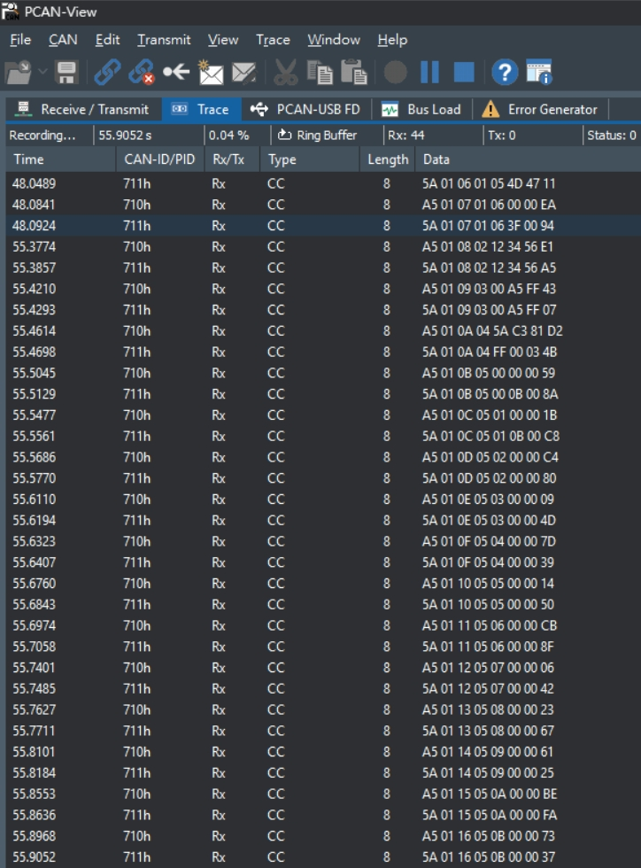<figcaption>CAN analyzer 的 request／response 與 error counter。</figcaption></figure>

<figure>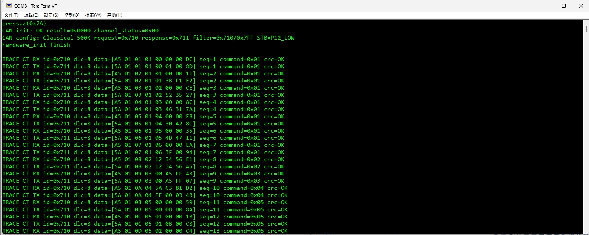<figcaption>MCU UART 的 sequence、command、payload 與 CRC 訊息。</figcaption></figure>

<a id="f13-device-update"></a>
<a id="mcu-can-device"></a>

## 3. MCU CAN device：App 更新

F13、F24 device 各自提供獨立的 Boot／App 工程。
Tool 使用同一組 CAN Upgrade 操作，依實際 BIN 與 live device 的 metadata 核對 MCU 與更新條件。

1. 在 CAN 頁選擇 CAN Upgrade、Bridge port 與對應 bitrate。
2. `Load Update Image` 載入該 device 的 `*_update.bin`。
3. 核對 MCU、版本、Metadata VALID 與 CRC MATCH。
4. `Discover Target` 取得 live device 的模式、Boot 與 App 資訊。
5. 需要時按 `Enter Bootloader`。
6. Prerequisite 顯示 Ready 後，按 `Start Device Update` 並確認目的地。
7. END 通過後等待 Tool 自動確認 APP_READY 與 live INFO，顯示 `App confirmed`。

未確認時，Tool 保留「已寫入／App 未確認」結果，不自動重寫。

重新 Discover 或 device UART 可作為補充診斷；判定條件與報告見 [更新確認](#update-confirmation)。

BIN size 包含尾端 CRC，capacity 則為可用 App 區域。
App Start 使用 BIN metadata；手動 override 作為額外核對值。

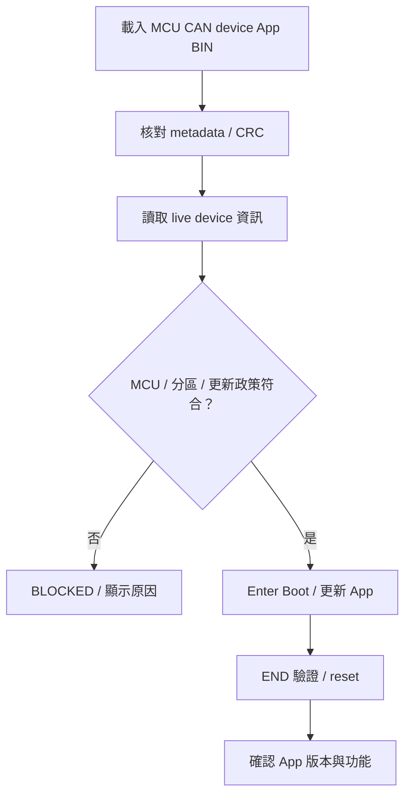

<a id="can-upgrade-performance"></a>

### 更新速度與紀錄

每64-byte區塊使用一次 ACK，raw frame 每次攜帶最多8 bytes。
更新耗時由映像大小、Host Link／CAN 速度、Flash 與 trace 負載共同決定。

量測時保存 BIN、介面速度、耗時、CRC、retry／error／overflow counters。
封包與 Flash 處理細節集中於以下逐層導讀。

<!-- CAN_WALKTHROUGH_BEGIN -->
<a id="can-update-walkthrough"></a>

## CAN 更新逐層導讀：Tool → MCU CAN host → MCU CAN device

本篇以同一條更新路徑，對照 Tool 操作、傳輸資料、處理函式及 Flash 寫入時點。
完整 byte 規格見 [Flash／metadata 全部 byte 位址與 CAN 格式](https://released.github.io/slide_boot_loader_for_RL78/#flash-metadata-can-reference)。
[MD 原稿](https://github.com/released/simple_renesas_isp_tool/blob/main/docs/CAN_UPDATE_WALKTHROUGH_zh-TW.md)與
[可下載 PDF](https://github.com/released/simple_renesas_isp_tool/blob/main/docs/CAN_UPDATE_WALKTHROUGH_zh-TW.pdf)可供離線對照。

本篇只描述現有 CAN Upgrade：Classical CAN、控制 ID `0x700/0x701`、raw data IDs `0x720..0x727`，
範例 App 起點 `0x2000`、metadata 位於 image offset `0x100..0x1FF`。這些是此範例契約，不是所有 MCU 的固定值。
Host 自身 App 的更新操作見 [Misc／UART](https://released.github.io/slide_isp_tool_for_RL78/#host-bridge-firmware)。

### A. 三層責任與資訊來源

| 層 | 輸入與輸出 | 負責判斷 | 不負責的事 |
| --- | --- | --- | --- |
| PC Tool | BIN／UI → Host Link UART commands | 離線 BIN、更新政策、live target 相容性；建立 CAN 更新封包 | 不直接操作 device Flash register |
| MCU CAN host App | Host Link → CAN TX；CAN RX → Host Link response | UART framing／CRC16、generic CAN record、傳送完成與等待條件 | 轉送 CAN frames；App metadata 與擦寫由 device 處理 |
| MCU CAN device Boot | CAN command／raw data → ACK | metadata 契約、RAM 區塊、CRC、Flash 邊界、完整映像及 Boot→App | 不解析 PC Host Link、不需要知道 COM 名稱 |
| MCU CAN device App | CAN INFO／ENTER | 回報 App／Boot 摘要；明確要求重進 Boot | 不在正常 App 中處理 Boot 的區塊擦寫流程 |

#### 三層資料往返

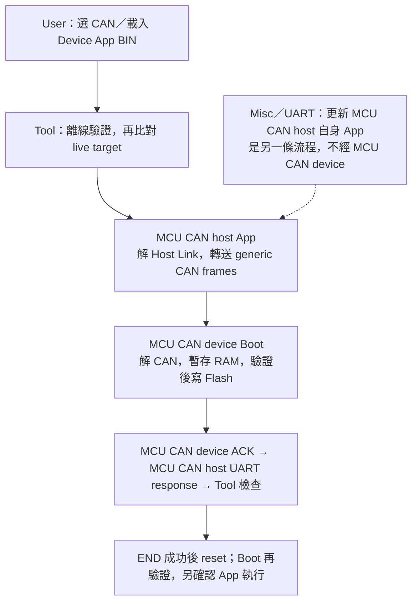

| UI／通訊中看到的資料 | 來自哪裡 | 代表什麼 | 不代表什麼 |
| --- | --- | --- | --- |
| LOADED APP BIN／共用 metadata | PC 上載入的檔案 | 即將寫入的離線映像與更新政策 | 不是板上已安裝的內容 |
| DEVICE TARGET／BOOT CODE／INSTALLED APP | MCU CAN device 的 CAN INFO pages | live 韌體回報的身分、layout、版本、容量及政策摘要 | Discover 不會讀回完整 256-byte Flash metadata；也不是 read-back CRC |
| HOST BRIDGE／Host descriptor | MCU CAN host 的 Host Link 身分與自身 metadata | 哪塊 bridge、支援哪些 port／commands、Host 自身 App 資訊 | 與外部 device 的 App BIN 分開顯示 |

### B. 使用者操作與內部動作對照

| 操作順序 | UI 要看什麼 | 實際動作／程式入口 | F13 Flash 是否改變 |
| --- | --- | --- | --- |
| 1. 接線／開啟 Tool | COM friendly name 只協助選埠 | F24 與 F13／analyzer 同 CAN bitrate、共地、終端；F13 EVB TJA1050T 使用 5 V | 否 |
| 2. Open + Probe Host | HOST BRIDGE VERIFIED LINK／port／能力 | 讀 Host Link 身分與能力；支援自身更新的 bridge 再驗證其 descriptor／metadata | 否 |
| 3. CAN／Load Update Image | LOADED APP BIN 為 OFFLINE；CRC Result／Metadata Status／Update Policy | `CMainFrame::LoadBinaryFromPath` → `InspectImage`／`ValidateLoadedFirmwareImage`；選 `_update.bin`，不是 HEX 或 Host BIN | 否 |
| 4. Discover Target | DEVICE TARGET、BOOT CODE、INSTALLED APP | `ProcessDiscoverF13Boot` → `GetTargetInfo`：逐頁 INFO，核對模式／速度／IDs | 否 |
| 5. Enter Boot（若仍在 App） | DEVICE TARGET 改為 Bootloader | `ProcessEnterF13Bootloader` → ENTER ACK → 等待 reset → INFO + HELLO | 否 |
| 6. 檢查 Ready／Missing | 中央先決條件不得有缺項 | `CMainFrame::UpdateUi`；檔案、route、bit12、Boot ready、live layout 全部相容 | 否 |
| 7. Start Device Update | progress／shared log | worker 再驗證 → metadata RESET／stage／SEAL → START → blocks → END | 到有效 COMMIT 才開始 |
| 8. 確認結果 | END ACK 與 App confirmed 分開記錄 | Tool 等待 APP_READY，再比對 live INFO 與載入 BIN 的身分／版本／build／大小；自動保存報告 | 更新流程已寫入 |

載入 BIN 與 Probe 的先後可以互換；但 Start 前必須全部通過。Transfer Test／Bridge Self Test
只能用來排查通訊，不會替代 CAN Upgrade 的映像驗證。完整操作見[Tool operation](https://released.github.io/slide_isp_tool_for_RL78/#tool-operation)。

### C. Tool 如何判斷「這個 BIN 可以更新」

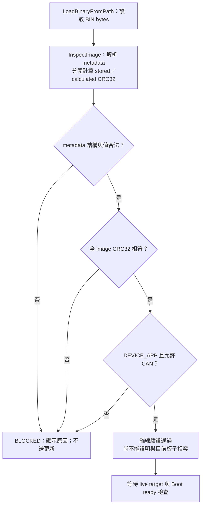

| 驗證關卡 | 檢查的 byte／資料 | 拒絕範例 | UI／程式判定 |
| --- | --- | --- | --- |
| 最小結構 | entry／vector 預留、0x100 起 256-byte metadata、尾端 CRC4；至少 516 bytes、4-byte 對齊 | 空檔、截斷、只給原始 App code | `ParseMetadata`；entry 不得為 FFFFFFFF |
| 格式與識別 | image magic、image format、core length、flags、protocol、checksum；MCU 字串與 padding | BUR1 Host BIN 放在 CAN TAB、壞 magic／字串 | Metadata Status 與 Update Policy；不是只看副檔名 |
| 幾何與容量 | image_size 等於檔案長度；start／capacity／Flash／Boot／erase／minimum | 超出 Flash、start 未對齊 erase | `ParseMetadata` 的 bounds checks |
| 保留區 | metadata offset 0x80..0xFF 共 128 bytes 必須 FF | 不相容擴充欄位卻未更新契約 | reserved 檢查；不是任意填零區 |
| 完整性 | 檔案前 N-4 bytes 的 CRC32 對比最後 4 bytes LE32 | metadata 正確但程式區損壞 | CRC Result MATCH；`ValidateImage` 才要求相等 |
| 更新政策 | UPD1 role／allowed transports／IRQ ABI／minimum boot | CAN-only Device App 改選 I2C；Host App 放入 CAN | `image_policy::Allows`；切換 TAB 後重新核對更新政策 |

`InspectImage` 的「Metadata Status = VALID」與「CRC Result = MATCH」是兩個獨立結果，
兩者都通過也只是離線成立。CRC提供完整性，不是簽章或身分認證。

### D. 離線 BIN 與在線 target 如何比對

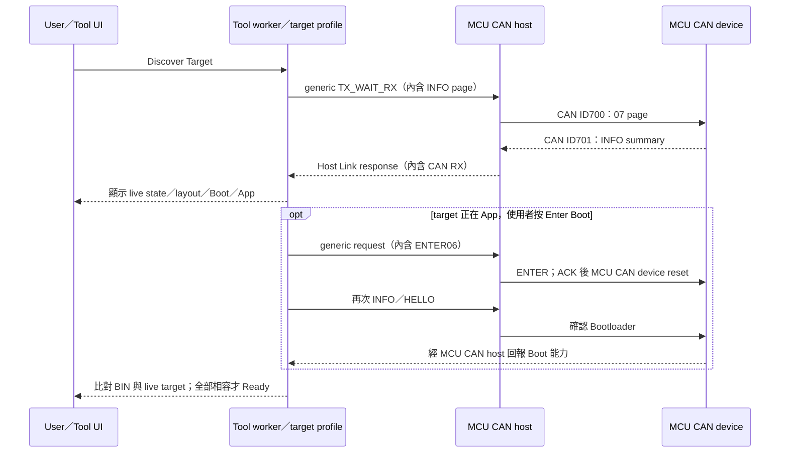

| 比對群組 | BIN metadata | live INFO／Host 能力 | 失敗後處理 |
| --- | --- | --- | --- |
| 身分 | target_id、mcu_family、mcu_part | target INFO 相同欄位 | 不以 USB-UART 描述或載入檔案推測身分 |
| 協定 | image format、protocol ID／version、checksum | live format／protocol／checksum | 使用 BEGIN／raw data／COMMIT 區塊流程 |
| Flash | start、capacity、Flash size、Boot reserve、erase、minimum | live layout 各項相等 | 不只比較 image 是否小於 capacity |
| CAN | mode／ID format／nominal mask／data mask／request／response | live 契約相同；選定設定也要被支援 | 改 bridge 速度不會改 F13 固定速度 |
| 政策 | DEVICE_APP、CAN allowed、固定 IRQ ABI、minimum boot | live role／CAN allowed／IRQ ABI；boot_version 足夠 | UI 與 worker `ImageMatchesTarget` 分別核對 |
| 傳輸能力 | 本路徑需要 generic burst | Host Link v2／128-byte payload／bit12；F13 block INFO | 缺 bit12 先經 Misc 更新 Host App，不直接開始 |
| 執行狀態 | 檔案有效且 App Start Override 相容 | 已確認 Bootloader；HELLO target／capacity 與 INFO 相符 | App 狀態須先 ENTER；未開 COM／busy 都不可更新 |

### E. 一個 BIN 區塊如何穿過 UART 與 CAN

| 名詞／單位 | 大小 | 本路徑的用途 | 範圍與差異 |
| --- | --- | --- | --- |
| metadata region | 256 bytes | image offset 0x100..0x1FF；128 core + 128 reserved | 不是 Host Link 單包大小 |
| metadata staging chunk | 4 bytes | METADATA08 每次攜帶 4 個 metadata bytes，總共 64 次 | 不是目前 raw App data 的有效長度 |
| image block | 最多 64 bytes | RAM staging／區塊 CRC／一次 COMMIT ACK | 不是 CAN FD frame |
| raw CAN data frame | 最多 8 bytes | ID 的低 3 bits 表示段號，payload 全部是 image bytes | 沒有占用 Byte0 當 command；最後一段可為 DLC4 |
| Host Link burst payload | 完整 block 為 122 bytes | 12-byte burst header + 10 ×（ID2 + DLC1 + data8） | 在 128-byte payload 上限內；含 UART framing 共 136 bytes |
| Flash write word／erase block | 4／1024 bytes | F13 以 4 bytes 寫入，到 erase 邊界時擦 1 block | 寫入單位不是 CAN 傳輸單位 |

#### 區塊封裝與回覆

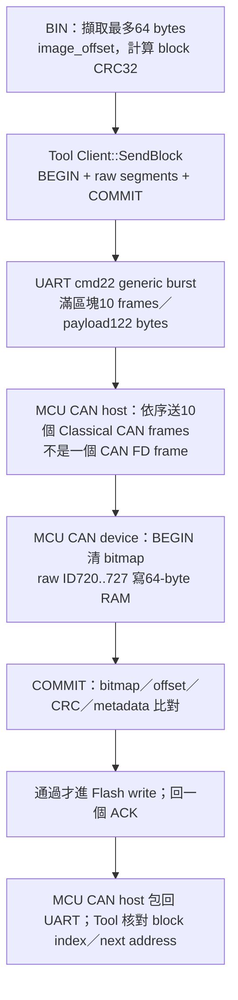

### F. F24 (MCU CAN host) 的接收與轉送流程

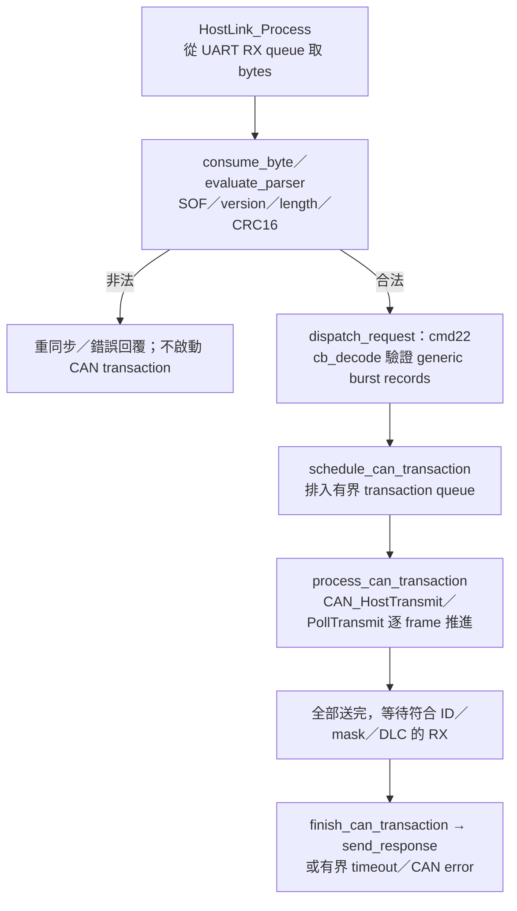

| 程式位置 | 檢查／動作 | 使用者可對照的結果 |
| --- | --- | --- |
| `host_link_protocol.c`：`validate_header`／`evaluate_parser` | UART header CRC16、payload 長度 ≤128、payload CRC16；逐 byte 可分段到達 | UART framing／CRC 錯誤與 CAN target status 是不同層 |
| `can_burst.inc`：`cb_decode` | 1..10 records、Standard ID、DLC≤8、timeout、非零 mask、完整長度／gap | 不合法 generic request 直接 BAD_ARGUMENT；尚未解 F13 command |
| `host_link_protocol.c`：`schedule_can_transaction` | 有界 queue／相同 sequence 與 payload 的重送處理 | 不因 UART retry 任意增加 target Flash 寫入 |
| `host_link_can_process.inc`：`process_can_transaction` | 非阻塞 TX／GAP／RX／ABORT；所有 frame 送完後等待 matching RX | bridge TX complete 只代表 CAN 傳送階段完成 |
| `can_fd_module.c`：`CAN_HostTransmit` | 把已解碼的 frame 結構交給 `R_CAN_SendByTXMB`；ISR 記錄事件／RX queue | 寄存器與 driver 留在 board backend，不把 target 邏輯放 ISR |
| `finish_can_transaction`／`send_response` | 將 CAN RX record 放進同 sequence 的 Host Link response | 外層 status OK 後，Tool 還要解析內層 F13 status／detail／value |

Host Link 的 115200／460800／921600 是 PC↔F24 這一路；CAN 的 500K 是 F24↔F13 另一路。
F24 不會把 UART baud 寫入 F13 metadata，也不會將收到的 BIN 自動燒進自己的 App。
F24 自身更新另見[Misc 更新 Host App](https://released.github.io/slide_isp_tool_for_RL78/#host-bridge-firmware)。

### G. F13 (MCU CAN device) 如何分類 CAN RX

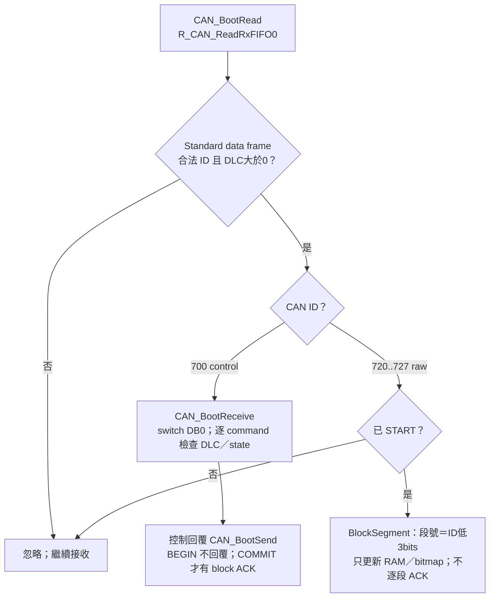

| 收到內容 | Decoder 看哪裡 | 狀態／長度要求 | 結果 |
| --- | --- | --- | --- |
| INFO07／HELLO01 | DB0、INFO 的 DB1 page | INFO DLC2；HELLO 回報 Boot 狀態／能力 | 讀摘要；不寫 Flash |
| METADATA08 | DB1..2 metadata offset、DB3=00、DB4..7 bytes | 未 START、DLC8；offset 4-byte aligned 且不可跳過 | 寫 metadata RAM，回下一 offset |
| SEAL09／START02 | SEAL 的 DB4..7 CRC；START 的 protocol／target／size | metadata 256 bytes 完整、契約與 CRC 正確才允許 START | 只建立 update session；不擦 Flash |
| BLOCK_BEGIN0B | DB1..3 image offset、DB4..7 block CRC | 已 START、DLC8；64-byte offset；本區塊或上一已提交區塊 | 初始化 block RAM／bitmap；不 ACK |
| raw ID720..727 | index=ID&7；DB0..7 都是 image data | 已 START、BEGIN 有效；DLC 必須等於該段實際長度 | 收齊 bitmap；相同重複可接受，衝突使 block 無效 |
| BLOCK_COMMIT0C | offset／CRC 與 BEGIN 一致 | started、DLC8、bitmap 全、區塊 CRC 相等 | 通過後才比對 metadata／寫 Flash；回 block ACK |
| END04／ABORT05 | DB0 | END 要求完整 size／Flash metadata／全 image CRC；ABORT 終止 session | END 成功後 reset；ABORT 不等於回復舊映像 |

### H. 完整 metadata、SEAL 與 START

一般 START 另檢查目前有效 App 的版本政策；`FORCE_START 0E` 只略過本次版本排序。
其餘契約／CRC／Flash 檢查相同；維護確認與密碼見 [force 降版操作](https://released.github.io/slide_isp_tool_for_RL78/#force-old-version)。

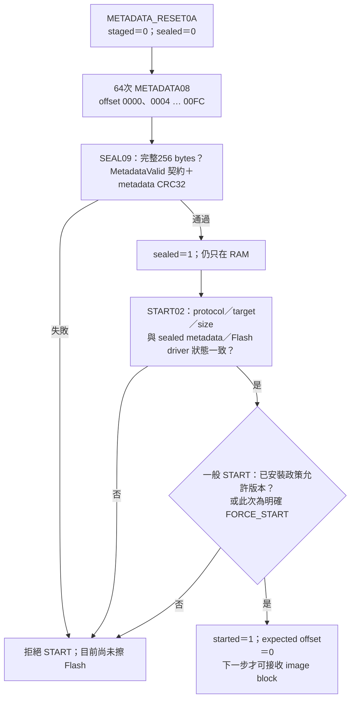

| 階段 | Tool 函式／資料 | F13 函式／判斷 | 不可誤解的保證 |
| --- | --- | --- | --- |
| RESET | `Client::StageMetadata` 先清舊 session；遇 BAD_STATE 可先 ABORT 再試一次 | `MetadataReset` 清 staged／sealed | 不清 Flash；不保證舊 image 尚可用 |
| 64 個 chunks | 取 image[0x100..0x1FF]；每次 4 bytes、等待 ACK | `MetadataStage`：不可跳號；相同重送接受、衝突拒絕 | 只更新 RAM；ACK detail 為下一 metadata offset |
| SEAL | CRC32(metadata 的全部 256 bytes) | `MetadataSeal` → `MetadataValid`＋CRC；核對固定契約與保留 FF | 不等於全 image CRC；尚未確認程式區 bytes |
| START | `Client::Start` 傳 protocol／target／image_size | size＝sealed words[6]；FSL 正常；設 address／expected | START ACK 不是「已擦除完成」 |
| 正式傳 image | `RunUpdate` 從 image offset0 開始，每區塊最多64 bytes | metadata 所在 image blocks 仍會再傳；COMMIT 前與已封存 RAM 比對 | 不可 stage 好 metadata A 卻正式寫入 metadata B |

### I. 用第一個 metadata chunk 對照 byte 與 address

這是 Bootloader 內、未 START、且先成功 RESET 的教學範例；不是讓 analyzer 任意掃描或自動擦寫。
完整逐 byte 表另見[格式對照](https://released.github.io/slide_boot_loader_for_RL78/#flash-metadata-can-reference)。

| 封包 | CAN ID／DLC | Data bytes | 讀法 |
| --- | --- | --- | --- |
| 只讀 INFO page0 | TX700／2 | `07 00` | command INFO、page0 |
| Boot INFO 回覆 | RX701／8 | `07 00 00 02 3B F1 05 06` | INFO／OK／page0／Bootloader；target F13B、protocol5、image format6 |
| 第一個 metadata chunk | TX700／8 | `08 00 00 00 43 41 4E 00` | METADATA；meta offset0000；reserved00；4 bytes 是 ASCII CAN\0 |
| metadata chunk ACK | RX701／8 | `08 00 04 00 00 01 00 00` | OK；detail0004＝下一 metadata offset；value00000100＝256 bytes |
| 第一個 block 提交成功 ACK | RX701／8 | `0C 00 00 00 40 20 00 00` | COMMIT OK；block index0；下一絕對 Flash address2040；不是 metadata offset |

#### 位址換算與 ACK 單位

| 同一個 magic byte C | 算式 | 本範例值 |
| --- | --- | --- |
| metadata-relative offset | 第一個 chunk offset + byte0 | 0x00 |
| BIN-relative offset | manifest offset + metadata offset | 0x100 + 0x00 = 0x100 |
| 暫存位置 | metadata RAM bytes[offset] | `g_metadata_words` 的第一個 byte，尚未在 Flash |
| 正式寫入位置 | App start + BIN offset | 0x2000 + 0x100 = 0x2100 |
| 此 byte 所屬 image block | floor(BIN offset /64) | block index4、image offset0x100；不是第0個 block |

metadata 分段 ACK 的 detail 以 bytes 計數；BLOCK_COMMIT ACK 的 detail 是 block index；
END ACK 的 detail 則是 image_size/4 的低16 bits。欄位位置相同，不表示單位相同。

### J. COMMIT 才是 RAM → Flash 的界線

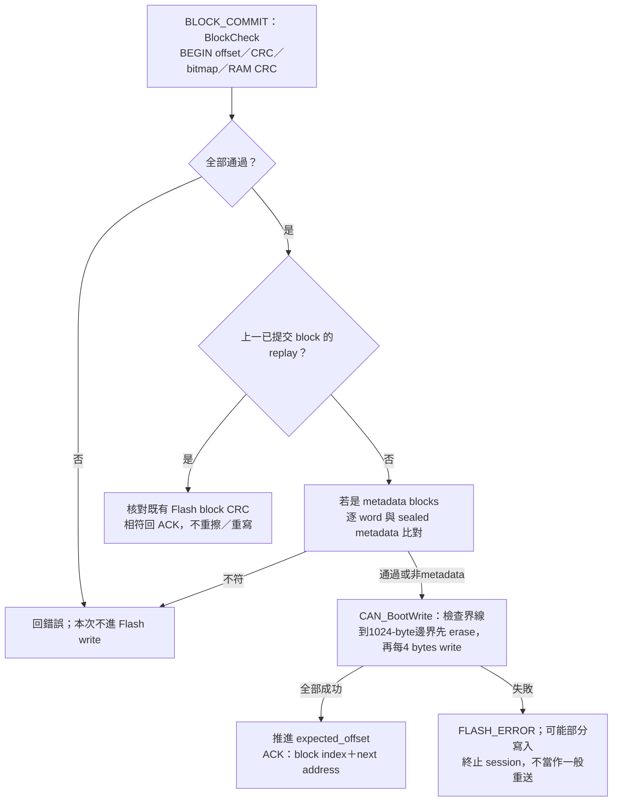

| 條件 | 如何判斷 | Flash 行為 | Tool 可否前進 |
| --- | --- | --- | --- |
| 缺 segment／錯 DLC／衝突重複／offset 錯 | bitmap／bad flag／BEGIN 與 COMMIT 不一致 | 此次不寫 | BAD_SEQUENCE；有界重送整 block |
| block CRC 不符 | 對 RAM 實際 block length 計算 CRC32 | 此次不寫 | CRC_ERROR；有界重送整 block |
| metadata 正式資料與 SEAL 不同 | image offset0x100..0x1FF 的 words 比對 staging RAM | 該 block 不寫；此前 blocks 可能已改變 | BAD_IMAGE，終止；不是 rollback |
| 本次正常 block | offset＝expected；大小不超 image／Flash 範圍 | 在 erase 邊界擦除，再逐4 bytes寫入 | ACK index／next address 正確才前進 |
| 上一已提交 block replay | offset 比 expected 少64，RAM／Flash CRC 均相符 | 不重寫、不再次擦除 | 可回相同 next address ACK；不是任意位置續傳 |
| FSL erase／write 失敗 | Flash library 回傳錯誤 | 回報部分寫入狀態並保留 Boot recovery | FLASH_ERROR，不以一般 CRC retry 掩蓋 |

目前 `Client::SendBlock` 對 bridge TIMEOUT 或 F13 BAD_SEQUENCE／CRC_ERROR 有界重送整區塊；
它仍要核對 ACK 的 block index 與 next address。這不是斷線續傳功能。
取消／失敗時 `RunUpdate` best-effort ABORT，worker 再停止 CAN；若實體線已斷，不能保證 ABORT 送達。

### K. END、reset、Boot→App 是三個步驟

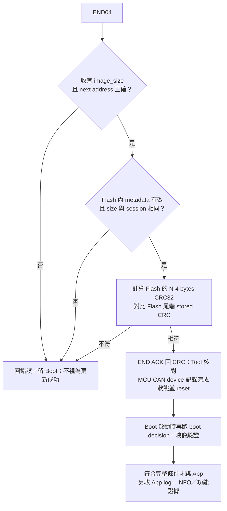

完整 ENTER、RAM handoff、checksum、逾時、失敗留 Boot 的條件以
[F13 Boot→App 完整條件圖](https://released.github.io/slide_isp_tool_for_RL78/#f13-boot-flow)為準。
僅有效舊 App 的 ENTER session 啟用30秒 inactivity；START 前可重驗舊 App 後返回，
接受 START 後逾時不自動回 App。無效 App 的 recovery 不啟用該逾時；ABORT／fatal error 不保證自動返回。

| 觀察到的證據 | 真正證明的範圍 | 還需要什麼 |
| --- | --- | --- |
| PC BIN CRC MATCH | 本地檔案 N-4 bytes 對尾端 CRC 正確 | metadata／route／live target 仍需核對 |
| analyzer 看見700／raw frames | CAN bus 有這些封包 | 不證明 F13 解碼、Flash 成功或 App 執行 |
| CAN ACK bit／F24 TX complete | 某節點確認鏈路／控制器送出 | 不等於 F13 Boot COMMIT ACK |
| Host Link status OK | bridge 完成指定 transport transaction | 仍須解內層 F13 status；內層可能是錯誤 |
| F13 COMMIT ACK OK | 該區塊處理成功；Tool 也核對 index／next address | 全 image 仍未 END 驗證 |
| END ACK＋matching CRC32 | F13 對寫入 Flash 的完整映像驗證成功 | reset 後是否真正跳 App 尚需獨立證據 |
| 新 App UART log／重新 INFO／實際功能 | 可觀察的 App 執行與版本／功能 | 不等於所有 IRQ／斷電／高速可靠性都已驗收 |

### L. 故障現象與分層診斷

| 現象 | 優先核對 | 對應流程 | 處理原則 |
| --- | --- | --- | --- |
| Tool Metadata VALID 但 CRC MISMATCH | 檔案截斷／post-build／尾端 CRC | C：離線驗證 | CRC 通過後才可開始更新 |
| CRC MATCH 卻 Update blocked | DEVICE_APP／CAN allowed、IRQ／minimum boot、live layout、bit12 | D：在線相容性 | 依實際不符欄位核對映像與 live target |
| Probe timeout | COM 是否選對、binary UART／Host baud、F24 是否在 App／Boot | B／F：Host Link | 僅對明確選定的 COM 執行 Probe |
| F24 TX error／bus error | 供電、CANH/L、共地、終端、各節點 bitrate／clock；F13 transceiver 5V | F／G：實體與 transport | 先確認實體層及傳輸，再核對協定解碼 |
| 有700但沒有701 | F13 state／RX filter／ID／DLC、transceiver；Transfer710與Boot700 | G：接收分類 | 使用目前模式對應的 ID／協定 |
| SEAL BAD_IMAGE／CRC_ERROR | 64 chunks 是否完整、固定契約／保留FF、metadata CRC | H：metadata RAM | metadata 通過 SEAL 後才進入後續更新流程 |
| COMMIT BAD_SEQUENCE／CRC_ERROR | BEGIN offset／raw IDs／DLC／bitmap／CRC、有限重送紀錄 | J：block RAM | 依錯誤分類及重試上限處理 |
| END 成功但沒有新 App log | reset／boot decision／vector／startup／App IRQ與板級初始化 | K：啟動驗證 | 另核對 APP_READY／live INFO 與功能執行 |

### M. 開原始碼時的閱讀順序

| 要理解的段落 | 實際來源連結 | 從哪個函式／符號開始 |
| --- | --- | --- |
| 載入檔案與 UI metadata | [main_frame_image.cpp](https://github.com/released/simple_renesas_isp_tool/blob/main/src/main_frame_image.cpp) | `LoadBinaryFromPath`／`ValidateLoadedFirmwareImage`／`UpdateFirmwareImageInfoText` |
| Ready／Missing 與 Start 按鈕 | [main_frame_workflow.cpp](https://github.com/released/simple_renesas_isp_tool/blob/main/src/main_frame_workflow.cpp) | `UpdateUi`／`OnBnClickedStartFirmwareUpdate` |
| App metadata 離線驗證 | [firmware_update_profile.cpp](https://github.com/released/simple_renesas_isp_tool/blob/main/src/core/firmware_update_profile.cpp) | `ParseMetadata`／`InspectImage`／`ValidateImage` |
| worker 二次檢查／流程 | [worker_can_workflows.cpp](https://github.com/released/simple_renesas_isp_tool/blob/main/src/worker_can_workflows.cpp) | `ProcessDiscoverF13Boot`／`ValidateF13BootTarget`／`ProcessProgramF13Boot` |
| BIN 對 live target | [worker_format.cpp](https://github.com/released/simple_renesas_isp_tool/blob/main/src/worker_format.cpp) | `ImageMatchesTarget` |
| 更新狀態機 | [f13_boot_update.cpp](https://github.com/released/simple_renesas_isp_tool/blob/main/src/core/f13_boot_update.cpp) | `RunUpdate`／`AbortAfterStart` |
| CAN 封包建立／ACK 解碼 | [f13_boot_profile.cpp](https://github.com/released/simple_renesas_isp_tool/blob/main/src/core/f13_boot_profile.cpp) | `Client::GetTargetInfo`／`StageMetadata`／`SendBlock`／`End` |
| F24 UART parser／generic dispatch | [host_link_protocol.c](https://github.com/released/simple_renesas_isp_tool/blob/main/firmware/RL78_F24_Bridge_app/host_link_protocol.c) | `HostLink_Process`／`evaluate_parser`／`dispatch_request` |
| F24 burst record 驗證 | [can_burst.inc](https://github.com/released/simple_renesas_isp_tool/blob/main/firmware/common/can_burst.inc) | `cb_decode`／`cb_next` |
| F24 CAN 非阻塞 transaction | [host_link_can_process.inc](https://github.com/released/simple_renesas_isp_tool/blob/main/firmware/RL78_F24_Bridge_app/host_link_can_process.inc) | `process_can_transaction`／`next_burst_frame` |
| F24 driver／RX queue | [can_fd_module.c](https://github.com/released/simple_renesas_isp_tool/blob/main/firmware/RL78_F24_Bridge_app/can_fd_module.c) | `CAN_HostTransmit`／`CAN_HostPollTransmit`／`CAN_RxQueuePop` |
| F13 CAN 接收與 Flash 入口 | [can_boot_transport.c](https://github.com/released/RL78_F13_Boot_loader_CAN/blob/main/can_boot_transport.c) | `CAN_BootRead`／`CAN_BootReceive`／`CAN_BootWrite`／`CAN_BootSend` |
| F13 metadata staging／契約 | [can_boot_metadata.inc](https://github.com/released/RL78_F13_Boot_loader_CAN/blob/main/can_boot_metadata.inc) | `MetadataStage`／`MetadataSeal`／`MetadataValid` |
| F13 raw segments／bitmap／CRC | [can_boot_block.inc](https://github.com/released/RL78_F13_Boot_loader_CAN/blob/main/can_boot_block.inc) | `BlockBegin`／`BlockSegment`／`BlockCheck` |
| F13 reset 與重新驗證 | [r_main.c](https://github.com/released/RL78_F13_Boot_loader_CAN/blob/main/r_main.c) | `boot_main`／`verify_application_checksum`；配合 Boot decision 圖 |

若要改成自己的專案：先固定 partition／vector ABI／board clock，再由 image build 設定產生 metadata／CRC；
同步修改 Tool target profile 與 device Boot 的契約，最後對照本篇每一關驗證。
只增加 App 一般 IRQ 且仍在既定 ABI／layout／更新協定內，不需要為此改 Boot；
更換更新介面或映像契約則必須重新評估 Boot。
詳見[Boot/App 移植工程](https://released.github.io/slide_boot_loader_for_RL78/#boot-app-porting)。

本篇是現行程式的導讀，不是新一輪板測報告。實體斷線／斷電、完整故障矩陣、高速長時間可靠性，
以及各自訂 App 的 IRQ／啟動，仍須在對應硬體上留存驗證紀錄。
<!-- CAN_WALKTHROUGH_END -->

## 4. I2C Master

目前操作為指定 port／address 的 G16 reference 探索。

1. Probe Host → I2C Master → IICA0／100kHz。
2. Slave 使用7-bit位址 `0x09`。
3. `Probe G16 Reference` 讀取 inquiry／signature／area。
4. Port、rate 或 address 調整後重新 Probe。

探索回覆用於核對連線與參考資訊。
此模式提供探索及 BIN CRC16 檢查，Start Firmware Update 顯示 BLOCKED。

<a id="host-bridge-firmware"></a>

## 5. MCU CAN host：Misc／UART 更新 Host App

本節更新 PC 所連接的 host 自身 App，使用 host Boot 的 UART 更新介面。

1. Open + Probe Host，切換 Misc。
2. `Read Bridge Update Info` 讀取 host MCU、分區與 App 資訊。
3. `Enter Bridge Boot (UART)` 進入 Boot；Tool 依描述器以115200重連。
4. 載入 `*_bridge_update.bin`，核對 HOST APP、MCU、metadata 與 CRC。
5. `Update HOST APP` 確認後更新。
6. 完成後按 `Run Validated Bridge App`，Tool 自動重連並確認 App 資訊。

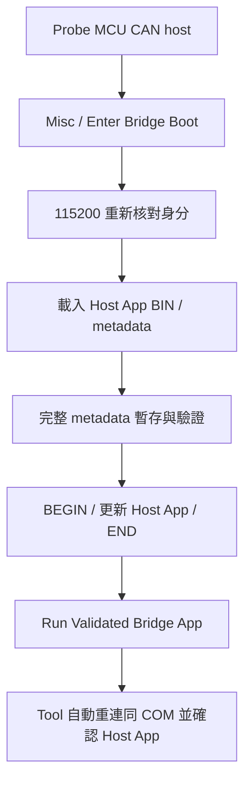

### Host 初次安裝

| 來源 | 用途 |
| --- | --- |
| `RL78_F24_Bridge_boot/DefaultBuild/*.mot` | 燒錄器初裝 Boot |
| `RL78_F24_Bridge_app/DefaultBuild/*_flash.mot` | 燒錄器初裝 App |
| `*_bridge_update.bin` | Misc 更新 Host App |

Host Boot 預留20 KiB，App 起點0x5000，最後1 KiB保留。
Host Boot 保持固定UART115200；一般 Host Link 連線速度見 [更新政策與通訊速度](#image-update-policy)。

### Recovery 入口

按住 SW1（P32 LOW）並 reset／重新上電，進入 host Boot。
Tool 以115200 Probe，確認 Boot 資訊後，使用上述 Misc 流程更新 App。

<!-- F24_APP_IRQ_BEGIN -->
<a id="host-app-engineering"></a>

### F24 (MCU CAN host)：App 工程

本節供需要閱讀或調整 host firmware 的開發者參考。

| 來源目錄 | 內容 |
| --- | --- |
| `firmware/RL78_F24_Bridge_boot` | Host Boot、UART recovery |
| `firmware/RL78_F24_Bridge_app` | Host App、Host Link dispatch、bus service |
| `firmware/f24_board` | 共用 board／driver／SC |
| `firmware/f24_bridge_common` | Host App 分區與自更新契約 |

#### 設定、解析與介面分工

Host App 擁有自己的 `app_image_config.h` 與 `app_irq_handlers.h`。
以 C header 編輯發行資訊與 IRQ mapping，Windows PowerShell／CS+ 負責產表與封裝。
MCU 建置不需要 Python 或 JSON 設定檔。

| 來源 | 職責 | 修改範圍 |
| --- | --- | --- |
| App 的 `app_image_config.h` | 版本、build、board ID、role、允許更新介面 | App 發行設定；身分與介面須符合 Boot 契約 |
| App 的 `app_irq_handlers.h` | `APP_IRQ_HANDLERS(X)` 對照 vector byte address 與 ISR | App 功能使用的中斷 |
| `f24_bridge_common/image_metadata_config.h` | MCU 身分、Flash 分區、Boot 版本、IRQ ABI、固定 UART | 工程配置；調整時核對 Boot／App、linker 與 backend |
| `f24_bridge_common/image_metadata_profile.c/.h` | 將工程配置組成 live descriptor 的預期值 | MCU／board profile，不操作 register |
| `common/bridge_image_metadata.c/.h` | BUR1／BUI1 欄位解碼、格式驗證及契約比對 | 可移植 C90 模組，不包含更新命令或 Flash driver |
| `common/bridge_update_contract.h`、`bridge_update_engine.c/.h` | 更新命令、狀態機與 Flash callback | 收包、staging、CRC 與更新時序 |
| `f24_bridge_common/boot_app_handoff.h` | recovery cookie 與 IRQ owner 的 no-init RAM 位址 | startup／linker／交接設定 |

Pre-build 產生 `bridge_vectors.asm`／`f24_app_identity.generated.h`。
Post-build 核對實際 linked App 身分、向量目的地及 RETI／RETB，再封裝更新映像。
單獨重新產生 header 不會改變已編譯映像的身分；不符時需重新建置。

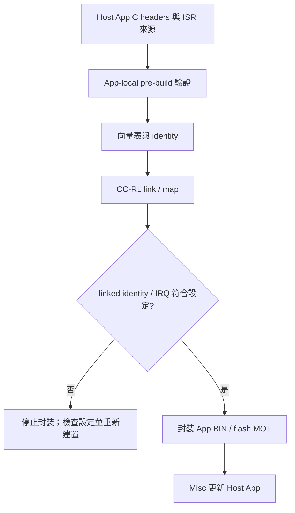

#### 編輯 App metadata

在 App 專案開啟 `app_image_config.h`；每個 define 的註解包含用途、範例與修改條件。

| Define | 範例 | 判斷方式 |
| --- | --- | --- |
| `APP_IMAGE_VERSION` | `0x00010600UL` = 1.6.0 | `0x00MMmmpp`，各一 byte；非日期或十進位字串 |
| `APP_IMAGE_BUILD` | `20261017UL` | 發行識別，允許 0..0xFFFFFFFE |
| `APP_IMAGE_TARGET_ID` | `0x0101U` | 等於 Boot 的 board ID；單獨改為 `0xF33BU` 會停止產生 |
| `APP_IMAGE_ROLE` | `2U` = HOST BRIDGE APP | 本工程使用 2；`5U` 等未定義值會停止產生 |
| `APP_IMAGE_UPDATE_TRANSPORTS` | `0x04U` = UART | bitmap：CAN=0x01、I2C=0x02、UART=0x04；此契約要求 UART |

例如發行 1.6.1 時，只調整版本與 build，再 clean build App。
Boot 版本與 App 版本是各自的發行身分，不要求數值相同。
Host App 的版本用於識別；更新仍依 board／分區／相容性與 CRC 判斷。

Misc 更新 UART 固定 115200，來源是 `image_metadata_config.h`。
App 執行時的 Host Link 115200／460800／921600、CAN bitrate 與 I2C speed 不會改寫這項更新契約。
Magic、core／region 長度與 policy 格式由 `bridge_image_metadata.h`／`image_policy.h` 定義；App 發行時維持格式契約。

#### 編輯 App IRQ mapping

在 App 的 `app_irq_handlers.h` 加入 `X(vector, handler)`。
Vector 是硬體 vector 的 byte address，來源為此專案的 `iodefine.h` 中斷定義及 MCU 硬體手冊的 Interrupt Functions 表。
例如 `INTST0=0x16` 對應表內的 UART send ISR；slot 位址為 `0x5000 + 0x16 × 2 = 0x502C`。

新增一般中斷時，將 ISR C 檔加入 App MTPJ，再於 X-macro 加入對應項目：

```c
/* Example INTP0 mapping; initialize its flag/mask/pin separately. */
X(0x08, app_aux_irq)
```

ISR 使用 global、無 `vect=` 的 interrupt pragma，並由編譯器產生 RETI。
Pre-build 檢查合法 vector、重複項目、實際登錄來源與 ISR 定義，產生完整 64-slot 表。
未列入的正常 IRQ 使用 default ISR；硬體初始化、旗標與 mask 仍由 App 配置。
固定向量介面內新增 mapping 不需修改 Boot 或 linker 的表長度。

#### 移植 metadata C 模組

| API | 輸入 | 成功表示 |
| --- | --- | --- |
| `Bu_ParseManifest(p, length, &manifest)` | 至少 128 bytes 的 BUR1 core | core 欄位及 geometry 格式合法 |
| `Bu_ParseMetadataRegion(p, length, &manifest)` | 完整 256 bytes | core 合法且後 128 bytes 全為 FF |
| `Bu_ParseInfo(p, length, &info)` | 至少 96 bytes 的 BUI1 descriptor | live descriptor 格式合法 |
| `Bu_MatchesDevice(&manifest, &info)` | 已解析的兩份資料 | board、MCU、分區、UART、IRQ ABI 與 minimum Boot 相符 |

Parse API 檢查 null／可用長度並回傳 1 或 0；失敗時不使用 output。
以 byte buffer 解碼 little-endian 欄位，無需將 wire buffer 強制轉型成 C struct。
編譯環境需提供 8-bit `uint8_t`、16-bit `uint16_t` 與 32-bit `uint32_t`；現有工程由 toolchain 的 `stdint.h` 提供。
`Bu_Read16/32`、`Bu_Write16/32` 是已確認 2／4-byte 範圍後使用的低階 helper。
格式與契約相符不代表完整映像 CRC、簽章或可啟動；完整 CRC 與執行條件由更新引擎及 Boot 檢查。

移植時將 metadata C 檔單獨加入 Boot／App 的編譯來源，保留 `image_policy.h` 格式定義。
以自己的 config／profile 提供 MCU 契約，再接上更新引擎的 Flash callback、UART 收包及 linker／startup。
只有 backend 使用該 MCU 的 register／Flash library；metadata parser 不引用這些介面。

#### App-only 建置

1. 建立自己的 App 工程，保留 MTPJ、startup、兩份 C header 與來源登錄。
2. Pre-build 使用 `prepare_f24_app_irq.ps1 -AppProject "."`。
3. Post-build 使用 `package_f24_bridge.ps1 -Kind app -AppProject "."`。
4. 在 Tool root 執行對應 App 的建置：

```powershell
.\scripts\build_f24_bridge.ps1 -Kind app -AppProject ".\ProjectA"
```

封裝輸出 `<專案名>_bridge_update.bin` 與 `<專案名>_flash.mot`。
產表與封裝會核對 App mapping、BR 目的地及 RETI／RETB。
更新操作集中於 [Misc／UART](https://released.github.io/slide_isp_tool_for_RL78/#host-bridge-firmware)。

#### Smart Configurator

SC 設定為 `firmware/f24_board/f24_board.scfg`。
搬移或重新產生 SC 後，以 `prepare_f24_bridge_projects.ps1 -Kind app` 整理 App 的相對路徑與來源登錄，再建置 App。
Host Boot 的硬體設定調整時，另以 `-Kind boot` 整理及建置。
<!-- F24_APP_IRQ_END -->

## 6. 連線與錯誤資訊

| 現象 | 對應檢查 |
| --- | --- |
| Host Link timeout | COM、UART 接線、Host Baud、host firmware |
| Clock error | 晶振、SC 與 runtime clock |
| CAN bus error | transceiver 供電、STB、共地、H／L、終端、bitrate／ACK |
| Request 無 response | device firmware、filter、ID、RX／TX 路徑 |
| Metadata／CRC error | App 工程與載入 BIN |
| CRC MATCH但按鈕未啟用 | prerequisite、live mode／layout、busy 狀態 |
| Misc 無更新能力 | Host live capability／Boot 描述器 |

完整故障矩陣涵蓋重送、取消、斷線、reset、斷電與 Flash error；實板結果由各工程記錄。
CRC 驗證用於映像完整性，詳細政策如下。

<!-- COMMON_IMAGE_POLICY_BEGIN -->
<a id="image-update-policy"></a>

## 更新政策與通訊速度

BIN metadata 提供更新目的地、允許介面、MCU 身分與 Boot 契約。
版本政策與密碼確認的維護操作集中於 [force 降版](https://released.github.io/slide_isp_tool_for_RL78/#force-old-version)。
Tool 將這些欄位與目前選定的 port、live device 資訊一併核對。

| UI 資訊 | 來源與作用 |
| --- | --- |
| Update Policy | App 目的地及允許 CAN／I2C／UART 更新的清單 |
| Boot / IRQ ABI | 映像所需的最低 Boot 版本、固定向量介面 |
| MCU、版本、分區、CRC | 載入 BIN 的離線資訊 |
| LIVE INFO | 目前連線裝置回報的資訊 |

選定介面與映像政策不同時，Tool 保留 BIN 原有資訊並顯示 BLOCKED。
UI、worker 與 device Boot 分別執行對應驗證；改變 port／address／rate 後會重新探索。

Metadata 位址與欄位格式見 [Device 映像對照](https://released.github.io/slide_boot_loader_for_RL78/#flash-metadata-can-reference)。

### 三條通訊路徑的速度

| 路徑 | 設定來源 | 目前設定 |
| --- | --- | --- |
| PC ↔ MCU CAN host 的 Host Link | Tool Host Baud 與 host live 能力 | 上電115200，可協商460800／921600 |
| MCU CAN host ↔ MCU CAN device | device Boot／App 編譯設定與 metadata | Classical CAN 500K |
| PC ↔ host Boot 的自身 App 更新 | host Boot 描述器 | Misc／UART115200 |

Host Link 換速完成後會重新確認 host 身分。
尚未確認時，host 在2秒內回到115200；已確認後維持該次連線速度。

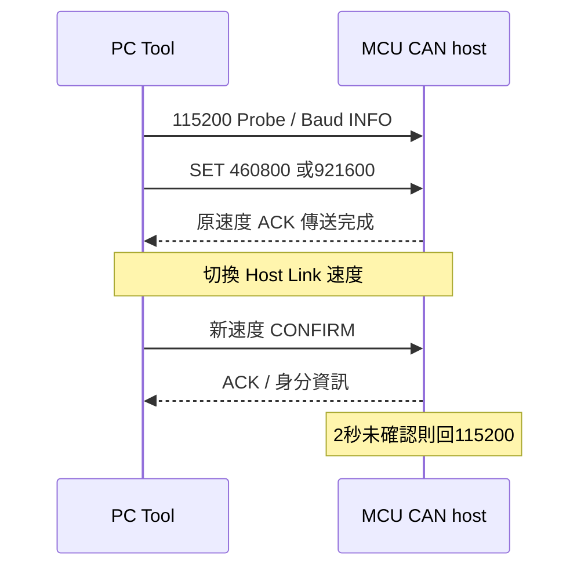

### 更新前的核對路徑

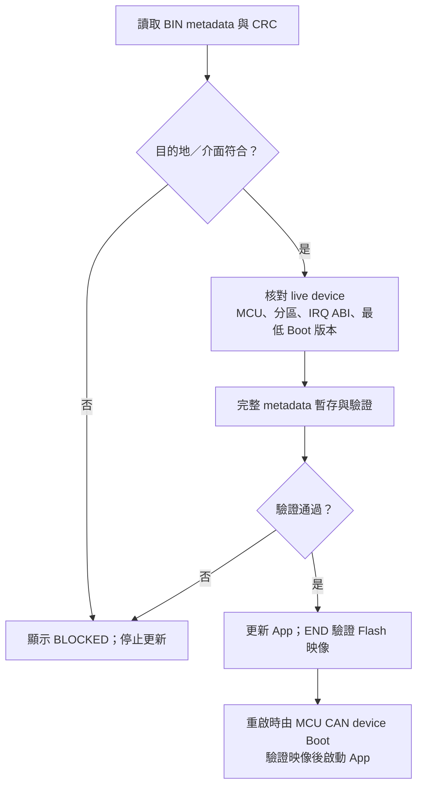

CRC提供完整性檢查。映像驗證與實板功能測試分別記錄。
Device UART metadata 的 `device_uart_baud` 由 Boot／App 編譯設定決定，獨立於 Host Baud。
<!-- COMMON_IMAGE_POLICY_END -->

## Device firmware 與工程說明

<a id="f13-boot-flow"></a>

<!-- F13_BOOT_DECISION_BEGIN -->
<a id="f13-boot-decision"></a>

## F13 (MCU CAN device)：Boot 啟動與更新狀態

Boot 啟動檢查、ENTER marker、30 秒 inactivity 與更新完成後的啟動路徑集中於 Bootloader 頁。
[閱讀完整章節](https://released.github.io/slide_boot_loader_for_RL78/#f13-boot-decision)
<!-- F13_BOOT_DECISION_END -->

<!-- F24_DEVICE_BEGIN -->
<a id="f24-can-device"></a>

## F24 (MCU CAN device)：工程配置

F24 CAN device 提供 Transfer、Boot 與 App 工程。板端時鐘、Flash 配置與 RFD 說明集中於 Bootloader 頁。
[閱讀完整章節](https://released.github.io/slide_boot_loader_for_RL78/#f24-can-device)
<!-- F24_DEVICE_END -->

<!-- DEVICE_WORKSHOP_BEGIN -->
<a id="device-metadata-vector-workshop"></a>

## Device App：Metadata 與 IRQ 設定

F13 與 F24 CAN device 使用兩份 C header 管理映像資訊與中斷對應，並共同作為後續 MCU 的工程基準。完整範例、產生命令及驗證步驟集中於 Bootloader 頁。
[閱讀完整章節](https://released.github.io/slide_boot_loader_for_RL78/#device-metadata-vector-workshop)
<!-- DEVICE_WORKSHOP_END -->

<!-- UPDATE_EVIDENCE_BEGIN -->
<a id="update-confirmation"></a>

## 更新確認、差異表與報告

更新流程把「資料已寫入」與「App 已開始執行」分開記錄。
CAN device 更新完成後由 Tool 自動確認 App；Misc 的 RUN 仍由使用者明確執行。
[MD 原稿](https://github.com/released/simple_renesas_isp_tool/blob/main/docs/UPDATE_VALIDATION_zh-TW.md)／
[PDF](https://github.com/released/simple_renesas_isp_tool/blob/main/docs/UPDATE_VALIDATION_zh-TW.pdf)提供離線說明與測試表。

| 操作 | 成功條件 | 未確認時 |
| --- | --- | --- |
| CAN Start Device Update | metadata、START、所有區塊及 END CRC 通過；同一路 CAN 收到 APP_READY，再取得 live INFO，版本／build／實際大小與載入 BIN 相符 | 顯示 END 已完成但 App 未確認；不自動重寫 |
| Misc Update HOST APP | 完整映像 CRC、有效標記與 256-byte metadata readback 通過 | 保留 Boot，顯示階段與原因 |
| Misc Run Validated Bridge App | RUN 只送一次；Tool 自動在同一 COM、115200 重連，核對相同 board ID、APP mode、完整 metadata、版本／build／大小 | 顯示 RUN 未確認；不重送 RUN、不自動擦寫 |
| Compare Metadata | 開啟 Loaded image／Live device 差異表 | 未取得 live 資訊時不以 BIN 補成 live |
| Verify Installed | CAN device 停留 Boot、無更新 session；重新計算已安裝映像 CRC，核對尾端 CRC | 回報 metadata／CRC／狀態錯誤，不擦寫 |

重連等待有時間與次數邊界，可由 Cancel 結束。
CAN 確認沿用現有 Host Link 與 CAN 路由，不會重新掃描其他 COM。
版本等摘要與健康回覆是目前執行的韌體回報，不是簽章或功能完整性的認證。

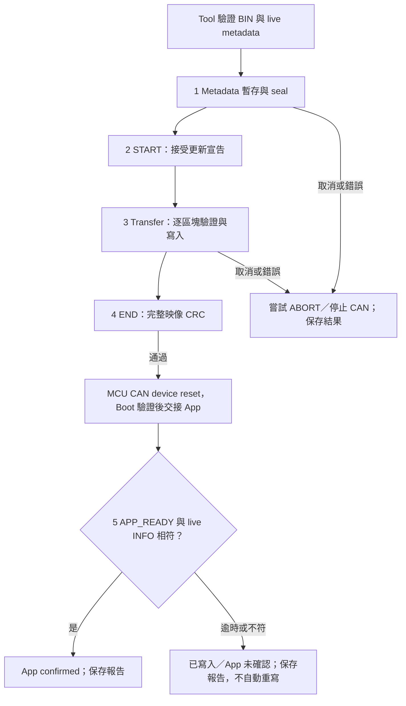

### 差異表與分階段進度

<a id="force-old-version"></a>

#### 版本政策與 force upgrade old version firmware

版本政策只有一個設定來源：MCU 目前有效 App 的 metadata。
Tool 的 `Installed Policy` 顯示目前政策，`BIN Version Policy` 顯示成功更新後將採用的設定；不提供另一個常駐開關。

| 已安裝 App 的 version control | 舊版 BIN | 同版 BIN | 新版 BIN |
| --- | --- | --- | --- |
| `0`，disable（預設） | 允許 | 允許 | 允許 |
| `1`，enable | 一般更新拒絕 | 允許 | 允許 |

比較的是 App major／minor／patch，不是 build 日期，也不是 Boot 版號。
較舊 BIN 即使設定 disable，仍須先通過目前政策；新政策只在成功更新後生效。
欄位修改與位址見 [Device App 設定](https://released.github.io/slide_boot_loader_for_RL78/#device-app-config)。

需要有意降版時：

1. 在 CAN TAB 載入目標 App BIN，Probe host、Discover device 並 Enter Boot。
2. 核對目前與目標版本。一般更新被版本政策擋下時，點選 `force upgrade old version firmware`。
3. 在密碼輸入對話框輸入 **3036**。輸入內容遮蔽顯示，不寫入 INI 或 log；取消或密碼錯誤時尚未開始更新。
4. 再確認目前版本、目標版本、檔案、範圍與 CRC；按 Yes 後僅放行這次更新。
5. 等待 END 與 App confirmed，保存自動報告；報告記錄 `force_old_version`、更新前版本及政策，不記錄密碼。

Worker 在送出前重新讀取 live device；若已安裝版本與確認時不同，就停止並重新確認。
Boot 的 `FORCE_START 0E` 只略過該次 START 的版本比較，仍檢查 metadata、target、介面、IRQ ABI、minimum Boot、分區、size 與 CRC。
不在 Boot、Tool 或 INI 保存解鎖狀態；下一次操作仍走一般政策，重試也只屬於同一更新交易。

`3036` 是公開的維護確認碼，用於減少誤操作，不是安全認證。
CAN 請求沒有簽章或身分認證；此功能不作為防止有意修改韌體的安全保護。
目前沒有獨立保存最低版本；若 App 因更新中斷而失效，Boot recovery 不再保留先前版本限制，重新驗證映像後可更新。

#### Metadata 差異表

Compare Metadata 位於共用映像區，CAN 與 Misc 共用相同檢視方式。
表格含 Field、Loaded image、Live device、Check；顏色同時搭配文字。

| Check | 顏色 | 意義 |
| --- | --- | --- |
| MATCH | 綠色 | 值一致，或滿足最低 Boot／允許介面條件 |
| CHANGE | 黃色 | 即將更新的版本、build、大小不同；這是資訊差異，不是相容性錯誤 |
| MISMATCH | 紅色 | 身分、分區、IRQ ABI、介面或其他契約不符；不能更新 |

底部顯示當前階段及該階段的百分比，不把傳輸 100% 當成整次更新完成。
CAN 分為 Metadata／START／Transfer／END CRC／Confirm App；Misc 分為 Metadata／BEGIN／Transfer／CRC-readback。
FLASH erase 的時間包含在對應區塊／BEGIN 交易中，不以推估值另報成精確硬體擦除時間。

Cancel 與 Close COM 分開。
Cancel 由 worker 在交易邊界停止，嘗試 ABORT 與必要的 bus cleanup，不額外要求 COM 斷線；Close COM 則在清理後再斷線。
若作業本身正在重連，取消時可能尚未建立新的 COM 連線。
已送出的 Flash 操作不能以 PC 按鈕立即撤回；END 後取消確認不會復原映像。

### 自動報告與 Host 診斷

<a id="update-html-report"></a>

CAN 更新、Misc 更新及 Misc RUN 結束時，Tool 在 EXE 旁的 `reports/` 自動儲存同名的 UTF-8 JSON 與 HTML。
成功、失敗與取消都有紀錄；檔案以時間與唯一尾碼區分，不覆寫既有報告。
目錄或寫檔失敗會顯示在 shared log，並保留手動 Export Summary。

| 產物 | 閱讀與使用方式 |
| --- | --- |
| HTML 更新報告 | 瀏覽器離線開啟；顯示結果、Host／Device、BIN CRC／身分、階段時間、counter 範圍與檢查建議 |
| JSON 更新報告 | 保留結構化欄位，供測試程式、紀錄比對及自動化使用 |
| App 編譯報告 | 記錄建置產生的 BIN、Metadata 與向量表；見 [編譯報告](https://released.github.io/slide_boot_loader_for_RL78/#device-app-build-report) |

更新報告對應實際 Tool 作業；編譯報告對應建置產物，兩者用途分開。
`Open Last Report` 開啟本次 Tool 執行期間最後成功儲存的 HTML；尚未產生時按鈕不啟用。
也可直接從 `reports/` 開啟歷史檔案。報告不自動開啟瀏覽器，無外部腳本或資源需求。

產生、編碼與寫檔由 worker 執行。
檔案先寫入暫存檔並完成 flush，再以不覆寫既有檔案的方式發布。
若其中一種格式儲存失敗，log 分別列出已完成的檔案及錯誤；報告儲存失敗不改寫裝置更新結果。

| 報告欄位 | 內容／範圍 |
| --- | --- |
| operation／result／message | 更新目的地、PASS／FAIL／CANCELED、失敗原因 |
| recorded_at_utc | 報告建立時間，UTC ISO 8601 |
| failure_guidance | 保留原始錯誤、作業／COM／Host Baud／階段及對應檢查建議；成功時為空 |
| host／port／host_baud／can | 本次選定的 Host 身分、COM 與速度、CAN 設定 |
| elapsed_ms／phases_ms | 整次作業與各階段耗時；不是 analyzer 測得的 bus time |
| details | 映像 CRC／大小／版本／build、已 ACK 區塊、ABORT 與 App 確認結果 |
| host_deltas | 本次 CAN 更新前後的 UART overflow、CAN lost／TX failure／bus-off／recovery 差值 |
| host_peaks | Host 自開機或 CLEAR_STATS 起的 queue 高水位、最長等待／交易／dispatcher 時間；不是本次區間峰值 |
| link_retries | 本次 Host Link 重試；已知重連重設時為 null，不當成零 |

<a id="tool-preflight"></a>

### 更新前檢查摘要

在共用映像區按下 `Preflight`，可於未連線或未載入 BIN 時先查看缺少的條件。
摘要使用目前 UI／session 快照，不傳送 command，也不執行擦寫。

| 範圍 | 摘要內容 |
| --- | --- |
| 共用 | 已驗證的 live Host、載入 BIN／CRC、目的地與介面 |
| CAN device | CAN Upgrade workflow、live Device／Boot、Host burst 能力、選定模式／速度、App start、版本政策及 Metadata 差異 |
| Misc Host App | live Boot、Flash ready、固定更新 UART 速度、HOST BIN、board／分區／IRQ／minimum Boot 契約 |
| I2C reference | 選定的 port／speed／address 是否已探索，以及該 adapter 的唯讀操作範圍 |

標題顯示未滿足的條件數；`MATCH` 與 `MISMATCH` 分別搭配綠色、紅色，版本等資訊差異以 `CHANGE`／黃色表示。
`Compare Metadata` 保留完整映像／live 欄位對照。
摘要不保存操作許可；開始更新時，UI、worker 與 Device 仍執行各自的即時檢查。

<a id="tool-error-guidance"></a>

### 錯誤資訊與檢查指引

操作失敗視窗保留原始錯誤，附上 Layer、作業、COM、Host Baud 及可取得的階段。
`Error Details` 可再次開啟目前作業的錯誤與檢查建議。

| 分類 | 可檢查的資訊 |
| --- | --- |
| PC／Host Link | COM 選擇、其他 terminal 占用、Host 電源、Host Baud；Boot 更新採固定速度 |
| Host／CAN controller | 回傳的 command／status／CAN error detail、Host clock、transceiver 與 bus 設定 |
| Host／Device bus | Bridge port、接線、終端、Device 電源、速度、request／response ID；搭配 analyzer trace |
| Image／Device contract | Preflight、Metadata 差異、MCU、分區、介面、IRQ ABI、CRC |
| Device version policy | 已安裝版本政策與映像版本；維護操作見 [版本維護](#force-old-version) |
| Device Flash | Flash 回覆、供電、Boot recovery 與重新探索 |
| App confirmation | 已寫入／END 與 App 啟動確認分開，保留未確認結果及證據 |

分類提供檢查方向，不作為實體故障原因的判定。
未知錯誤保留原文；Tool 不因檢查指引而自動重送擦寫或 RUN。

<a id="tool-com-hints"></a>

### COM 拔插與裝置提示

COM 清單保留 Windows 友善名稱，通訊仍只使用標準 COM 名稱。
成功 Probe 後，Tool 可在本機 INI 記錄該 port 與可取得的 Windows PnP instance hint。
這是 USB adapter 的選擇提示，不是 MCU Host 身分認證，也不推定所有 adapter 都具有唯一序號。

Windows 通知裝置清單變更後，Tool 會延後至 worker 閒置且 COM 已關閉時更新清單。
原 port 消失、被不同 Windows 裝置使用，或相同 hint 出現在其他 COM 時，log／狀態區提供提示。
原選擇消失時不自動改選另一個 port；使用者明確選擇後，再執行 `Open + Probe Host`。
重複 hint 或無法取得 hint 時，以明確選擇與實際 Probe 結果為準。

拔插通知不開啟其他 COM、不關閉 worker 持有的連線、不自動重連或重寫。
PnP hint 僅保存於本機設定，不輸出到更新報告；分享設定、截圖與 log 前可檢查個人資訊。

### Host 計數器與停留原因

Host 計數器飽和、可辨識的重設（例如計數回退）或缺少有效快照時顯示 unavailable，不把無法比較的值當成零。
計數快照不含開機序號；若 Host 重啟後計數已超過先前快照，僅靠差值無法辨識這次重啟。
Misc 會跨 Boot／App reset，故不將這兩邊的 counter 相減。
時間診斷單位為 1 ms，低於解析度的值可以是 0；queue 水位以 bytes 或 frames／pending transactions 表示。

| Host Boot 停留原因 | 判定 |
| --- | --- |
| No valid App | 尚無有效映像標記 |
| Metadata invalid | metadata 結構／保留區不符 |
| Contract mismatch | MCU／board／分區／更新契約不符 |
| CRC mismatch | 已安裝映像完整 CRC 不符 |
| SW1 recovery | recovery 按鍵要求停留 |
| Flash failure | Flash 初始化／擦寫失敗 |
| ENTER request | App 明確要求進 Boot |
| Update complete | END 驗證完成，等待使用者 RUN |

### MCU CAN device 健康回覆與唯讀驗證

APP_READY 與 INFO 分開：INFO 是描述資訊；APP_READY 表示必要初始化完成且本機檢查通過。
目前參考 App 的本機檢查為 clock、CAN 初始化與已觀察到 timer IRQ。
新增應用功能時，可將其必要檢查接入 App 的 readiness 判定；不需要因而改動固定 IRQ 轉送介面。

| CAN frame | 格式／意義 |
| --- | --- |
| Health request | control request ID，DLC2：`07 1B` |
| Diagnostics capability | INFO page `1C`，LE32 bit0 health、bit1 Boot VERIFY、bit2 細分錯誤；Tool 依 live bit1 啟用 VERIFY，不從 MCU 名稱／版號推測 |
| Health response | response ID，DLC8：`07 status 1B state health0 health1 health2 health3` |
| health byte0 | `01`＝READY，`00`＝尚未 ready |
| health byte1 | bit0 clock、bit1 CAN、bit2 timer；目前全通過為 `07` |
| health byte2 | bit0 由 Boot 交接、bit1 本次完成更新 |
| health byte3 | MCU RESF reset flags；對照該 MCU 硬體手冊 |
| VERIFY request | control request ID，DLC1：`0D` |
| VERIFY response | response ID，DLC8：`0D status 00 00 crc0 crc1 crc2 crc3`；映像範圍由 live INFO 的 App start／installed size 對照 |

VERIFY 在 Boot 無 active update 時執行，只讀 Flash。
Tool 只有在對應 device Boot 提供此功能時啟用 Verify Installed。
F13 device 支援唯讀 VERIFY；App 健康頁適用於 F13／F24 device 各自的參考 App。

| Device Boot status | 意義 |
| --- | --- |
| `0A METADATA` | metadata 固定欄位或 reserved bytes 不符 |
| `0B UPDATE_POLICY` | role、允許的更新介面或 minimum Boot 不符 |
| `0C IRQ_ABI` | 固定向量轉送契約不符 |
| `0D FLASH_LAYOUT` | App start／capacity／Flash／Boot／erase 分區不符 |
| `0E VERSION_DOWNGRADE` | 有效已安裝 App 啟用版控，目標 App 版本較舊；一般 START 拒絕，尚未擦寫 |
| `09 BAD_IMAGE` | 其餘映像／完整性前置條件不符 |

### App A／B 工程驗證

`scripts/verify_device_app_ab.ps1` 在 Tool 的暫存目錄建立兩個獨立 App fixture。
A／B 使用不同 IRQ mapping 與 ISR 名稱，各自執行 CS+ clean compile、產表、link 檢查與 BIN 封裝，
最後比對原始 Boot HEX 的 SHA-256 未改變。
這是工程建置驗證；實際 IRQ 執行仍由板上測試確認。

```powershell
.\scripts\verify_device_app_ab.ps1 -Device F13 -BootProject <F13 Boot project> -AppProject <F13 App project>
.\scripts\verify_device_app_ab.ps1 -Device F24 -BootProject <F24 Boot project> -AppProject <F24 App project>
```

### 實板驗證紀錄

以下項目需要實際板子、可擦寫的測試映像、Tool log 與 CAN analyzer trace。
未取得板上證據前，狀態維持 NOT RUN；離線模型不替代電氣、Flash 或斷電驗證。

| 項目 | 測試方式 | 驗收證據 | 狀態 |
| --- | --- | --- | --- |
| Host Link 三種速度 | 115200／460800／921600 各連續更新 50 次；CAN 速度依 device BIN | 每次 END／APP_READY／live identity、報告；overflow／lost／bus-off 無增加 | NOT RUN |
| Misc 速度邊界 | 高速 Host App → ENTER → Boot 115200 → 更新 → 明確 RUN → 自動確認 | 同 COM／board、metadata 一致，確認 App 啟動 | NOT RUN |
| 獨立取消 | Metadata、Transfer、END／確認等階段取消 | ABORT／cleanup 記錄，COM 不由 UI 直接關閉，可重新操作 | NOT RUN |
| 拔線／重連 | 代表性傳輸點拔除 Host Link，重新接回同一板子 | 不自動續寫；重新 Probe／Discover，安全重做更新 | NOT RUN |
| CAN 故障 | 代表性區塊期間斷 CAN／bus-off，再恢復 | 錯誤／counter／有限重試，恢復後重新驗證 | NOT RUN |
| Device 斷電 | START 前、首 erase、中段 write、END、reset 交接時斷電 | 重啟只有在 Boot 的映像／metadata／CRC 啟動檢查通過後進 App，否則停 Boot | NOT RUN |
| Host 斷電／SW1 | BEGIN、write、END marker、RUN 前後斷電；按 SW1 | Boot 原始碼／雜湊不變，停留原因及再次更新恢復 | NOT RUN |
| A／B App IRQ | 分別更新 A、B，觸發各自使用的中斷 | ISR 行為與 mapping 相符，Boot 不重燒 | NOT RUN |

<!-- UPDATE_EVIDENCE_END -->
