[知識庫首頁](https://released.github.io/) · [Bootloader 實作指南](../slide_boot_loader_for_RL78/)

<a id="article_top"></a>

# RL78 ISP Tool 與 MCU Bridge 操作指南

> 先辨識板子，再驗證映像，最後才開始更新。

FirmwareUpgradeTool 提供 MCU bridge 連線、映像驗證與韌體更新操作。
EXE / INI 使用 `FirmwareUpgradeTool`；公開範例來源見下方GitHub連結。

本版Host Link payload上限128 bytes，完整frame142 bytes；舊96-byte host不相容，
PC／bridge需配套更新。F13 (MCU CAN device) 使用image format6，F24 (MCU CAN host) 使用bridge contract3。
首次須安裝相容的Boot/App；後續更新仍須通過live能力與BIN metadata檢查，Misc不更新Boot。

<span class="state state-ok">已有使用者 CAN benchmark 證據</span>
<span class="state state-report">CAN正常更新已有實板紀錄；完整故障矩陣仍待驗證</span>
<span class="state state-blocked">G16 I2C 擦寫封鎖</span>

本頁介紹目前 tool、F24 (MCU CAN host) 與 F13 (MCU CAN device) 的操作。F14、RA2L1、RA6 是未來 backend，
不是已驗證的 host；source/mock test 通過不代表 MCU device 已更新成功。

使用時需準備相容的bridge firmware、device Boot/App與更新映像。
F13初裝使用boot_app.hex，後續CAN更新使用_update.bin；兩者用途不同。
精確配套版本、SHA-256及單次實測紀錄請查閱所用交付套件的說明，
不要把本頁的通用步驟當成所有版本皆可互換。I2C擦寫與UART device更新尚未開放。

<!-- F24_DEVICE_BEGIN -->
<a id="f24-can-device"></a>

## F24 (MCU CAN device)：獨立的 CAN Transfer／Boot／App

F24 除了擔任 **MCU CAN host**，也能在 CAN 另一端擔任 **MCU CAN device**。
兩者不是同一個 firmware：device 以板上的 4 MHz X1 運作，沿用 F13 的 CAN 更新架構，
但換成 F24 RS-CANFD 與 RFD driver。不能把 host 的 Misc 更新 BIN 當成 device App。

### 為什麼 F24 device 可以使用 8 KiB Boot？

Boot 大小取決於實作，不是 F24 必須預留 20 KiB。
此 device 版本使用固定 Classical CAN backend、移除未引用功能、預設關閉 Boot UART log，
保留 metadata／CRC／完整普通向量轉送／64-byte 區塊更新與 RFD RAM 執行鏈。
建置強制保留至少 512 bytes 餘裕；超限會失敗，不能靜默跨進 App。
新增 Boot 功能或開啟 log 時要重新量測；App／Transfer 仍保留獨立 UART log。

| 項目 | F24 (MCU CAN host) | F24 (MCU CAN device) |
| --- | --- | --- |
| 角色 | PC Host Link ↔ CAN 轉送 | CAN 接收、解碼、驗證及更新自身 App |
| 專案 | `RL78_F24_Bridge_boot`／`RL78_F24_Bridge_app` | `RL78_F24_CAN_Transfer`／`RL78_F24_Boot_loader_CAN`／`RL78_F24_Boot_loader_CAN_app` |
| 目前板上 X1 | 20 MHz | 4 MHz；Target Board R7F124FPJ5xFB |
| Boot／App 起點 | 20 KiB／`0x5000` | 8 KiB／`0x2000` |
| 更新自身 App | Misc／PC→host UART | CAN／host→device，Classical 500K |
| 映像／target／IRQ ABI | BUR1／host board ID／host ABI | CAN3／`0xF24B`／F2V1 |
| 實板證據 | 既有 host 測試紀錄 | 此 device 實作已建置及軟體模型驗證；實板驗證待執行 |

### F24 device Flash mapping

以下是 **F24 device**，不是 F24 host 的 BUR1 分區，也不是 F13 的容量。

| 絕對 address | 用途 | 產生／驗證位置 |
| --- | --- | --- |
| `0x00000..0x01FFF` | 唯讀 Boot、實體 vector／option；CAN 不可寫 | `can_boot_config.h`／`package_images.py` |
| `0x02000..0x020FF` | 64 組 4-byte BR：reset／普通 IRQ／default／BRK fallback | App 自有 `app_irq_handlers.json` → `device_vectors.asm` |
| `0x02100..0x0217F` | 128-byte metadata core；含 role、CAN permission、F2V1、min Boot | `app_image.json`＋Boot 契約 →生成 `.inc`／link／封裝；Boot `MetadataValid` |
| `0x02180..0x021FF` | 128 bytes 預留，固定 `FF` | 封裝／staging SEAL／Flash 驗證 |
| `0x02200..` | App code／startup／far constants | linker；不得侵入前面 metadata |
| `0x2000 + actual image size - 4` | CRC32 尾碼；actual size 隨建置決定 | 封裝／Tool offline／Boot END／reset launch |
| `0x3FC00..0x3FFFF` | 最後 1 KiB 整塊保護，含 debug monitor | RFD erase/write bounds／封裝 guard |

最大 App 容量 `0x3DC00`（247 KiB）；擦除單位 1 KiB，寫入單位 4 bytes。
metadata 每個欄位的格式沿用 [CAN3 byte 對照](https://released.github.io/slide_boot_loader_for_RL78/#flash-metadata-can-reference)，
但 target、MCU、geometry、IRQ ABI、版本與 CRC 必須取自此 F24 device 實際 BIN，
不可照抄 F13 的範例值。PC→host UART 速度不屬於 device CAN 映像的更新速度。

### 操作順序與資料路徑

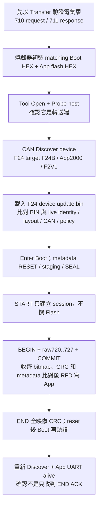

| 層級 | 處理內容 | 不應處理的內容 |
| --- | --- | --- |
| Tool | BIN checksum／metadata；對比 live device；送 CAN protocol | 不根據 COM 名稱猜 MCU；不可用 PC override 繞過 geometry |
| F24 (MCU CAN host) App | Host Link 解包、generic CAN burst、等待 response | 不解 F24/F13 device Flash address 或 Boot state |
| F24 (MCU CAN device) Boot | CAN decode、metadata staging、block／CRC／replay、RFD、launch | 不接受 host BUR1 或不相容 device 映像 |
| F24 device App | 自有完整 IRQ table、INFO／ENTER、正常功能 | 不取代 Boot 的最終 Flash 驗證 |

普通 vectors `0x04..0x7C` 的轉送介面在 Boot 一次固定。不同 App 可自行增加／更換 ISR，
只需將無 `vect=` 的普通中斷函式加入自己的 MTPJ 與 JSON，再編譯 App；
只要 MCU、更新協定、layout、IRQ ABI 與 min Boot 相容，就不必因 IRQ 使用清單改變重燒 Boot。
硬體 BRK 不轉送；App 表保留 RETB fallback。更換 CAN／I2C 等更新協定仍是另一項相容性設計。

### 工程與驗證界線

Metadata 的可編輯／自動產生欄位、JSON 修改前後與新增 ISR 的完整流程，請讀
[F13／F24 device 實作教學](https://released.github.io/slide_boot_loader_for_RL78/#device-metadata-vector-workshop)。

三個 F24 device 專案置於同一父目錄；Boot 的 `common` 提供共用 board／clock／CAN backend，
App 與 Transfer 各使用自己的 SC。Boot 內附 F24 RFD 來源，不依賴個人的工作區路徑。
在 Boot 目錄執行 `build.ps1 -Kind all`；之後只改 App 可用 `-Kind app`。
MTPJ pre-build 產生啟動／vector projections，post-build 強制 ROM／RAM／向量／封裝檢查。

初裝 Boot 使用 `boot0000_1FFF.hex`，App 使用 `*_flash.hex`；CAN 更新只用 `*_update.bin`。
**不可直接燒 App 原始 MOT**：它含 device file 自動產生的實體記錄，封裝後才會排除。
不要用 Transfer 整機映像作為 App BIN，也不要在 Misc 更新外部 device。

目前已完成三專案 clean rebuild、8 KiB／512-byte spare guard、實際 vector／RETI bytes、
RFD RAM 位址與 map-visible reference 檢查、IRQ stack model、production C RAM metadata／block fault model，
以及現有 Tool production parser 對實際 F24 BIN 的驗證。這不是整顆 MCU 模擬器或實板測試。
CAN backend 的 register-level model、波形／ACK、RFD 實際擦寫、reset 後 App、斷線及斷電矩陣仍待驗證。
現有公開下載區的 F24 firmware 是 **host**；本節的 **device** 工程不可與其互換。
<!-- F24_DEVICE_END -->

<!-- DEVICE_WORKSHOP_BEGIN -->
<a id="device-metadata-vector-workshop"></a>

## Device 開發實作：編輯 Metadata、增加 IRQ、產生並驗證 App

本章只處理 **F13 (MCU CAN device)** 與 **F24 (MCU CAN device)**，不調整 F24 host。
兩者都由 CAN 更新 App；不要套用 host 的 BUR1、`0x5000`、Misc 或 host 專用產表腳本。
這裡的「編輯」是修改 firmware 專案來源，再透過 pre-build／post-build 產生映像，
不是在 Tool 手動改 BIN。生成的表、identity header、size 與 CRC 不應手動修補。

### A. 先辨識專案與共用介面

| 項目 | F13 (MCU CAN device) | F24 (MCU CAN device) |
| --- | --- | --- |
| Boot／App | `RL78_F13_Boot_loader_CAN`／`RL78_F13_Boot_loader_CAN_app` | `RL78_F24_Boot_loader_CAN`／`RL78_F24_Boot_loader_CAN_app` |
| MCU／Flash driver | R5F10BMG／FSL | R7F124FPJ5xFB／RFD，忙碌期間必要程式在 RAM |
| Target／IRQ ABI | `0xF13B`／F1V1 | `0xF24B`／F2V1 |
| Boot／App 起點 | 8 KiB／`0x2000` | 8 KiB／`0x2000` |
| App capacity | `0x1E000`，120 KiB | `0x3DC00`，247 KiB；最後 1 KiB 保護 |
| 更新契約 | CAN3、image format 6、CAN protocol 5、Classical 500K | 同樣格式／協定，但身分與 geometry 不同 |
| 版本／build 編輯來源 | App `app_image.json` | App `app_image.json` |
| IRQ 編輯來源 | 各 App 的 `app_irq_handlers.json`＋已註冊 ISR C 檔 | 同左 |

App 與 matching Boot 以原名稱放在同一父目錄；保留相鄰 Boot 提供的腳本／共用來源。
F13 可由 [Boot](https://github.com/released/RL78_F13_Boot_loader_CAN)／[App](https://github.com/released/RL78_F13_Boot_loader_CAN_app) 取得。
F24 device 請使用配套的上述 CAN device 工程；Tool repository 的 `Bridge_app` 是 host，不能替代。
獨立 Transfer 專案是通訊測試整機映像，不是可載入的 App 更新 BIN。

#### A1. ftable.inc 與兩份 JSON，哪個較容易修改？

| 格式 | 一般使用者的閱讀／修改成本 | 現行用途與注意事項 |
| --- | --- | --- |
| `ftable.inc`／metadata `.inc` | 使用者不必理解 `.EQU` 或資料排列才可升版 | **生成檔，不再手改**；F13 為 `ftable.inc`，F24 device 為 `app_metadata.generated.inc` |
| `app_image.json` | 欄位少、可用名稱表達用途，日常版本／build 修改較直覺 | 兩個 device 都用相同五欄 schema；JSON 不接受裸 `0x` 數字，所以 version 使用 hex 字串，build 使用十進位整數；不可加註解 |
| `app_irq_handlers.json` | 直接列出 vector → handler，與 image 設定分開較不易誤動 metadata | 兩個 device 都使用；仍需核對硬體 vector、註冊 ISR 及保留原 mapping |

兩個 device 現在都統一為兩份 JSON 分工；`.inc`、identity header、向量表交給各自產生器。
不保留「沒有 JSON 就讀取手寫 ftable.inc」的 fallback。舊 App 專案須先新增 matching JSON，
保留原 version／build，然後執行 App-mode 產生與 clean rebuild；不能只改副檔名。

### B. Metadata：哪些可改、哪些不能手改？

| 分類／欄位 | 編輯或產生位置 | 只更新 App？ |
| --- | --- | --- |
| App version／build | 兩者都編輯 `app_image.json` 的 `version`／`build` | 是，仍須符合既有契約 |
| image_size／CRC 地址／CRC32 | 由 linker map 與 post-build 封裝決定 | 自動產生，不填預估大小、不用 hex editor 改 |
| Target、MCU part／family、Flash geometry、CAN IDs／rate | Boot 契約、App producer、linker／backend、封裝與 live INFO 必須一致 | 不能只改 App；須評估並安裝 matching Boot/App |
| Role／transport／IRQ ABI／minimum Boot | matching Boot config／producer 產生；Boot／Tool 均驗證 | 契約欄位；不能藉改字串或 JSON 繞過更新路徑 |
| Metadata reserved `0x80..0xFF` | Producer 固定填 `FF` | 不可直接填入新功能；需定義新版契約並同步所有驗證器 |
| JSON 的 `target`／`role`／`transport` | 是契約核對值，不是任意可選 MCU／介面 | F13 為 `0xF13B`，F24 為 `0xF24B`；兩者皆 `DEVICE_APP`／`CAN` |

Packed version 採 `(major << 16) | (minor << 8) | patch`；每部分一個 byte。
以下版本／日期是教學輸入，不是交付配套版本要求；build 是十進位整數，不能寫成 JSON 字串。
App 版本、Boot 版本與 minimum Boot 是不同欄位；App 升版不應順便修改 minimum Boot。

#### B1. F13：編輯 app_image.json

修改前：

```json
{
  "version": "0x00010500",
  "build": 20261015,
  "target": "0xF13B",
  "role": "DEVICE_APP",
  "transport": "CAN"
}
```

修改後（僅示範 App 資訊變更）：

```json
{
  "version": "0x00010501",
  "build": 20261016,
  "target": "0xF13B",
  "role": "DEVICE_APP",
  "transport": "CAN"
}
```

App pre-build 讀 JSON 與 matching Boot 的 `can_boot_config.h`，產生 `ftable.inc`／`app_identity.h`；
`ftable_RL78_F13.asm` 依生成常數排列 CAN3 metadata，讓 App INFO 與 BIN 使用同一版本／build。
`IMAGE_SIZE_POST_BUILD = 0xFFFFFFFF` 由產生器保留，封裝才填實際大小；不要手改 `.inc`。
改 target／分區等固定契約時，仍須另行同步 Boot config、linker、producer 與 validator。
不能只改 metadata 的某一個 byte，就把已 link 的程式搬到不同 address。

#### B2. F24 device：編輯 app_image.json

修改前：

```json
{
  "version": "0x00010000",
  "build": 20261015,
  "target": "0xF24B",
  "role": "DEVICE_APP",
  "transport": "CAN"
}
```

修改後（保留契約欄位）：

```json
{
  "version": "0x00010001",
  "build": 20261016,
  "target": "0xF24B",
  "role": "DEVICE_APP",
  "transport": "CAN"
}
```

`prepare_projects.py` 核對 JSON，產生 `app_identity.generated.h`、`app_metadata.generated.inc`
與其組語 wrapper；linker 將該 256-byte metadata 放到 `0x2100`。
`package_images.py` 比對已編譯 metadata 與同一 JSON／Boot contract，再填實際長度與尾端 CRC。
JSON 不是整份 metadata 編輯器；geometry、IRQ ABI、CAN routing 等由固定契約提供。
把 `transport` 改成 I2C、改 role 或改 target，不會自動變成另一種 bootloader，應被拒絕。

兩邊 JSON 必須剛好有 `version`／`build`／`target`／`role`／`transport` 五個欄位；
version 使用 `0x`＋8 位 hex 的字串，target 使用 `0x`＋4 位 hex 的字串。
build 必須為整數 `0..4294967294`，不能是字串、小數或布林值；version `0xFFFFFFFF` 不接受。
未知或缺少欄位也會拒絕。合法格式仍不代表 target／role／transport 可任意更改。

#### B3. 用 address 與 byte 核對結果

兩個 device 的 App 起點相同，以下 address 相同；**欄位值與 image capacity 仍不同**。
完整欄位見 [Flash／Metadata byte 對照](https://released.github.io/slide_boot_loader_for_RL78/#flash-metadata-can-reference)；
此處兩個 device 使用 CAN3，不可套用該參考頁中 F24 host 的 BUR1 欄位表。

| 欄位 | Metadata offset | BIN offset | 絕對 Flash address | 本例預期 |
| --- | --- | --- | --- | --- |
| App version | `0x10..0x13` | `0x110..0x113` | `0x2110..0x2113` | F13：`01 05 01 00`；F24：`01 00 01 00` |
| App build | `0x14..0x17` | `0x114..0x117` | `0x2114..0x2117` | 20261016，LE32 |
| Actual image size | `0x18..0x1B` | `0x118..0x11B` | `0x2118..0x211B` | 必須等於 BIN 檔案長度，不是 capacity |
| Policy／IRQ ABI | `0x60..0x6F` | `0x160..0x16F` | `0x2160..0x216F` | DEVICE_APP、允許 CAN、各自 ABI 與 minimum Boot |
| Reserved FF | `0x80..0xFF` | `0x180..0x1FF` | `0x2180..0x21FF` | 128 bytes 全 `FF` |
| Tail CRC32 | 不在 metadata 裡 | `actual size - 4` | `0x2000 + actual size - 4` | 前面全部 BIN bytes 的 CRC32，LE32 |

#### B4. Metadata 產生路徑

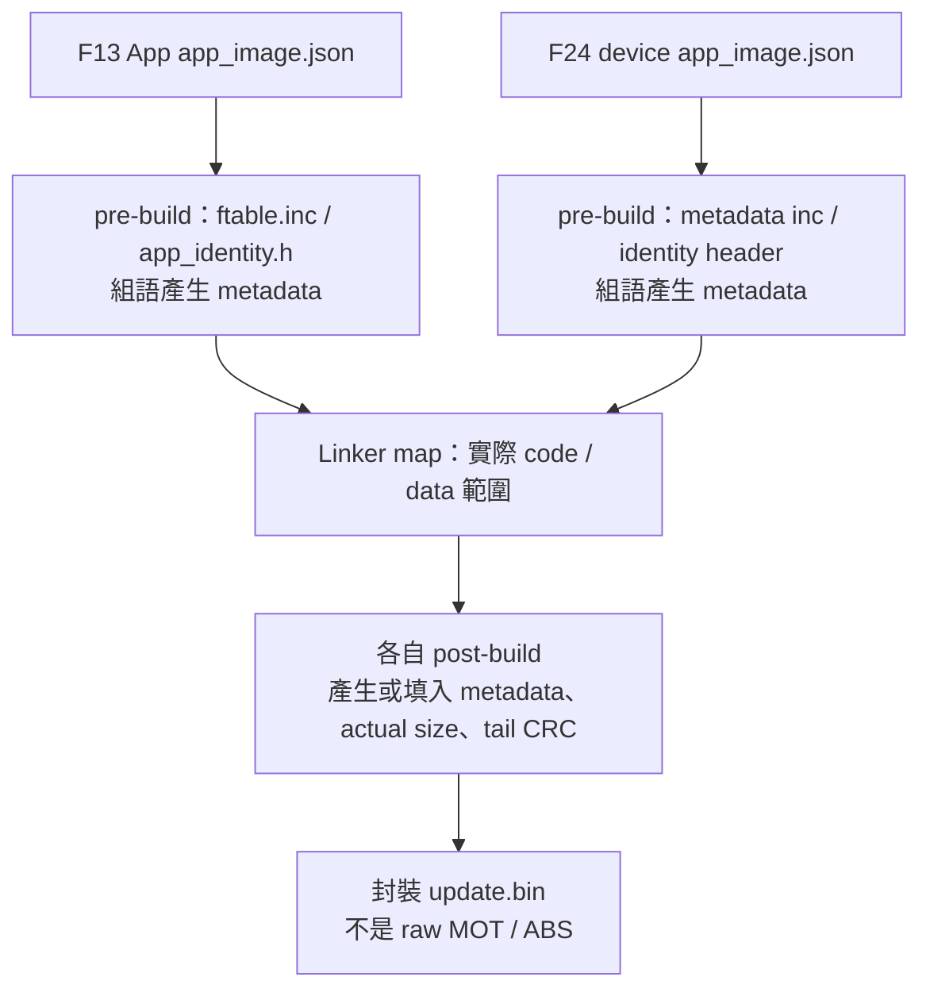

### C. App Vector Table：新增一個 IRQ 的完整範例

本例使用兩個 device header 都定義的 `INTP1 = 0x0A`；不是因為兩顆 MCU 的所有向量皆相同。
JSON key 是 **實體 vector byte address**，不是 IRQ 序號、App slot 或周邊 pin。
兩者的 App slot 計算為 `0x2000 + 0x0A × 2 = 0x2014`，即 BIN offset `0x14`。

#### C1. 加入一般 ISR，並在 App MTPJ 註冊來源

在自己的 App 新增 `app_extra_irq.c`，透過 CS+ 將它加入該 App 的編譯來源。
以下函式只清旗標並記錄事件；**不會初始化或啟用 INTP1**。

```c
#include "r_cg_macrodriver.h"

volatile unsigned char g_app_aux_irq_count;

#pragma interrupt app_aux_irq
void __near app_aux_irq(void)
{
    /* Clear the source flag and capture bounded state only. */
    PIF1 = 0U;
    g_app_aux_irq_count++;
}
```

ISR 必須 global、非 static、無 `vect=`，由編譯器產生 RETI；不要寫成普通 callback，
也不能另設實體 `.VECTOR` 或 `-VECTN` 與 Boot 競爭。
啟用中斷之前，另依實際板子完成 pin／edge／priority／pending flag／mask 初始化；
範例未提供可直接接線使用的 INTP1 pin 設定。未用 IRQ 應保持 mask。
SC／Code Generator 重產後也要核對：原始生成 ISR 若仍帶 `vect=`，不能直接照搬到 split App。

#### C2. F13 mapping：保留原有項目，新增 0x0A

修改前：

```json
{
  "0x08": "r_intc0_interrupt",
  "0x16": "r_uart0_interrupt_send",
  "0x18": "r_uart0_interrupt_receive",
  "0x1E": "r_tmr_rj0_interrupt"
}
```

修改後：

```json
{
  "0x08": "r_intc0_interrupt",
  "0x0A": "app_aux_irq",
  "0x16": "r_uart0_interrupt_send",
  "0x18": "r_uart0_interrupt_receive",
  "0x1E": "r_tmr_rj0_interrupt"
}
```

#### C3. F24 device mapping：保留自己的 timer

修改前：

```json
{
  "0x2E": "Device_TimerIsr"
}
```

修改後：

```json
{
  "0x0A": "app_aux_irq",
  "0x2E": "Device_TimerIsr"
}
```

不能把 F13 的 UART／timer mapping 整份複製給 F24；也不能用只有新 IRQ 的 JSON 覆蓋舊清單。
改函式名稱要同步 C pragma／定義與 JSON。移除 mapping 前先停用其周邊 IRQ，避免 default RETI 反覆觸發。

#### C4. 生成表中應看到什麼？

| 檢查位置 | 修改前 | 修改後 |
| --- | --- | --- |
| F13 `app_irq_table.inc` 的 vector `0x0A` | `BR !!f13_app_default_isr` | `BR !!_app_aux_irq`，slot `0x2014` |
| F24 device `device_vectors.asm` 的 vector `0x0A` | `BR !!device_default_isr` | `BR !!_app_aux_irq`；table start `0x2000` |
| App map | 沒有新 ISR symbol | `_app_aux_irq` 有有效 code address；應為 interrupt ISR |
| 最終 BIN 的 offset `0x14..0x17` | 指向原 default ISR | `EC`＋新 ISR 的 3-byte little-endian 絕對 address |
| Boot 的實體 vector／來源 | 固定轉送介面 | 不因 App 函式名或使用清單改變 |

Assembler symbol 前綴 `_` 由 generator 加入，JSON 寫 `app_aux_irq`，不要寫 `_app_aux_irq`。
表有固定 64 個 4-byte slot，不是每增加一個 IRQ 就把後面的 entry 往後推。
App reset slot 進 `_start`，不是直接進 `main`；`0x02` 仍是保留位置，不能加入 JSON。
F13 此 slot 填 `FF`，F24 device 產生 default branch；兩者都不代表可啟用 reserved IRQ。
physical BRK `0x7E` 不由 Boot 轉送；App 的保留 BRK slot 使用 RETB，不是一般 IRQ 的 RETI。

#### C5. IRQ 的產生與執行路徑

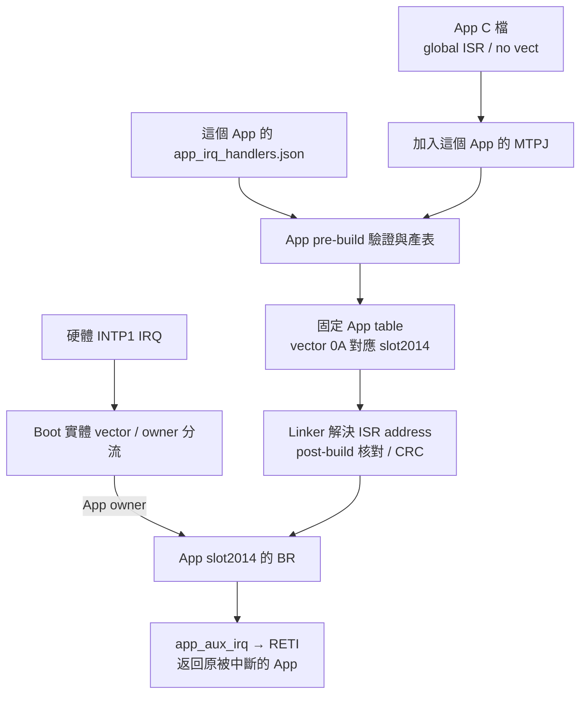

### D. 產生命令：F13 與 F24 device 分開執行

下列是相鄰工程的相對路徑；在自己的 App 根目錄執行。先備份／記錄 matching Boot image 雜湊。
範例只變動 App 資訊及一般 IRQ，**不應呼叫 Boot 產表或 Boot rebuild**。
使用 Windows PowerShell 執行命令；先安裝工程對應的 CS+／CC-RL。F24 device 另需 Python 3，
以 `python --version` 確認可呼叫。CS+ 開啟的是自己的 App `.mtpj`，建置組態為 `DefaultBuild`。
下方 PowerShell 腳本以單次 `-ExecutionPolicy Bypass` 執行，不需永久更改系統執行原則。

#### D0. 第一次操作：逐步完成一次 App 變更

1. 選定 F13 或 F24 **device** 的 matching Boot/App，按原名稱放在同一父目錄；先確認舊版可建置。
2. 備份現有 Boot HEX、App 更新 BIN 與兩份 JSON，記錄 Boot image 雜湊。舊 F13 若尚無 image JSON，先按 B1 範例新增，保留自己的原版本／build。
3. 開啟 App 的 `app_image.json`，只修改 `version`／`build`；對照 B1 或 B2，保留原 target、DEVICE_APP 與 CAN。存成 UTF-8 JSON，不加註解。
4. 若只升版本，跳到第6步。若新增 IRQ，依 C1 新增正常 ISR C 檔，並在 CS+ **此 App** 的 MTPJ 加入來源；還不要啟用硬體 IRQ。
5. 編輯這個 App 的 `app_irq_handlers.json`，保留舊清單，再加入 `0x0A` 範例或已核對的合法 vector／handler；不要用其他 MCU 的整份清單覆蓋。
6. 從 App 根目錄執行 D1 或 D2 的產生命令，再執行 CheckOnly。錯誤先修正 JSON／MTPJ／ISR，不手改 `.inc`、identity 或 table。
7. Clean Rebuild **App**，確認 pre-build 與 post-build 都成功。對照下方產物表，確認新 table、version／build、實際 BIN 長度與 CRC；不要沿用前次失敗後留下的舊檔。
8. 在 Tool CAN TAB 載入該 App 的 `*_update.bin`，依 E 節核對新版本、Metadata VALID 與 CRC MATCH；這一步不寫 MCU。
9. Open + Probe host、Discover **device**，核對 live target／layout／CAN／IRQ ABI／minimum Boot；相容才 Enter Boot 並開始更新，不以離線 BIN 取代 live 身分。
10. END／reset 後另外確認新版 App INFO／UART、既有 IRQ 與新 IRQ；最後比較 Boot 區／映像未變。硬體 IRQ 啟用前的初始化與故障測試仍需另作。

只升 App 版本時不必新增 ISR；只新增 IRQ 時也不必更改 target 或 Boot 版本。

#### D1. F13 device

```powershell
# Generate this App's metadata INC, IRQ table and identity; never Boot.
powershell.exe -NoProfile -ExecutionPolicy Bypass `
  -File "..\RL78_F13_Boot_loader_CAN\generate_irq_contract.ps1" `
  -Mode App -AppProject "."

# Read-only freshness check; run after generating, not instead of generating.
powershell.exe -NoProfile -ExecutionPolicy Bypass `
  -File "..\RL78_F13_Boot_loader_CAN\generate_irq_contract.ps1" `
  -Mode App -AppProject "." -CheckOnly
```

然後在 CS+ **Clean Rebuild 此 App**。原有 pre-build 保留上述 App-mode 命令，
post-build 保留 `generate_update_image.ps1`；該腳本依 map／App HEX 封裝，並非只產表就有新 BIN。
Tool 的 `scripts/verify_f13_artifacts.ps1` 可作後續檢查，需指定正確 Boot／App project。
F13 目前仍保留參考 MTPJ／map／輸出檔名與 sibling Boot 假設；若改專案名／搬目錄，
必須另外對齊 source／include／hook、`-MapFile`、輸出命名、checker 及 Boot HEX 來源。

#### D2. F24 device

```powershell
# Update this App's projections / registered project settings, never Boot.
python ..\RL78_F24_Boot_loader_CAN\tools\prepare_projects.py --kind app --project .

# Read-only freshness / registration check.
python ..\RL78_F24_Boot_loader_CAN\tools\prepare_projects.py --kind app --project . --check

# Clean rebuild and mandatory map / image packaging checks.
powershell.exe -NoProfile -ExecutionPolicy Bypass `
  -File "..\RL78_F24_Boot_loader_CAN\build.ps1" `
  -Kind app -AppProject "."
```

CS+ pre-build 使用 `prepare_projects.py --kind app --project . --artifacts-only`；
post-build 使用 `package_images.py --kind app --project .`。`--artifacts-only` 不會修正 MTPJ 登錄／選項。
只改一般 App 功能，不用省略 kind 的 all-mode prepare／build；SC 重產後先重新 prepare **app**。
若改名或搬移，仍須修正相對 source／include／hook 路徑；不是任意 standalone App 加 JSON 即可。
目前 F24 device prepare 使用相對路徑；Boot 與 App 必須在同一磁碟，不能跨磁碟直接產生工程。

| 產物 | F13 device | F24 device |
| --- | --- | --- |
| Metadata `.inc`（不可手改） | `ftable.inc` | `app_metadata.generated.inc`＋`app_metadata.generated.asm` wrapper |
| App pre-build identity | `app_identity.h` | `app_identity.generated.h` |
| App vector table | `app_irq_table.inc` | `device_vectors.asm` |
| 後續 CAN 更新 | `DefaultBuild/RL78_F13_Boot_loader_CAN_app_update.bin` | `DefaultBuild/<MTPJ stem>_update.bin` |
| 燒錄器初裝 App | `DefaultBuild/flash_app_variable_CRC.hex` | `DefaultBuild/<MTPJ stem>_flash.hex` |
| matching Boot 初裝 | 先核對 `boot_app.hex` 的來源／產生時間；或 matching Boot＋App HEX | matching `boot0000_1FFF.hex`＋封裝 App HEX，依燒錄器設定核對擦除範圍 |

F13 若找不到 sibling Boot HEX，post-build 不會產生新的合併檔；舊 `boot_app.hex` 可能仍留著。
任何 build／guard 失敗，舊 BIN 也可能仍在，不能以「檔案存在」判定這次成功。
raw App MOT／ABS 可能包含低位實體記錄，不應代替已封裝的 App HEX 或 update BIN。
post-build 會拒絕 JSON 與已編譯 metadata／IRQ 表不同的舊輸出，不能改完 JSON 只重跑封裝。
F13 也直接比對 App map、實際 BR 目的地與 mapped ISR 的 RETI，不依賴 Boot map 才能執行這項 App 檢查。
CheckOnly 發現手改／過期生成檔時只報錯、不修復；先重產，再 clean rebuild。

### E. 驗證新 BIN 與向量，而非只看 build success

| 步驟 | 要檢查的結果 | 未通過時 |
| --- | --- | --- |
| 產表 | 新 JSON entry 對應到正確 slot；source 有且僅有對應的正常 ISR | 不手改生成檔，修 source／MTPJ／JSON |
| map／向量 bytes | table 在 `0x2000`，metadata 不佔 code；BR 指向 App code，ISR 應有 RETI | 不更新 MCU；先查 linker／pragma／註冊 |
| BIN offline | size 等於檔長、metadata reserved FF、CRC match、role／CAN／ABI 正確 | 不用修改 Tool 欄位繞過 |
| Tool Load Update Image | Metadata VALID、CRC MATCH、新 version／build；這仍只是 offline 資訊 | 重查 producer／封裝及實際載入檔案 |
| Discover live device | MCU／target／geometry／CAN／IRQ ABI／minimum Boot 相容 | 不送 START；不能把載入 BIN 身分當 live 身分 |
| 更新與 reset | END 成功後，確認 App 新版 INFO／UART、正常與新增 IRQ，Boot 區未變 | 保留 log／trace，分清 END ACK 與 App 執行證據 |

#### E1. Tool 驗證與更新後 App 證據

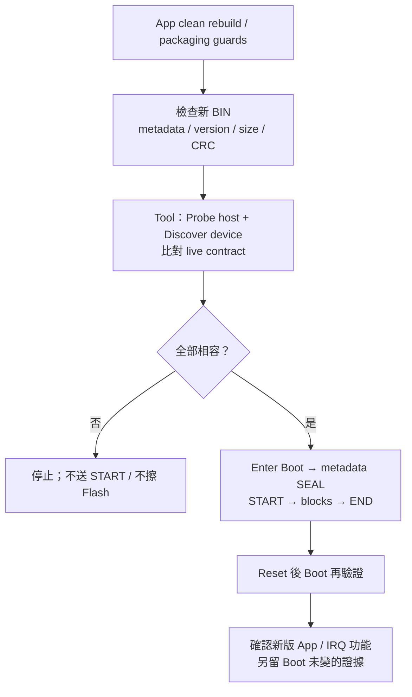

本章的 command／JSON／byte 範例以現有來源與暫存產表測試核對；不是已在板上啟用新 INTP1。
F24 device 的 CAN／RFD 實板更新與故障矩陣仍需另驗；F13 已有正常更新紀錄也不代表此新增 IRQ 已驗證。
CRC 是完整性檢查，不是簽章或防回滾；不完整更新也不等於可以 rollback 到舊 App。

### F. 常見錯誤與只換 App 的邊界

| 變更／錯誤 | 處理原則 |
| --- | --- |
| 只改 App version／build 或相容的一般 IRQ | 產表、重建與封裝 App；不因 ISR 名稱改動重燒 Boot |
| 改 MCU／App start／geometry／IRQ ABI／更新協定 | 不是上述 App-only 教學；同步 Boot、App、producer、Tool／validator 並重新驗證 |
| JSON key 寫 `0x2014`、IRQ index 或保留／奇數 vector | 應寫合法實體 byte address，本例為 `0x0A`；不能跨 MCU 照抄 |
| C 檔只複製進資料夾，沒有加入 MTPJ | generator 或 linker 應拒絕；先修正專案登錄 |
| ISR 帶 `vect=`／static／普通函式，或 symbol 拼錯 | 改成正常 global interrupt ISR，再核對 JSON 與 generated table |
| 覆蓋原有 UART／timer mappings | 先恢復仍在用的清單；新增不是替換整份 JSON |
| 手改 `.inc`、generated table、identity、BIN bytes／CRC | 回到兩份 JSON／ISR 來源修改並重建；CheckOnly 不會替你更新生成檔 |
| 拿 host 的 `prepare_f24_app_irq.ps1`／BUR1／Misc 套 device | 使用本章 F24 device 工具鏈；兩個角色不可混用 |

同一份 Boot 可搭配 App A／B 的不同 ISR 清單，前提是完整共同契約不變。
「Boot 不必因新增普通 IRQ 修改」不等於硬體初始化、stack、pending flag 或 IRQ 行為不需驗證。
<!-- DEVICE_WORKSHOP_END -->

<!-- PUBLIC_RESOURCES_BEGIN -->
<a id="downloads"></a>

## 下載與操作總覽

本頁現行CAN範例的角色為 **F24 (MCU CAN host)** 與 **F13 (MCU CAN device)**。
Host透過Host Link連接PC並橋接CAN，device是CAN另一端被更新的MCU。
後續 **F24 (MCU CAN device)** 的Boot/App是另一組專案與映像；
不可把下列F24 host韌體當成F24 device韌體。角色由專案與metadata決定，不由MCU型號推斷。
F24 host自身的App仍經Misc／UART更新；「CAN host」不表示其自身Boot改用CAN更新。

以下連結提供Tool、Host board與Device board的公開來源；不用原開發者的本機路徑。
首次安裝Boot使用燒錄器，之後更新App才使用對應的Tool流程；不可把Host與Device映像互換。

| 項目 | 下載／原始碼 | 適用方式 |
| --- | --- | --- |
| PC Tool | [Windows EXE](https://raw.githubusercontent.com/released/simple_renesas_isp_tool/main/build/FirmwareUpgradeTool.exe)／[完整原始碼](https://github.com/released/simple_renesas_isp_tool) | Windows x64；先安裝實際VCOM所需driver，再選COM並Probe Host |
| F24 (MCU CAN host) Boot | [Boot專案](https://github.com/released/simple_renesas_isp_tool/tree/main/firmware/RL78_F24_Bridge_boot)／[Boot MOT](https://raw.githubusercontent.com/released/simple_renesas_isp_tool/main/firmware/RL78_F24_Bridge_boot/DefaultBuild/RL78_F24_Bridge_boot.mot) | 首次以燒錄器安裝；Misc不更新Boot |
| F24 (MCU CAN host) App | [App專案](https://github.com/released/simple_renesas_isp_tool/tree/main/firmware/RL78_F24_Bridge_app)／[Host App BIN](https://raw.githubusercontent.com/released/simple_renesas_isp_tool/main/firmware/RL78_F24_Bridge_app/DefaultBuild/RL78_F24_Bridge_app_bridge_update.bin) | Misc／UART115200；完成後明確Run Validated Bridge App |
| F13 (MCU CAN device) Boot | [Boot專案](https://github.com/released/RL78_F13_Boot_loader_CAN)／[Boot HEX](https://raw.githubusercontent.com/released/RL78_F13_Boot_loader_CAN/main/DefaultBuild/boot0000_1FFF.hex) | 首次以燒錄器安裝matching Boot/App；不要保留不相容舊App |
| F13 (MCU CAN device) App | [App專案](https://github.com/released/RL78_F13_Boot_loader_CAN_app)／[初裝合併HEX](https://raw.githubusercontent.com/released/RL78_F13_Boot_loader_CAN_app/main/boot_app.hex)／[CAN更新BIN](https://raw.githubusercontent.com/released/RL78_F13_Boot_loader_CAN_app/main/DefaultBuild/RL78_F13_Boot_loader_CAN_app_update.bin) | 合併HEX供燒錄器初裝；CAN TAB載入_update.bin更新Device App |
| F13 (MCU CAN device) 通訊測試 | [Transfer範例](https://github.com/released/RL78_F13_CAN_Transfer) | Custom Transfer，不擦寫Flash；不是Boot/App更新映像 |

F24 firmware需下載完整Tool repository，保留firmware共用來源與scripts，不能只取Boot/App子目錄。
F13 Boot與App需以原repository名稱放在同一父目錄，App會引用相鄰Boot；Download ZIP
解壓後請移除-main尾碼。先build Boot，再build App；版本、metadata、IRQ ABI與CRC仍須相容。

### 六個操作與流程圖入口

| 想了解的動作 | 網站操作／流程圖 | Tool docs中的詳細說明 |
| --- | --- | --- |
| Tool／F24 (MCU CAN host) 流程與責任 | [Tool與bridge動作圖](https://released.github.io/slide_isp_tool_for_RL78/#tool-bridge-flow) | [多介面架構與流程](https://github.com/released/simple_renesas_isp_tool/blob/main/docs/MULTIBUS_TOOL_GUIDE_zh-TW.md) |
| F13 (MCU CAN device) Boot啟動、ENTER與逾時 | [F13 Boot→App完整條件圖](https://released.github.io/slide_isp_tool_for_RL78/#f13-boot-flow) | [Boot decision與更新流程](https://github.com/released/simple_renesas_isp_tool/blob/main/docs/F13_BOOT_UPDATE_FLOW_zh-TW.md) |
| Tool operation | [COM／Host識別與操作起點](https://released.github.io/slide_isp_tool_for_RL78/#tool-operation) | [共用畫面與操作指南](https://github.com/released/simple_renesas_isp_tool/blob/main/docs/SHARED_CONSOLE_BRIDGE_GUIDE_zh-TW.md) |
| 更新F24 (MCU CAN host) App | [Misc：Host App更新圖與RUN](https://released.github.io/slide_isp_tool_for_RL78/#host-bridge-firmware) | [F24 UART自更新協定](https://github.com/released/simple_renesas_isp_tool/blob/main/docs/BRIDGE_SELF_UPDATE_PROTOCOL.md) |
| 更新F13 (MCU CAN device) App | [CAN：驗證、Enter Boot、更新與確認](https://released.github.io/slide_isp_tool_for_RL78/#f13-device-update) | [CAN區塊更新及保護](https://github.com/released/simple_renesas_isp_tool/blob/main/docs/CAN_BLOCK_TRANSFER_V5_zh-TW.md) |
| Boot code如何移植 | [Boot/App移植與向量工程](https://released.github.io/slide_boot_loader_for_RL78/#boot-app-porting) | [完整移植指南](https://github.com/released/simple_renesas_isp_tool/blob/main/docs/RL78_BOOT_APP_PORTING_GUIDE_zh-TW.md) |

<a id="tool-bridge-flow"></a>

先用[CAN 更新逐層導讀](https://released.github.io/slide_isp_tool_for_RL78/#can-update-walkthrough)
對照 Tool 操作／BIN 驗證、F24 UART↔CAN 轉送、F13 metadata／receive／Flash 的表格與流程圖；
[MD](https://github.com/released/simple_renesas_isp_tool/blob/main/docs/CAN_UPDATE_WALKTHROUGH_zh-TW.md)／[PDF](https://github.com/released/simple_renesas_isp_tool/blob/main/docs/CAN_UPDATE_WALKTHROUGH_zh-TW.pdf)可離線閱讀。

Flash mapping、metadata全部256個byte的address／範例值、產生與解析程式，以及CAN逐byte格式，
請讀[Flash／Metadata／CAN移植對照](https://released.github.io/slide_boot_loader_for_RL78/#flash-metadata-can-reference)。

### Tool／F24 (MCU CAN host)／F13 (MCU CAN device) 動作分工

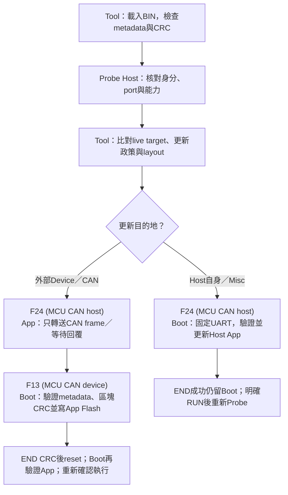

錯映像或不相容條件先封鎖，不送START／BEGIN。完整故障、斷電與高速可靠性仍須實板驗證；
CRC是完整性檢查，不是簽章。F13正常更新完成不等於已看到reset後App執行；兩者應分別留證。
<!-- PUBLIC_RESOURCES_END -->

<a id="f13-reference-projects"></a>

## F13 (MCU CAN device) 範例原始碼

| 專案 | 用途 | Tool workflow |
| --- | --- | --- |
| [RL78_F13_CAN_Transfer](https://github.com/released/RL78_F13_CAN_Transfer) | 不擦寫Flash的通訊benchmark，先確認CAN request／response | Custom Transfer |
| [RL78_F13_Boot_loader_CAN](https://github.com/released/RL78_F13_Boot_loader_CAN) | Device Boot：Flash更新、映像驗證與向量轉送 | CAN Upgrade |
| [RL78_F13_Boot_loader_CAN_app](https://github.com/released/RL78_F13_Boot_loader_CAN_app) | Matching App：metadata、CRC、INFO／ENTER及App更新映像 | CAN Upgrade |

Boot與App請下載到同一父目錄，目錄分別保留為RL78_F13_Boot_loader_CAN與
RL78_F13_Boot_loader_CAN_app；使用Download ZIP時須移除解壓目錄的-main尾碼。
App會引用相鄰Boot的board來源、設定與產表腳本，不能只下載App就直接build。
先build Boot再build App；初裝用boot_app.hex，後續CAN更新用_update.bin。
完整取得方式見[Boot/App範例與移植說明](../slide_boot_loader_for_RL78/#boot-app-porting)。

## Firmware 開發者入口：自訂 Bootloader／App 移植

如果只想知道 MCU Boot/App 的向量、startup、linker、RAM、建置與安裝設定，
請先讀 [RL78 Boot/App 移植指南](../slide_boot_loader_for_RL78/#boot-app-porting)。
內容區分沿用現有 Boot／自行開發更新流程，列出 F13/F24 差異、必要檔案、
App-local 產表與 App-only 更新的前提；不要求先熟悉本 Tool，亦不等於任意 App 可直接載入。

需要逐byte修改時，再讀[Flash mapping／Metadata／CAN格式對照](https://released.github.io/slide_boot_loader_for_RL78/#flash-metadata-can-reference)：
完整256個metadata address、實際BIN範例值、欄位來源程式與每個CAN command的Byte0..7。
技術內容由同名 canonical MD 的 RL78_PORTING block 同步，避免兩份手動維護。
本頁繼續負責 Tool／bridge 操作；兩者都保留實板尚待驗證標示。

<!-- CAN_WALKTHROUGH_BEGIN -->
<a id="can-update-walkthrough"></a>

## CAN 更新逐層導讀：Tool → F24 (MCU CAN host) → F13 (MCU CAN device)

本篇用同一條更新路徑，把「使用者按什麼、傳什麼、哪個函式處理、何時改到 Flash」對起來。
先讀本篇理解流程，再查[Flash／metadata 全部 byte 位址與 CAN 格式](https://released.github.io/slide_boot_loader_for_RL78/#flash-metadata-can-reference)。
[教學原稿](https://github.com/released/simple_renesas_isp_tool/blob/main/docs/CAN_UPDATE_WALKTHROUGH_zh-TW.md)與
[可下載 PDF](https://github.com/released/simple_renesas_isp_tool/blob/main/docs/CAN_UPDATE_WALKTHROUGH_zh-TW.pdf)可供離線對照。

本篇只描述現有 CAN Upgrade：Classical CAN、控制 ID `0x700/0x701`、raw data IDs `0x720..0x727`，
F13 App 起點 `0x2000`、metadata 位於 image offset `0x100..0x1FF`。這些是此範例契約，不是所有 MCU 的固定值。
F24 自身 App 更新走 Misc／UART；I2C／未來 Device UART 不可直接沿用本篇的 CAN wire 格式。

### A. 先分清三層責任與三種資訊

| 層 | 輸入與輸出 | 負責判斷 | 不負責的事 |
| --- | --- | --- | --- |
| PC Tool | BIN／UI → Host Link UART commands | 離線 BIN、更新政策、live target 相容性；建立 CAN 更新封包 | 不直接操作 F13 Flash register |
| F24 (MCU CAN host) App | Host Link → CAN TX；CAN RX → Host Link response | UART framing／CRC16、generic CAN record、傳送完成與等待條件 | 不解析 CAN3、不知道 F13 App 起點、不決定 F13 擦寫 |
| F13 (MCU CAN device) Boot | CAN command／raw data → ACK | metadata 契約、RAM 區塊、CRC、Flash 邊界、完整映像及 Boot→App | 不解析 PC Host Link、不需要知道 COM 名稱 |
| F13 (MCU CAN device) App | CAN INFO／ENTER | 回報 App／Boot 摘要；明確要求重進 Boot | 不在正常 App 中處理 Boot 的區塊擦寫流程 |

#### 三層資料往返

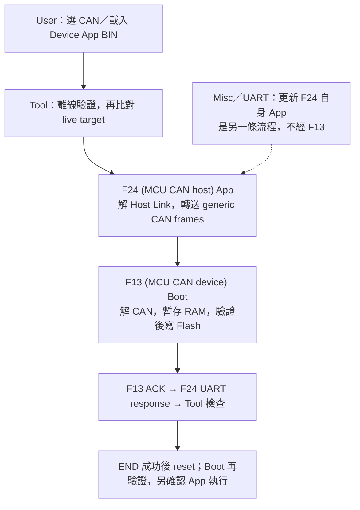

| UI／通訊中看到的資料 | 來自哪裡 | 代表什麼 | 不代表什麼 |
| --- | --- | --- | --- |
| LOADED APP BIN／共用 metadata | PC 上載入的檔案 | 即將寫入的離線映像；CAN3／UPD1 | 不是板上已安裝的內容 |
| DEVICE TARGET／BOOT CODE／INSTALLED APP | F13 的 CAN INFO pages | live 韌體回報的身分、layout、版本、容量及政策摘要 | Discover 不會讀回完整 256-byte Flash metadata；也不是 read-back CRC |
| HOST BRIDGE／Host descriptor | F24 的 Host Link 身分與自身 BUR1 metadata | 哪塊 bridge、支援哪些 port／commands、Host 自身 App 資訊 | 不是外部 F13 的 CAN3，也不是要下載給 F13 的 metadata |

### B. 使用者操作與內部動作對照

| 操作順序 | UI 要看什麼 | 實際動作／程式入口 | F13 Flash 是否改變 |
| --- | --- | --- | --- |
| 1. 接線／開啟 Tool | COM friendly name 只協助選埠 | F24 與 F13／analyzer 同 CAN bitrate、共地、終端；F13 EVB TJA1050T 使用 5 V | 否 |
| 2. Open + Probe Host | HOST BRIDGE VERIFIED LINK／port／能力 | 讀 Host Link 身分與能力；支援自身更新的 bridge 再驗證其 descriptor／metadata | 否 |
| 3. CAN／Load Update Image | LOADED APP BIN 為 OFFLINE；CRC Result／Metadata Status／Update Policy | `CMainFrame::LoadBinaryFromPath` → `InspectImage`／`ValidateLoadedFirmwareImage`；選 `_update.bin`，不是 HEX 或 Host BIN | 否 |
| 4. Discover Target | DEVICE TARGET、BOOT CODE、INSTALLED APP | `ProcessDiscoverF13Boot` → `GetTargetInfo`：逐頁 INFO，核對模式／速度／IDs | 否 |
| 5. Enter Boot（若仍在 App） | DEVICE TARGET 改為 Bootloader | `ProcessEnterF13Bootloader` → ENTER ACK → 等待 reset → INFO + HELLO | 否 |
| 6. 檢查 Ready／Missing | 中央先決條件不得有缺項 | `CMainFrame::UpdateUi`；檔案、route、bit12、Boot ready、live layout 全部相容 | 否 |
| 7. Start Device Update | progress／shared log | worker 再驗證 → metadata RESET／stage／SEAL → START → blocks → END | 到有效 COMMIT 才開始 |
| 8. 確認結果 | END ACK 與後續 App 證據分開看 | Tool 核對 END CRC；F13 reset 後 Boot 再檢查；以 App log／INFO／功能確認真正執行 | 更新流程已寫入 |

載入 BIN 與 Probe 的先後可以互換；但 Start 前必須全部通過。Transfer Test／Bridge Self Test
只能用來排查通訊，不會替代 CAN Upgrade 的映像驗證。完整操作見[Tool operation](https://released.github.io/slide_isp_tool_for_RL78/#tool-operation)。

### C. Tool 如何判斷「這個 BIN 可以更新」

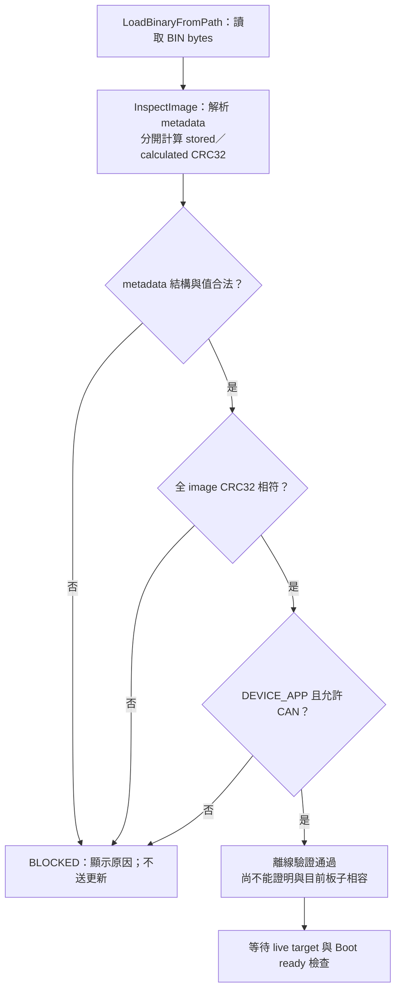

| 驗證關卡 | 檢查的 byte／資料 | 拒絕範例 | UI／程式判定 |
| --- | --- | --- | --- |
| 最小結構 | entry／vector 預留、0x100 起 256-byte metadata、尾端 CRC4；至少 516 bytes、4-byte 對齊 | 空檔、截斷、只給原始 App code | `ParseMetadata`；entry 不得為 FFFFFFFF |
| 格式與識別 | CAN3 magic、image format、core length、flags、protocol、checksum；MCU 字串與 padding | BUR1 Host BIN 放在 CAN TAB、壞 magic／字串 | Metadata Status 與 Update Policy；不是只看副檔名 |
| 幾何與容量 | image_size 等於檔案長度；start／capacity／Flash／Boot／erase／minimum | 超出 Flash、start 未對齊 erase | `ParseMetadata` 的 bounds checks |
| 保留區 | metadata offset 0x80..0xFF 共 128 bytes 必須 FF | 不相容擴充欄位卻未更新契約 | reserved 檢查；不是任意填零區 |
| 完整性 | 檔案前 N-4 bytes 的 CRC32 對比最後 4 bytes LE32 | metadata 正確但程式區損壞 | CRC Result MATCH；`ValidateImage` 才要求相等 |
| 更新政策 | UPD1 role／allowed transports／IRQ ABI／minimum boot | CAN-only Device App 改選 I2C；Host App 放入 CAN | `image_policy::Allows`；不能靠切 TAB 繞過 |

`InspectImage` 的「Metadata Status = VALID」與「CRC Result = MATCH」是兩個獨立結果，
兩者都通過也只是離線成立。CRC提供完整性，不是簽章或身分認證。

### D. 離線 BIN 與在線 target 如何比對

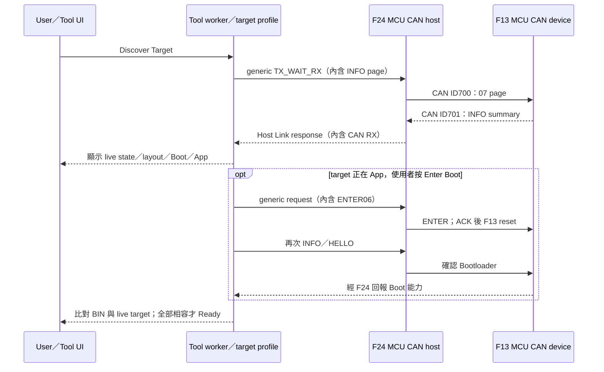

| 比對群組 | BIN metadata | live INFO／Host 能力 | 失敗後處理 |
| --- | --- | --- | --- |
| 身分 | target_id、mcu_family、mcu_part | target INFO 相同欄位 | 不以 USB-UART 描述或載入檔案推測身分 |
| 協定 | image format、protocol ID／version、checksum | live format／protocol／checksum | 不退回舊 DATA03 流程 |
| Flash | start、capacity、Flash size、Boot reserve、erase、minimum | live layout 各項相等 | 不只比較 image 是否小於 capacity |
| CAN | mode／ID format／nominal mask／data mask／request／response | live 契約相同；選定設定也要被支援 | 改 bridge 速度不會改 F13 固定速度 |
| 政策 | DEVICE_APP、CAN allowed、固定 IRQ ABI、minimum boot | live role／CAN allowed／IRQ ABI；boot_version 足夠 | worker `ImageMatchesTarget` 再做一次，不能只依賴 UI |
| 傳輸能力 | 本路徑需要 generic burst | Host Link v2／128-byte payload／bit12；F13 block INFO | 缺 bit12 先經 Misc 更新 Host App，不直接開始 |
| 執行狀態 | 檔案有效且 App Start Override 相容 | 已確認 Bootloader；HELLO target／capacity 與 INFO 相符 | App 狀態須先 ENTER；未開 COM／busy 都不可更新 |

### E. 一個 BIN 區塊如何穿過 UART 與 CAN

| 名詞／單位 | 大小 | 本路徑的用途 | 不要混淆 |
| --- | --- | --- | --- |
| metadata region | 256 bytes | image offset 0x100..0x1FF；128 core + 128 reserved | 不是 Host Link 單包大小 |
| metadata staging chunk | 4 bytes | METADATA08 每次攜帶 4 個 metadata bytes，總共 64 次 | 不是目前 raw App data 的有效長度 |
| image block | 最多 64 bytes | RAM staging／區塊 CRC／一次 COMMIT ACK | 不是 CAN FD frame |
| raw CAN data frame | 最多 8 bytes | ID 的低 3 bits 表示段號，payload 全部是 image bytes | 沒有占用 Byte0 當 command；最後一段可為 DLC4 |
| Host Link burst payload | 完整 block 為 122 bytes | 12-byte burst header + 10 ×（ID2 + DLC1 + data8） | 在 128-byte payload 上限內；含 UART framing 共 136 bytes |
| Flash write word／erase block | 4／1024 bytes | F13 以 4 bytes 寫入，到 erase 邊界時擦 1 block | 寫入單位不是 CAN 傳輸單位 |

#### 區塊封裝與回覆

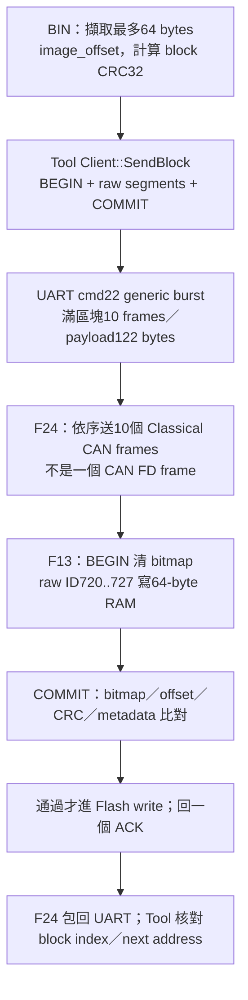

### F. F24 (MCU CAN host) 的接收與轉送流程

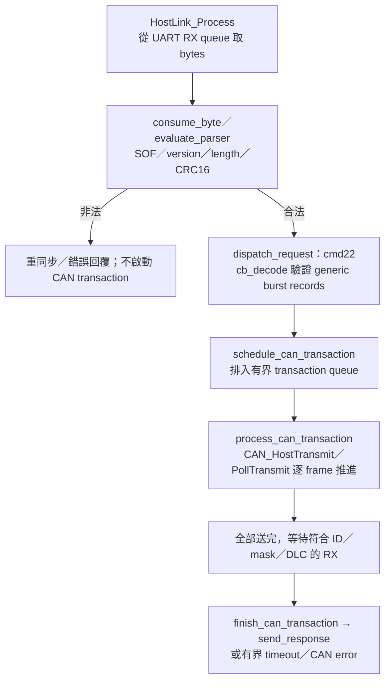

| 程式位置 | 檢查／動作 | 使用者可對照的結果 |
| --- | --- | --- |
| `host_link_protocol.c`：`validate_header`／`evaluate_parser` | UART header CRC16、payload 長度 ≤128、payload CRC16；逐 byte 可分段到達 | UART framing／CRC 錯誤與 CAN target status 是不同層 |
| `can_burst.inc`：`cb_decode` | 1..10 records、Standard ID、DLC≤8、timeout、非零 mask、完整長度／gap | 不合法 generic request 直接 BAD_ARGUMENT；尚未解 F13 command |
| `host_link_protocol.c`：`schedule_can_transaction` | 有界 queue／相同 sequence 與 payload 的重送處理 | 不因 UART retry 任意增加 target Flash 寫入 |
| `host_link_can_process.inc`：`process_can_transaction` | 非阻塞 TX／GAP／RX／ABORT；所有 frame 送完後等待 matching RX | bridge TX complete 只代表 CAN 傳送階段完成 |
| `can_fd_module.c`：`CAN_HostTransmit` | 把已解碼的 frame 結構交給 `R_CAN_SendByTXMB`；ISR 記錄事件／RX queue | 寄存器與 driver 留在 board backend，不把 target 邏輯放 ISR |
| `finish_can_transaction`／`send_response` | 將 CAN RX record 放進同 sequence 的 Host Link response | 外層 status OK 後，Tool 還要解析內層 F13 status／detail／value |

Host Link 的 115200／460800／921600 是 PC↔F24 這一路；CAN 的 500K 是 F24↔F13 另一路。
F24 不會把 UART baud 寫入 F13 metadata，也不會將收到的 BIN 自動燒進自己的 App。
F24 自身更新另見[Misc 更新 Host App](https://released.github.io/slide_isp_tool_for_RL78/#host-bridge-firmware)。

### G. F13 (MCU CAN device) 如何分類 CAN RX

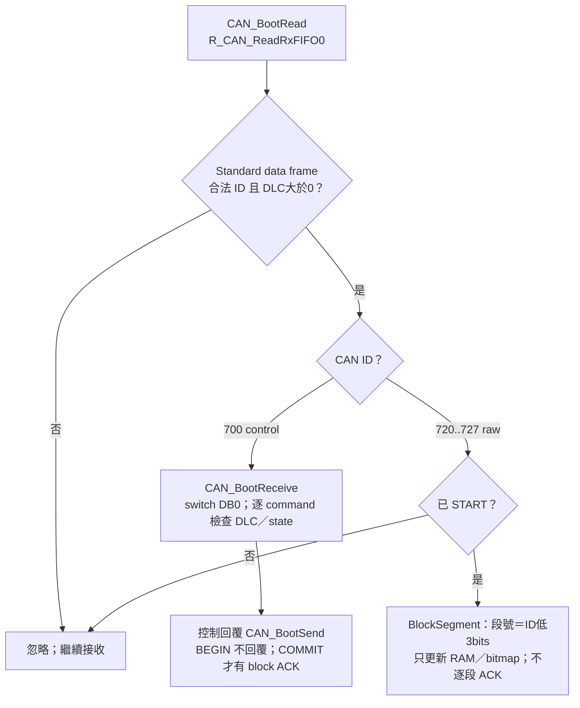

| 收到內容 | Decoder 看哪裡 | 狀態／長度要求 | 結果 |
| --- | --- | --- | --- |
| INFO07／HELLO01 | DB0、INFO 的 DB1 page | INFO DLC2；HELLO 回報 Boot 狀態／能力 | 讀摘要；不寫 Flash |
| METADATA08 | DB1..2 metadata offset、DB3=00、DB4..7 bytes | 未 START、DLC8；offset 4-byte aligned 且不可跳過 | 寫 metadata RAM，回下一 offset |
| SEAL09／START02 | SEAL 的 DB4..7 CRC；START 的 protocol／target／size | metadata 256 bytes 完整、契約與 CRC 正確才允許 START | 只建立 update session；不擦 Flash |
| BLOCK_BEGIN0B | DB1..3 image offset、DB4..7 block CRC | 已 START、DLC8；64-byte offset；本區塊或上一已提交區塊 | 初始化 block RAM／bitmap；不 ACK |
| raw ID720..727 | index=ID&7；DB0..7 都是 image data | 已 START、BEGIN 有效；DLC 必須等於該段實際長度 | 收齊 bitmap；相同重複可接受，衝突使 block 無效 |
| BLOCK_COMMIT0C | offset／CRC 與 BEGIN 一致 | started、DLC8、bitmap 全、區塊 CRC 相等 | 通過後才比對 metadata／寫 Flash；回 block ACK |
| END04／ABORT05 | DB0 | END 要求完整 size／Flash metadata／全 image CRC；ABORT 終止 session | END 成功後 reset；ABORT 不等於回復舊映像 |

### H. 先送完整 metadata，為什麼還要 SEAL／START？

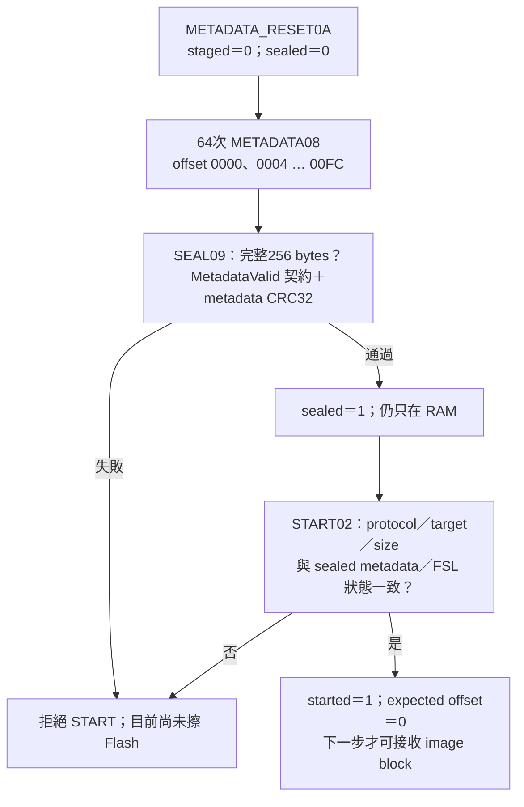

| 階段 | Tool 函式／資料 | F13 函式／判斷 | 不可誤解的保證 |
| --- | --- | --- | --- |
| RESET | `Client::StageMetadata` 先清舊 session；遇 BAD_STATE 可先 ABORT 再試一次 | `MetadataReset` 清 staged／sealed | 不清 Flash；不保證舊 image 尚可用 |
| 64 個 chunks | 取 image[0x100..0x1FF]；每次 4 bytes、等待 ACK | `MetadataStage`：不可跳號；相同重送接受、衝突拒絕 | 只更新 RAM；ACK detail 為下一 metadata offset |
| SEAL | CRC32(metadata 的全部 256 bytes) | `MetadataSeal` → `MetadataValid`＋CRC；核對固定契約與保留 FF | 不等於全 image CRC；尚未確認程式區 bytes |
| START | `Client::Start` 傳 protocol／target／image_size | size＝sealed words[6]；FSL 正常；設 address／expected | START ACK 不是「已擦除完成」 |
| 正式傳 image | `RunUpdate` 從 image offset0 開始，每區塊最多64 bytes | metadata 所在 image blocks 仍會再傳；COMMIT 前與已封存 RAM 比對 | 不可 stage 好 metadata A 卻正式寫入 metadata B |

### I. 用第一個 metadata chunk 對照 byte 與 address

這是 Bootloader 內、未 START、且先成功 RESET 的教學範例；不是讓 analyzer 任意掃描或自動擦寫。
完整逐 byte 表另見[格式對照](https://released.github.io/slide_boot_loader_for_RL78/#flash-metadata-can-reference)。

| 封包 | CAN ID／DLC | Data bytes | 讀法 |
| --- | --- | --- | --- |
| 只讀 INFO page0 | TX700／2 | `07 00` | command INFO、page0 |
| Boot INFO 回覆 | RX701／8 | `07 00 00 02 3B F1 05 06` | INFO／OK／page0／Bootloader；target F13B、protocol5、image format6 |
| 第一個 metadata chunk | TX700／8 | `08 00 00 00 43 41 4E 33` | METADATA；meta offset0000；reserved00；4 bytes 是 ASCII CAN3 |
| metadata chunk ACK | RX701／8 | `08 00 04 00 00 01 00 00` | OK；detail0004＝下一 metadata offset；value00000100＝256 bytes |
| 第一個 block 提交成功 ACK | RX701／8 | `0C 00 00 00 40 20 00 00` | COMMIT OK；block index0；下一絕對 Flash address2040；不是 metadata offset |

#### 位址換算與 ACK 單位

| 同一個 magic byte C | 算式 | 本範例值 |
| --- | --- | --- |
| metadata-relative offset | 第一個 chunk offset + byte0 | 0x00 |
| BIN-relative offset | manifest offset + metadata offset | 0x100 + 0x00 = 0x100 |
| 暫存位置 | metadata RAM bytes[offset] | `g_metadata_words` 的第一個 byte，尚未在 Flash |
| 正式寫入位置 | App start + BIN offset | 0x2000 + 0x100 = 0x2100 |
| 此 byte 所屬 image block | floor(BIN offset /64) | block index4、image offset0x100；不是第0個 block |

metadata 分段 ACK 的 detail 以 bytes 計數；BLOCK_COMMIT ACK 的 detail 是 block index；
END ACK 的 detail 則是 image_size/4 的低16 bits。欄位位置相同，不表示單位相同。

### J. COMMIT 才是 RAM → Flash 的界線

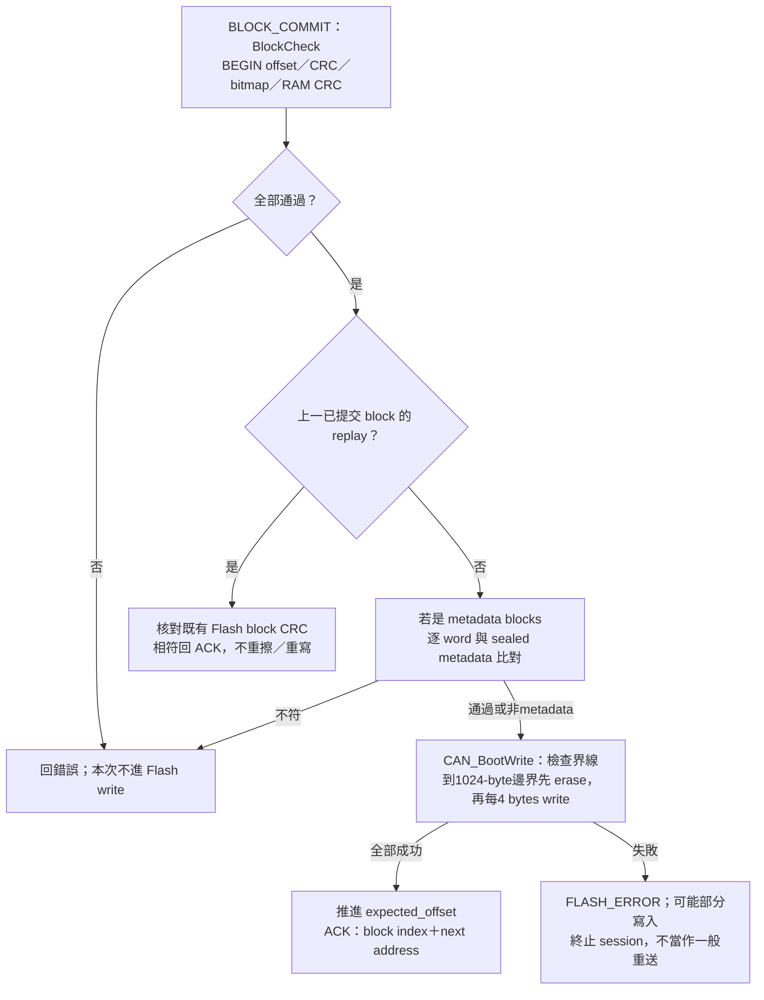

| 條件 | 如何判斷 | Flash 行為 | Tool 可否前進 |
| --- | --- | --- | --- |
| 缺 segment／錯 DLC／衝突重複／offset 錯 | bitmap／bad flag／BEGIN 與 COMMIT 不一致 | 此次不寫 | BAD_SEQUENCE；有界重送整 block |
| block CRC 不符 | 對 RAM 實際 block length 計算 CRC32 | 此次不寫 | CRC_ERROR；有界重送整 block |
| metadata 正式資料與 SEAL 不同 | image offset0x100..0x1FF 的 words 比對 staging RAM | 該 block 不寫；此前 blocks 可能已改變 | BAD_IMAGE，終止；不是 rollback |
| 本次正常 block | offset＝expected；大小不超 image／Flash 範圍 | 在 erase 邊界擦除，再逐4 bytes寫入 | ACK index／next address 正確才前進 |
| 上一已提交 block replay | offset 比 expected 少64，RAM／Flash CRC 均相符 | 不重寫、不再次擦除 | 可回相同 next address ACK；不是任意位置續傳 |
| FSL erase／write 失敗 | Flash library 回傳錯誤 | 可能部分寫入，不能宣稱原子性 | FLASH_ERROR，不以一般 CRC retry 掩蓋 |

目前 `Client::SendBlock` 對 bridge TIMEOUT 或 F13 BAD_SEQUENCE／CRC_ERROR 有界重送整區塊；
它仍要核對 ACK 的 block index 與 next address。這不是斷線續傳功能。
取消／失敗時 `RunUpdate` best-effort ABORT，worker 再停止 CAN；若實體線已斷，不能保證 ABORT 送達。

### K. END、reset、Boot→App 是三個步驟

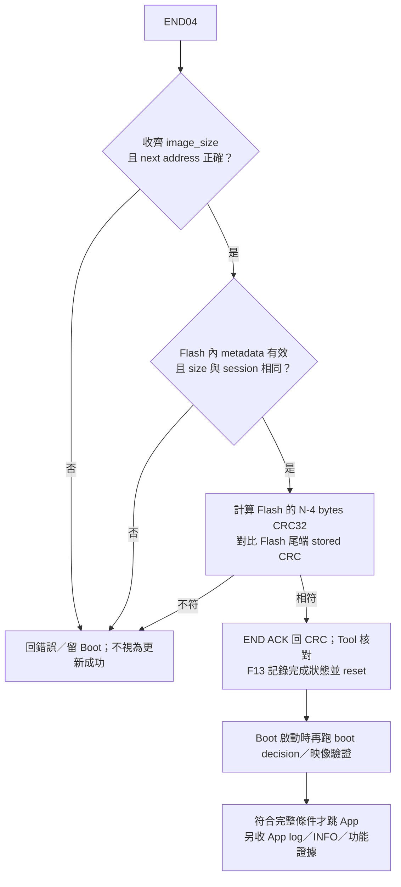

完整 ENTER、RAM handoff、checksum、逾時、失敗留 Boot 的條件以
[F13 Boot→App 完整條件圖](https://released.github.io/slide_isp_tool_for_RL78/#f13-boot-flow)為準。
僅有效舊 App 的 ENTER session 啟用30秒 inactivity；START 前可重驗舊 App 後返回，
接受 START 後逾時不自動回 App。無效 App 的 recovery 不啟用該逾時；ABORT／fatal error 不保證自動返回。

| 觀察到的證據 | 真正證明的範圍 | 還需要什麼 |
| --- | --- | --- |
| PC BIN CRC MATCH | 本地檔案 N-4 bytes 對尾端 CRC 正確 | metadata／route／live target 仍需核對 |
| analyzer 看見700／raw frames | CAN bus 有這些封包 | 不證明 F13 解碼、Flash 成功或 App 執行 |
| CAN ACK bit／F24 TX complete | 某節點確認鏈路／控制器送出 | 不等於 F13 Boot COMMIT ACK |
| Host Link status OK | bridge 完成指定 transport transaction | 仍須解內層 F13 status；內層可能是錯誤 |
| F13 COMMIT ACK OK | 該區塊處理成功；Tool 也核對 index／next address | 全 image 仍未 END 驗證 |
| END ACK＋matching CRC32 | F13 對寫入 Flash 的完整映像驗證成功 | reset 後是否真正跳 App 尚需獨立證據 |
| 新 App UART log／重新 INFO／實際功能 | 可觀察的 App 執行與版本／功能 | 不等於所有 IRQ／斷電／高速可靠性都已驗收 |

### L. 故障時先看哪一層

| 現象 | 優先核對 | 對應流程 | 不應採取的捷徑 |
| --- | --- | --- | --- |
| Tool Metadata VALID 但 CRC MISMATCH | 檔案截斷／post-build／尾端 CRC | C：離線驗證 | 不跳過 CRC 強制 Start |
| CRC MATCH 卻 Update blocked | DEVICE_APP／CAN allowed、IRQ／minimum boot、live layout、bit12 | D：在線相容性 | 不因 MCU 名稱相近就接受 |
| Probe timeout | COM 是否選對、binary UART／Host baud、F24 是否在 App／Boot | B／F：Host Link | 不自動 Probe 所有 COM |
| F24 TX error／bus error | 供電、CANH/L、共地、終端、各節點 bitrate／clock；F13 transceiver 5V | F／G：實體與 transport | 不先修改 F13 metadata 解碼 |
| 有700但沒有701 | F13 state／RX filter／ID／DLC、transceiver；分清 Transfer710與Boot700 | G：接收分類 | 不把 Transfer 協定封包送給 Boot |
| SEAL BAD_IMAGE／CRC_ERROR | 64 chunks 是否完整、固定契約／保留FF、metadata CRC | H：metadata RAM | 不先擦 Flash 測運氣 |
| COMMIT BAD_SEQUENCE／CRC_ERROR | BEGIN offset／raw IDs／DLC／bitmap／CRC、有限重送紀錄 | J：block RAM | 不把所有錯誤無限重試 |
| END 成功但沒有新 App log | reset／boot decision／vector／startup／App IRQ與板級初始化 | K：啟動驗證 | 不把100%當作已執行 App |

### M. 開原始碼時的閱讀順序

| 要理解的段落 | 實際來源連結 | 從哪個函式／符號開始 |
| --- | --- | --- |
| 載入檔案與 UI metadata | [main_frame_image.cpp](https://github.com/released/simple_renesas_isp_tool/blob/main/src/main_frame_image.cpp) | `LoadBinaryFromPath`／`ValidateLoadedFirmwareImage`／`UpdateFirmwareImageInfoText` |
| Ready／Missing 與 Start 按鈕 | [main_frame_workflow.cpp](https://github.com/released/simple_renesas_isp_tool/blob/main/src/main_frame_workflow.cpp) | `UpdateUi`／`OnBnClickedStartFirmwareUpdate` |
| CAN3 離線驗證 | [firmware_update_profile.cpp](https://github.com/released/simple_renesas_isp_tool/blob/main/src/core/firmware_update_profile.cpp) | `ParseMetadata`／`InspectImage`／`ValidateImage` |
| worker 二次檢查／流程 | [worker_can_workflows.cpp](https://github.com/released/simple_renesas_isp_tool/blob/main/src/worker_can_workflows.cpp) | `ProcessDiscoverF13Boot`／`ValidateF13BootTarget`／`ProcessProgramF13Boot` |
| BIN 對 live target | [worker_format.cpp](https://github.com/released/simple_renesas_isp_tool/blob/main/src/worker_format.cpp) | `ImageMatchesTarget` |
| 更新狀態機 | [f13_boot_update.cpp](https://github.com/released/simple_renesas_isp_tool/blob/main/src/core/f13_boot_update.cpp) | `RunUpdate`／`AbortAfterStart` |
| CAN 封包建立／ACK 解碼 | [f13_boot_profile.cpp](https://github.com/released/simple_renesas_isp_tool/blob/main/src/core/f13_boot_profile.cpp) | `Client::GetTargetInfo`／`StageMetadata`／`SendBlock`／`End` |
| F24 UART parser／generic dispatch | [host_link_protocol.c](https://github.com/released/simple_renesas_isp_tool/blob/main/firmware/RL78_F24_Bridge_app/host_link_protocol.c) | `HostLink_Process`／`evaluate_parser`／`dispatch_request` |
| F24 burst record 驗證 | [can_burst.inc](https://github.com/released/simple_renesas_isp_tool/blob/main/firmware/common/can_burst.inc) | `cb_decode`／`cb_next` |
| F24 CAN 非阻塞 transaction | [host_link_can_process.inc](https://github.com/released/simple_renesas_isp_tool/blob/main/firmware/RL78_F24_Bridge_app/host_link_can_process.inc) | `process_can_transaction`／`next_burst_frame` |
| F24 driver／RX queue | [can_fd_module.c](https://github.com/released/simple_renesas_isp_tool/blob/main/firmware/RL78_F24_Bridge_app/can_fd_module.c) | `CAN_HostTransmit`／`CAN_HostPollTransmit`／`CAN_RxQueuePop` |
| F13 CAN 接收與 Flash 入口 | [can_boot_transport.c](https://github.com/released/RL78_F13_Boot_loader_CAN/blob/main/can_boot_transport.c) | `CAN_BootRead`／`CAN_BootReceive`／`CAN_BootWrite`／`CAN_BootSend` |
| F13 metadata staging／契約 | [can_boot_metadata.inc](https://github.com/released/RL78_F13_Boot_loader_CAN/blob/main/can_boot_metadata.inc) | `MetadataStage`／`MetadataSeal`／`MetadataValid` |
| F13 raw segments／bitmap／CRC | [can_boot_block.inc](https://github.com/released/RL78_F13_Boot_loader_CAN/blob/main/can_boot_block.inc) | `BlockBegin`／`BlockSegment`／`BlockCheck` |
| F13 reset 與重新驗證 | [r_main.c](https://github.com/released/RL78_F13_Boot_loader_CAN/blob/main/r_main.c) | `boot_main`／`verify_application_checksum`；配合 Boot decision 圖 |

若要改成自己的專案：先固定 partition／vector ABI／board clock，再由 image build 設定產生 metadata／CRC；
同步修改 Tool target profile 與 device Boot 的契約，最後對照本篇每一關驗證。
只增加 App 一般 IRQ 且仍在既定 ABI／layout／更新協定內，不需要為此改 Boot；
更換更新介面或映像契約則必須重新評估 Boot。
詳見[Boot/App 移植工程](https://released.github.io/slide_boot_loader_for_RL78/#boot-app-porting)。

本篇是現行程式的導讀，不是新一輪板測報告。實體斷線／斷電、完整故障矩陣、高速長時間可靠性，
以及各自訂 App 的 IRQ／啟動，仍須在對應硬體上留存驗證紀錄。
<!-- CAN_WALKTHROUGH_END -->

## 1. 三個角色，不要認錯板

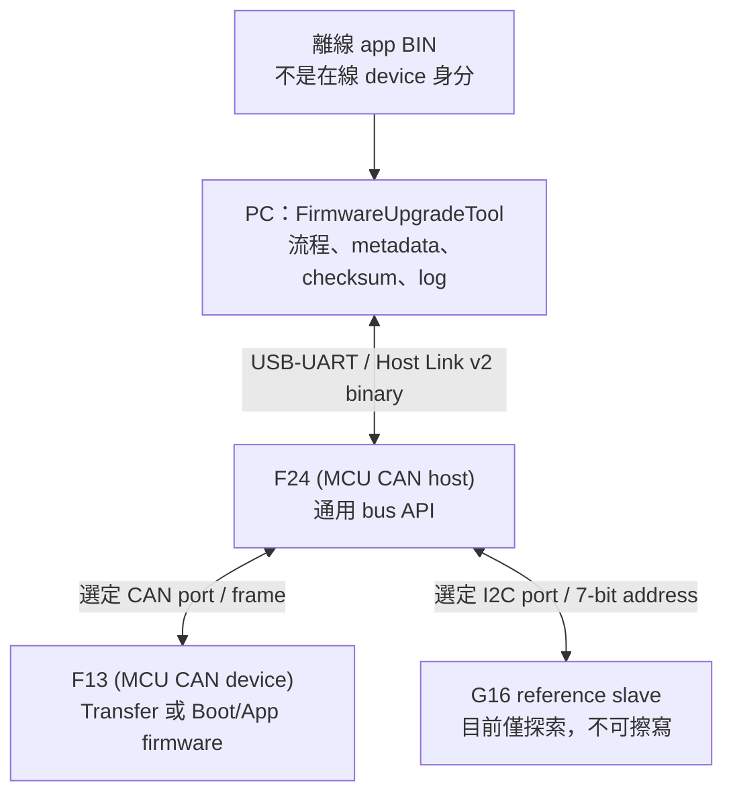

| 角色 | 來源 | 不能據此證明的事 |
|---|---|---|
| Host | UART GET_HOST_INFO：board ID、FW/build、Host Link；支援時再讀 bridge descriptor 的 MCU part／boot／layout | USB adapter 名稱不是 MCU 身分；舊 host 不提供完整 descriptor，不從板名推測 |
| Device | CAN INFO / Transfer DEVICE_INFO；I2C reference signature | 收到 frame 不等於 flash完整、read-back正確或身分認證 |
| Loaded app | BIN manifest、實際size、calculate/stored CRC | 未通訊前不知道板上版本；CRC不是簽章 |

## 2. 明亮 UI：先看五張資訊卡

| 卡片 | 要確認什麼 | 顏色與來源 |
|---|---|---|
| HOST BRIDGE | 哪塊host、哪個COM、FW/build、boardID | 綠色 VERIFIED LINK：已完成Host Link探索 |
| DEVICE TARGET | MCU family/part、targetID、Application / Bootloader / Transfer mode | 綠色live protocol資訊；G16 reference為琥珀色 |
| BOOT CODE | Boot version/build、reserve、app start | LIVE INFO；未探索或Transfer不提供時N/A |
| INSTALLED APP | 板上version/build、installed bytes、capacity | LIVE INFO；不是載入檔案或read-back CRC |
| LOADED APP BIN | 待更新version/build、實際size、MCU、start | 藍色 OFFLINE；CRC/manifest錯誤為紅色 |

角色與來源都有文字，不只依賴顏色；hover卡片可讀完整資訊。
BIN size、calculated CRC、stored CRC、compare與metadata仍分欄顯示。
未載BIN為N/A；斷線後live卡片回N/A，已載BIN保留離線顯示。
主視窗不設上下捲軸，以1366×768為目標；左側介面設定、中間共用
BIN／18欄metadata／CRC、右側共用log、底部共用progress／elapsed。
底部進度列的操作名稱／百分比維持單行，以UI字型
量測並預留100%寬度；進度條、耗時與build資訊保持在底部列內且不重疊。
只有操作名稱改變才重新配置，逐包百分比不觸發整頁重排。100／125／150%字型
幾何測試不等於實際桌面DPI驗證，仍需實際操作與截圖確認。
啟動期間須先完成INI路徑與欄位初始化，再儲存設定；不修改Windows權限。
Host重新連線仍須完整讀回metadata，不可略過驗證。
只有log歷史和下拉選單可捲動。較小畫面五張卡同列，較大畫面可分兩列。
左欄標題INTERFACE SETTINGS下方才有CAN／I2C／Misc TAB；TAB不橫跨中、右欄。
中欄固定標題SHARED IMAGE / METADATA，右欄固定SHARED LOG；切TAB仍沿用同一組控制項與BIN。
CAN、I2C與未來UART device只替換介面參數和image adapter，不建立另一套
Load Update Image／metadata／log。TAB最後是Misc，目的地改為HOST BRIDGE，
BOOT／APP卡顯示host資訊，不沿用外部F13或G16的舊資料。
1366×768實際啟動、TAB無殘影及100%/125% DPI仍待桌面視覺驗證；幾何測試不等於目視通過。

<div class="capture-pending">待補新版 UI 實際截圖：未連線、合法 BIN、CRC 錯誤、Host 探索成功。Desktop screenshot helper 無法連線；此區不是示意 screenshot。</div>

## 3. 接線與上電前檢查

| 項目 | F24 (MCU CAN host)／F13 (MCU CAN device) 基準 |
|---|---|
| PC ⇄ F24 (MCU CAN host) UART | P15 TX / P16 RX，交叉接線、共地；tool預設115200；binary Host Link不可混printf |
| F24 (MCU CAN host) CAN | P10 TX / P11 RX / P12 STB；X1 20MHz → PLL80 → CPU/CAN40 |
| F13 (MCU CAN device) CAN | X1 4MHz → PLL/CPU32 → CAN16；不可抄F24 host clock |
| Transceiver | F13 EVB TJA1050T使用5V；本次3.3V bus error改5V後benchmark正常 |
| CAN bus | H/L正確、共地、兩端termination；斷電H-L約60Ω是常見檢查，不代表時序已驗證 |
| Analyzer | 同bitrate；self-test需能ACK的active analyzer/node；listen-only不會ACK |
| F24 (MCU CAN host) 的I2C介面 | IICA0 SCL P62 / SDA P63、100kHz；確認pull-up電壓，不可把CAN 5V直接當I2C邏輯電壓 |

不可供電時用歐姆檔量termination。依實際board原理圖確認電壓。
各MCU的flash library、vector、clock、pin mux、erase/write unit不同；共用tool不代表共用register設定。

<a id="tool-operation"></a>

## 4. 連線：COM 名稱只是選擇提示

1. Refresh → 選 `COMx: Windows friendly name`；降低選錯adapter的機會。
2. 確認UART baud → `Open + Probe Host`；不會自動probe所有COM。
3. 看HOST BRIDGE的board/FW/build，確認與預期host一致。
4. 選CAN / I2C TAB，再選firmware宣告的Bridge port；Misc只更新host自己的app。
5. disabled時讀operation error / prerequisite，不要靠反覆按button猜測。

INI保存canonical COM，不把friendly name當identity。
`Reset Host` 明確reset並reconnect host，不是reset device。
`Disconnect` 停當前bus/target；`Close COM` 結束UART並可取消工作。

## 5. Bridge Board Self Test：先排除 host TX

1. Probe Host、選CAN port，保持CAN stopped。
2. Classical CAN → host支援的250K/500K/1M，analyzer同rate。
3. `Start Bridge Board Self Test`；旁邊 `?` 提示要搭配analyzer。
4. STD `0x123` / DLC8，每約1秒 `11 22 33 44 55 66 77 counter`。
5. 每次啟動counter reset：`00 → 01 → … → FF → 00`；按Stop結束。

不擦寫，也不證明F13接收正常；TX counter不是wire量測。
CAN rate經UART SET_CAN_CONFIG在stopped時修改bridge，並非CAN500K變速command；target不跟著變速。

<div class="capture-pending">待補 self-test button / tooltip / PC log / analyzer trace。空的0x000/DLC0不代表正確測試frame。</div>

## 6. Custom Transfer：已確認 benchmark

1. Device燒錄`RL78_F13_CAN_Transfer`、完成init；不需BIN。
2. Tool選Custom Transfer / Classical500K / metadata-default exact filter。
3. `Discover Test Target`：確認part、targetID、protocol。
4. `Transfer Test`：DEVICE_INFO、PING、ECHO、PATTERN、STATS，均不擦flash。
5. `Start Log`存PC log；device存UART TRACE；analyzer存CAN trace。
6. `Export Summary`；比對sequence、command、payload、CRC、error counters。

Request STD `0x710`、response `0x711`、DLC8；CRC-8/ATM不是app CRC32。
Analyzer單獨送DEVICE_INFO page0：`0x710` / `A5 01 01 01 00 00 00 DC`，
本次F13回`0x711` / `5A 01 01 01 00 01 00 8D`。
這只讀page0；Tool discovery會讀全部identity pages。

### 使用者原圖：歷史 benchmark，非新版 UI

<figure><figcaption>2026-10-14使用者Transfer benchmark；不是Boot/App programming證據。</figcaption></figure>

<figure><figcaption>同一benchmark的MCU UART，供與PC/analyzer比對；不是新版UI。</figcaption></figure>

<a id="f13-device-update"></a>

## 7. F13 (MCU CAN device) CAN Upgrade：先看 BIN，再看 live device

CAN正常更新與END CRC已有實板紀錄；完整故障矩陣仍需獨立驗證。

<a id="can-upgrade-performance"></a>

### 更新速度：區塊傳輸與量測方式

CAN更新以區塊減少PC往返：每64-byte區塊一次ACK，區塊內標準ID720..727
攜帶8-byte image，最後短段使用DLC4。Flash仍以4-byte word寫入，並非每個word
都要完成一次PC往返。Tool與bridge能力、device protocol及image必須相容。

PC串口在有資料時立即返回，無資料才按剩餘期限等待；等待上限不是逐包固定延遲。
若UI佇列溢位，log會明確告警，不可用不完整的trace行數推算實際收發量。
效能依映像大小、Host Link速度、CAN bitrate、Flash及Detailed trace負載而異。
單次實測數字與精確版本保留在交付紀錄，不當成所有板子或映像的速度保證。

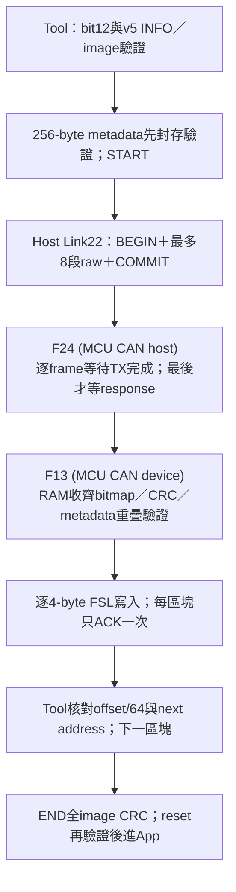

安裝順序：F24經Misc115200更新相容的Bridge App，明確RUN並Probe bit12；
已有相容Boot時不需重燒Boot。F13初次安裝須使用matching Boot/App；
範例採8KiB／App2000h、format6／metadata256與F1V1向量ABI。
區塊protocol不提供舊逐筆DATA相容模式，不能任意混用兩者。
缺段／CRC錯或ACK遺失限整區塊重送一次；已提交區塊核對Flash、不重寫。
Flash錯誤／錯ACK／斷線停止，ABORT後完整重刷，不猜續傳。
軟體已測實際PC、F24 codec／非阻塞progression、F13 RAM staging／CRC；
CAN HAL、Flash與斷電仍是模型，不代替實板。後續同BIN／CAN500K各測Host
115200、460800、921600與trace-on/off，記錄blocks／ms／B/s／CRC／errors。
G16新版I2C與UART device仍未開放；固定Misc速度不跟Host高速會話改變。
泛用burst22負責傳送整組frame，不把PC TX意圖當成已量測的CAN wire trace。
後續維持同BIN／115200／500K／相同Detailed trace設定做多次A/B，再關trace並另測
460800／921600，每組至少3次，留存耗時、CRC與overflow/lost/error計數。
Misc自身App更新仍使用Boot固定115200。I/O模型PASS不等於實板加速倍數。

COM號會變，不能寫死特定COM或從USB driver名稱認定板子；以Probe身分為準。
END CRC成功後，仍需以device UART或重新Discover確認App已執行。

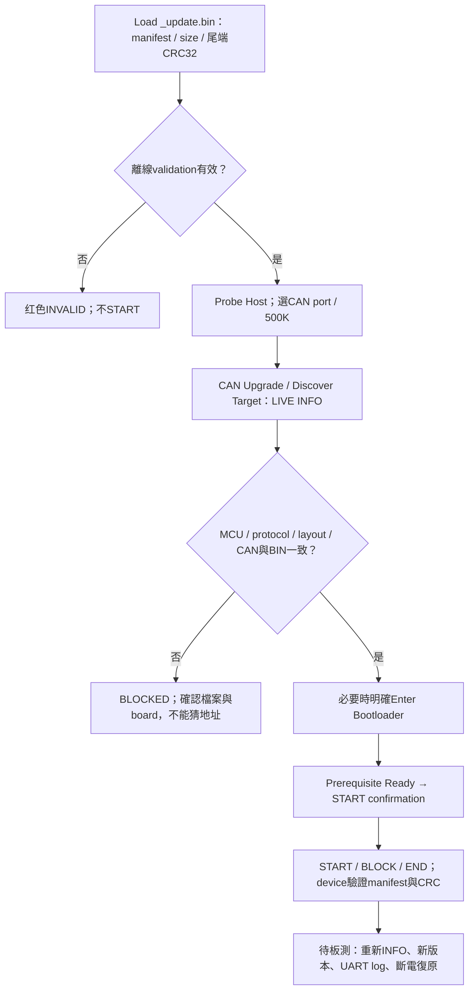

| BIN 欄位 | 確認重點 |
|---|---|
| BIN Size | 實際bytes含CRC尾端；不是capacity |
| Calculated / Stored CRC32 | 計算`[0,size-4)`；stored尾端LE32；MATCH / MISMATCH |
| Metadata | MCU/target、protocol/format、app version/build、layout/CAN |
| App Range / Image Capacity | 實際image範圍vs最大app區；不可擦data/boot區 |
| App Start Override Auto | 使用BIN metadata start，不猜0x2000；手動值须與image/device一致 |

32K/60K/80K/110K皆可能；120K不是固定app size。
但不是任意raw BIN都接受：仍須manifest、minimum/capacity、4-byte alignment、start/protocol匹配。
Post-build依linker map決定尾端、填manifest image-size、末端4bytes CRC32。
Boot/app/data分區變更須配合device linker與metadata；override不能重定位已compile的app。
CRC檢查不是簽章、認證或anti-rollback。

<a id="f13-boot-flow"></a>

### F13 (MCU CAN device)：所有 boot→app 條件、ENTER 與逾時

<!-- F13_BOOT_DECISION_BEGIN -->
本節僅適用目前 F13 (MCU CAN device) boot/app（format6／CAN protocol5），不是 F24 (MCU CAN host)
host bridge 的 Misc／RUN 規則，也不是既有 UART／I2C 教材的 boot contract。
依據 `r_main.c` 的 `application_is_valid`／`condition_check`／`boot_main`，以及
`can_boot_transport.c` 的 manifest、START、END 與 timeout 實作；是 source 核對，非新增實板驗證。

#### A. 每次 reset 的 app 有效性檢查：全部通過才可啟動

| 檢查 | 目前 F13 build 必須符合 |
| --- | --- |
| Reset entry | `0x2000` 的第一個 DWORD 不為 `0xFFFFFFFF`；只檢查非 erased，沒有完整反組譯／驗證跳轉目的地 |
| Metadata header | `0x2100` magic=`CAN3`；format6、core length128、flags=`0x0003`；protocol ID1／version5、checksum type1（CRC32）、target=`0xF13B`、Classical CAN／standard ID 格式全部匹配 |
| Metadata reserved | 整區256 bytes 中後128 bytes（`0x2180..0x21FF`）全部為 `0xFF` |
| Metadata policy | UPD1 version1／size32、DEVICE_APP、允許CAN、無未知transport bit、F1V1 IRQ ABI；minimum boot不高於目前boot；policy保留16 bytes全0 |
| Image size | manifest size 含尾端 CRC4 bytes，介於516與122880 bytes，且4-byte aligned |
| App version | 不可為 `0xFFFFFFFF`；不要求比舊版新，不是 anti-rollback |
| Flash layout | app start=`0x2000`、capacity=`0x1E000`、code Flash=`0x20000`、boot reserve=`0x2000`、erase=`0x400`、minimum=`0x204`，均等於 boot 編譯設定 |
| CAN contract | nominal mask=`0x04`（500K）、data mask=0、request ID=`0x700`、response ID=`0x701`，均等於 boot 編譯設定 |
| CRC32 | 對 `[app_start, app_start + image_size - 4)` 計算 CRC32，等於該 image 最後4 bytes 的 LE32 stored CRC |

Boot 現在也直接比對 MCU ASCII family／part，要求 build 已初始化，並檢查
UPD1更新政策、IRQ ABI與最低boot版本。PC仍須另作image/live device比對。
CRC是完整性，不是簽章或身分認證；最低boot版本不等於app防回滾。

#### B. ENTER marker 與啟動路徑

1. app 有效且沒有 ENTER marker：正常返回 startup，轉到 `0x2000` 的 app table。
2. app 收到 standard data ID=`0x700`、DLC1、data=`06` 的明確 ENTER request 時，
   先嘗試送 ACK（ID=`0x701`、DLC2、`06 00`），再將 `0xAA55AA55` 寫入
   no-init RAM `0xFF700`，最後 software reset。ACK 不是 reset 的可靠送達保證。
3. boot 看見 marker 後立即清除，表示本次先進入更新模式，不是永久鎖住 boot。
   P13.7／INTP0 不參與 boot decision，也不要求 tool 或 analyzer 必須在線才能正常開 app。
4. app 無效：禁止跳 app；CAN ready 時留 boot 等完整更新，clock／CAN 初始化失敗則
   software reset 重試，不能藉此放行無效 app。
5. app 有效但要求進 boot，而 clock／CAN 初始化失敗：目前實作會返回有效 app，
   不會永久卡 boot；CAN ready／FSL ready 不是所有正常啟動都必須通過的額外 gate。
6. 真正交接前關中斷，寫 `0xFF714` handoff signature、將 `0xFF710` ISR owner
   設為 app（`0x55`），startup 再 branch app table。這些是 boot 的輸出，不是額外外部啟動要求。

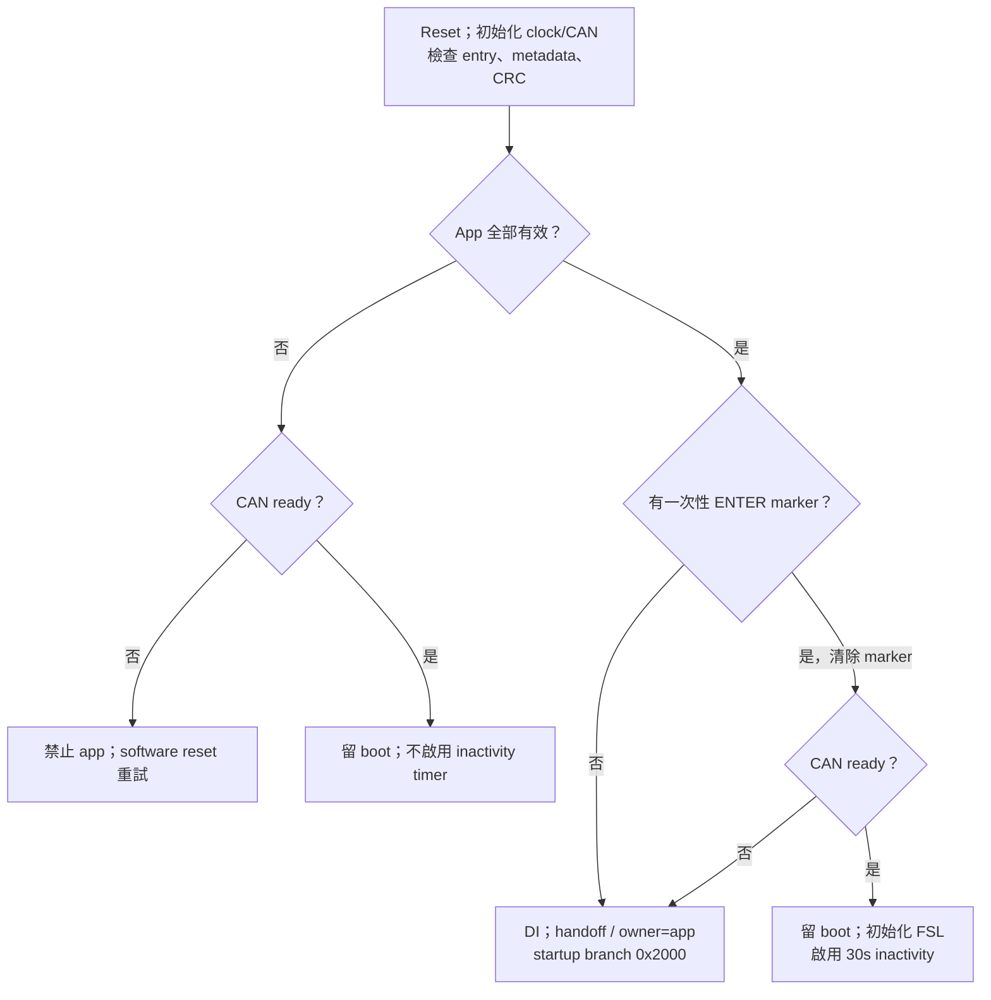

#### C. 30 秒 inactivity、START、失敗與更新成功

| 事件 | boot 的實際結果 |
| --- | --- |
| 原 app 有效、ENTER 後尚未接受 START | 連續30秒沒有符合底層接收條件的 CAN request，關閉已初始化的 FSL 後返回原 app |
| 持續 INFO／HELLO／其他符合接收條件的 frame | 都會刷新 inactivity；不是上電後固定30秒，也不是只由 DATA 刷新；未知 command／錯誤 DLC 也可能刷新 |
| 原 app 無效 | 從一開始不啟用 inactivity timer，接受 START 後也不會自動啟用；失聯仍留 boot 等重試 |
| START 被拒絕（protocol／target／size／FSL not ready） | 沒有進入 started state；不能把這個拒絕當成 app 已被擦寫；原 app 有效且 timer 啟用時仍可 inactivity 返回 |
| START 已接受後 inactivity 到期 | 若本次 timer 原本啟用，回 session-timeout error、留 boot、關閉後續自動返回；不跳可能只有部分內容的 app |
| ABORT／erase-write error／END metadata 或 CRC error | error 返回主迴圈，關閉後續自動返回，留 boot 等新 session；ABORT 即使在 START 前也走這條留 boot 路徑 |
| END 長度／state 尚不完整 | 回錯誤但保留 session；不得先宣布成功或跳 app |
| END 收齊、metadata size 等於 START size、Flash metadata 與 CRC 正確 | ACK 成功，關閉 FSL，寫 `0xFF718` update-complete marker，再 software reset；下次 reset 重新通過 A 節與 ENTER 判斷才進 app |
| 擦寫中掉電 | 下次上電重新跑 A 節；若 image 仍有效且無 ENTER 則可啟動，否則留 boot；不是保證有雙映像回復 |

底層接收條件為standard／非RTR、ID700或720..727、DLC>0；通過即刷新timer，之後才
檢查 command。計時由1ms TMRJ0 IRQ 累加，Flash 操作關 IRQ 時不是嚴格的 wall-clock
30秒。timer 已停用或未啟用時，PC 失聯不能期待 target 自動 timeout／reset；tool 的
bounded wait／ABORT 不能取代供電、Flash、IRQ 與掉電的實板驗證。

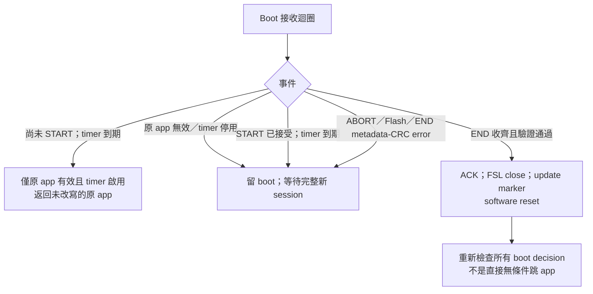
#### 固定完整 IRQ 介面：不同 app 專案沿用同一份 boot

F13 image format6／boot1.4.0 起，boot 固定擁有一般 vector 0x04..0x7C
的61個位置（包含保留位置，但 app 不可啟用保留 vector）。Reset 仍屬 boot；
0x02 保留，physical BRK 0x7E 不轉送，留給 debugger／device 設定。
App 的64個4-byte slot 固定在0x2000..0x20FF，公式是0x2000＋vector×2。

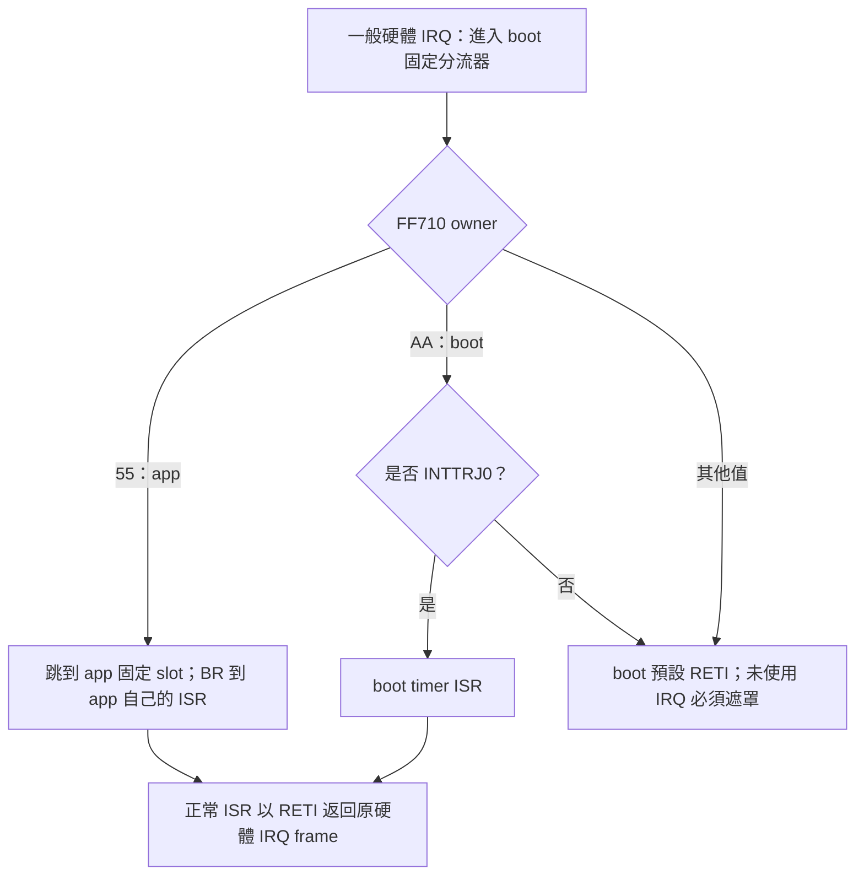

INTTRJ0 不再是普通 callback，與其他 app ISR 一樣使用無 vect 的 interrupt
pragma、以 RETI 返回。Boot 內部的 CALL／RET 僅用於壓縮組語分流，先移除
自己的暫存 call frame 再交給 ISR，並不是 C ISR 呼叫另一個 ISR。
分流暫存額外使用10 bytes stack，恢復 AX／HL／ES，原硬體 PC20／PSW frame
保持完整；未採用在分流期間重新 EI 的巢狀模式。

加入 app IRQ 只需：新增非 static ISR、在 app_irq_handlers.json 設定實體 vector
與函式名、將來源加入 app MTPJ、在 EI 前初始化／清旗標／設定優先權與解除遮罩。
App pre-build 會驗證 pragma 並產生 app_irq_table.inc；不要手改產物或 boot 向量。
未用 slot 指向 app 預設 RETI，不再是FFFFFFFF；預設返回不替你清除硬體原因，
所以不能把未處理的 IRQ 打開，否則可能反覆進中斷。

不同 app 專案可共用 boot 的前提：相同 R5F10BMG、8KiB boot／app2000、
完整跳轉表、FF700 recovery 與 FF710..FF71F no-init／stack 保留、startup 與
4MHz／PLL32／CAN16 交接、format6 的256-byte metadata／CRC32，以及
CAN protocol5／ID700與701。App 版本／build 由自己的 app_image.json 產生 ftable.inc／identity，
不綁定 boot 的編譯版本；若仍需 Tool 從 app ENTER 回 boot，該 app 必須實作
INFO／ENTER 與相同 reset request，不能只加入向量表。

**本次需先以燒錄器安裝 matching format6 boot＋app 一次。** 舊 format4 的
callback app 與新 RETI boot 不相容，即使 CRC 正確也拒絕；以後在上述契約內
換 app 專案、新增一般 IRQ 或改 app 版本，只更新 app，不需重燒 boot。
若改 MCU、分區、共用 RAM、boot 本身使用的 IRQ／更新通訊或 metadata ABI，
仍須評估並重新安裝 boot。完整向量不代表所有周邊已初始化。

F24 與 F13 現在採相同 app-facing 原則：boot 持有固定完整一般向量、依 owner
轉送 app slot、app ISR 都是 RETI。F24 用各向量直接分支；F13 為維持8KiB
boot 以共用組語分流節省 ROM，實作不同但 app 不再有 callback 特例。
目前軟體建置／HEX與stack模型檢查可執行；實板新增IRQ、E2 lite、update/reset
及斷電回復仍需驗證，不能把模型結果視為硬體通過。
<!-- F13_BOOT_DECISION_END -->

## 8. I2C Master：本版只能探索 G16

1. Probe Host → I2C Master → IICA0 / 100kHz / slave `0x09`。
2. `0x09`是未左移7-bit，不填`0x12`write address。
3. `Probe G16 Reference`：setup / repeated-start / inquiry / signature / area。
4. Label、boot/app version是範例回報常數，不是認證MCU/installed image。
5. Port/rate/address變更後舊metadata不再current，重新Probe。
6. G16 raw BIN可驗CRC16；MCU/version/start metadata為N/A。

<span class="state state-blocked">Start Firmware Update 保持 BLOCKED</span>

供應的slave缺少active READ/auth與安全boot CRC/recovery，不送erase/write/app jump。
CRC16/XMODEM與CAN CRC32不同，不能混用；corrected slave ready後再補更新/read-back/復原。

<a id="host-bridge-firmware"></a>

## 9. Misc：透過 UART 更新 F24 (MCU CAN host) App

此頁更新的是PC直接連接的host，不是CAN／I2C外部device；不以CAN500K傳切換命令。
支援optional feature bit10的host才可操作；舊standalone firmware保持封鎖，
不能把CAN `_update.bin` 或G16 raw BIN改名後使用。

```mermaid
flowchart TD
    PROBE[Open + Probe Host] --> CAP{支援 bridge self-update?}
    CAP -->|否| BLOCK[BLOCKED；首次需 debugger 安裝 matching boot/app]
    CAP -->|是| INFO[Misc：Read Bridge Update Info]
    INFO --> ENTER[明確 Enter Bridge Boot；同 COM 重新 Probe]
    ENTER --> BIN[載入 HOST APP BUR1 BIN；核對 MCU／geometry／CRC32]
    BIN --> CONFIRM[確認目的地 HOST BRIDGE／範圍／大小]
    CONFIRM --> STAGE[ABORT清暫存；四次STAGE_METADATA各64 bytes]
    STAGE --> VALIDATE{收齊256 bytes且metadata CRC／身分／分區有效?}
    VALIDATE -->|否| METAERR[BLOCKED；不擦除，檢查metadata]
    VALIDATE -->|是| WRITE[BEGIN才擦除；DATA／END；完整CRC成功才提交標記]
    WRITE --> STAY[留在 boot；不自動 RUN]
    STAY --> RUN[明確 Run Validated Bridge App；重新 Open + Probe]
```

1. 確認HOST BRIDGE識別，再切到最後的Misc；`Read Bridge Update Info`不擦寫。
2. `Enter Bridge Boot`後等同一COM重新探索，核對實際MCU、UART及boot descriptor。
3. 共用Load Update Image載入`*_bridge_update.bin`；要求HOST APP角色、contract3 BUR1 metadata、
   長度、尾端CRC32及live geometry／minimum boot version一致。
4. 明確確認目的地HOST BRIDGE、COM、檔案、app start及size，才可更新；預設No。
5. 寫完仍留boot，按`Run Validated Bridge App`才執行；COM關閉後重新Probe確認版本。

Close COM會取消並嘗試ABORT。中斷或CRC錯誤保留boot，但不保證舊app還可用。
有效manifest magic最後才提交；完整CRC未通過時不得跳app。這是完整性保護，不是簽章或防回滾。

metadata區固定256 bytes（core128＋reserved128填0xFF），與UART單包128是不同概念。
同一STAGE_METADATA command帶16-bit offset／total，分offset0/64/128/192傳四次；
只暫存RAM，收齊及驗證後BEGIN才可擦Flash。缺段、衝突、CRC錯誤或BEGIN前取消不擦除。
Read Info在有有效app時，會以同一READ_METADATA command分四次讀回並核對descriptor；
更新完成也比對完整區域read-back。有效core長度為128，不將256塞入舊8-bit欄位。

### F24 (MCU CAN host) 首次安裝與產物

目前R7F124FLJ3xFB為256KiB code flash，分區來源為
`firmware/f24_bridge_common/f24_bridge_layout.h`，不是PC硬編碼。

| 區域／檔案 | 意義 |
|---|---|
| Boot `0x00000..0x04FFF` | 20KiB；Misc不可改寫boot |
| Host app `0x05000..0x3FBFF` | 235KiB capacity；實際BIN動態長度 |
| 保留 `0x3FC00..0x3FFFF` | 最後1KiB含debug monitor，不擦寫 |
| App offset `0x000 / 0x100 / 0x200` | IRQ table256／metadata區256（core128＋reserved128）／linked code |
| `RL78_F24_Bridge_boot` 的 `.mot` | 初次debugger／programmer安裝boot |
| `RL78_F24_Bridge_app` 的 `*_flash.mot` | 初次安裝matching app，已排除低位向量／option／debug區 |
| `*_bridge_update.bin` | 後續Misc更新app；最後4bytes為CRC32 |

最小image為516 bytes，確保尾端CRC不與metadata重疊；實際程式長度仍由linker決定。

不要直接安裝原始app `.mot`／`.abs`代替`*_flash.mot`，低位向量placeholder並非獨立啟動映像。
SC重產後先執行`prepare_f24_bridge_projects.ps1`再clean rebuild；boot/app共用同一硬體來源。
MCU flash-mode程式與RFD須在RAM，IRQ／常數／stack／handoff RAM須通過linker檢查。
BRK使用RETB而非一般IRQ的RETI；boot不轉送physical BRK。這些source／build檢查不代表E2 lite已驗證。

<span class="state state-report">F24 split boot/app與PC parser／mock flash測試通過；實板UART擦寫、IRQ handoff、E2 lite及斷電復原尚未驗證。</span>

<div class="capture-pending">待補Misc的host descriptor、HOST APP確認與明確RUN畫面。首次安裝及真實erase/write須另有具體操作授權；不以模擬flash測試當成板測成功。</div>

<!-- F24_APP_IRQ_BEGIN -->
### F24 (MCU CAN host)：各 app 專案獨立產表，沿用同一份 boot

本節為F24 (MCU CAN host) 的Bridge Boot/App；其自身App由Misc／UART更新。
F13 (MCU CAN device) 為CAN另一端的更新對象；後續F24 (MCU CAN device) 須使用另一組Boot/App。

Boot 固定轉送一般 IRQ 到 app start＋實體 vector×2；app 的64個4-byte slot
固定佔用 offset000h..0FFh。各專案決定 slot 要跳到哪個函式，boot 不認識
aaa_irq／ccc_irq 等 app 名稱。這項流程不改 UART boot、分區或 BUR1 contract3。

```mermaid
flowchart TD
    BOOT["同一份 F24 (MCU CAN host) boot：固定一般向量轉送"] --> SLOT["app 固定 slot；位置契約不變"]
    A["App A：自己的 mapping／aaa_irq、bbb_irq"] --> GEN["App-local pre-build 驗證與產表"]
    B["App B：自己的 mapping／ccc_irq、ddd_irq"] --> GEN
    GEN --> SLOT
    SLOT --> ISR["跳到該 app 的正常 ISR，以 RETI 返回"]
```

工程只保留兩個產品：Bridge_boot 是唯一 Boot；Bridge_app 是唯一正常 App。
f24_board 提供共用 board／driver／SC，不是第三份可燒錄韌體。
App 的 main、Host Link dispatch、CAN service 已回到 App 自己的目錄；
共用 UART／timer 僅依賴 f24_runtime_hooks.h，由 Boot／App 分別實作。
可攜式 I2C staging 在 common；分區／BUR1 支援在 f24_bridge_common。

SC 唯一設定為 firmware/f24_board/f24_board.scfg，輸出為同目錄 src/smc_gen。
搬移工作目錄後先執行 prepare_f24_bridge_projects.ps1 -Kind app 更新 SC 路徑，
由 App MTPJ 開啟並核對輸出位置。重產後再 prepare -Kind app、build App；
僅 Boot 自己的硬體設定改變才另行 prepare -Kind boot、build Boot。
prepare 讀取各自既有 MTPJ，保留 build options／hook 與 App JSON，不再複製第三個專案。
SC 新位置的 GUI 重產仍待操作確認；目前已驗證現有設定、來源與乾淨編譯。

每個 app 根目錄保存兩份來源：app_irq_handlers.json 對應實體 vector 與
函式名；app_image.json 保存自己的 packed version／build。產生的
bridge_vectors.asm 與 f24_app_identity.generated.h 不可手改；版本同時用於
Host Link 回報及 BIN metadata，不必修改共用 boot layout header。

```json
{"0x08":"aaa_irq","0x0A":"bbb_irq"}
```

上例只展示新增 IRQ；從 bridge 範例建立專案時，必須保留仍有使用的 UART／
timer／CAN／I2C mapping，不可用這兩筆覆蓋必要的清單。B 專案可改用其他合法
vector／函式名。來源需加入該 app MTPJ；ISR 必須 global、非 static、正常
interrupt pragma 且無 vect=，函式定義為 void handler(void)，以 RETI 返回。
未用的 IRQ 必須停用或遮罩，預設 RETI 不會替你清除周邊原因。

整合順序：

1. 以已整合的 F24 split app 為範本，建立自己的 app 專案；每個資料夾一份
   MTPJ。保留 R7F124FLJ3xFB、BRIDGE_SPLIT_APP、startup／4KiB stack／
   FF700與FF710保留、app5000／code5200／末1KiB保護等契約。不是任意
   standalone 專案加入 JSON 就能完成整合。
2. 複製專案時一併保留自己的全部 App .c／.h、generated_projection、兩份 JSON
   及 bridge_vectors.asm 的專案登錄。若移到不同目錄，先在 CS+ 修正相對
   source／include／library／preinclude 路徑；不要重新產生或覆寫共用 boot。
3. CS+ pre-build 呼叫 prepare_f24_app_irq.ps1 -AppProject "."；post-build
   呼叫 package_f24_bridge.ps1 -Kind app -AppProject "."。腳本路徑指向
   tool 的 scripts，跨目錄專案請使用正確完整路徑；不要呼叫雙專案 prepare。
4. 登錄各 app 自己的 ISR、修改 mapping／app_image.json 後，只執行：

```powershell
.\scripts\build_f24_bridge.ps1 -Kind app -AppProject ".\ProjectA"
.\scripts\build_f24_bridge.ps1 -Kind app -AppProject ".\ProjectB"
```

也可從 CS+ clean rebuild，hook 會自動執行。只驗證產物是否最新使用
prepare_f24_app_irq.ps1 -AppProject 專案路徑 -CheckOnly，不會寫檔。
產表不讀其他 app 的 IRQ 清單；build 的 -AppProject 與 -Prepare 不可併用，
避免誤重建參考專案。App-only 操作不產生／編譯／寫入 boot。

封裝依各 MTPJ 檔名找 DefaultBuild 下的 map／MOT，輸出各自的
專案名_bridge_update.bin／專案名_flash.mot。除原本分區、stack、flash/RAM、
metadata／CRC 檢查，還逐 slot 比對實際 branch 與 mapping，核對 ISR 的
真實 RETI／保留 BRK slot 的 RETB。Physical BRK 仍不轉送。Build 失敗時
舊 BIN 可能仍保留，不得把前次產物當成這次成功輸出。

本輪 A／B 實際 CC-RL 編譯與封裝、不同 mapping／版本、輸入拒絕及 boot
向量／MTPJ／MOT 雜湊隔離測試通過；測試沒有啟用新 IRQ，也沒有燒錄 MCU。
先安裝policy contract3 matching boot/app；之後相容的app-only IRQ改動不需重燒boot。
CAN區塊更新需要bridge宣告泛用CAN burst22／bit12，以live能力判斷，不以版號猜測。
已有相容Boot時，可用Misc115200更新App。實板只換 app、新舊 IRQ／UART ENTER、reset／斷電
與 E2 lite 仍待驗證。
F13 保留既有 app-local mapping 流程；未新增 F13 I2C boot。

若舊F24 App重新連線時INFO成功、接著0x57回BAD_COMMAND，可能是外層分派
漏了READ_METADATA。應安裝包含完整metadata讀回支援的App，不可略過驗證。復原方式：

1. 關閉COM，按住實體SW1（P32，LOW），同時重置／重新上電，讓既有Boot留在recovery。
2. 開啟Tool，Host Baud115200，Open + Probe Host；確認live顯示BOOT。
3. Misc重新Load Update Image，選交付套件中與此Boot相容的_bridge_update.bin，確認metadata及CRC。
4. Update HOST APP成功後另按Run Validated Bridge App；再重新Probe並關閉／重開Tool確認實際App身分。

若Boot、分區與IRQ契約仍相容，不必重燒Boot。步驟為source／mock驗證，實板復測待補。
<!-- F24_APP_IRQ_END -->

## 10. 依層次定位錯誤

| 現象 | 檢查層次 |
|---|---|
| Host Link timeout | COM、UART wiring/baud、host firmware |
| X1 / CAN clock error | 實際晶振、Smart Configurator、runtime clock |
| TX log有，wire是ID0/DLC0 | clock/register/frame buffer；log不等於wire正確 |
| bus error / dominant-bit error | transceiver供電、STB、共地、H/L、termination、rate/ACK |
| 有request沒response | device firmware/filter/ID、CAN RX/TX；分開驗host/device |
| CRC/metadata error | 不可START；取得正確_update.bin |
| CRC MATCH但button灰色 | 讀prerequisite：mode/layout、boot state、override、busy |
| Misc unsupported／BUR1 mismatch | 先確認host feature／matching boot；外部device BIN不能拿來更新host |
| Host要求128但回報96 | 重燒matching bridge firmware；本版沒有舊host相容路徑 |

## 11. 後續補圖與 device ready gate

[拍攝清單](SCREENSHOT_CHECKLIST.md)列出每項功能、檔名與證據要求。
Device ready後補App INFO → Enter → Boot INFO → confirmation → progress → 新版確認；
並補錯MCU/start/size、取消、bus-off、掉電、CRC fail與boot retention。
I2C及RA只在實際firmware與板測ready後補操作，不預填虛構成功。
截圖與log應移除個人路徑、序號及不必要資料。

## 12. 功能、文件與 web 同步規則

每次功能變更，同一輪同步程式對應的MD／受影響PDF與本頁：操作步驟、
支援／BLOCKED範圍、主畫面配置、metadata來源與截圖清單必須一致。
Bootloader教材與知識庫導覽只有受影響時才更新；精確版號與實測數字留在交付紀錄。
實際UI截圖或板測尚未完成時，保留待補及NOT RUN，不用舊圖冒充新版本。
下載與六個流程入口由Tool的`PUBLIC_RESOURCES`原稿同步；執行
`sync_public_resources.ps1 -CheckOnly`核對兩頁，保留下載URL與操作錨點。

為重新build／替換EXE，已授權自動正常關閉此專案build目錄內的tool，
讓worker取消、COM／log釋放與INI儲存完成；不再逐次要求使用者關閉。
其他路徑的同名tool不處理。若15秒內無法正常關閉，停止build，不強殺更新中的程序。

<!-- COMMON_IMAGE_POLICY_BEGIN -->
## 共用 Metadata 與跨介面防呆

Metadata固定256 bytes：前128 bytes為已定義內容（含32-byte UPD1政策），
後128 bytes必須為0xFF；app code仍從offset0x200開始。舊core96格式不相容。

| UI資訊 | 意義 |
| --- | --- |
| Update Policy | DEVICE APP或HOST APP，以及允許CAN／I2C／UART更新的清單 |
| Boot / IRQ ABI | 映像要求的最低boot版本，以及固定向量介面識別 |
| MCU、版本、分區、CRC | 仍來自載入BIN；不以目前TAB或在線device補造 |

允許更新介面不是app執行時使用的周邊。CAN-only BIN切到I2C仍顯示原本
MCU／版本／CRC32與政策，卡片及政策欄變紅並封鎖更新；不改解讀為G16 raw BIN。
Misc的目的地是HOST BRIDGE APP，不能拿DEVICE APP更新host。
PC到bridge的Host Link UART不算device更新介面；未實作UART device adapter。

上方Baud只管PC到bridge：上電115200，驗證APP支援後可協商460800／921600。
CAN／I2C／未來第二組UART不跟著換速。UART device映像的UPD1 policy version2
在metadata112..115宣告編譯時固定的device_uart_baud，Tool顯示UART @固定值，
不能由Host Link選單覆寫。boot/app須共用target編譯設定；version1 CAN／HOST
BIN保持原值與相容性。BUR1的uart_baud另指bridge自身BOOT固定更新速度。
目前僅準備UART policy解析、build helper與防呆；未提供UART device燒錄流程。

正常Close會盡力回115200；異常斷線後只對選定COM有限探測三組速度。
Misc ENTER改以BOOT描述器的固定baud重連，現行115200，不沿用APP高速。
F24分頻計算值115200→114942、460800→454545、921600→909090；Tool log
會列名義／計算值。高速度的FTDI、時鐘誤差及負載可靠性仍待實板驗證。

更新路徑必須同時受BIN政策、live boot能力、bridge選定port支援；並通過
MCU／target／分區／protocol／IRQ ABI／最低boot版本／CRC檢查。
UI與worker皆檢查，device boot在首次擦寫前再驗證完整metadata，不能只靠按鈕。
切換介面不能沿用另一介面的探索結果；port／address／rate改動後必須重新確認。

F13 (MCU CAN device) 使用CAN protocol5、image format6，DEVICE_APP／CAN／F1V1。
F24 (MCU CAN host) 使用BUR1 contract3，HOST_APP／UART／F2V1。
後續F24 (MCU CAN device) 是不同專案，不能因型號相同就套用HOST_APP／BUR1。
平台首次安裝須有matching Boot/App；不同更新協定或IRQ契約不能任意混用。
已有matching Boot時，可用Misc更新相容的Host App；Misc不更新boot本身。
精確配套版本與映像雜湊以交付說明、live INFO及BIN metadata為準。
已固定的完整一般向量轉送架構不變，未來相容app新增中斷仍只更新app。

G16新版I2C boot/app依使用者要求延後開發；舊範例保留參考及read-only探索，
不提供erase／write／app jump，也不因tool新增metadata就視為可安全更新。

正常更新／END CRC成功，不代表reset後App已執行，也不代表完整故障驗收。
自動測試包含錯映像、介面／目的地不符、
metadata重送／缺段／CRC錯、重設與768個模擬中斷寫入點。這不是實板斷電驗證；
實體CAN／FSL故障、UART斷線、
最大映像CRC耗時、debug／IRQ、斷電復原及1366×768／DPI視覺驗證仍需板測／目視。
CRC提供完整性，不是簽章、身分認證或防降版。

```mermaid
sequenceDiagram
    participant P as PC Tool
    participant H as Bridge APP
    P->>H: 上電115200 Probe / Baud INFO
    P->>H: SET 460800 或921600
    H-->>P: 舊速度ACK完整傳完
    Note over P,H: 兩端切換Host Link，device周邊不變
    P->>H: 新速度CONFIRM
    H-->>P: ACK / 重新驗證身分
    Note over H: 2秒未確認則回115200；已確認不因閒置改速
```

```mermaid
flowchart TD
    BIN["共用BIN解析<br/>身分、CRC、更新政策"] --> ROUTE{"目的地／選定介面相容？"}
    ROUTE -->|"否"| STOP["紅色BLOCKED<br/>不送START／BEGIN"]
    ROUTE -->|"是"| LIVE["比對live boot與bridge port<br/>分區、IRQ ABI、最低boot版本"]
    LIVE --> META["分段傳完整256-byte metadata<br/>boot驗證／CRC封存，不擦寫"]
    META --> VALID{"全部通過？"}
    VALID -->|"否"| STOP
    VALID -->|"是"| WRITE["START／BEGIN後更新<br/>END驗證Flash映像CRC"]
    WRITE --> BOOT["重啟仍由boot驗證<br/>無效映像留boot復原"]
```
<!-- COMMON_IMAGE_POLICY_END -->
