[知識庫首頁](https://released.github.io/) · [MCU CAN device 開發](../slide_boot_loader_for_RL78/)

<a id="article_top"></a>

# RL78 ISP Tool 與 MCU CAN host 操作

FirmwareUpgradeTool 透過 MCU CAN host 與 CAN device 通訊。
本頁整理 Tool 操作、Custom Transfer、CAN 更新及 Host App 自身更新。

<!-- ISP_MODE_NAV_BEGIN -->
| 分類 | MCU device 範例 | 操作入口 |
| --- | --- | --- |
| Classical CAN | F13／F24 | [App 更新與確認](#f13-device-update) |
| CAN FD | F24 | [App 更新與確認](#can-fd-update) |
| Custom Transfer | F13／F24 Classical CAN、F24 CAN FD | [三種範例、原始碼與通訊測試](#custom-transfer) |
<!-- ISP_MODE_NAV_END -->

- [連線與主畫面](#tool-operation)
- [欄位、Metadata 與狀態訊息](#tool-ui-fields)
- [Host App 更新](#host-bridge-firmware)
- [更新政策與通訊速度](#image-update-policy)

<!-- PUBLIC_RESOURCES_BEGIN -->
<a id="downloads"></a>

## 下載與操作總覽

Host 透過 Host Link 連接 PC 並橋接 CAN；device 是 CAN 另一端接受更新的 MCU。
F13 (MCU CAN device)、F24 (MCU CAN device) 各自具有獨立的 Transfer／Boot／App 工程。
F24 (MCU CAN host) 使用獨立的 Bridge Boot／App，透過 Misc／UART 更新自身 App。

以下連結提供 Tool、MCU CAN host 與 MCU CAN device 的下載及原始碼。
首次安裝Boot使用燒錄器，之後更新App才使用對應的Tool流程；不可把Host與Device映像互換。

| 項目 | 下載／原始碼／說明 | 適用方式 |
| --- | --- | --- |
| PC Tool | [Windows EXE](https://raw.githubusercontent.com/released/simple_renesas_isp_tool/main/build/FirmwareUpgradeTool.exe)／[完整原始碼](https://github.com/released/simple_renesas_isp_tool) | Windows x64；先安裝實際VCOM所需driver，再選COM並Probe Host |
| F24 (MCU CAN host) Boot | [Boot專案](https://github.com/released/simple_renesas_isp_tool/tree/main/firmware/RL78_F24_Bridge_boot)／[Boot MOT](https://raw.githubusercontent.com/released/simple_renesas_isp_tool/main/firmware/RL78_F24_Bridge_boot/DefaultBuild/RL78_F24_Bridge_boot.mot) | 首次以燒錄器安裝；Misc不更新Boot |
| F24 (MCU CAN host) App | [App專案](https://github.com/released/simple_renesas_isp_tool/tree/main/firmware/RL78_F24_Bridge_app)／[Misc 更新 BIN](https://raw.githubusercontent.com/released/simple_renesas_isp_tool/main/firmware/RL78_F24_Bridge_app/DefaultBuild/RL78_F24_Bridge_app_bridge_update.bin)／[燒錄器初裝 App MOT](https://raw.githubusercontent.com/released/simple_renesas_isp_tool/main/firmware/RL78_F24_Bridge_app/DefaultBuild/RL78_F24_Bridge_app_flash.mot) | Misc 載入 `_bridge_update.bin`，使用 UART115200；`_flash.mot` 搭配 Boot MOT 供燒錄器初裝 |
| F13 (MCU CAN device) Boot | [Boot專案](https://github.com/released/RL78_F13_Boot_loader_CAN)／[Boot 專用 HEX](https://raw.githubusercontent.com/released/RL78_F13_Boot_loader_CAN/main/DefaultBuild/boot0000_1FFF.hex) | 燒錄器安裝／重燒 Boot；範圍為 `0x0000..0x1FFF`，不包含 App |
| F13 (MCU CAN device) App | [App專案](https://github.com/released/RL78_F13_Boot_loader_CAN_app)／[初裝合併HEX](https://raw.githubusercontent.com/released/RL78_F13_Boot_loader_CAN_app/main/boot_app.hex)／[CAN更新BIN](https://raw.githubusercontent.com/released/RL78_F13_Boot_loader_CAN_app/main/DefaultBuild/RL78_F13_Boot_loader_CAN_app_update.bin) | 合併HEX供燒錄器初裝；CAN TAB載入_update.bin更新Device App |
| F13 (MCU CAN device) 通訊測試 | [Transfer範例](https://github.com/released/RL78_F13_CAN_Transfer) | Custom Transfer，不擦寫Flash；不是Boot/App更新映像 |
| F24 (MCU CAN device) Classical CAN Boot／App | [工程配置與建置說明](https://released.github.io/slide_boot_loader_for_RL78/#f24-can-device) | 燒錄器初裝 Boot HEX／App flash HEX；CAN 更新使用 App update BIN |
| F24 (MCU CAN device) Classical CAN 通訊測試 | [Transfer 原始碼](https://github.com/released/RL78_F24_CAN_Transfer)／[操作與截圖](https://released.github.io/slide_isp_tool_for_RL78/#f24-custom-transfer-example) | `RL78_F24_CAN_Transfer` 獨立工程；Custom Transfer 不擦寫 Flash |
| F24 (MCU CAN device) CAN FD Boot／App | [工程配置與建置說明](https://released.github.io/slide_boot_loader_for_RL78/#can-fd-device-engineering) | 燒錄器初裝 FD Boot；Tool 使用配對的 FD App update BIN。連結為工程說明 |
| F24 (MCU CAN device) CAN FD 通訊測試 | [Transfer 原始碼](https://github.com/released/RL78_F24_CAN_FD_Transfer)／[CAN FD 操作](https://released.github.io/slide_isp_tool_for_RL78/#can-fd-custom-transfer) | `RL78_F24_CAN_FD_Transfer` 獨立工程；不使用更新 BIN、不擦寫 Flash |

F24 host firmware 使用完整 Tool repository，包含 firmware 共用來源與 scripts。
F13 Boot與App需以原repository名稱放在同一父目錄，App會引用相鄰Boot；Download ZIP
解壓後請移除-main尾碼。先build Boot，再build App；版本、metadata、IRQ ABI與CRC仍須相容。

### 交付檔與安裝範圍

Boot 使用燒錄器安裝；日常 App 更新才在 Tool 載入 BIN。
F24 host 的 `_bridge_update.bin` 用於 Misc；F13 device 的 `_update.bin` 用於 CAN。
F24 host 更新寫入完成後，按 `Run Validated Bridge App` 啟動並重新確認 Host App。

HEX（Intel HEX）與 MOT（Motorola S-record）含位址記錄；BIN 為連續映像資料，Tool 依 metadata 與 live Boot 契約核對目的地。
副檔名不能互換，檔案的文字大小也不等於 Flash 程式大小。

F13 App 根目錄 `boot_app.hex` 包含 Boot、App 與剩餘區域的 `0xFF`，供燒錄器整體初裝。
同目錄 `boot_app.bin` 內容相同，僅供需要 raw binary 的燒錄方式使用，起點為 `0x0000`；它不是 CAN 更新 BIN。
僅更新 App 時使用上表的更新 BIN，不使用合併映像。

F24 App 原始 `.mot` 與 F13 原始專案 `.hex` 是編譯／封裝輸入。
正式安裝使用已加入 metadata／CRC 的 `_flash.mot`、`flash_app_variable_CRC.hex` 或配套合併 HEX；日常更新使用對應的更新 BIN。
以燒錄器重燒 Boot／App 前，核對實際 MCU、檔案位址及 erase 設定；分區映像不代表燒錄器一定採分區擦除。

原始碼維護可使用 Tool 根目錄的 `github_push.bat`，同步 F13 Boot／App、F24 device 的 Classical CAN 與 CAN FD Transfer／Boot／App，以及 Tool（含 F24 MCU CAN host）。
保留檔清單、本機 `tmp` 排除、確認與恢復方式見 [GitHub 原始碼與交付檔同步](https://github.com/released/simple_renesas_isp_tool/blob/main/docs/GITHUB_PUBLISH_zh-TW.md)。

### 操作與工程入口

| 想了解的動作 | 網站操作／流程圖 | Tool docs中的詳細說明 |
| --- | --- | --- |
| Tool／F24 (MCU CAN host) 流程與責任 | [Tool與bridge動作圖](https://released.github.io/slide_isp_tool_for_RL78/#tool-bridge-flow) | [多介面架構與流程](https://github.com/released/simple_renesas_isp_tool/blob/main/docs/MULTIBUS_TOOL_GUIDE_zh-TW.md) |
| MCU CAN device Boot啟動、ENTER與逾時 | [Boot→App完整條件圖](https://released.github.io/slide_boot_loader_for_RL78/#f13-boot-decision) | [Boot decision與更新流程](https://github.com/released/simple_renesas_isp_tool/blob/main/docs/F13_BOOT_UPDATE_FLOW_zh-TW.md) |
| Tool operation | [COM／Host識別與操作起點](https://released.github.io/slide_isp_tool_for_RL78/#tool-operation) | [共用畫面與操作指南](https://github.com/released/simple_renesas_isp_tool/blob/main/docs/SHARED_CONSOLE_BRIDGE_GUIDE_zh-TW.md) |
| 更新確認／診斷／報告 | [App 確認、差異與驗證表](https://released.github.io/slide_isp_tool_for_RL78/#update-confirmation) | [更新確認與驗證紀錄](https://github.com/released/simple_renesas_isp_tool/blob/main/docs/UPDATE_VALIDATION_zh-TW.md) |
| 更新F24 (MCU CAN host) App | [Misc：Host App更新圖與RUN](https://released.github.io/slide_isp_tool_for_RL78/#host-bridge-firmware) | [F24 UART自更新協定](https://github.com/released/simple_renesas_isp_tool/blob/main/docs/BRIDGE_SELF_UPDATE_PROTOCOL.md) |
| Classical CAN device App 更新 | [CAN：驗證、Enter Boot、更新與確認](https://released.github.io/slide_isp_tool_for_RL78/#f13-device-update) | [CAN區塊更新及保護](https://github.com/released/simple_renesas_isp_tool/blob/main/docs/CAN_BLOCK_TRANSFER_V5_zh-TW.md) |
| Classical CAN Custom Transfer 通訊驗證 | [Custom Transfer 操作](https://released.github.io/slide_isp_tool_for_RL78/#custom-transfer) | [通訊測試協定](https://github.com/released/simple_renesas_isp_tool/blob/main/docs/F13_TRANSFER_PROTOCOL.md) |
| CAN FD device App 更新 | [CAN FD：設定、更新與 App 確認](https://released.github.io/slide_isp_tool_for_RL78/#can-fd-update) | [CAN FD 更新說明](https://github.com/released/simple_renesas_isp_tool/blob/main/docs/CAN_FD_UPDATE_zh-TW.md#can-fd-update) |
| CAN FD Custom Transfer 通訊驗證 | [Discover／Transfer Test 操作](https://released.github.io/slide_isp_tool_for_RL78/#can-fd-custom-transfer) | [CAN FD 通訊測試說明](https://github.com/released/simple_renesas_isp_tool/blob/main/docs/CAN_FD_UPDATE_zh-TW.md#can-fd-custom-transfer) |
| Boot code如何移植 | [Boot/App移植與向量工程](https://released.github.io/slide_boot_loader_for_RL78/#boot-app-porting) | [完整移植指南](https://github.com/released/simple_renesas_isp_tool/blob/main/docs/RL78_BOOT_APP_PORTING_GUIDE_zh-TW.md) |

<a id="tool-bridge-flow"></a>

先用[CAN 更新逐層導讀](https://released.github.io/slide_isp_tool_for_RL78/#can-update-walkthrough)
對照 Tool 操作／BIN 驗證、MCU CAN host 轉送、MCU CAN device metadata／receive／Flash 的表格與流程圖；
[MD](https://github.com/released/simple_renesas_isp_tool/blob/main/docs/CAN_UPDATE_WALKTHROUGH_zh-TW.md)／[PDF](https://github.com/released/simple_renesas_isp_tool/blob/main/docs/CAN_UPDATE_WALKTHROUGH_zh-TW.pdf)可離線閱讀。

Flash mapping、metadata全部256個byte的address／範例值、產生與解析程式，以及CAN逐byte格式，
請讀[Flash／Metadata／CAN移植對照](https://released.github.io/slide_boot_loader_for_RL78/#flash-metadata-can-reference)。

<!-- PUBLIC_RESOURCES_END -->

<a id="tool-operation"></a>

## 1. Tool 連線與主畫面

1. `Refresh` 後選取 `COMx: Windows friendly name`。
2. 選擇 Host Baud，按 `Open + Probe Host`。
3. 核對 HOST BRIDGE 卡片的 MCU、board ID 與 firmware 資訊。
4. 在 CAN／I2C 頁選擇 host 回報的 Bridge port。
5. 功能是否可執行，會顯示於狀態列及 prerequisite 區。

`Reset Host` 重新啟動 host；`Disconnect` 結束 bus／target 連線；`Close COM` 結束 UART 連線並取消工作。
COM friendly name 用於選擇介面，MCU 身分由 Probe 回覆取得。

<!-- TOOL_CONNECT_MEDIA_BEGIN -->
<a id="tool-connect-example"></a>

### COM 連線操作圖

選擇 COM 與 Host Baud 後按 `Open + Probe Host`，核對 `HOST BRIDGE | VERIFIED LINK` 與實際 MCU。
下圖的 COM 已驗證，但 Misc 仍保留 Device CAN BIN，因此出現 `INVALID - HOST APP required`；連線成功與選檔相容是兩項獨立判斷。
進行更新前，依[下載與操作總覽](https://released.github.io/slide_isp_tool_for_RL78/#downloads)載入對應目的地的 App BIN。

圖中的版本、COM 與大小是操作範例；本機檔案與報告路徑已遮蔽，狀態與操作結果保留。
網頁上的操作圖可點選開啟原尺寸，方便查看欄位與訊息。

[](images/tool_operation/tool_connect_COM.jpg)
<!-- TOOL_CONNECT_MEDIA_END -->

### 五張資訊卡

| 資訊卡 | 內容 | 來源 |
| --- | --- | --- |
| HOST BRIDGE | Host MCU／COM／firmware／能力 | Host Link |
| DEVICE TARGET | Device MCU／target／目前模式 | Device live INFO |
| BOOT CODE | Boot version／build／分區 | Live INFO |
| INSTALLED APP | 板上 App version／build／大小 | Live INFO |
| LOADED APP BIN | 檔案 version／build／MCU／大小／CRC | 離線 BIN |

畫面使用 Windows 系統灰白底與加粗群組邊框；綠色表示條件符合，黃色表示等待／政策提示，紅色表示錯誤或 BLOCKED。
卡片同時顯示文字；滑鼠停留時可閱讀完整內容。

共用映像區的 20 個欄位、正常／錯誤訊息與處理方式，集中於 [欄位與狀態判讀](#tool-ui-fields)。
其中也分開說明離線 BIN 與 live 裝置資料，以及 CAN／Misc／I2C 的顯示差異。

最上方為 Host 連線，次上方為 BIN／裝置資訊；下方分成周邊設定、載入／更新映像、Message Log。
底部顯示進度與耗時，只有 Log 歷史和下拉選單捲動。
群組間的資料關聯見 [畫面群組](#tool-console-layout)；Log 的 [Auto scroll down](#tool-log-auto-scroll) 預設啟用，可記憶於 INI。
切換介面後沿用同一份映像與 log，live 資訊則依目前連線重新取得。

### 接線與介面參數

| 項目 | 設定 |
| --- | --- |
| PC ↔ host UART | TX／RX 交叉、共地，預設115200 |
| F24 MCU CAN host | CAN P10 TX／P11 RX／P12 STB；UART P15 TX／P16 RX |
| CAN bus | CAN H／L、共地、兩端終端電阻、相同 bitrate |
| F13 device EVB | X1 4MHz、CAN16MHz；TJA1050T VCC 5V、S LOW |
| F24 device Target Board | X1 4MHz、CAN40MHz；接線依該板原理圖 |
| I2C | IICA0 P62／P63、100kHz，pull-up 電壓依 slave 規格 |

終端電阻以斷電狀態量測。
CAN analyzer 設定與 bus bitrate 一致；active 節點提供 ACK。

### Bridge Board Self Test

1. Probe Host，選定 CAN port，保持 CAN stopped。
2. 選取 host 支援的 Classical CAN 250K／500K／1M，analyzer 使用同一速率。
3. 按 `Start Bridge Board Self Test`；旁邊 `?` 提供 analyzer 提示。
4. 觀察 standard ID `0x123`、DLC8、`11 22 33 44 55 66 77 counter`。
5. Counter 每次啟動從00開始，每秒遞增，FF後回00；按 Stop 結束。

此功能驗證 host TX 路徑。Device 端收發可使用下一節的 Custom Transfer。

<a id="custom-transfer"></a>

## 2. Custom Transfer：MCU CAN device 通訊驗證

<!-- TRANSFER_EXAMPLES_BEGIN -->
Custom Transfer 搭配 device 的獨立 Transfer 工程。
測試包含 DEVICE_INFO、PING、ECHO、PATTERN、STATS，過程不擦寫 App Flash，也不使用更新 BIN。

### CAN_Transfer 範例分類

| MCU device／模式 | 範例原始碼 | Tool 設定 | 操作與對照 |
| --- | --- | --- | --- |
| F13 Classical CAN | [RL78_F13_CAN_Transfer](https://github.com/released/RL78_F13_CAN_Transfer) | Classical CAN／500K | [F13 量測範例](https://released.github.io/slide_isp_tool_for_RL78/#f13-transfer-example) |
| F24 Classical CAN | [RL78_F24_CAN_Transfer](https://github.com/released/RL78_F24_CAN_Transfer) | Classical CAN／500K | [F24 操作與截圖](https://released.github.io/slide_isp_tool_for_RL78/#f24-custom-transfer-example) |
| F24 CAN FD | [RL78_F24_CAN_FD_Transfer](https://github.com/released/RL78_F24_CAN_FD_Transfer) | CAN FD／500K／2M、BRS | [CAN FD 操作與中斷接收](https://released.github.io/slide_isp_tool_for_RL78/#can-fd-custom-transfer) |

### Classical CAN 操作

1. 燒錄 device Transfer 工程並上電。
2. Tool 選擇 Custom Transfer、Classical500K。
3. 按 `Discover Test Target`，核對回覆的 part／target／protocol。
4. 按 `Transfer Test`。
5. 使用 PC log、device UART TRACE 與 analyzer trace 比對 sequence、command、payload、CRC 及 counters。
6. `Export Summary` 匯出結果。

Request 使用 standard `0x710`，response 使用 `0x711`，DLC8。
Payload Byte7 為 CRC-8/ATM。
<!-- TRANSFER_EXAMPLES_END -->

<!-- TRANSFER_DIAGNOSTICS_BEGIN -->
<a id="transfer-diagnostics"></a>

### Custom Transfer 診斷

Device UART（P15／P16，115200）的啟動與錯誤訊息，可對照初始化、CAN 連線及封包處理。

| Device UART 欄位 | 意義與核對方式 |
| --- | --- |
| `CAN init: OK/FAIL`、`result` | CAN 初始化結果；`0x0000` 表示成功，非零值依各 MCU driver 定義 |
| `global_status`／`channel_status` | F24 controller 原始狀態；保留完整值供診斷，不與 F13 的狀態數值直接比較 |
| `stage` | F24 初始化階段；`5` 表示 ready，未完成的 `1..4` 見下表 |
| `CAN config` | 編譯設定：Classical 500K、request `0x710`、response `0x711`、filter `0x710/0x7FF` |
| `STB=P12_LOW/HIGH` | MCU 的 P12 output latch；成功後應為 LOW，初始化失敗維持 HIGH。這不是供電或腳位電壓量測 |
| `TRACE CT RX/TX` | ID、DLC、完整資料、sequence、command 與 CRC；TX 表示 driver 接受傳送，不等於已收到 CAN ACK |
| `TRACE CT CAN_ERROR` | 已擷取的 Classical CAN 錯誤旗標與名稱；重複故障期間最多每 250 ms 輸出一次 |

| F24 stage 1..4 | 檢查位置 | 未通過時的核對方向 |
| ---: | --- | --- |
| 1 | driver configuration | 保留 result，核對 SC 與 clock／CAN 設定 |
| 2 | ID／global／channel reset state | 核對 request ID 與 controller raw status |
| 3 | start communication | 核對 driver result 與 mode transition |
| 4 | communication active | 等待有界；逾時回報 WAITING，核對 controller／bus 狀態 |

F24 的 `clock status: OK` 表示時鐘初始化檢查通過，不是頻率量測。
若時鐘初始化未通過，程式保留 standby，且不使用尚未符合 clock 設定的 UART 輸出。

GET_STATS index 7／8／9 分別是 warning／error-passive／bus-off 擷取計數，index 11 是最後擷取的錯誤旗標。
F13 由 error ISR 擷取；F24 由主迴圈輪詢並清除已觀察旗標，不在 ISR 格式化文字。
硬體旗標可能合併多次事件，計數表示軟體擷取次數；counter 飽和於 `0xFFFF`。
`CLEAR_STATS` 會重設統計，因此零次紀錄不等於已量測到沒有實體錯誤。

比對封包時開啟 Tool 的 `Detailed trace (slower)` 與 Log，另存 device UART 與 analyzer trace。
量測速度時將 device 的 `CAN_TRANSFER_UART_TRACE_ENABLE` 設為 `0U` 後重建，並關閉 Tool detailed trace；
錯誤擷取與 GET_STATS 仍運作。
完整 byte／command／counter 定義見 [通訊測試協定](https://github.com/released/simple_renesas_isp_tool/blob/main/docs/F13_TRANSFER_PROTOCOL.md)。
<!-- TRANSFER_DIAGNOSTICS_END -->

Analyzer 可送出 DEVICE_INFO page0：
ID `0x710`，資料 `A5 01 01 01 00 00 00 DC`。
F13 範例回覆為 ID `0x711`、`5A 01 01 01 00 01 00 8D`。
其他 page 由 Tool discovery 依序讀取。

<a id="f13-transfer-example"></a>

### F13 Classical CAN Transfer 量測範例

<figure><figcaption>CAN analyzer 的 request／response 與 error counter。</figcaption></figure>

<figure><figcaption>MCU UART 的 sequence、command、payload 與 CRC 訊息。</figcaption></figure>

<!-- CUSTOM_TRANSFER_MEDIA_BEGIN -->
<a id="f24-custom-transfer-example"></a>

### F24 (MCU CAN device)：Custom Transfer 操作範例

範例使用 `RL78_F24_CAN_Transfer`，Classical CAN 500K，request／response 為 `0x710／0x711`。
操作畫面與 MCU UART 可對照 discovery、測試命令及結果；點選圖片可開啟原尺寸。

畫面上方保留的 F13 App BIN 屬於 **OFFLINE** 檔案資訊，Custom Transfer 不使用此 BIN。
實際連線的 device 以 **DEVICE TARGET** 的 live 回覆為準；此例為 `R7F124FP`、target `0xF24B`。
Custom Transfer 不回報 Boot／App metadata，對應 LIVE INFO 顯示 `N/A` 是此模式的正常狀態。

#### 1. Tool：選擇通訊測試

Host 連線完成後，CAN 頁選擇 `Custom Transfer`、Classical 500K，再執行 `Discover Test Target`。

[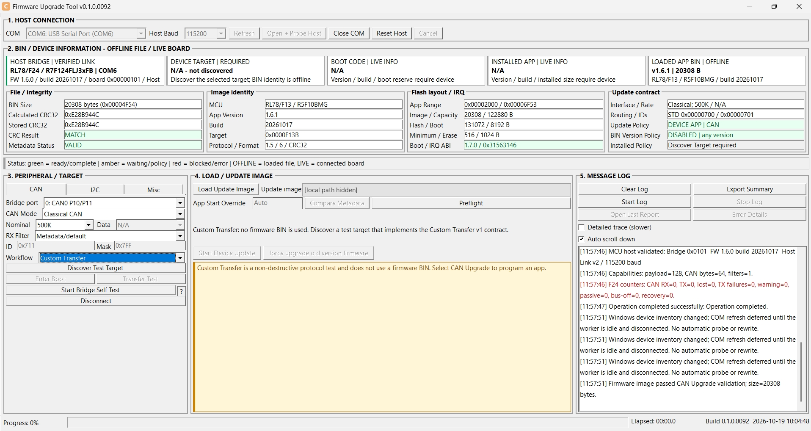](images/custom_transfer/CAN_custom_transfer_1.png)

圖：Host 已連線、device 尚未探索。此模式使用通訊測試命令，更新按鈕不啟用。

#### 2. MCU UART：Discovery 回覆

`DEVICE_INFO` 的 sequence 1..7 依序回覆 protocol、target、part prefix 與 capabilities。
圖中的 RX／TX 分別是 `0x710／0x711`，各筆顯示 `crc=OK`；target page 的 `4B F2` 為 little-endian `0xF24B`。

[](images/custom_transfer/CAN_custom_transfer_mcu_log_1.png)

圖：Device discovery 的 CAN request／response，可核對相同 sequence、command、payload 與 CRC。

#### 3. Tool：Transfer Test 完成

探索完成後，DEVICE TARGET 顯示 `R7F124FP / 0xF24B / protocol 1.0`。
執行 `Transfer Test` 後，Log 顯示 `Custom Transfer test completed successfully`，進度為 100%。

[](images/custom_transfer/CAN_custom_transfer_2.png)

圖：正常通訊測試完成。Log 的 `F24 counters: CAN RX=22, TX=22` 是 **MCU host** 的統計；
`Custom Transfer statistic[index]` 則來自 **MCU device** 的 GET_STATS 回覆。

#### 4. MCU UART：測試命令與統計

Sequence 8..22 可對照 PING（`0x02`）、ECHO（`0x03`）、PATTERN_TEST（`0x04`）與 GET_STATS（`0x05`）。
UART 圖中各筆 request／response 均顯示 `crc=OK`，可與 Tool 結果交叉核對。

[](images/custom_transfer/CAN_custom_transfer_mcu_log_2.png)

圖：Device 的測試命令與統計回覆。Counter 定義與判讀見 [Custom Transfer 診斷](#transfer-diagnostics)。

這組操作紀錄呈現正常 discovery／通訊測試；不包含 CAN 波形量測、故障注入、斷線恢復或 Boot／App 擦寫驗證。
<!-- CUSTOM_TRANSFER_MEDIA_END -->

<a id="f13-device-update"></a>
<a id="mcu-can-device"></a>

## 3. MCU CAN device：App 更新

F13、F24 device 各自提供獨立的 Boot／App 工程。
Tool 使用同一組 CAN Upgrade 操作，依實際 BIN 與 live device 的 metadata 核對 MCU 與更新條件。

BIN size 包含尾端 CRC，capacity 則為可用 App 區域。
App Start 使用 BIN metadata；手動 override 作為額外核對值。

<!-- TOOL_DEVICE_MEDIA_BEGIN -->
<a id="device-update-example"></a>

### Device App 更新操作圖

先完成 Host Probe，在 CAN 頁選取 `CAN Upgrade`、Bridge port 與 device 使用的 bitrate。
以下圖片使用 F13 (MCU CAN device)，各欄數值來自所載入 BIN 與 live device；操作順序依回報模式選擇。
F13 與 F24 device 的正常 CAN App 更新皆已完成實板驗證，使用相同的載入、探索、進 Boot、更新及 App 確認流程。
F24 的完成報告與執行畫面見 [F24 device 更新結果](#f24-device-update-example)。
完整[欄位與狀態判讀](https://released.github.io/slide_isp_tool_for_RL78/#tool-ui-fields)集中於 Tool operation。

#### 1. 載入 Device App BIN

`Load Update Image` 選取 `RL78_F13_Boot_loader_CAN_app_update.bin`，核對 MCU、App version、Metadata VALID 與 CRC MATCH。
此時尚未 Discover，LIVE 資訊為 N/A；離線驗證通過不代表已與 device 連線。

[](images/tool_operation/tool_CAN_update1_load_image.jpg)

#### 2. Discover Target

`Discover Target` 讀取目前模式、Boot 與 installed App 資訊。
圖中為 `APPLICATION MODE`，下一步是 Enter Boot；若回報 `BOOTLOADER MODE`，直接進入步驟 4。

[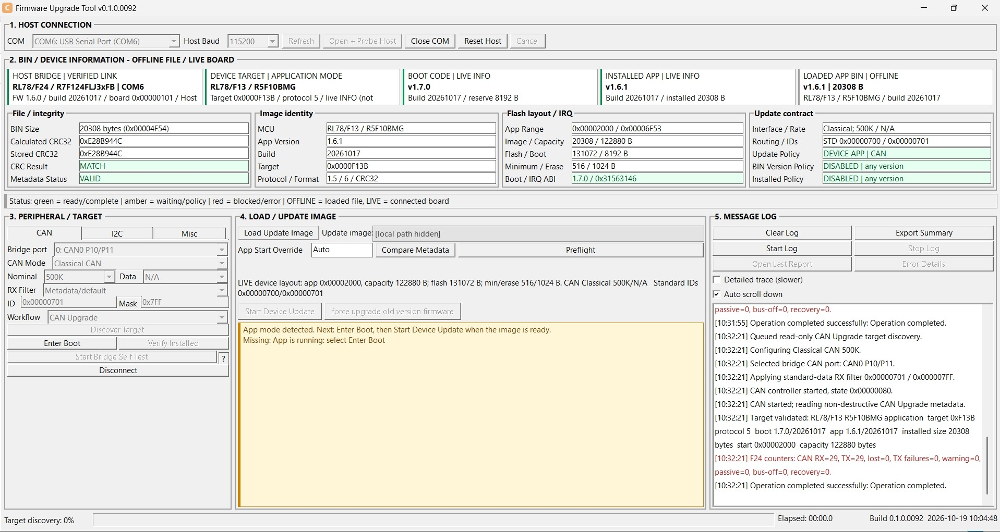](images/tool_operation/tool_CAN_update2_discover_target.jpg)

#### 3. Enter Boot 與操作等待時間

按 `Enter Boot`，等 DEVICE TARGET 回報 `BOOTLOADER MODE` 與 prerequisite 的 Ready。

F13 Boot 在**原 App 有效、ENTER 後尚未接受 START**時，若連續約 **30 秒沒有符合接收條件的 CAN request**，會返回原 App。
這是 inactivity 計時，不是 ENTER 後固定等待 30 秒；符合條件的 INFO 等 request 也會刷新計時。
在確認視窗停留過久，裝置也可能已返回 App，無法直接開始更新。

此時重新 `Discover Target`；若為 App 模式，再 `Enter Boot`，確認目前仍在 Boot 後執行 `Start Device Update`。
畫面先前取得的 Boot 資訊不是持續連線保證。
原 App 無效、START 已接受或錯誤處理後的行為，見 [Boot 逾時與更新狀態](https://released.github.io/slide_boot_loader_for_RL78/#f13-boot-decision)，不沿用此「返回原 App」條件。

[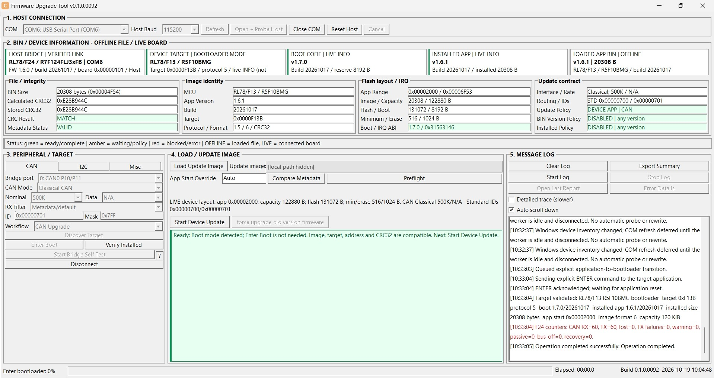](images/tool_operation/tool_CAN_update3_enter_boot.jpg)

#### 4. 確認並開始更新

按 `Start Device Update`，核對確認視窗的 MCU、檔案、版本、size、CRC 與改寫範圍，再確認寫入。
若出現狀態已改變、Boot 未就緒或 timeout，依步驟 3 重新取得目前模式，再確認更新條件。
Tool 在真正更新前會重新讀取模式；`Device is no longer in Boot; update not started.` 表示沒有開始更新，需重新 Discover／Enter Boot。

[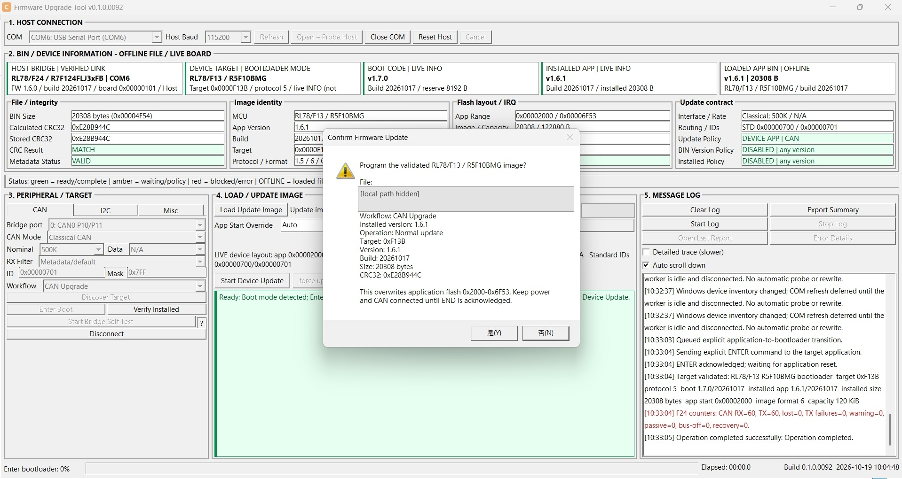](images/tool_operation/tool_CAN_update4_start_update.jpg)

#### 5. 更新進行中

觀察階段、progress 與 Log。保持供電及 CAN 連線；`Cancel` 取消目前工作，`Close COM` 會取消並結束連線。
START 已接受後失聯不會沿用步驟 3 的自動返回原 App 行為；取消、錯誤與不完整映像的處理見 Boot 狀態章節。

[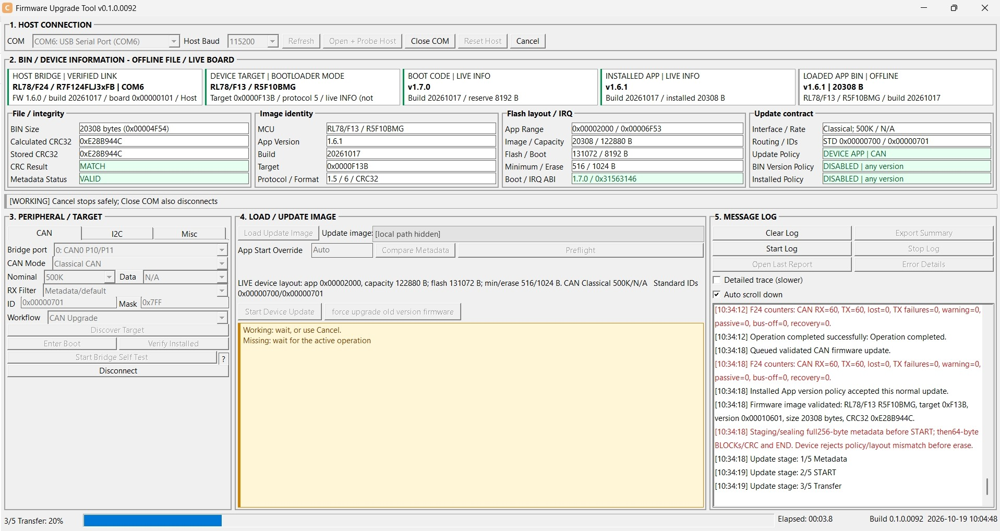](images/tool_operation/tool_CAN_update5_during_update.jpg)

#### 6. 更新完成與 App 確認

只有 END／CRC 通過、APP_READY 與 live INFO 核對完成後，才顯示 `[COMPLETE]` 與 Device App update complete。
正常完成會停止 Host CAN、保留 COM（Host UART），讓使用者檢查 App 與板上功能；因此 DEVICE TARGET 回到 N/A 並要求再次 Discover 是完成清理後的狀態。
App 未確認或 CAN STOP 未確認時，依[完成提示與下一步](https://released.github.io/slide_isp_tool_for_RL78/#update-completion)處理，不自動重寫。
Tool 自動保存 Firmware update report；右下 `MESSAGE LOG` 的 `Open Last Report` 可開啟報告，操作見[更新報告](https://released.github.io/slide_isp_tool_for_RL78/#update-html-report)。

[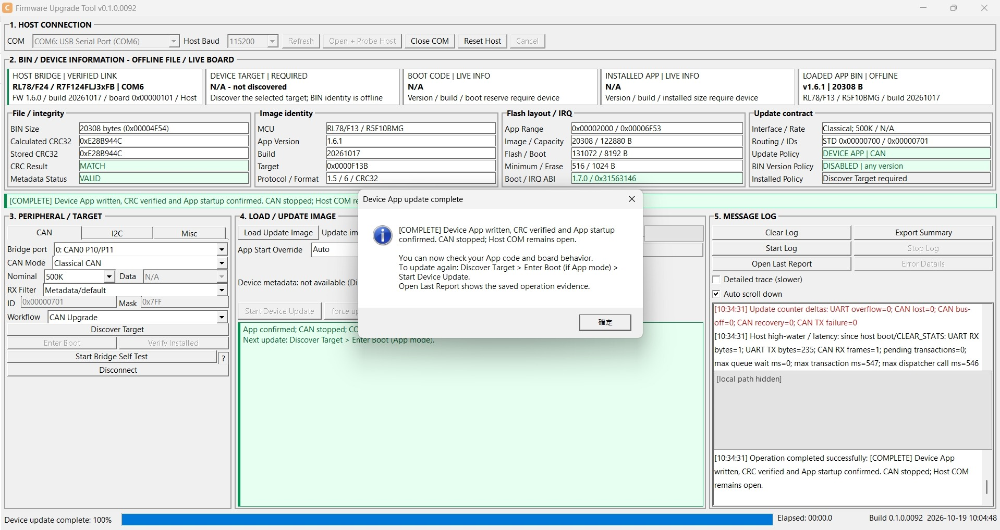](images/tool_operation/tool_CAN_update6_after_update.jpg)

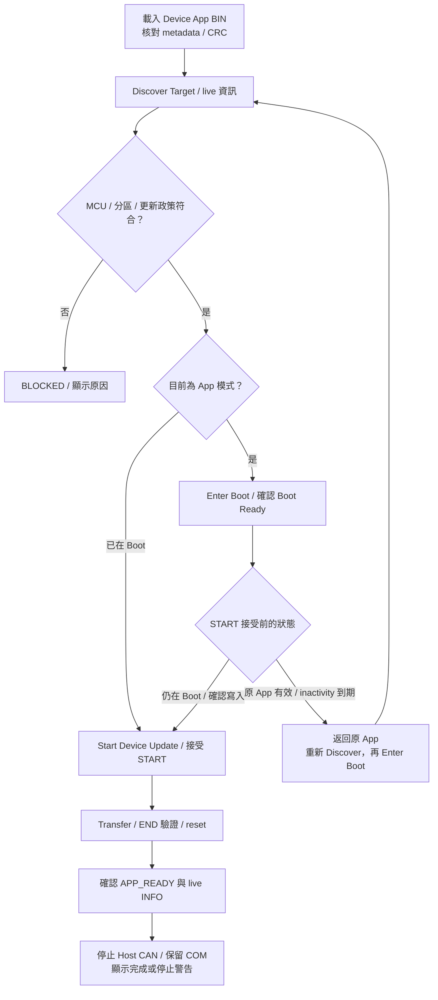

<a id="f24-device-update-example"></a>

### F24 (MCU CAN device)：更新結果與 App 執行

F24 device 已確認可完整執行正常 CAN App 更新：配對 Boot 驗證映像、寫入 App、
END／CRC 通過、reset 後回報 APP_READY，Tool 再核對 live INFO 並停止 Host CAN。
操作沿用上方六個步驟，載入檔案改為 `RL78_F24_Boot_loader_CAN_app_update.bin`，
並核對 F24 device 自己的 MCU、target、Flash 配置與 IRQ ABI。

#### 更新報告

HTML 報告的 `PASS | CAN device update` 與 `[COMPLETE]` 表示寫入、CRC 及 App 啟動確認均完成，
不以進度到達 100% 單獨判定成功。圖中 Host Link 為 115200，CAN 為 Classical 500K。

[](images/tool_operation/firmware_update_report.png)

| 報告項目 | 判讀方式 |
| --- | --- |
| `Target before operation` | 更新前的 device 模式與已安裝 App；不是更新後版本 |
| `Input bytes` | 此次載入並傳送的 App BIN 長度，與 Flash capacity 分開 |
| `App version / Build / Image bytes` 比對 | 完整 HTML 的 live 值與載入 BIN 相符，代表重啟後辨識到此次 App |
| `CAN stopped; Host COM remains open` | App 確認後停止 CAN、保留 Host COM；下一次更新先重新 Discover |

開啟方式、完整欄位與錯誤判讀集中於 [更新報告](https://released.github.io/slide_isp_tool_for_RL78/#update-html-report)。

#### Device UART 執行紀錄

UART 畫面顯示 `boot-validated`、`CAN update: completed`，以及 `log(timer)-V1` counter 從 0 持續遞增。
這份紀錄與 Tool 的 APP_READY／live INFO 一起確認 App 已啟動、timer 與主迴圈持續運作。
V1 是可編輯的觀察標籤，不取代 metadata 的版本號；修改位置見 [App 執行標籤](https://released.github.io/slide_boot_loader_for_RL78/#device-app-runtime-log)。

[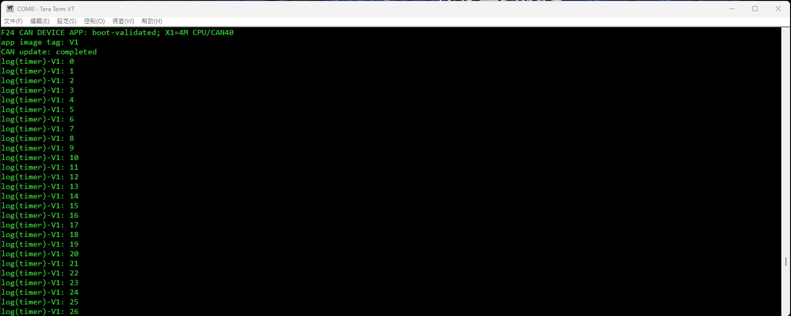](images/tool_operation/MCU_F24_Device_app_log.png)

以上確認正常 115200 Host Link／500K CAN 更新與 App 執行。
250K／1M、長時間壓力、其他 IRQ、取消、拔線及斷電復原各自依 [實板驗證矩陣](https://released.github.io/slide_isp_tool_for_RL78/#update-confirmation) 保留測試結果。
<!-- TOOL_DEVICE_MEDIA_END -->

<a id="can-upgrade-performance"></a>

### 更新速度與紀錄

每64-byte區塊使用一次 ACK，raw frame 每次攜帶最多8 bytes。
更新耗時由映像大小、Host Link／CAN 速度、Flash 與 trace 負載共同決定。

量測時保存 BIN、介面速度、耗時、CRC、retry／error／overflow counters。
封包與 Flash 處理細節集中於以下逐層導讀。

<!-- CAN_WALKTHROUGH_BEGIN -->
<a id="can-update-walkthrough"></a>

## CAN 更新逐層導讀：Tool → MCU CAN host → MCU CAN device

本篇以同一條更新路徑，對照 Tool 操作、傳輸資料、處理函式及 Flash 寫入時點。
完整 byte 規格見 [Flash／metadata 全部 byte 位址與 CAN 格式](https://released.github.io/slide_boot_loader_for_RL78/#flash-metadata-can-reference)。
[MD 原稿](https://github.com/released/simple_renesas_isp_tool/blob/main/docs/CAN_UPDATE_WALKTHROUGH_zh-TW.md)與
[可下載 PDF](https://github.com/released/simple_renesas_isp_tool/blob/main/docs/CAN_UPDATE_WALKTHROUGH_zh-TW.pdf)可供離線對照。

本篇只描述現有 CAN Upgrade：Classical CAN、控制 ID `0x700/0x701`、raw data IDs `0x720..0x727`，
範例 App 起點 `0x2000`、metadata 位於 image offset `0x100..0x1FF`。這些是此範例契約，不是所有 MCU 的固定值。
Host 自身 App 的更新操作見 [Misc／UART](https://released.github.io/slide_isp_tool_for_RL78/#host-bridge-firmware)。

### A. 三層責任與資訊來源

| 層 | 輸入與輸出 | 負責判斷 | 不負責的事 |
| --- | --- | --- | --- |
| PC Tool | BIN／UI → Host Link UART commands | 離線 BIN、更新政策、live target 相容性；建立 CAN 更新封包 | 不直接操作 device Flash register |
| MCU CAN host App | Host Link → CAN TX；CAN RX → Host Link response | UART framing／CRC16、generic CAN record、傳送完成與等待條件 | 轉送 CAN frames；App metadata 與擦寫由 device 處理 |
| MCU CAN device Boot | CAN command／raw data → ACK | metadata 契約、RAM 區塊、CRC、Flash 邊界、完整映像及 Boot→App | 不解析 PC Host Link、不需要知道 COM 名稱 |
| MCU CAN device App | CAN INFO／ENTER | 回報 App／Boot 摘要；明確要求重進 Boot | 不在正常 App 中處理 Boot 的區塊擦寫流程 |

#### 三層資料往返

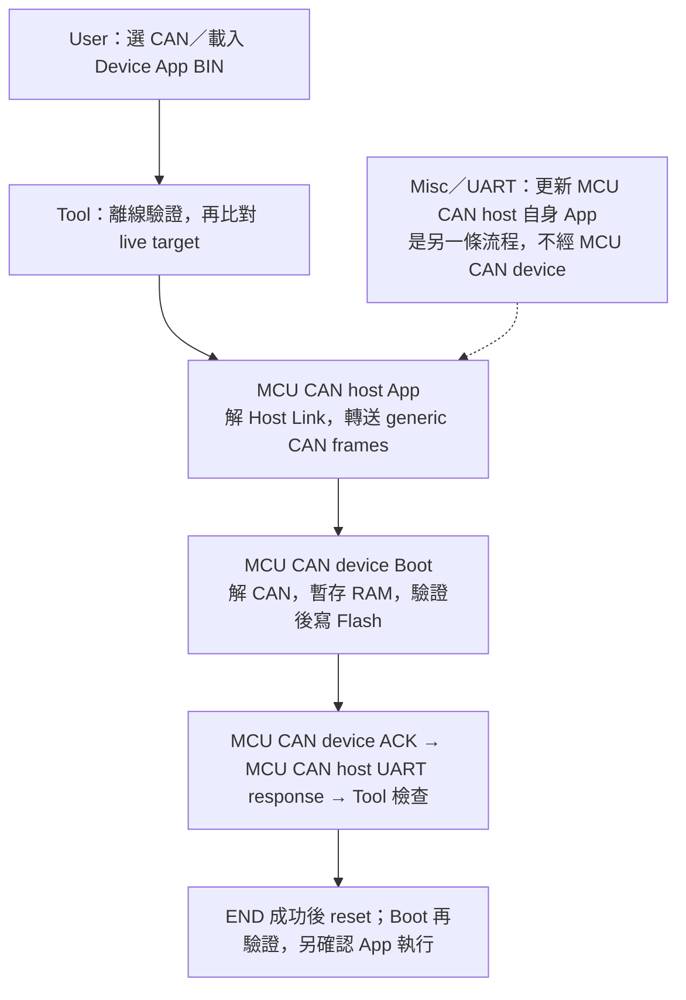

| UI／通訊中看到的資料 | 來自哪裡 | 代表什麼 | 不代表什麼 |
| --- | --- | --- | --- |
| LOADED APP BIN／共用 metadata | PC 上載入的檔案 | 即將寫入的離線映像與更新政策 | 不是板上已安裝的內容 |
| DEVICE TARGET／BOOT CODE／INSTALLED APP | MCU CAN device 的 CAN INFO pages | live 韌體回報的身分、layout、版本、容量及政策摘要 | Discover 不會讀回完整 256-byte Flash metadata；也不是 read-back CRC |
| HOST BRIDGE／Host descriptor | MCU CAN host 的 Host Link 身分與自身 metadata | 哪塊 bridge、支援哪些 port／commands、Host 自身 App 資訊 | 與外部 device 的 App BIN 分開顯示 |

### B. 使用者操作與內部動作對照

| 操作順序 | UI 要看什麼 | 實際動作／程式入口 | F13 Flash 是否改變 |
| --- | --- | --- | --- |
| 1. 接線／開啟 Tool | COM friendly name 只協助選埠 | F24 與 F13／analyzer 同 CAN bitrate、共地、終端；F13 EVB TJA1050T 使用 5 V | 否 |
| 2. Open + Probe Host | HOST BRIDGE VERIFIED LINK／port／能力 | 讀 Host Link 身分與能力；支援自身更新的 bridge 再驗證其 descriptor／metadata | 否 |
| 3. CAN／Load Update Image | LOADED APP BIN 為 OFFLINE；CRC Result／Metadata Status／Update Policy | `CMainFrame::LoadBinaryFromPath` → `InspectImage`／`ValidateLoadedFirmwareImage`；選 `_update.bin`，不是 HEX 或 Host BIN | 否 |
| 4. Discover Target | DEVICE TARGET、BOOT CODE、INSTALLED APP | `ProcessDiscoverF13Boot` → `GetTargetInfo`：逐頁 INFO，核對模式／速度／IDs | 否 |
| 5. Enter Boot（若仍在 App） | DEVICE TARGET 改為 Bootloader | `ProcessEnterF13Bootloader` → ENTER ACK → 等待 reset → INFO + HELLO | 否 |
| 6. 檢查 Ready／Missing | 中央先決條件不得有缺項 | `CMainFrame::UpdateUi`；檔案、route、bit12、Boot ready、live layout 全部相容 | 否 |
| 7. Start Device Update | progress／shared log | worker 再驗證 → metadata RESET／stage／SEAL → START → blocks → END | 到有效 COMMIT 才開始 |
| 8. 確認結果 | END ACK 與 App confirmed 分開記錄 | Tool 等待 APP_READY，再比對 live INFO 與載入 BIN 的身分／版本／build／大小；自動保存報告 | 更新流程已寫入 |

載入 BIN 與 Probe 的先後可以互換；但 Start 前必須全部通過。Transfer Test／Bridge Self Test
只能用來排查通訊，不會替代 CAN Upgrade 的映像驗證。完整操作見[Tool operation](https://released.github.io/slide_isp_tool_for_RL78/#tool-operation)。

### C. Tool 如何判斷「這個 BIN 可以更新」

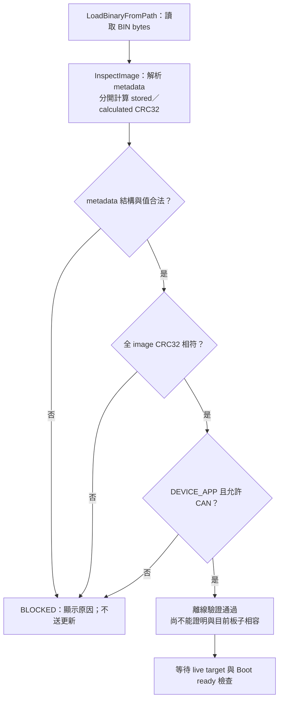

| 驗證關卡 | 檢查的 byte／資料 | 拒絕範例 | UI／程式判定 |
| --- | --- | --- | --- |
| 最小結構 | entry／vector 預留、0x100 起 256-byte metadata、尾端 CRC4；至少 516 bytes、4-byte 對齊 | 空檔、截斷、只給原始 App code | `ParseMetadata`；entry 不得為 FFFFFFFF |
| 格式與識別 | image magic、image format、core length、flags、protocol、checksum；MCU 字串與 padding | BUR1 Host BIN 放在 CAN TAB、壞 magic／字串 | Metadata Status 與 Update Policy；不是只看副檔名 |
| 幾何與容量 | image_size 等於檔案長度；start／capacity／Flash／Boot／erase／minimum | 超出 Flash、start 未對齊 erase | `ParseMetadata` 的 bounds checks |
| 保留區 | metadata offset 0x80..0xFF 共 128 bytes 必須 FF | 不相容擴充欄位卻未更新契約 | reserved 檢查；不是任意填零區 |
| 完整性 | 檔案前 N-4 bytes 的 CRC32 對比最後 4 bytes LE32 | metadata 正確但程式區損壞 | CRC Result MATCH；`ValidateImage` 才要求相等 |
| 更新政策 | UPD1 role／allowed transports／IRQ ABI／minimum boot | CAN-only Device App 改選 I2C；Host App 放入 CAN | `image_policy::Allows`；切換 TAB 後重新核對更新政策 |

`InspectImage` 的「Metadata Status = VALID」與「CRC Result = MATCH」是兩個獨立結果，
兩者都通過也只是離線成立。CRC提供完整性，不是簽章或身分認證。

### D. 離線 BIN 與在線 target 如何比對

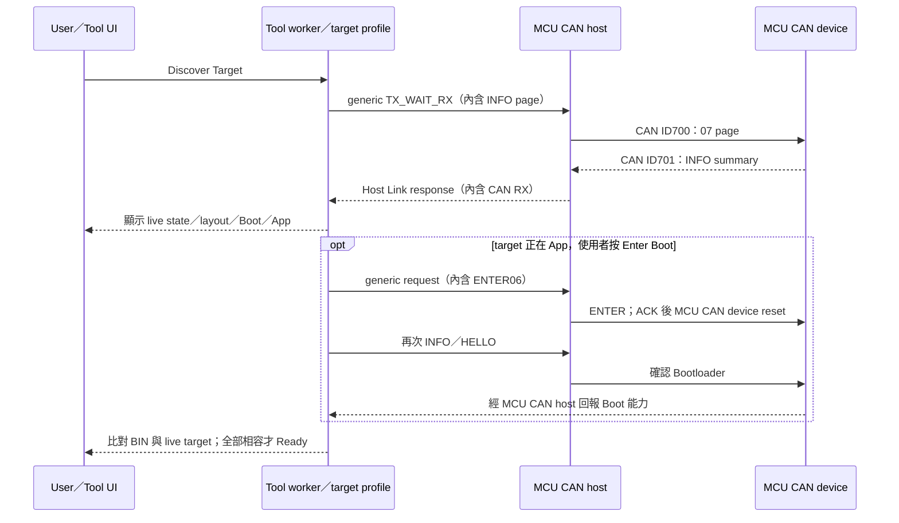

| 比對群組 | BIN metadata | live INFO／Host 能力 | 失敗後處理 |
| --- | --- | --- | --- |
| 身分 | target_id、mcu_family、mcu_part | target INFO 相同欄位 | 不以 USB-UART 描述或載入檔案推測身分 |
| 協定 | image format、protocol ID／version、checksum | live format／protocol／checksum | 使用 BEGIN／raw data／COMMIT 區塊流程 |
| Flash | start、capacity、Flash size、Boot reserve、erase、minimum | live layout 各項相等 | 不只比較 image 是否小於 capacity |
| CAN | mode／ID format／nominal mask／data mask／request／response | live 契約相同；選定設定也要被支援 | 改 bridge 速度不會改 F13 固定速度 |
| 政策 | DEVICE_APP、CAN allowed、固定 IRQ ABI、minimum boot | live role／CAN allowed／IRQ ABI；boot_version 足夠 | UI 與 worker `ImageMatchesTarget` 分別核對 |
| 傳輸能力 | 本路徑需要 generic burst | Host Link v2／128-byte payload／bit12；F13 block INFO | 缺 bit12 先經 Misc 更新 Host App，不直接開始 |
| 執行狀態 | 檔案有效且 App Start Override 相容 | 已確認 Bootloader；HELLO target／capacity 與 INFO 相符 | App 狀態須先 ENTER；未開 COM／busy 都不可更新 |

### E. 一個 BIN 區塊如何穿過 UART 與 CAN

| 名詞／單位 | 大小 | 本路徑的用途 | 範圍與差異 |
| --- | --- | --- | --- |
| metadata region | 256 bytes | image offset 0x100..0x1FF；128 core + 128 reserved | 不是 Host Link 單包大小 |
| metadata staging chunk | 4 bytes | METADATA08 每次攜帶 4 個 metadata bytes，總共 64 次 | 不是目前 raw App data 的有效長度 |
| image block | 最多 64 bytes | RAM staging／區塊 CRC／一次 COMMIT ACK | 不是 CAN FD frame |
| raw CAN data frame | 最多 8 bytes | ID 的低 3 bits 表示段號，payload 全部是 image bytes | 沒有占用 Byte0 當 command；最後一段可為 DLC4 |
| Host Link burst payload | 完整 block 為 122 bytes | 12-byte burst header + 10 ×（ID2 + DLC1 + data8） | 在 128-byte payload 上限內；含 UART framing 共 136 bytes |
| Flash write word／erase block | 4／1024 bytes | F13 以 4 bytes 寫入，到 erase 邊界時擦 1 block | 寫入單位不是 CAN 傳輸單位 |

#### 區塊封裝與回覆

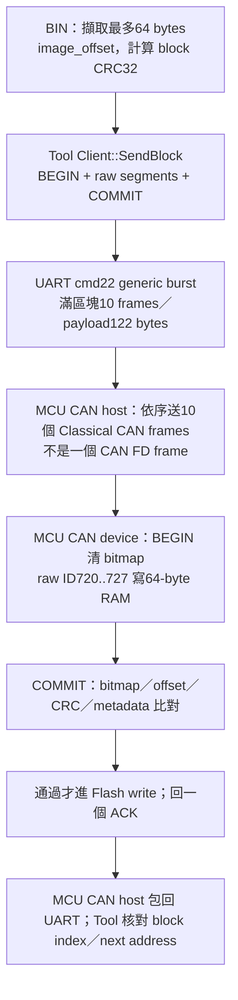

### F. F24 (MCU CAN host) 的接收與轉送流程

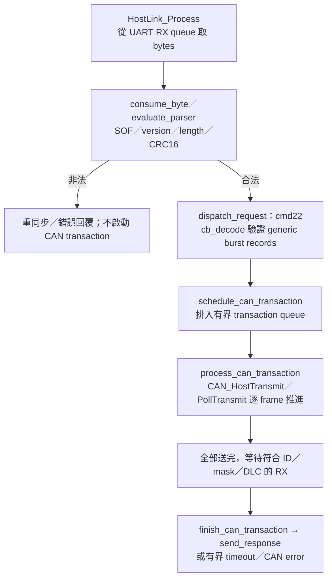

| 程式位置 | 檢查／動作 | 使用者可對照的結果 |
| --- | --- | --- |
| `host_link_protocol.c`：`validate_header`／`evaluate_parser` | UART header CRC16、payload 長度 ≤128、payload CRC16；逐 byte 可分段到達 | UART framing／CRC 錯誤與 CAN target status 是不同層 |
| `can_burst.inc`：`cb_decode` | 1..10 records、Standard ID、DLC≤8、timeout、非零 mask、完整長度／gap | 不合法 generic request 直接 BAD_ARGUMENT；尚未解 F13 command |
| `host_link_protocol.c`：`schedule_can_transaction` | 有界 queue／相同 sequence 與 payload 的重送處理 | 不因 UART retry 任意增加 target Flash 寫入 |
| `host_link_can_process.inc`：`process_can_transaction` | 非阻塞 TX／GAP／RX／ABORT；所有 frame 送完後等待 matching RX | bridge TX complete 只代表 CAN 傳送階段完成 |
| `can_fd_module.c`：`CAN_HostTransmit` | 把已解碼的 frame 結構交給 `R_CAN_SendByTXMB`；ISR 記錄事件／RX queue | 寄存器與 driver 留在 board backend，不把 target 邏輯放 ISR |
| `finish_can_transaction`／`send_response` | 將 CAN RX record 放進同 sequence 的 Host Link response | 外層 status OK 後，Tool 還要解析內層 F13 status／detail／value |

Host Link 的 115200／460800／921600 是 PC↔F24 這一路；CAN 的 500K 是 F24↔F13 另一路。
F24 不會把 UART baud 寫入 F13 metadata，也不會將收到的 BIN 自動燒進自己的 App。
F24 自身更新另見[Misc 更新 Host App](https://released.github.io/slide_isp_tool_for_RL78/#host-bridge-firmware)。

### G. F13 (MCU CAN device) 如何分類 CAN RX

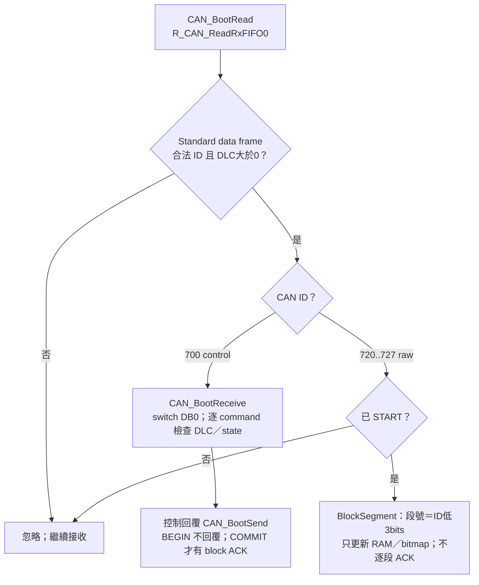

| 收到內容 | Decoder 看哪裡 | 狀態／長度要求 | 結果 |
| --- | --- | --- | --- |
| INFO07／HELLO01 | DB0、INFO 的 DB1 page | INFO DLC2；HELLO 回報 Boot 狀態／能力 | 讀摘要；不寫 Flash |
| METADATA08 | DB1..2 metadata offset、DB3=00、DB4..7 bytes | 未 START、DLC8；offset 4-byte aligned 且不可跳過 | 寫 metadata RAM，回下一 offset |
| SEAL09／START02 | SEAL 的 DB4..7 CRC；START 的 protocol／target／size | metadata 256 bytes 完整、契約與 CRC 正確才允許 START | 只建立 update session；不擦 Flash |
| BLOCK_BEGIN0B | DB1..3 image offset、DB4..7 block CRC | 已 START、DLC8；64-byte offset；本區塊或上一已提交區塊 | 初始化 block RAM／bitmap；不 ACK |
| raw ID720..727 | index=ID&7；DB0..7 都是 image data | 已 START、BEGIN 有效；DLC 必須等於該段實際長度 | 收齊 bitmap；相同重複可接受，衝突使 block 無效 |
| BLOCK_COMMIT0C | offset／CRC 與 BEGIN 一致 | started、DLC8、bitmap 全、區塊 CRC 相等 | 通過後才比對 metadata／寫 Flash；回 block ACK |
| END04／ABORT05 | DB0 | END 要求完整 size／Flash metadata／全 image CRC；ABORT 終止 session | END 成功後 reset；ABORT 不等於回復舊映像 |

### H. 完整 metadata、SEAL 與 START

一般 START 另檢查目前有效 App 的版本政策；`FORCE_START 0E` 只略過本次版本排序。
其餘契約／CRC／Flash 檢查相同；維護確認與密碼見 [force 降版操作](https://released.github.io/slide_isp_tool_for_RL78/#force-old-version)。

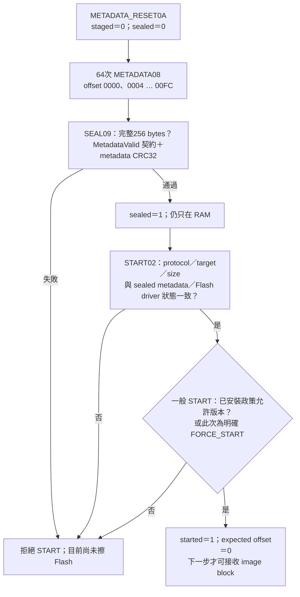

| 階段 | Tool 函式／資料 | F13 函式／判斷 | 不可誤解的保證 |
| --- | --- | --- | --- |
| RESET | `Client::StageMetadata` 先清舊 session；遇 BAD_STATE 可先 ABORT 再試一次 | `MetadataReset` 清 staged／sealed | 不清 Flash；不保證舊 image 尚可用 |
| 64 個 chunks | 取 image[0x100..0x1FF]；每次 4 bytes、等待 ACK | `MetadataStage`：不可跳號；相同重送接受、衝突拒絕 | 只更新 RAM；ACK detail 為下一 metadata offset |
| SEAL | CRC32(metadata 的全部 256 bytes) | `MetadataSeal` → `MetadataValid`＋CRC；核對固定契約與保留 FF | 不等於全 image CRC；尚未確認程式區 bytes |
| START | `Client::Start` 傳 protocol／target／image_size | size＝sealed words[6]；FSL 正常；設 address／expected | START ACK 不是「已擦除完成」 |
| 正式傳 image | `RunUpdate` 從 image offset0 開始，每區塊最多64 bytes | metadata 所在 image blocks 仍會再傳；COMMIT 前與已封存 RAM 比對 | 不可 stage 好 metadata A 卻正式寫入 metadata B |

### I. 用第一個 metadata chunk 對照 byte 與 address

這是 Bootloader 內、未 START、且先成功 RESET 的教學範例；不是讓 analyzer 任意掃描或自動擦寫。
完整逐 byte 表另見[格式對照](https://released.github.io/slide_boot_loader_for_RL78/#flash-metadata-can-reference)。

| 封包 | CAN ID／DLC | Data bytes | 讀法 |
| --- | --- | --- | --- |
| 只讀 INFO page0 | TX700／2 | `07 00` | command INFO、page0 |
| Boot INFO 回覆 | RX701／8 | `07 00 00 02 3B F1 05 06` | INFO／OK／page0／Bootloader；target F13B、protocol5、image format6 |
| 第一個 metadata chunk | TX700／8 | `08 00 00 00 43 41 4E 00` | METADATA；meta offset0000；reserved00；4 bytes 是 ASCII CAN\0 |
| metadata chunk ACK | RX701／8 | `08 00 04 00 00 01 00 00` | OK；detail0004＝下一 metadata offset；value00000100＝256 bytes |
| 第一個 block 提交成功 ACK | RX701／8 | `0C 00 00 00 40 20 00 00` | COMMIT OK；block index0；下一絕對 Flash address2040；不是 metadata offset |

#### 位址換算與 ACK 單位

| 同一個 magic byte C | 算式 | 本範例值 |
| --- | --- | --- |
| metadata-relative offset | 第一個 chunk offset + byte0 | 0x00 |
| BIN-relative offset | manifest offset + metadata offset | 0x100 + 0x00 = 0x100 |
| 暫存位置 | metadata RAM bytes[offset] | `g_metadata_words` 的第一個 byte，尚未在 Flash |
| 正式寫入位置 | App start + BIN offset | 0x2000 + 0x100 = 0x2100 |
| 此 byte 所屬 image block | floor(BIN offset /64) | block index4、image offset0x100；不是第0個 block |

metadata 分段 ACK 的 detail 以 bytes 計數；BLOCK_COMMIT ACK 的 detail 是 block index；
END ACK 的 detail 則是 image_size/4 的低16 bits。欄位位置相同，不表示單位相同。

### J. COMMIT 才是 RAM → Flash 的界線

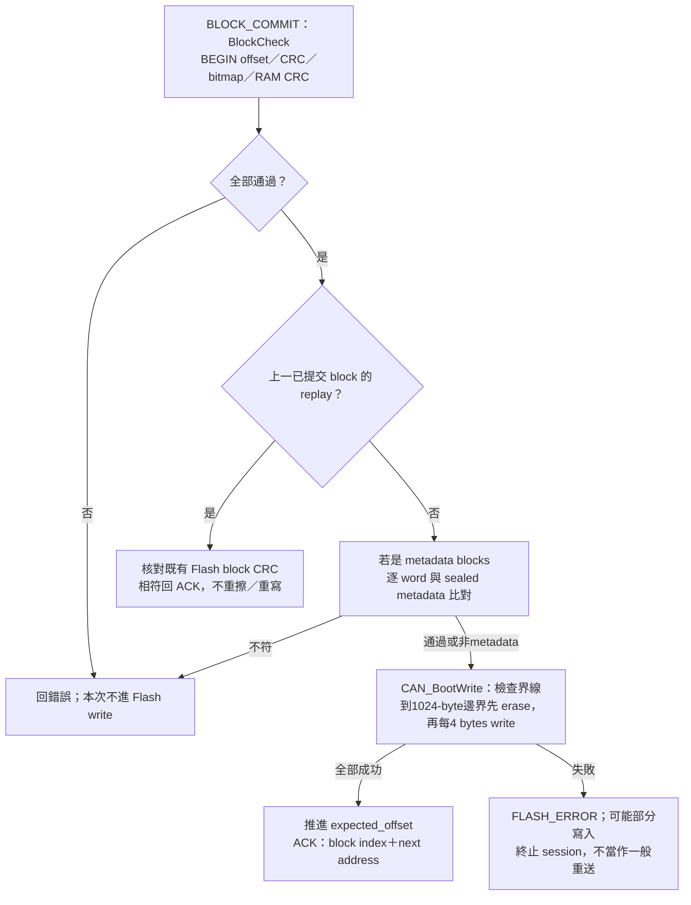

| 條件 | 如何判斷 | Flash 行為 | Tool 可否前進 |
| --- | --- | --- | --- |
| 缺 segment／錯 DLC／衝突重複／offset 錯 | bitmap／bad flag／BEGIN 與 COMMIT 不一致 | 此次不寫 | BAD_SEQUENCE；有界重送整 block |
| block CRC 不符 | 對 RAM 實際 block length 計算 CRC32 | 此次不寫 | CRC_ERROR；有界重送整 block |
| metadata 正式資料與 SEAL 不同 | image offset0x100..0x1FF 的 words 比對 staging RAM | 該 block 不寫；此前 blocks 可能已改變 | BAD_IMAGE，終止；不是 rollback |
| 本次正常 block | offset＝expected；大小不超 image／Flash 範圍 | 在 erase 邊界擦除，再逐4 bytes寫入 | ACK index／next address 正確才前進 |
| 上一已提交 block replay | offset 比 expected 少64，RAM／Flash CRC 均相符 | 不重寫、不再次擦除 | 可回相同 next address ACK；不是任意位置續傳 |
| FSL erase／write 失敗 | Flash library 回傳錯誤 | 回報部分寫入狀態並保留 Boot recovery | FLASH_ERROR，不以一般 CRC retry 掩蓋 |

目前 `Client::SendBlock` 對 bridge TIMEOUT 或 F13 BAD_SEQUENCE／CRC_ERROR 有界重送整區塊；
它仍要核對 ACK 的 block index 與 next address。這不是斷線續傳功能。
取消／失敗時 `RunUpdate` best-effort ABORT，worker 再停止 CAN；若實體線已斷，不能保證 ABORT 送達。

### K. END、reset、Boot→App 是三個步驟

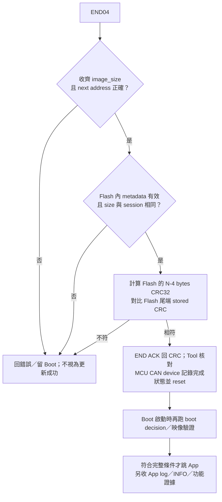

完整 ENTER、RAM handoff、checksum、逾時、失敗留 Boot 的條件以
[F13 Boot→App 完整條件圖](https://released.github.io/slide_isp_tool_for_RL78/#f13-boot-flow)為準。
僅有效舊 App 的 ENTER session 啟用30秒 inactivity；START 前可重驗舊 App 後返回，
接受 START 後逾時不自動回 App。無效 App 的 recovery 不啟用該逾時；ABORT／fatal error 不保證自動返回。

| 觀察到的證據 | 真正證明的範圍 | 還需要什麼 |
| --- | --- | --- |
| PC BIN CRC MATCH | 本地檔案 N-4 bytes 對尾端 CRC 正確 | metadata／route／live target 仍需核對 |
| analyzer 看見700／raw frames | CAN bus 有這些封包 | 不證明 F13 解碼、Flash 成功或 App 執行 |
| CAN ACK bit／F24 TX complete | 某節點確認鏈路／控制器送出 | 不等於 F13 Boot COMMIT ACK |
| Host Link status OK | bridge 完成指定 transport transaction | 仍須解內層 F13 status；內層可能是錯誤 |
| F13 COMMIT ACK OK | 該區塊處理成功；Tool 也核對 index／next address | 全 image 仍未 END 驗證 |
| END ACK＋matching CRC32 | F13 對寫入 Flash 的完整映像驗證成功 | reset 後是否真正跳 App 尚需獨立證據 |
| 新 App UART log／重新 INFO／實際功能 | 可觀察的 App 執行與版本／功能 | 不等於所有 IRQ／斷電／高速可靠性都已驗收 |

### L. 故障現象與分層診斷

| 現象 | 優先核對 | 對應流程 | 處理原則 |
| --- | --- | --- | --- |
| Tool Metadata VALID 但 CRC MISMATCH | 檔案截斷／post-build／尾端 CRC | C：離線驗證 | CRC 通過後才可開始更新 |
| CRC MATCH 卻 Update blocked | DEVICE_APP／CAN allowed、IRQ／minimum boot、live layout、bit12 | D：在線相容性 | 依實際不符欄位核對映像與 live target |
| Probe timeout | COM 是否選對、binary UART／Host baud、F24 是否在 App／Boot | B／F：Host Link | 僅對明確選定的 COM 執行 Probe |
| F24 TX error／bus error | 供電、CANH/L、共地、終端、各節點 bitrate／clock；F13 transceiver 5V | F／G：實體與 transport | 先確認實體層及傳輸，再核對協定解碼 |
| 有700但沒有701 | F13 state／RX filter／ID／DLC、transceiver；Transfer710與Boot700 | G：接收分類 | 使用目前模式對應的 ID／協定 |
| SEAL BAD_IMAGE／CRC_ERROR | 64 chunks 是否完整、固定契約／保留FF、metadata CRC | H：metadata RAM | metadata 通過 SEAL 後才進入後續更新流程 |
| COMMIT BAD_SEQUENCE／CRC_ERROR | BEGIN offset／raw IDs／DLC／bitmap／CRC、有限重送紀錄 | J：block RAM | 依錯誤分類及重試上限處理 |
| END 成功但沒有新 App log | reset／boot decision／vector／startup／App IRQ與板級初始化 | K：啟動驗證 | 另核對 APP_READY／live INFO 與功能執行 |

### M. 開原始碼時的閱讀順序

| 要理解的段落 | 實際來源連結 | 從哪個函式／符號開始 |
| --- | --- | --- |
| 載入檔案與 UI metadata | [main_frame_image.cpp](https://github.com/released/simple_renesas_isp_tool/blob/main/src/main_frame_image.cpp) | `LoadBinaryFromPath`／`ValidateLoadedFirmwareImage`／`UpdateFirmwareImageInfoText` |
| Ready／Missing 與 Start 按鈕 | [main_frame_workflow.cpp](https://github.com/released/simple_renesas_isp_tool/blob/main/src/main_frame_workflow.cpp) | `UpdateUi`／`OnBnClickedStartFirmwareUpdate` |
| App metadata 離線驗證 | [firmware_update_profile.cpp](https://github.com/released/simple_renesas_isp_tool/blob/main/src/core/firmware_update_profile.cpp) | `ParseMetadata`／`InspectImage`／`ValidateImage` |
| worker 二次檢查／流程 | [worker_can_workflows.cpp](https://github.com/released/simple_renesas_isp_tool/blob/main/src/worker_can_workflows.cpp) | `ProcessDiscoverF13Boot`／`ValidateF13BootTarget`／`ProcessProgramF13Boot` |
| BIN 對 live target | [worker_format.cpp](https://github.com/released/simple_renesas_isp_tool/blob/main/src/worker_format.cpp) | `ImageMatchesTarget` |
| 更新狀態機 | [f13_boot_update.cpp](https://github.com/released/simple_renesas_isp_tool/blob/main/src/core/f13_boot_update.cpp) | `RunUpdate`／`AbortAfterStart` |
| CAN 封包建立／ACK 解碼 | [f13_boot_profile.cpp](https://github.com/released/simple_renesas_isp_tool/blob/main/src/core/f13_boot_profile.cpp) | `Client::GetTargetInfo`／`StageMetadata`／`SendBlock`／`End` |
| F24 UART parser／generic dispatch | [host_link_protocol.c](https://github.com/released/simple_renesas_isp_tool/blob/main/firmware/RL78_F24_Bridge_app/host_link_protocol.c) | `HostLink_Process`／`evaluate_parser`／`dispatch_request` |
| F24 burst record 驗證 | [can_burst.inc](https://github.com/released/simple_renesas_isp_tool/blob/main/firmware/common/can_burst.inc) | `cb_decode`／`cb_next` |
| F24 CAN 非阻塞 transaction | [host_link_can_process.inc](https://github.com/released/simple_renesas_isp_tool/blob/main/firmware/RL78_F24_Bridge_app/host_link_can_process.inc) | `process_can_transaction`／`next_burst_frame` |
| F24 driver／RX queue | [can_fd_module.c](https://github.com/released/simple_renesas_isp_tool/blob/main/firmware/RL78_F24_Bridge_app/can_fd_module.c) | `CAN_HostTransmit`／`CAN_HostPollTransmit`／`CAN_RxQueuePop` |
| F13 CAN 接收與 Flash 入口 | [can_boot_transport.c](https://github.com/released/RL78_F13_Boot_loader_CAN/blob/main/can_boot_transport.c) | `CAN_BootRead`／`CAN_BootReceive`／`CAN_BootWrite`／`CAN_BootSend` |
| F13 metadata staging／契約 | [can_boot_metadata.inc](https://github.com/released/RL78_F13_Boot_loader_CAN/blob/main/can_boot_metadata.inc) | `MetadataStage`／`MetadataSeal`／`MetadataValid` |
| F13 raw segments／bitmap／CRC | [can_boot_block.inc](https://github.com/released/RL78_F13_Boot_loader_CAN/blob/main/can_boot_block.inc) | `BlockBegin`／`BlockSegment`／`BlockCheck` |
| F13 reset 與重新驗證 | [r_main.c](https://github.com/released/RL78_F13_Boot_loader_CAN/blob/main/r_main.c) | `boot_main`／`verify_application_checksum`；配合 Boot decision 圖 |

若要改成自己的專案：先固定 partition／vector ABI／board clock，再由 image build 設定產生 metadata／CRC；
同步修改 Tool target profile 與 device Boot 的契約，最後對照本篇每一關驗證。
只增加 App 一般 IRQ 且仍在既定 ABI／layout／更新協定內，不需要為此改 Boot；
更換更新介面或映像契約則必須重新評估 Boot。
詳見[Boot/App 移植工程](https://released.github.io/slide_boot_loader_for_RL78/#boot-app-porting)。

本篇是現行程式的導讀，不是新一輪板測報告。實體斷線／斷電、完整故障矩陣、高速長時間可靠性，
以及各自訂 App 的 IRQ／啟動，仍須在對應硬體上留存驗證紀錄。
<!-- CAN_WALKTHROUGH_END -->

## 4. I2C Master

目前操作為指定 port／address 的 G16 reference 探索。

1. Probe Host → I2C Master → IICA0／100kHz。
2. Slave 使用7-bit位址 `0x09`。
3. `Probe G16 Reference` 讀取 inquiry／signature／area。
4. Port、rate 或 address 調整後重新 Probe。

探索回覆用於核對連線與參考資訊。
此模式提供探索及 BIN CRC16 檢查，Start Firmware Update 顯示 BLOCKED。

<a id="host-bridge-firmware"></a>

## 5. MCU CAN host：Misc／UART 更新 Host App

本節更新 PC 所連接的 host 自身 App，使用 host Boot 的 UART 更新介面。

1. Open + Probe Host，切換 Misc。
2. `Read Bridge Update Info` 讀取 host MCU、分區與 App 資訊。
3. `Enter Bridge Boot (UART)` 進入 Boot；Tool 依描述器以115200重連。
4. 載入 `*_bridge_update.bin`，核對 HOST APP、MCU、metadata 與 CRC。
5. `Update HOST APP` 確認後更新。
6. 完成後按 `Run Validated Bridge App`，Tool 自動重連並確認 App 資訊。

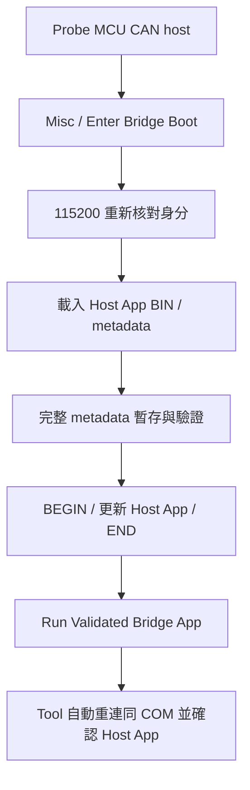

### Host 初次安裝

Boot 專用 MOT、燒錄器 App `_flash.mot` 與 Misc `_bridge_update.bin` 的檔名及下載集中於[交付檔與安裝範圍](#downloads)。
可先以燒錄器安裝 Boot，再透過 Misc 更新 App；或以燒錄器安裝配套 Boot 與 App MOT。

Host Boot 預留20 KiB，App 起點0x5000，最後1 KiB保留。
Host Boot 保持固定UART115200；一般 Host Link 連線速度見 [更新政策與通訊速度](#image-update-policy)。

<!-- TOOL_BRIDGE_MEDIA_BEGIN -->
<a id="bridge-update-example"></a>

### Host App 更新操作圖

以下使用 F24 (MCU CAN host)。Misc 更新的是 PC 所連接 host 自身的 App，固定以 UART115200 操作。
初裝 Boot MOT、燒錄器 App MOT 與 Misc BIN 的選用，見[下載與操作總覽](https://released.github.io/slide_isp_tool_for_RL78/#downloads)。

#### 1. 載入 Host App BIN

選取 Misc，載入 `RL78_F24_Bridge_app_bridge_update.bin`。
核對目的地為 HOST BRIDGE、MCU、metadata、CRC MATCH 與 UART115200；Device App BIN 會因目的地不符而被拒絕。

[](images/tool_operation/tool_Bridge_update1_load_image.jpg)

#### 2. 確認 Enter Bridge Boot

按 `Read Bridge Update Info` 取得目前資訊，再按 `Enter Bridge Boot (UART)`。
確認視窗列出的 HOST BRIDGE、COM 與 MCU；此步進入 Boot，不擦寫 App。

[](images/tool_operation/tool_Bridge_update2_enter_boot.jpg)

#### 3. 確認 Host Boot 已連線

等 Tool 以同一 COM／115200 重新 Probe。
目的地回報 `HOST BRIDGE - BOOT mode`，且 prerequisite 為 Ready 後，才可更新。

[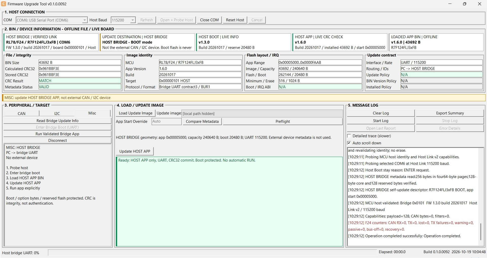](images/tool_operation/tool_Bridge_update3_enter_boot.jpg)

#### 4. 確認並寫入 Host App

按 `Update HOST APP`，核對檔案、MCU、App start 與 size，確認後開始寫入。
保持 UART 與供電；Boot／option／保留區不在 Misc App 寫入範圍。

[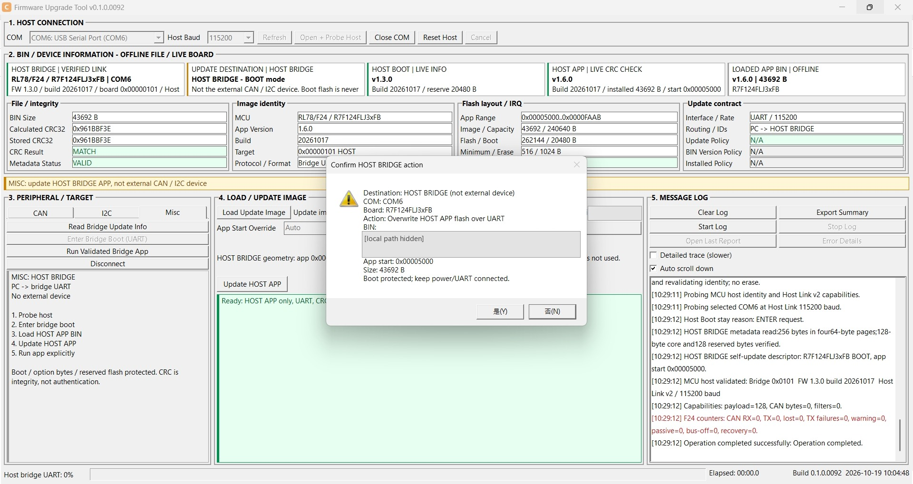](images/tool_operation/tool_Bridge_update4_start_update.jpg)

#### 5. 寫入完成，仍停留 Boot

`Host App update complete - RUN required` 表示映像寫入、CRC 與 metadata readback 通過，**還沒有啟動 App**。
下一步是明確執行 RUN，不需再次燒錄。
此次寫入結果會自動保存為 Firmware update report，可按 `Open Last Report` 查看；[報告操作](https://released.github.io/slide_isp_tool_for_RL78/#update-html-report)說明儲存位置與判讀方式。

[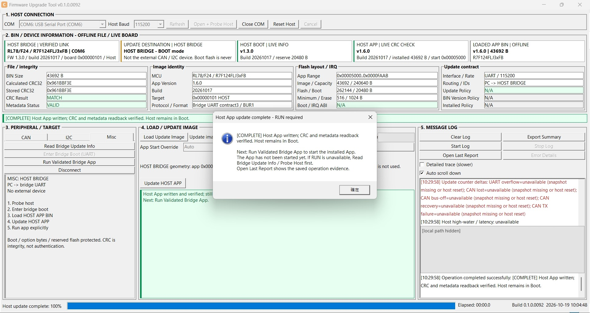](images/tool_operation/tool_Bridge_update5_after_update.jpg)

#### 6. Run Validated Bridge App

按 `Run Validated Bridge App`，核對 HOST BRIDGE 目的地後確認。

[](images/tool_operation/tool_Bridge_update6_run_valid.jpg)

#### 7. Host App 啟動確認

Tool 自動重連同一 COM，重新讀取並核對已安裝 App 資訊。
`Host App startup confirmed` 與 `[COMPLETE] Host App is running` 表示此階段完成；之後可選擇 CAN 等 device 介面。
若 Log 的 counter 顯示 unavailable，代表該次重啟前後無可比對的 snapshot，不等於此處的 App 更新失敗。
此時 `Open Last Report` 開啟的是本次 RUN 確認報告；先前的寫入報告仍保留於 `reports/`。

[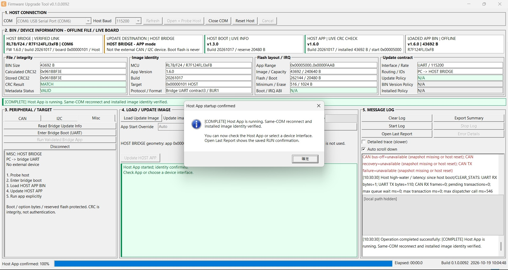](images/tool_operation/tool_Bridge_update7_update_finish.jpg)
<!-- TOOL_BRIDGE_MEDIA_END -->

### Recovery 入口

按住 SW1（P32 LOW）並 reset／重新上電，進入 host Boot。
Tool 以115200 Probe，確認 Boot 資訊後，使用上述 Misc 流程更新 App。

<!-- F24_APP_IRQ_BEGIN -->
<a id="host-app-engineering"></a>

### F24 (MCU CAN host)：App 工程

本節供需要閱讀或調整 host firmware 的開發者參考。

| 來源目錄 | 內容 |
| --- | --- |
| `firmware/RL78_F24_Bridge_boot` | Host Boot、UART recovery |
| `firmware/RL78_F24_Bridge_app` | Host App、Host Link dispatch、bus service |
| `firmware/f24_board` | 共用 board／driver／SC |
| `firmware/f24_bridge_common` | Host App 分區與自更新契約 |

#### 設定、解析與介面分工

Host App 擁有自己的 `app_image_config.h` 與 `app_irq_handlers.h`。
以 C header 編輯發行資訊與 IRQ mapping，Windows PowerShell／CS+ 負責產表與封裝。
MCU 建置不需要 Python 或 JSON 設定檔。

| 來源 | 職責 | 修改範圍 |
| --- | --- | --- |
| App 的 `app_image_config.h` | 版本、build、board ID、role、允許更新介面 | App 發行設定；身分與介面須符合 Boot 契約 |
| App 的 `app_irq_handlers.h` | `APP_IRQ_HANDLERS(X)` 對照 vector byte address 與 ISR | App 功能使用的中斷 |
| `f24_bridge_common/image_metadata_config.h` | MCU 身分、Flash 分區、Boot 版本、IRQ ABI、固定 UART | 工程配置；調整時核對 Boot／App、linker 與 backend |
| `f24_bridge_common/image_metadata_profile.c/.h` | 將工程配置組成 live descriptor 的預期值 | MCU／board profile，不操作 register |
| `common/bridge_image_metadata.c/.h` | BUR1／BUI1 欄位解碼、格式驗證及契約比對 | 可移植 C90 模組，不包含更新命令或 Flash driver |
| `common/bridge_update_contract.h`、`bridge_update_engine.c/.h` | 更新命令、狀態機與 Flash callback | 收包、staging、CRC 與更新時序 |
| `f24_bridge_common/boot_app_handoff.h` | recovery cookie 與 IRQ owner 的 no-init RAM 位址 | startup／linker／交接設定 |

Pre-build 產生 `bridge_vectors.asm`／`f24_app_identity.generated.h`。
Post-build 核對實際 linked App 身分、向量目的地及 RETI／RETB，再封裝更新映像。
單獨重新產生 header 不會改變已編譯映像的身分；不符時需重新建置。

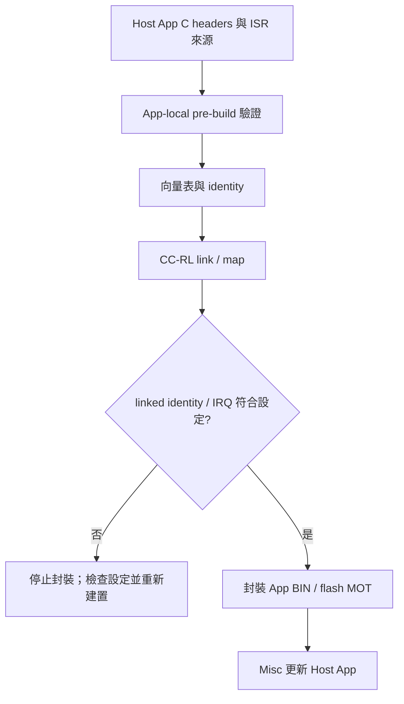

#### 編輯 App metadata

在 App 專案開啟 `app_image_config.h`；每個 define 的註解包含用途、範例與修改條件。

| Define | 範例 | 判斷方式 |
| --- | --- | --- |
| `APP_IMAGE_VERSION` | `0x00010600UL` = 1.6.0 | `0x00MMmmpp`，各一 byte；非日期或十進位字串 |
| `APP_IMAGE_BUILD` | `20261017UL` | 發行識別，允許 0..0xFFFFFFFE |
| `APP_IMAGE_TARGET_ID` | `0x0101U` | 等於 Boot 的 board ID；單獨改為 `0xF33BU` 會停止產生 |
| `APP_IMAGE_ROLE` | `2U` = HOST BRIDGE APP | 本工程使用 2；`5U` 等未定義值會停止產生 |
| `APP_IMAGE_UPDATE_TRANSPORTS` | `0x04U` = UART | bitmap：CAN=0x01、I2C=0x02、UART=0x04；此契約要求 UART |

例如發行 1.6.1 時，只調整版本與 build，再 clean build App。
Boot 版本與 App 版本是各自的發行身分，不要求數值相同。
Host App 的版本用於識別；更新仍依 board／分區／相容性與 CRC 判斷。

Misc 更新 UART 固定 115200，來源是 `image_metadata_config.h`。
App 執行時的 Host Link 115200／460800／921600、CAN bitrate 與 I2C speed 不會改寫這項更新契約。
Magic、core／region 長度與 policy 格式由 `bridge_image_metadata.h`／`image_policy.h` 定義；App 發行時維持格式契約。

#### 編輯 App IRQ mapping

在 App 的 `app_irq_handlers.h` 加入 `X(vector, handler)`。
Vector 是硬體 vector 的 byte address，來源為此專案的 `iodefine.h` 中斷定義及 MCU 硬體手冊的 Interrupt Functions 表。
例如 `INTST0=0x16` 對應表內的 UART send ISR；slot 位址為 `0x5000 + 0x16 × 2 = 0x502C`。

新增一般中斷時，將 ISR C 檔加入 App MTPJ，再於 X-macro 加入對應項目：

```c
/* Example INTP0 mapping; initialize its flag/mask/pin separately. */
X(0x08, app_aux_irq)
```

ISR 使用 global、無 `vect=` 的 interrupt pragma，並由編譯器產生 RETI。
Pre-build 檢查合法 vector、重複項目、實際登錄來源與 ISR 定義，產生完整 64-slot 表。
未列入的正常 IRQ 使用 default ISR；硬體初始化、旗標與 mask 仍由 App 配置。
固定向量介面內新增 mapping 不需修改 Boot 或 linker 的表長度。

#### 移植 metadata C 模組

| API | 輸入 | 成功表示 |
| --- | --- | --- |
| `Bu_ParseManifest(p, length, &manifest)` | 至少 128 bytes 的 BUR1 core | core 欄位及 geometry 格式合法 |
| `Bu_ParseMetadataRegion(p, length, &manifest)` | 完整 256 bytes | core 合法且後 128 bytes 全為 FF |
| `Bu_ParseInfo(p, length, &info)` | 至少 96 bytes 的 BUI1 descriptor | live descriptor 格式合法 |
| `Bu_MatchesDevice(&manifest, &info)` | 已解析的兩份資料 | board、MCU、分區、UART、IRQ ABI 與 minimum Boot 相符 |

Parse API 檢查 null／可用長度並回傳 1 或 0；失敗時不使用 output。
以 byte buffer 解碼 little-endian 欄位，無需將 wire buffer 強制轉型成 C struct。
編譯環境需提供 8-bit `uint8_t`、16-bit `uint16_t` 與 32-bit `uint32_t`；現有工程由 toolchain 的 `stdint.h` 提供。
`Bu_Read16/32`、`Bu_Write16/32` 是已確認 2／4-byte 範圍後使用的低階 helper。
格式與契約相符不代表完整映像 CRC、簽章或可啟動；完整 CRC 與執行條件由更新引擎及 Boot 檢查。

移植時將 metadata C 檔單獨加入 Boot／App 的編譯來源，保留 `image_policy.h` 格式定義。
以自己的 config／profile 提供 MCU 契約，再接上更新引擎的 Flash callback、UART 收包及 linker／startup。
只有 backend 使用該 MCU 的 register／Flash library；metadata parser 不引用這些介面。

#### App-only 建置

1. 建立自己的 App 工程，保留 MTPJ、startup、兩份 C header 與來源登錄。
2. Pre-build 使用 `prepare_f24_app_irq.ps1 -AppProject "."`。
3. Post-build 使用 `package_f24_bridge.ps1 -Kind app -AppProject "."`。
4. 在 Tool root 執行對應 App 的建置：

```powershell
.\scripts\build_f24_bridge.ps1 -Kind app -AppProject ".\ProjectA"
```

封裝輸出 `<專案名>_bridge_update.bin` 與 `<專案名>_flash.mot`。
產表與封裝會核對 App mapping、BR 目的地及 RETI／RETB。
更新操作集中於 [Misc／UART](https://released.github.io/slide_isp_tool_for_RL78/#host-bridge-firmware)。

#### Smart Configurator

SC 設定為 `firmware/f24_board/f24_board.scfg`。
搬移或重新產生 SC 後，以 `prepare_f24_bridge_projects.ps1 -Kind app` 整理 App 的相對路徑與來源登錄，再建置 App。
Host Boot 的硬體設定調整時，另以 `-Kind boot` 整理及建置。
<!-- F24_APP_IRQ_END -->

## 6. 連線與錯誤資訊

| 現象 | 對應檢查 |
| --- | --- |
| Host Link timeout | COM、UART 接線、Host Baud、host firmware |
| Clock error | 晶振、SC 與 runtime clock |
| CAN bus error | transceiver 供電、STB、共地、H／L、終端、bitrate／ACK |
| Request 無 response | device firmware、filter、ID、RX／TX 路徑 |
| Metadata／CRC error | App 工程與載入 BIN |
| CRC MATCH但按鈕未啟用 | prerequisite、live mode／layout、busy 狀態 |
| Misc 無更新能力 | Host live capability／Boot 描述器 |

完整故障矩陣涵蓋重送、取消、斷線、reset、斷電與 Flash error；實板結果由各工程記錄。
CRC 驗證用於映像完整性，詳細政策如下。

<!-- COMMON_IMAGE_POLICY_BEGIN -->
<a id="image-update-policy"></a>

## 更新政策與通訊速度

BIN metadata 提供更新目的地、允許介面、MCU 身分與 Boot 契約。
版本政策與密碼確認的維護操作集中於 [force 降版](https://released.github.io/slide_isp_tool_for_RL78/#force-old-version)。
Tool 將這些欄位與目前選定的 port、live device 資訊一併核對。

| UI 資訊 | 來源與作用 |
| --- | --- |
| Update Policy | App 目的地及允許 CAN／I2C／UART 更新的清單 |
| Boot / IRQ ABI | 映像所需的最低 Boot 版本、固定向量介面 |
| MCU、版本、分區、CRC | 載入 BIN 的離線資訊 |
| LIVE INFO | 目前連線裝置回報的資訊 |

選定介面與映像政策不同時，Tool 保留 BIN 原有資訊並顯示 BLOCKED。
UI、worker 與 device Boot 分別執行對應驗證；改變 port／address／rate 後會重新探索。

Metadata 位址與欄位格式見 [Device 映像對照](https://released.github.io/slide_boot_loader_for_RL78/#flash-metadata-can-reference)。

### 三條通訊路徑的速度

| 路徑 | 設定來源 | 目前設定 |
| --- | --- | --- |
| PC ↔ MCU CAN host 的 Host Link | Tool Host Baud 與 host live 能力 | 上電115200，可協商460800／921600 |
| MCU CAN host ↔ MCU CAN device | device Boot／App 編譯設定與 metadata | Classical CAN 500K |
| PC ↔ host Boot 的自身 App 更新 | host Boot 描述器 | Misc／UART115200 |

Host Link 換速完成後會重新確認 host 身分。
尚未確認時，host 在2秒內回到115200；已確認後維持該次連線速度。

Device 改為 250K／1M 時，依 [Device CAN 速率配置](https://released.github.io/slide_boot_loader_for_RL78/#device-can-bitrate)
同步修改 driver timing、Boot／App 的速率契約並重建安裝；Tool 下拉選單只設定 host，不改變 device。

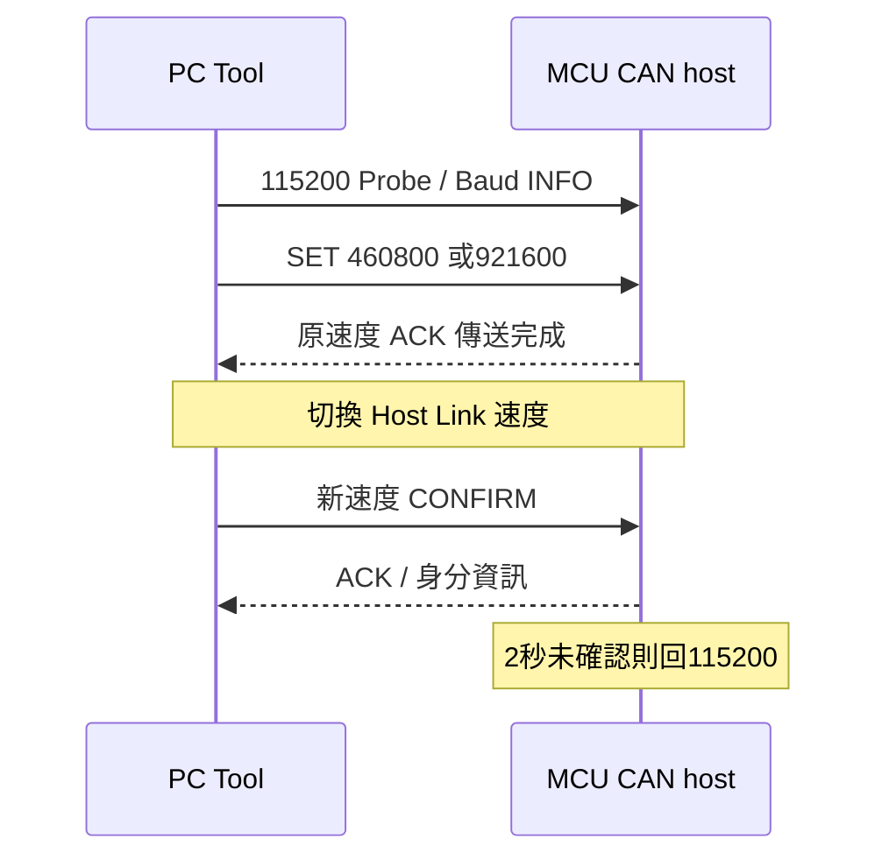

### 更新前的核對路徑

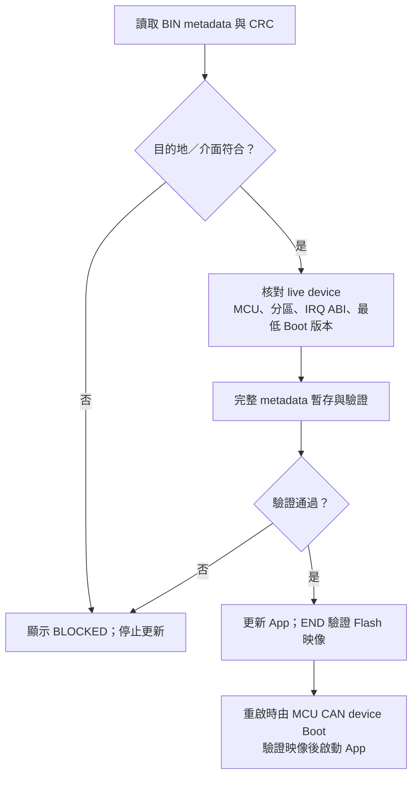

CRC提供完整性檢查。映像驗證與實板功能測試分別記錄。
Device UART metadata 的 `device_uart_baud` 由 Boot／App 編譯設定決定，獨立於 Host Baud。
<!-- COMMON_IMAGE_POLICY_END -->

## Device firmware 與工程說明

<a id="f13-boot-flow"></a>

<!-- F13_BOOT_DECISION_BEGIN -->
<a id="f13-boot-decision"></a>

## F13 (MCU CAN device)：Boot 啟動與更新狀態

Boot 啟動檢查、ENTER marker、30 秒 inactivity 與更新完成後的啟動路徑集中於 Bootloader 頁。
[閱讀完整章節](https://released.github.io/slide_boot_loader_for_RL78/#f13-boot-decision)
<!-- F13_BOOT_DECISION_END -->

<!-- F24_DEVICE_BEGIN -->
<a id="f24-can-device"></a>

## F24 (MCU CAN device)：工程配置

F24 CAN device 提供 Transfer、Boot 與 App 工程。板端時鐘、Flash 配置與 RFD 說明集中於 Bootloader 頁。
[閱讀完整章節](https://released.github.io/slide_boot_loader_for_RL78/#f24-can-device)
<!-- F24_DEVICE_END -->

<!-- DEVICE_WORKSHOP_BEGIN -->
<a id="device-metadata-vector-workshop"></a>

## Device App：Metadata 與 IRQ 設定

F13 與 F24 CAN device 使用兩份 C header 管理映像資訊與中斷對應，並共同作為後續 MCU 的工程基準。完整範例、產生命令及驗證步驟集中於 Bootloader 頁。
[閱讀完整章節](https://released.github.io/slide_boot_loader_for_RL78/#device-metadata-vector-workshop)
<!-- DEVICE_WORKSHOP_END -->

<!-- UPDATE_EVIDENCE_BEGIN -->
<a id="update-confirmation"></a>

## 更新確認、差異表與報告

更新流程把「資料已寫入」與「App 已開始執行」分開記錄。
CAN device 更新完成後由 Tool 自動確認 App；Misc 的 RUN 仍由使用者明確執行。
[MD 原稿](https://github.com/released/simple_renesas_isp_tool/blob/main/docs/UPDATE_VALIDATION_zh-TW.md)／
[PDF](https://github.com/released/simple_renesas_isp_tool/blob/main/docs/UPDATE_VALIDATION_zh-TW.pdf)提供離線說明與測試表。

| 操作 | 成功條件 | 未確認時 |
| --- | --- | --- |
| CAN Start Device Update | metadata、START、所有區塊及 END CRC 通過；同一路 CAN 收到 APP_READY，再取得 live INFO，版本／build／實際大小與載入 BIN 相符 | 顯示 END 已完成但 App 未確認；不自動重寫 |
| Misc Update HOST APP | 完整映像 CRC、有效標記與 256-byte metadata readback 通過 | 保留 Boot，顯示階段與原因 |
| Misc Run Validated Bridge App | RUN 只送一次；Tool 自動在同一 COM、115200 重連，核對相同 board ID、APP mode、完整 metadata、版本／build／大小 | 顯示 RUN 未確認；不重送 RUN、不自動擦寫 |
| Compare Metadata | 開啟 Loaded image／Live device 差異表 | 未取得 live 資訊時不以 BIN 補成 live |
| Verify Installed | CAN device 停留 Boot、無更新 session；重新計算已安裝映像 CRC，核對尾端 CRC | 回報 metadata／CRC／狀態錯誤，不擦寫 |

重連等待有時間與次數邊界，可由 Cancel 結束。
CAN 確認沿用現有 Host Link 與 CAN 路由，不會重新掃描其他 COM。
版本等摘要與健康回覆是目前執行的韌體回報，不是簽章或功能完整性的認證。

<a id="app-restart-confirmation"></a>

### 重啟等待與 App 確認

END CRC 通過後，Tool 先保留 1 秒的重啟等待，再開始 APP_READY 唯讀查詢。
等待期間不送出 CAN 請求，不切換 COM 或重送 END；Cancel 仍可結束確認流程。
這段等待包含在原有 12 秒的探測期限內，後續未就緒的查詢間隔至少 100 ms。
單次通訊仍有自身的逾時邊界；等待值不是所有 App 的最長啟動時間保證。

`phases_ms.app_confirmation` 包含重啟等待及 App 確認耗時。
`details` 的 `app_reset_quiet_ms` 與 `app_health_probes` 分別記錄等待設定及實際健康查詢次數。
逾時、取消或 live 資訊不符時，保留 END 已通過的事實，不自動重寫映像。

### 寫入與啟動確認流程

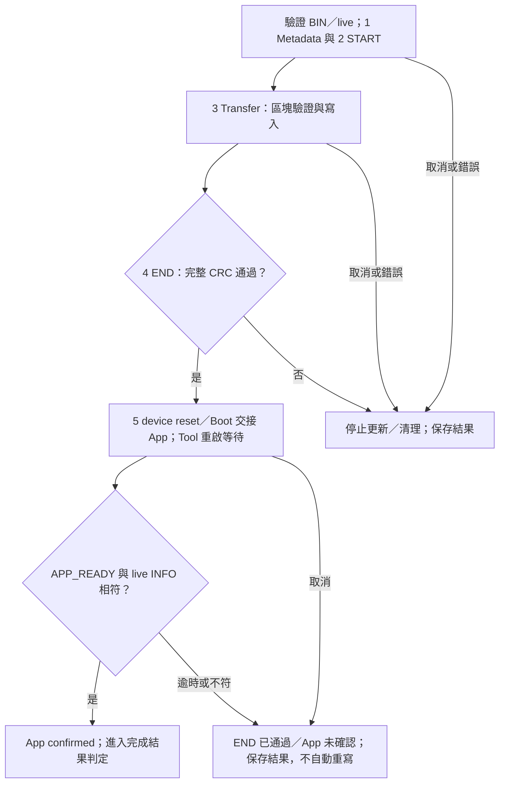

### 完成結果與計數判定流程

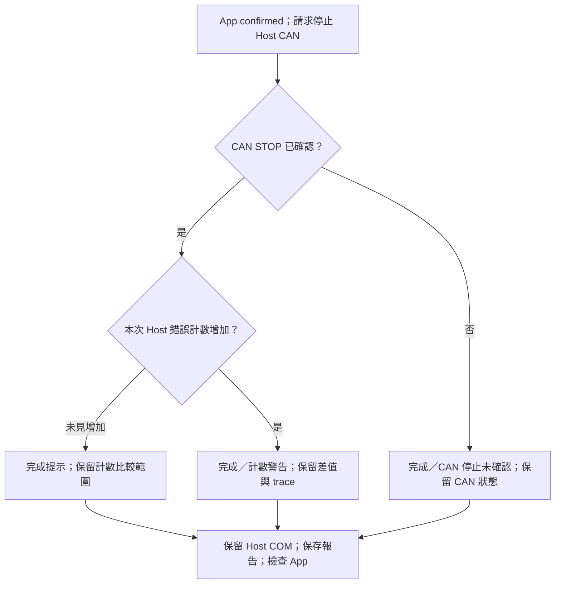

<a id="update-completion"></a>

### 完成提示與下一步

百分比表示當前階段的進度。
完整更新條件通過後，Tool 顯示一次完成對話框，並在狀態列與共用映像區保留 `[COMPLETE]` 及下一步操作。
開始其他作業、切換 TAB 或載入檔案後，畫面回到目前操作的條件判定；歷史結果可從 Log 與報告查看。

| 操作結果 | 畫面提示 | 下一步 |
| --- | --- | --- |
| CAN device 更新且 App 啟動確認通過 | `Device App update complete`；CRC／App 已確認，Host CAN 停止，COM 保留 | 可檢查 App code 與板上功能；再次更新時重新 Discover Target |
| App 已確認、CAN 已停止，但本次 Host 錯誤計數增加 | `Device App updated / Host counter warning`；黃色 `[COMPLETE / WARNING]` | 更新成功；查看報告的 counter 差值與 detailed trace，不以重寫 App 清除警告 |
| App 啟動已確認，但 Host CAN STOP 未確認 | `Device App updated / CAN stop not confirmed`；黃色 `[COMPLETE / WARNING]` | 更新已成功，CAN 可能仍在運作；查看 Shared Log，使用 Disconnect／Close COM 清理後再調整介面，不以重寫 App 處理停止警告 |
| Misc Host App 寫入與驗證通過 | `Host App update complete - RUN required`；Host 停留 Boot | 按 `Run Validated Bridge App`；若按鈕不可用，先 Read Bridge Update Info／Probe Host |
| Misc 明確 RUN 並重連確認通過 | `Host App startup confirmed`；同一 COM、board 與已安裝映像核對完成 | 可檢查 Host App 或切換至 device 介面 |
| 已 END，但 App 未確認、操作失敗或取消 | 保留原始錯誤／取消結果；不顯示更新成功對話框 | 依階段、Log 與報告檢查；不自動重寫或重送 RUN |

CAN 在 APP_READY 與 live INFO 核對完成後才停止，不在 Transfer 100% 或 END ACK 當下停止。
這裡停止的是 Host CAN controller，不是關閉 COM、切斷 device 電源或停止 App 執行。
停止後清除當前 live target 快照；上方卡片須經下一次 Discover 才重新取得資訊，完成結果則保留於狀態區。
App 啟動確認涵蓋必要初始化與映像身分，板上的應用功能仍可另行檢查。

#### Discover Target 與 Enter Boot

`Discover Target` 是唯讀探索，在 Boot 或支援更新協定的 App 模式都可執行，不限於尚未安裝 App 的裝置。
`Enter Boot` 則是已探索的 App 切入 Boot 的明確操作；探索到 Boot 時不需要再次 ENTER。

| 裝置目前狀態 | 畫面指引 | 操作順序 |
| --- | --- | --- |
| 尚未 Probe Host | `Next: Open + Probe Host, then Discover Target.` | Probe → Discover |
| 已 Probe，尚未 Discover | `Next: Discover Target (available in Boot or App mode).` | Discover → 依回報模式繼續 |
| Discover 回報 Boot | `Boot mode detected. Enter Boot is not needed` | 核對 BIN／條件 → Start Device Update；有無已安裝 App 都依實際模式判斷 |
| Discover 回報 App | `App mode detected. Next: Enter Boot` | Discover → Enter Boot → 核對 BIN／條件 → Start Device Update |

App 的 INFO／ENTER 回覆由該 App 實作。
若自行開發的 App 未提供更新協定，可使用專案定義的 reset／recovery 方式停留 Boot，再 Discover；Tool 不以未回覆推定裝置已進入 Boot。
完整操作入口見 [MCU CAN device 更新](https://released.github.io/slide_isp_tool_for_RL78/#mcu-can-device)。

<a id="tool-ui-fields"></a>

### Tool 欄位與狀態判讀

畫面上的資訊分為離線 BIN、目前連線裝置與本次操作設定。
`LOADED APP BIN | OFFLINE` 與共用映像區大多來自檔案，不代表板上已安裝相同內容。
`Installed Policy` 則來自已探索的裝置；尚未取得的 live 資訊不以 BIN 補入。
五張資訊卡的位置與來源見 [主畫面](https://released.github.io/slide_isp_tool_for_RL78/#tool-operation)。

<a id="tool-console-layout"></a>

#### 畫面群組與資料關聯

畫面使用 Windows 系統灰底、白色資料欄與加粗群組邊框。
一般資訊以標題、位置及 `OFFLINE`／`LIVE` 文字區分；綠、黃、紅集中表示判定結果。

| 群組 | 位置與用途 | 資料關聯 |
| --- | --- | --- |
| 1. HOST CONNECTION | 最上方；COM、Host Baud、Probe、Close、Reset 與 Cancel | PC ↔ bridge 的連線；先 Probe 才取得 Host 身分與周邊能力 |
| 2. BIN / DEVICE INFORMATION | 次上方；Host／Device／Boot／Installed App／BIN 摘要與完整欄位 | `LIVE` 是板上回覆；`OFFLINE` 是載入的檔案，兩者獨立核對 |
| 3. PERIPHERAL / TARGET | 左下；CAN／I2C／Misc、port、速度、ID／位址及探索操作 | 決定通訊路徑與目前目標；TAB 僅涵蓋此群組 |
| 4. LOAD / UPDATE IMAGE | 中下；載入 BIN、App Start、Compare Metadata、Preflight 與更新 | 載入後，群組 2 顯示解析結果；前置條件與完成後下一步顯示於此 |
| 5. MESSAGE LOG | 右下；訊息、檔案紀錄、報告、詳細 trace 與自動捲動 | 記錄操作過程；可暫停跟隨新訊息來閱讀歷史內容 |

群組 2 的 20 個欄位再分為 `File / integrity`、`Image identity`、`Flash layout / IRQ`、`Update contract`。
先從完整性與 MCU 身分核對檔案，再查看分區與更新條件；[逐欄說明](#tool-ui-metadata)列出各欄位的意義。
較長的值可停留滑鼠查看完整內容，或開啟 Compare Metadata／Preflight。
主視窗不使用上下捲軸，只有 Log 歷史與下拉清單捲動；最小視窗高度依字型尺寸調整。

<a id="tool-log-auto-scroll"></a>

#### Message Log 自動捲動

`Auto scroll down` 位於 Message Log 操作區，預設勾選，與 `Detailed trace (slower)` 分開設定。

| 設定 | 新訊息到達時 | 閱讀方式 |
| --- | --- | --- |
| 勾選 | 每次追加訊息後顯示最底部 | 持續查看最新訊息；重新勾選時也立即回到底部 |
| 取消勾選 | 訊息照常追加，保留目前捲動位置與選取文字 | 可往上閱讀或複製；新訊息不會拉動畫面 |

設定儲存在 EXE 旁的 `FirmwareUpgradeTool.ini`，重開 Tool 沿用：

```ini
[ui]
log_auto_scroll=1
```

`1` 表示跟隨，`0` 表示暫停跟隨；沒有此設定時預設啟用。
這個選項只控制視窗，不停止通訊、不取消操作，也不影響已啟用的檔案 Log 紀錄。
`Detailed trace` 控制詳細訊息量；`Start Log`／`Stop Log` 控制檔案紀錄，三者用途各自獨立。

#### 連線、介面與載入欄位

| 欄位／操作 | 用途 | 正常顯示／選擇 | 未符合時的判讀與處理 |
| --- | --- | --- | --- |
| COM／Open + Probe Host | 選擇 PC 到 bridge 的連線，讀取 Host 身分與能力 | `COM6: USB Serial Port (COM6)`；Probe 後 HOST BRIDGE 為 `VERIFIED LINK` | friendly name 不是 MCU 身分；未驗證或逾時時先核對 COM、電源、占用程式與 Host Baud |
| Host Baud | PC 與 Host Link 的 UART 速度 | `115200`、`460800`、`921600`，依 Host 能力協商 | 不等於 CAN bitrate 或 device 更新 UART；Misc 更新固定 `115200`，詳見 [通訊速度](https://released.github.io/slide_isp_tool_for_RL78/#image-update-policy) |
| Bridge port | 使用 Host 實際回報的周邊 port | Probe 後選擇列出的 port | `N/A - Probe bridge first` 表示尚未取得能力，不是從 MCU 型號推測 port |
| CAN Mode／Nominal／Data | 本次 CAN 模式、仲裁段與資料段速度 | `Classical CAN`／`500K`／`N/A` | Classical 的 Data 為 `N/A` 是正常；模式、速度須同時符合 Host、BIN 與 device，改 Tool 不會改 device Boot 的編譯設定 |
| RX Filter／ID／Mask | Host 接收回覆的篩選條件 | `Metadata/default`，或符合回覆 ID 的自訂 filter | 接收錯 ID 可能造成逾時；自訂 mask 不得為零。這是接收 filter，不會改寫 BIN 裡的 request／response ID |
| Workflow | 選擇更新或通訊測試 | 更新用 `CAN Upgrade`；通訊驗證用 `Custom Transfer` | Transfer 不使用更新 BIN，也不提供 Boot／App metadata；操作見 [Custom Transfer](https://released.github.io/slide_isp_tool_for_RL78/#custom-transfer) |
| Load Update Image／Update image | 讀入檔案並顯示實際路徑 | CAN 載入 `_update.bin`；Misc 載入 `_bridge_update.bin` | 路徑可用來確認選檔，但檔名不是驗證依據；HEX、MOT、未封裝 BIN 或不同角色的映像不能只改副檔名使用 |
| App Start Override | CAN 更新起點的額外一致性檢查 | `Auto` 使用 BIN metadata 的起點 | 手動值須與 BIN 起點一致；不會搬移映像、重建向量或改寫 metadata。Misc 不開放此欄位 |

<a id="tool-ui-status"></a>

#### 狀態文字與顏色

顏色只代表該欄位的判定範圍；一般數值欄位不會逐一與 live 值比較後變紅。
實際差異與未滿足條件可從 `Compare Metadata`、`Preflight` 及 prerequisite 區查看。

| 顯示文字／位置 | 顏色 | 代表意義 | 後續查看 |
| --- | --- | --- | --- |
| `VALID`／Metadata Status | 綠 | CAN 映像的格式、欄位與配置檢查通過；不包含 CRC 相符或 live 裝置相容的保證 | 同時看 CRC Result、Update Policy 與 Preflight；Misc 判定範圍見 [介面差異](#tool-ui-adapters) |
| `INVALID (see log)`／Metadata Status | 紅 | CAN metadata 不符合映像契約；部分欄位會維持 `N/A` | Shared Log 的原始原因；不要以尚未顯示的數值當成零 |
| `MATCH`／CRC Result | 綠 | 計算值等於檔案儲存值 | 仍須核對 metadata 與 live 裝置；CRC 不是來源認證 |
| `MISMATCH`／CRC Result | 紅 | 計算值與儲存值不同 | 核對檔案是否截斷、封裝後被修改，或選到非更新產物；重新建置並封裝 |
| `UNAVAILABLE`／CRC Result | 紅 | CAN 檔案不足以讀取尾端 CRC32 | 檢查檔案與大小，不進行更新 |
| `N/A`／資訊欄位 | 灰／中性 | 尚無資料、無法解析，或此操作不適用 | 依欄位來源判斷；不是零值，也不等於檢查通過 |
| `N/A - not verified`／HOST BRIDGE；`N/A - not discovered`／DEVICE TARGET | 等待／中性 | 尚未完成 Host Probe 或 device discovery | 先 Probe，再依 Workflow 探索目標；不以載入 BIN 的 MCU 取代 live 身分 |
| `BOOTLOADER MODE`／`APPLICATION MODE`／DEVICE TARGET | 已取得 live 資訊時依狀態顯示 | 裝置目前回報 Boot 或 App 模式 | 更新仍須滿足 Boot 與其他條件；模式本身不表示已驗證 Flash CRC |
| `N/A - not installed`／INSTALLED APP | 黃 | 裝置未回報有效的已安裝 App | 與尚未探索時的 `N/A` 區分；載入離線 BIN 不會改變此狀態 |
| `ENABLED \| same / newer`／版本政策 | 黃 | 已啟用同版或新版限制，是政策提示而非錯誤 | 分清 BIN 與 Installed；見 [版本維護](#force-old-version) |
| `DISABLED \| any version`／版本政策 | 綠 | 不限制版本順序 | CRC、MCU、分區、介面與 IRQ 等檢查仍有效 |
| `RECOVERY \| no valid App`／Installed Policy | 灰／中性 | live 裝置未回報有效 App 的版本政策 | 走映像與裝置驗證；沒有獨立保存的最低版本門檻 |
| `WRONG ROUTE`／載入映像卡 | 紅 | 載入的角色或允許介面與目前 TAB 不符 | 選擇正確 TAB／映像；切 TAB 不會轉換檔案格式 |
| `Ready:`／prerequisite | 綠 | 目前操作的前置條件已符合 | 可開始操作；不是已完成更新 |
| `[COMPLETE]`／狀態與共用映像區 | 綠；CAN 停止未確認時為黃色警告 | 更新／啟動核對已完成，保留本次結果與下一步 | 依 [完成提示](#update-completion) 檢查 App 或明確 RUN；不把下一次更新需要進入 Boot 當成這次失敗 |
| `Missing:`／prerequisite，或停用按鈕 | 黃；不相容時可為紅 | 缺少連線、Boot 模式、映像、能力或其他條件；作業執行中也會停用按鈕 | 先讀該區文字，再開 Preflight；不一定是 BIN 錯誤 |

`Update Policy` 與 `Boot / IRQ ABI` 的背景色目前表示映像角色／允許介面與所選 TAB 是否相符。
兩欄呈綠色不代表已與 live Boot 版本或 IRQ ABI 比對成功；實際契約比較見 [Metadata 差異表](#tool-metadata-comparison)。
狀態列的 `[WORKING]` 文字表示作業執行中，`[ERROR]`／紅色表示有原始錯誤可從 `Error Details` 再次查看。

<a id="tool-ui-metadata"></a>

#### 共用映像區：20 個欄位

以下數值是判讀範例，不是所有 MCU 專案的固定值。
以一份 CAN device BIN 為例：檔案長 `8192` bytes，映像起點 `0x00002000`，最後一個 byte 位於 `0x00003FFF`。
CRC 範例 `0x12345678` 僅示意兩欄相等，不是這份示例的實測 checksum。

##### 檔案與完整性

| UI 欄位 | 資料來源與用途 | 顯示範例 | 判讀與處理 |
| --- | --- | --- | --- |
| BIN Size | 實際載入檔案長度，包含向量區、metadata、程式與尾端 CRC | `8192 bytes (0x00002000)` | 應與封裝結果及 metadata image size 一致；不是只計算程式碼的大小 |
| Calculated CRC32 | Tool 對檔案最後 4 bytes 之前的內容計算 CRC32 | `0x12345678` | 不含尾端儲存的 CRC32；與 Stored CRC32 比較，不是讀回板上 Flash |
| Stored CRC32 | 檔案最後 4 bytes 的 little-endian CRC32 | `0x12345678` | 由封裝產生；修改 BIN 內容後須重新封裝，不是手動填入任意相同數字 |
| CRC Result | 上述兩值的比較 | `MATCH` | `MISMATCH` 拒絕更新；`MATCH` 只代表檔案 checksum 相符，不代表適合目前裝置 |
| Metadata Status | 離線映像契約的檢查結果 | `VALID` | CAN 與 Misc 的判定邊界不同；`VALID` 仍須搭配目的地及 live 相容性檢查 |

##### 身分與格式

| UI 欄位 | 資料來源與用途 | 顯示範例 | 判讀與處理 |
| --- | --- | --- | --- |
| MCU | BIN 宣告的 MCU family／part | `RL78/F13 / R5F10BMG` | 與 DEVICE TARGET 的 live 身分分開；不一致時核對所選專案與目標板 |
| App Version | BIN 的 App major.minor.patch | `1.2.3` | 用於版本政策比較；不是目前板上版本，也不是 Boot 版本 |
| Build | BIN 的 build 識別值 | `20260101` | 日期是專案慣例；不以 build 大小決定能否降版 |
| Target | BIN 宣告的 target ID | `0x0000F13B` | 須符合裝置契約；不能只修改 ID 就將其他 MCU 的程式轉為可用映像 |
| Protocol / Format | 更新協定 ID.版本／映像格式／checksum 類型 | `1.5 / 6 / CRC32` | `1.5` 是協定 ID 與協定版本的組合，不是 App 版號或 CAN port；不符時核對工程配置與封裝流程 |

##### 映像範圍與 Flash 配置

| UI 欄位 | 資料來源與用途 | 顯示範例 | 判讀與處理 |
| --- | --- | --- | --- |
| App Range | 整份映像的起點／最後一個 byte 位址 | `0x00002000 / 0x00003FFF` | 結束位址為 start + image size - 1，包含尾端 CRC；不是 C 程式入口或整個可用分區的終點 |
| Image / Capacity | 本份映像大小／可用 App 映像容量 | `8192 / 122880 B` | 前者不得超過後者；Capacity 不是剩餘空間，兩者不必相等 |
| Flash / Boot | MCU code Flash 大小／Boot 保留大小 | `131072 / 8192 B` | 來自工程契約，不是目前 Boot 消耗量；須與 live 配置一致 |
| Minimum / Erase | 最小完整映像長度／Flash 擦除單位 | `516 / 1024 B` | 最小長度含向量、metadata 與 CRC；Erase 不是 CAN 資料區塊大小，也不是本次總擦除量 |

##### 更新介面、相容性與版本政策

| UI 欄位 | 資料來源與用途 | 顯示範例 | 判讀與處理 |
| --- | --- | --- | --- |
| Interface / Rate | BIN 允許的 CAN 模式與 nominal／data bitrate | `Classical; 500K / N/A` | 不是目前下拉選單值或 Host Baud；Classical 的 data rate 不適用。Misc 顯示其更新 UART |
| Routing / IDs | BIN 的 ID 格式、request／response ID | `STD 0x00000700 / 0x00000701` | 分別為更新請求與回覆，不是兩組 CAN port；與 Boot、接收 filter 及 live 契約核對 |
| Update Policy | BIN 的角色與允許更新介面 | `DEVICE APP \| CAN` | CAN BIN 切到 I2C／Misc 不會自動變成可更新；不相容時先確認目的地與編譯契約 |
| Boot / IRQ ABI | BIN 要求的最低 Boot 版本／IRQ 介面識別 | `1.0.0 / 0x31563146` | live Boot 須達最低版本，IRQ ABI 須相符；不要求 App 與 Boot 版號相等，數值與顏色不能取代 live 比較 |
| BIN Version Policy | 本份 BIN 安裝成功後採用的版本順序政策 | `ENABLED \| same / newer` 或 `DISABLED \| any version` | 不決定本次是否能降版；由目前有效 App 的 Installed Policy 決定 |
| Installed Policy | live device 回報的目前有效 App 政策 | `ENABLED \| same / newer`；未探索時 `Discover Target required` | 一般更新依此判斷；`RECOVERY \| no valid App` 與 `N/A` 不當成已取得 disabled 政策 |

欄位編輯與產生方式見 [App 設定與建置](https://released.github.io/slide_boot_loader_for_RL78/#device-app-config)。
每個 byte 的 offset／Flash address 與對應程式見 [Metadata 位址對照](https://released.github.io/slide_boot_loader_for_RL78/#flash-metadata-can-reference)。
本節只解讀畫面；更改顯示或檔名不會改變工程契約。

<a id="tool-ui-adapters"></a>

#### CAN、Misc 與 I2C 的顯示差異

共用畫面依辨識出的映像格式顯示資訊；即使選錯 TAB，仍可能讀出檔案身分，再由更新政策拒絕該路由。

| 操作範圍 | 格式與正常顯示 | 驗證範圍與不適用欄位 |
| --- | --- | --- |
| CAN device 更新 | CAN device manifest；CRC32；`DEVICE APP \| CAN` | `Metadata Status = VALID` 與 `CRC Result = MATCH` 是分開判定；兩者都通過後仍檢查 live 身分、分區、速度、IRQ 及版本政策 |
| Misc Host App 更新 | BUR1；`Bridge UART contract3 / BUR1`；`UART / 115200`；`PC -> HOST BRIDGE` | `VALID` 包含 BUR1 格式、配置、檔案長度與 CRC 檢查。`INVALID - HOST APP required` 也可能是長度／CRC 錯誤，須看 log。未辨識 BUR1 時 CRC 欄位可能為 `N/A`；兩個版本政策欄位不填入，`N/A` 不代表 disabled |
| I2C reference 原始 BIN 檢視 | `RAW BIN - no manifest`；欄名為 `Calculated CRC16`／`Stored CRC16`；可顯示 `MATCH (G16 reference)` | 無 manifest 時不從原始 BIN 推測 MCU、版本或 App 起點，也不把 live 值填入離線欄位。CRC16 相符不開放擦寫；目前為唯讀參考操作 |

I2C reference 使用 CRC16/XMODEM、初值 0，計算範圍不含檔案最後 4 bytes；儲存 CRC16 位於檔尾前 4 bytes 起的兩個 bytes，採 little-endian。
此範圍與 CAN／Misc 的尾端 CRC32 不同，不能交叉解讀 `MATCH`。
Misc 更新與明確 RUN 的操作見 [Host App 更新](https://released.github.io/slide_isp_tool_for_RL78/#host-bridge-firmware)。

#### 常見組合與原始訊息

| 畫面組合／log 原文 | 意義 | 可核對的項目 |
| --- | --- | --- |
| `VALID` + `MISMATCH` | CAN metadata 通過，但檔案 checksum 不符 | 重新取得或封裝 BIN；不進行更新 |
| `MATCH` + `INVALID (see log)` | checksum 相符，但映像契約未通過 | 檔案種類、metadata 配置與 log 原因；CRC 不能取代格式檢查 |
| `VALID` + `MATCH`，更新仍停用 | 檔案通過離線檢查，仍可能缺少 live 條件或有相容性差異 | [Preflight](#tool-preflight)、[Metadata 差異表](#tool-metadata-comparison)與 prerequisite 文字 |
| `App Start Override does not match image metadata (...)` | 手動起點與 BIN 不同；括號內為實際位址 | 回到 `Auto`，或使用與工程配置相符的值；不以此欄搬移 BIN |
| `CAN Upgrade image metadata magic is invalid.` | 映像識別值不符 | 是否載入正確的封裝產物，而不是 HEX、raw BIN 或其他角色映像 |
| `Image update policy is missing, malformed or unsupported.` | 更新角色／介面等 policy 無法通過解析 | App／工程 header、產生流程及封裝輸出 |
| `Firmware image length does not match its metadata.` | 檔案大小與宣告值不同，或未符合最小長度／4-byte 對齊條件 | 是否截斷、誤選產物、最小長度配置錯誤，或封裝後另有附加資料 |
| `Reserved metadata extension bytes must be 0xFF for this image format.` | 保留區不是契約要求的 `0xFF` | metadata 產生配置；不在保留區自行填資料 |
| `Firmware CRC32 trailer does not match the calculated CRC32.` | 尾端 CRC32 不符 | 重新建置／封裝，避免在產出 BIN 後直接修改內容 |

完整更新判定與資料傳遞見 [CAN 更新逐層導讀](https://released.github.io/slide_isp_tool_for_RL78/#can-update-walkthrough)。
通訊與裝置回覆錯誤的分類見 [錯誤資訊](#tool-error-guidance)。
畫面欄位對應實作：[CAN 映像顯示](https://github.com/released/simple_renesas_isp_tool/blob/main/src/main_frame_image.cpp)、[狀態色彩](https://github.com/released/simple_renesas_isp_tool/blob/main/src/main_frame_status.cpp)、[Misc](https://github.com/released/simple_renesas_isp_tool/blob/main/src/main_frame_misc.cpp)、[I2C](https://github.com/released/simple_renesas_isp_tool/blob/main/src/main_frame_i2c_image.cpp)。

### 差異表與分階段進度

<a id="force-old-version"></a>

#### 版本政策與 force upgrade old version firmware

版本政策只有一個設定來源：MCU 目前有效 App 的 metadata。
Tool 的 `Installed Policy` 顯示目前政策，`BIN Version Policy` 顯示成功更新後將採用的設定；不提供另一個常駐開關。

| 已安裝 App 的 version control | 舊版 BIN | 同版 BIN | 新版 BIN |
| --- | --- | --- | --- |
| `0`，disable（預設） | 允許 | 允許 | 允許 |
| `1`，enable | 一般更新拒絕 | 允許 | 允許 |

比較的是 App major／minor／patch，不是 build 日期，也不是 Boot 版號。
較舊 BIN 即使設定 disable，仍須先通過目前政策；新政策只在成功更新後生效。
欄位修改與位址見 [Device App 設定](https://released.github.io/slide_boot_loader_for_RL78/#device-app-config)。

需要有意降版時：

1. 在 CAN TAB 載入目標 App BIN，Probe host、Discover device 並 Enter Boot。
2. 核對目前與目標版本。一般更新被版本政策擋下時，點選 `force upgrade old version firmware`。
3. 在密碼輸入對話框輸入 **3036**。輸入內容遮蔽顯示，不寫入 INI 或 log；取消或密碼錯誤時尚未開始更新。
4. 再確認目前版本、目標版本、檔案、範圍與 CRC；按 Yes 後僅放行這次更新。
5. 等待 END 與 App confirmed，保存自動報告；報告記錄 `force_old_version`、更新前版本及政策，不記錄密碼。

Worker 在送出前重新讀取 live device；若已安裝版本與確認時不同，就停止並重新確認。
Boot 的 `FORCE_START 0E` 只略過該次 START 的版本比較，仍檢查 metadata、target、介面、IRQ ABI、minimum Boot、分區、size 與 CRC。
不在 Boot、Tool 或 INI 保存解鎖狀態；下一次操作仍走一般政策，重試也只屬於同一更新交易。

`3036` 是公開的維護確認碼，用於減少誤操作，不是安全認證。
CAN 請求沒有簽章或身分認證；此功能不作為防止有意修改韌體的安全保護。
目前沒有獨立保存最低版本；若 App 因更新中斷而失效，Boot recovery 不再保留先前版本限制，重新驗證映像後可更新。

<a id="tool-metadata-comparison"></a>

#### Metadata 差異表

Compare Metadata 位於共用映像區，CAN 與 Misc 共用相同檢視方式。
表格含 Field、Loaded image、Live device、Check；顏色同時搭配文字。

| Check | 顏色 | 意義 |
| --- | --- | --- |
| MATCH | 綠色 | 值一致，或滿足最低 Boot／允許介面條件 |
| CHANGE | 黃色 | 即將更新的版本、build、大小不同；這是資訊差異，不是相容性錯誤 |
| MISMATCH | 紅色 | 身分、分區、IRQ ABI、介面或其他契約不符；不能更新 |

底部顯示當前階段及該階段的百分比，不把傳輸 100% 當成整次更新完成。
CAN 分為 Metadata／START／Transfer／END CRC／Confirm App；Misc 分為 Metadata／BEGIN／Transfer／CRC-readback。
FLASH erase 的時間包含在對應區塊／BEGIN 交易中，不以推估值另報成精確硬體擦除時間。

Cancel 與 Close COM 分開。
Cancel 由 worker 在交易邊界停止，嘗試 ABORT 與必要的 bus cleanup，不額外要求 COM 斷線；Close COM 則在清理後再斷線。
若作業本身正在重連，取消時可能尚未建立新的 COM 連線。
已送出的 Flash 操作不能以 PC 按鈕立即撤回；END 後取消確認不會復原映像。

### 自動報告與 Host 診斷

<a id="update-html-report"></a>

CAN 更新、Misc 更新及 Misc RUN 結束時，Tool 在 EXE 旁的 `reports/` 自動儲存同名的 UTF-8 JSON 與 HTML。
成功、失敗與取消都有紀錄；檔案以時間與唯一尾碼區分，不覆寫既有報告。
目錄或寫檔失敗會顯示在 shared log，並保留手動 Export Summary。

#### 更新完成後開啟 Firmware update report

1. 更新成功後，確認完成對話框與 `[COMPLETE]` 提示。報告會自動儲存，不需先按 Export Summary。
2. 在右下 `MESSAGE LOG` 群組按 `Open Last Report`，以預設瀏覽器開啟 **Firmware update report**；Tool 不會自行開啟瀏覽器。
3. 先核對 `operation`、`result` 與 `message`，再查看目的地、載入映像、CRC、App 確認及階段時間。
   CAN 更新包含 App 啟動確認；Misc 寫入完成仍需明確 RUN，RUN 的確認另存一份報告。各結果見[完成提示與下一步](#update-completion)。
4. 需要保存或分享紀錄時，可從 EXE 旁的 `reports/` 取得同名 `update_*.html` 與 `update_*.json`。
   HTML 可直接離線閱讀；對外分享前可先核對其中的 COM、檔案路徑及裝置資訊。

`Open Last Report` 開啟本次 Tool 執行期間最後成功儲存的 HTML；尚未產生時按鈕不啟用。
重新開啟 Tool 後，可直接從 `reports/` 開啟歷史報告。
實際畫面見 [MCU CAN device 更新報告範例](https://released.github.io/slide_isp_tool_for_RL78/#f24-device-update-example)。

| 產物 | 閱讀與使用方式 |
| --- | --- |
| HTML 更新報告 | 瀏覽器離線開啟；顯示結果、Host／Device、BIN CRC／身分、階段時間、counter 範圍與檢查建議 |
| JSON 更新報告 | 保留結構化欄位，供測試程式、紀錄比對及自動化使用 |
| App 編譯報告 | 記錄建置產生的 BIN、Metadata 與向量表；見 [編譯報告](https://released.github.io/slide_boot_loader_for_RL78/#device-app-build-report) |

更新報告對應實際 Tool 作業；編譯報告對應建置產物，兩者用途分開。
HTML 報告無外部腳本或資源需求。

產生、編碼與寫檔由 worker 執行。
檔案先寫入暫存檔並完成 flush，再以不覆寫既有檔案的方式發布。
若其中一種格式儲存失敗，log 分別列出已完成的檔案及錯誤；報告儲存失敗不改寫裝置更新結果。

| 報告欄位 | 內容／範圍 |
| --- | --- |
| operation／result／message | 更新目的地、PASS／PASS_WITH_WARNINGS／FAIL／CANCELED、完成範圍或失敗原因 |
| recorded_at_utc | 報告建立時間，UTC ISO 8601 |
| failure_guidance | 保留原始錯誤、作業／COM／Host Baud／階段及對應檢查建議；成功時為空 |
| host／port／host_baud／can | 本次選定的 Host 身分、COM 與速度、CAN 設定 |
| elapsed_ms／phases_ms | 整次作業與各階段耗時；不是 analyzer 測得的 bus time |
| details | 映像 CRC／大小／版本／build、已 ACK 區塊、ABORT 與 App 確認結果 |
| host_deltas | 本次 CAN 更新前後的 UART overflow、CAN lost／warning／error-passive／TX failure／bus-off／recovery 差值 |
| host_counter_assessment／host_counter_note | 本次計數比較的判定及範圍；與映像寫入／App 確認結果分開記錄 |
| host_peaks | Host 自開機或 CLEAR_STATS 起的 queue 高水位、最長等待／交易／dispatcher 時間；不是本次區間峰值 |
| link_retries | 本次 Host Link 重試；已知重連重設時為 null，不當成零 |

<a id="tool-preflight"></a>

### 更新前檢查摘要

在共用映像區按下 `Preflight`，可於未連線或未載入 BIN 時先查看缺少的條件。
摘要使用目前 UI／session 快照，不傳送 command，也不執行擦寫。

| 範圍 | 摘要內容 |
| --- | --- |
| 共用 | 已驗證的 live Host、載入 BIN／CRC、目的地與介面 |
| CAN device | CAN Upgrade workflow、live Device／Boot、Host burst 能力、選定模式／速度、App start、版本政策及 Metadata 差異 |
| Misc Host App | live Boot、Flash ready、固定更新 UART 速度、HOST BIN、board／分區／IRQ／minimum Boot 契約 |
| I2C reference | 選定的 port／speed／address 是否已探索，以及該 adapter 的唯讀操作範圍 |

標題顯示未滿足的條件數；`MATCH` 與 `MISMATCH` 分別搭配綠色、紅色，版本等資訊差異以 `CHANGE`／黃色表示。
`Compare Metadata` 保留完整映像／live 欄位對照。
摘要不保存操作許可；開始更新時，UI、worker 與 Device 仍執行各自的即時檢查。

<a id="tool-error-guidance"></a>

### 錯誤資訊與檢查指引

操作失敗視窗保留原始錯誤，附上 Layer、作業、COM、Host Baud 及可取得的階段。
`Error Details` 可再次開啟目前作業的錯誤與檢查建議。

| 分類 | 可檢查的資訊 |
| --- | --- |
| PC／Host Link | COM 選擇、其他 terminal 占用、Host 電源、Host Baud；Boot 更新採固定速度 |
| Host／CAN controller | 回傳的 command／status／CAN error detail、Host clock、transceiver 與 bus 設定 |
| Host／Device bus | Bridge port、接線、終端、Device 電源、速度、request／response ID；搭配 analyzer trace |
| Image／Device contract | Preflight、Metadata 差異、MCU、分區、介面、IRQ ABI、CRC |
| Device version policy | 已安裝版本政策與映像版本；維護操作見 [版本維護](#force-old-version) |
| Device Flash | Flash 回覆、供電、Boot recovery 與重新探索 |
| App confirmation | 已寫入／END 與 App 啟動確認分開，保留未確認結果及證據 |

分類提供檢查方向，不作為實體故障原因的判定。
未知錯誤保留原文；Tool 不因檢查指引而自動重送擦寫或 RUN。

<a id="tool-com-hints"></a>

### COM 拔插與裝置提示

COM 清單保留 Windows 友善名稱，通訊仍只使用標準 COM 名稱。
成功 Probe 後，Tool 可在本機 INI 記錄該 port 與可取得的 Windows PnP instance hint。
這是 USB adapter 的選擇提示，不是 MCU Host 身分認證，也不推定所有 adapter 都具有唯一序號。

Windows 通知裝置清單變更後，Tool 會延後至 worker 閒置且 COM 已關閉時更新清單。
原 port 消失、被不同 Windows 裝置使用，或相同 hint 出現在其他 COM 時，log／狀態區提供提示。
原選擇消失時不自動改選另一個 port；使用者明確選擇後，再執行 `Open + Probe Host`。
重複 hint 或無法取得 hint 時，以明確選擇與實際 Probe 結果為準。

拔插通知不開啟其他 COM、不關閉 worker 持有的連線、不自動重連或重寫。
PnP hint 僅保存於本機設定，不輸出到更新報告；分享設定、截圖與 log 前可檢查個人資訊。

### Host 計數器與停留原因

Host 計數器飽和、可辨識的重設（例如計數回退）或缺少有效快照時顯示 unavailable，不把無法比較的值當成零。
計數快照不含開機序號；若 Host 重啟後計數已超過先前快照，僅靠差值無法辨識這次重啟。
Misc 會跨 Boot／App reset，故不將這兩邊的 counter 相減。
時間診斷單位為 1 ms，低於解析度的值可以是 0；queue 水位以 bytes 或 frames／pending transactions 表示。

| 計數判定 | 意義 |
| --- | --- |
| `NO_RECORDED_ERRORS` | 可比較的上述七項錯誤計數均未增加；不等於分析儀波形或 device queue 壓力測試通過 |
| `WARNING` | 至少一項可比較的錯誤計數增加；其他欄位若無法比較，仍保留 unavailable |
| `UNAVAILABLE` | 尚無可確認的增加，但快照缺少、倒退或飽和，無法完整比較；不是零錯誤結論 |

更新及 App 確認成功，但 Host 錯誤計數增加或 CAN STOP 未確認時，報告為 `PASS_WITH_WARNINGS`，HTML 使用黃色提示。
失敗／取消仍分別記為 `FAIL`／`CANCELED`，不會被計數判定改成成功。
非零累計值不單獨觸發本次警告；Tool 比較的是操作前後的增加量，不會自動清除 Host 計數或重啟板子。
非同步事件的文字可能稍後才顯示；定位發生階段時可對照 detailed trace 的原始 `TRACE UART EVENT`，不只看彙整訊息的顯示時間。

| Host Boot 停留原因 | 判定 |
| --- | --- |
| No valid App | 尚無有效映像標記 |
| Metadata invalid | metadata 結構／保留區不符 |
| Contract mismatch | MCU／board／分區／更新契約不符 |
| CRC mismatch | 已安裝映像完整 CRC 不符 |
| SW1 recovery | recovery 按鍵要求停留 |
| Flash failure | Flash 初始化／擦寫失敗 |
| ENTER request | App 明確要求進 Boot |
| Update complete | END 驗證完成，等待使用者 RUN |

### MCU CAN device 健康回覆與唯讀驗證

APP_READY 與 INFO 分開：INFO 是描述資訊；APP_READY 表示必要初始化完成且本機檢查通過。
目前參考 App 的本機檢查為 clock、CAN 初始化與已觀察到 timer IRQ。
新增應用功能時，可將其必要檢查接入 App 的 readiness 判定；不需要因而改動固定 IRQ 轉送介面。

| CAN frame | 格式／意義 |
| --- | --- |
| Health request | control request ID，DLC2：`07 1B` |
| Diagnostics capability | INFO page `1C`，LE32 bit0 health、bit1 Boot VERIFY、bit2 細分錯誤；Tool 依 live bit1 啟用 VERIFY，不從 MCU 名稱／版號推測 |
| Health response | response ID，DLC8：`07 status 1B state health0 health1 health2 health3` |
| health byte0 | `01`＝READY，`00`＝尚未 ready |
| health byte1 | bit0 clock、bit1 CAN、bit2 timer；目前全通過為 `07` |
| health byte2 | bit0 由 Boot 交接、bit1 本次完成更新 |
| health byte3 | MCU RESF reset flags；對照該 MCU 硬體手冊 |
| VERIFY request | control request ID，DLC1：`0D` |
| VERIFY response | response ID，DLC8：`0D status 00 00 crc0 crc1 crc2 crc3`；映像範圍由 live INFO 的 App start／installed size 對照 |

VERIFY 在 Boot 無 active update 時執行，只讀 Flash。
Tool 只有在對應 device Boot 提供此功能時啟用 Verify Installed。
F13 device 支援唯讀 VERIFY；App 健康頁適用於 F13／F24 device 各自的參考 App。

| Device Boot status | 意義 |
| --- | --- |
| `0A METADATA` | metadata 固定欄位或 reserved bytes 不符 |
| `0B UPDATE_POLICY` | role、允許的更新介面或 minimum Boot 不符 |
| `0C IRQ_ABI` | 固定向量轉送契約不符 |
| `0D FLASH_LAYOUT` | App start／capacity／Flash／Boot／erase 分區不符 |
| `0E VERSION_DOWNGRADE` | 有效已安裝 App 啟用版控，目標 App 版本較舊；一般 START 拒絕，尚未擦寫 |
| `09 BAD_IMAGE` | 其餘映像／完整性前置條件不符 |

### App A／B 工程驗證

`scripts/verify_device_app_ab.ps1` 在 Tool 的暫存目錄建立兩個獨立 App fixture。
A／B 使用不同 IRQ mapping 與 ISR 名稱，各自執行 CS+ clean compile、產表、link 檢查與 BIN 封裝，
最後比對原始 Boot HEX 的 SHA-256 未改變。
這是工程建置驗證；實際 IRQ 執行仍由板上測試確認。

```powershell
.\scripts\verify_device_app_ab.ps1 -Device F13 -BootProject <F13 Boot project> -AppProject <F13 App project>
.\scripts\verify_device_app_ab.ps1 -Device F24 -BootProject <F24 Boot project> -AppProject <F24 App project>
```

### 實板驗證紀錄

F13 與 F24 device 的正常 CAN App 更新已完成實板驗證。
F24 的更新報告、reset 後 App 確認與 UART counter 集中於 [F24 device 更新結果](https://released.github.io/slide_isp_tool_for_RL78/#f24-device-update-example)。
各測試保留自己的證據範圍；尚無對應紀錄的壓力與故障項目維持 NOT RUN。
CAN 波形、電氣特性與斷電復原仍需對應量測或故障測試，不由正常更新報告推定。

| 項目 | 測試方式 | 驗收證據 | 狀態 |
| --- | --- | --- | --- |
| 正常 CAN device App 更新 | Host Link 115200／Classical CAN 500K；配對 Boot／App | 寫入／END CRC／reset 後 APP_READY／live INFO；F24 UART counter | PASS |
| Host Link 三種速度 | 115200／460800／921600 各連續更新 50 次；CAN 依 BIN | END／APP_READY／live identity／報告；overflow／lost／bus-off 無增加 | NOT RUN |
| Misc 速度邊界 | 高速 Host App → ENTER → Boot 115200 → 更新 → RUN／確認 | 同 COM／board／metadata；App 啟動 | NOT RUN |
| 獨立取消 | Metadata、Transfer、END／確認等階段取消 | ABORT／cleanup 記錄，COM 不由 UI 直接關閉，可重新操作 | NOT RUN |
| 拔線／重連 | 代表性傳輸點拔除 Host Link，重新接回同一板子 | 不自動續寫；重新 Probe／Discover，安全重做更新 | NOT RUN |
| CAN 故障 | 代表性區塊期間斷 CAN／bus-off，再恢復 | 錯誤／counter／有限重試，恢復後重新驗證 | NOT RUN |
| Device 斷電 | START 前／首 erase／write 中段／END／reset 交接時斷電 | Boot 的映像／metadata／CRC 檢查通過才進 App，否則停 Boot | NOT RUN |
| Host 斷電／SW1 | BEGIN、write、END marker、RUN 前後斷電；按 SW1 | Boot 原始碼／雜湊不變，停留原因及再次更新恢復 | NOT RUN |
| A／B App IRQ | 分別更新 A、B，觸發各自使用的中斷 | ISR 行為與 mapping 相符，Boot 不重燒 | NOT RUN |

<!-- UPDATE_EVIDENCE_END -->

<!-- FD_UPDATE_BEGIN -->
<a id="can-fd-update"></a>

## CAN FD App 更新操作

此設定使用 nominal 500 kbit/s、data 2 Mbit/s、BRS，以及 64-byte FD 資料幀。
Tool 與 MCU CAN host 負責傳輸，MCU CAN device Boot 負責映像驗證與 Flash 寫入。
F24 CAN FD device 的一般 App 寫入、END CRC、APP_READY 與 UART counter 已有實板紀錄。
驗證包含初次 Boot 更新，以及 App → Enter Boot → 更新 → App 確認；
重啟等待後的更新紀錄中，七項 Host 錯誤計數差值均為零。
長時間連續更新、queue 壓力與故障／斷電恢復仍各自保留驗證範圍。

### 準備與設定

| 項目 | 核對內容 |
| --- | --- |
| PC Tool | 使用支援 FD burst 的 FirmwareUpgradeTool |
| MCU CAN host | F24 Bridge App 宣告 CAN FD bit1 與 FD burst bit13；Host Boot 維持原有版本 |
| MCU CAN device | 配對的 CAN FD Boot／App；初裝 Boot 使用燒錄器 |
| Bus | 實際 transceiver、分析儀、供電、共地及終端適用於此 FD 設定 |
| Tool CAN TAB | CAN FD、Nominal 500K、Data 2M；Standard request0x700／response0x701 |
| 更新 BIN | `RL78_F24_Boot_loader_CAN_FD_app_update.bin`，metadata mode2、nominal mask4、data mask2 |
| PC 到 Host Link | 可先用115200；此速度與 CAN nominal／data phase 分開設定 |

若 host 缺少 bit13，Tool 在寫入前拒絕更新。
使用 [Misc Host App 更新](https://released.github.io/slide_isp_tool_for_RL78/#host-bridge-firmware)
載入 `RL78_F24_Bridge_app_bridge_update.bin`，完成後明確 RUN、重新 Probe 核對能力。
此流程更新 Host App，不改 Host Boot。

### 操作順序與結果

| 順序 | 操作 | 核對結果／未符合時 |
| --- | --- | --- |
| 1 | Open + Probe Host | Host 身分及能力有效；失敗時先檢查 COM／Host Link |
| 2 | CAN FD／500K／2M，載入 FD update BIN | Metadata／CRC 有效，介面與 live device 設定一致 |
| 3 | Discover Target | 顯示 live Boot 或 App；無回覆時檢查兩端 FD timing／接線 |
| 4 | live App 時按 Enter Boot | 重新確認 Boot；已在 Boot 時不需 ENTER |
| 5 | Start Device Update | metadata／政策／版本／IRQ／分區通過才進行區塊寫入 |
| 6 | 等待 END 與 App 確認 | 全映像 CRC、APP_READY 與 live 身分比對通過 |
| 7 | 閱讀完成提示及 Firmware update report | CAN_STOP ACK 後清除 target session，保留 Host COM |

接收使用 RXMB0 中斷與 8 筆 RAM queue；Boot／App 向量與 Flash 交接詳見
[FD device 接收與中斷](https://released.github.io/slide_boot_loader_for_RL78/#can-fd-device-rx)。
實板核對時保留 Tool Log、Firmware update report 與 device UART Log，分別確認：

| 階段 | 可觀察結果 |
| --- | --- |
| Boot 安裝／Discover | 使用 programmer 安裝 Boot HEX；Tool 顯示 live Boot、FD 模式與相符的 MCU／分區 |
| App 更新 | 載入 FD App update BIN；metadata／CRC／路由核對通過後才開始更新 |
| END 與 App 啟動 | Tool 確認 APP_READY 與 live 版本／build／size；UART 顯示 `CAN update: completed` |
| App 接收路徑 | UART 顯示 `CAN RX: RXMB0 interrupt -> RAM queue=8 -> main; vector=0x4C`，並持續輸出 V1／V2 counter |
| 再次更新 | 再次 Discover App → Enter Boot → 更新；若 ENTER 已逾時回 App，重新 Discover／Enter Boot |

有效 App 的 ENTER session 在 START 前使用30秒 inactivity。
若已返回 App，重新 Discover → Enter Boot，再開始更新；開始寫入後逾時不會直接跳入未完成映像。
START 本身不擦除 Flash，區塊 COMMIT 驗證通過後才由 Flash driver 寫入。


報告及成功／失敗欄位沿用 [更新確認與驗證紀錄](https://released.github.io/slide_isp_tool_for_RL78/#update-confirmation)。
END 後的等待與查詢時序見 [重啟等待與 App 確認](https://released.github.io/slide_isp_tool_for_RL78/#app-restart-confirmation)；
完成提示與報告同時保留映像驗證結果及 Host 計數警告。
Metadata 的逐欄內容見 [共用欄位指南](https://released.github.io/slide_isp_tool_for_RL78/#tool-ui-fields)，
不以離線 BIN 資訊代替 live device 身分。

### 三幀區塊與 Host Link

每個區塊最多64個有效映像 bytes。
控制與 ACK 也使用 FD+BRS；控制 payload 保留各命令原有長度。
下列 LE 值皆為 little-endian，offset 以 App BIN 開頭為0。

| CAN ID／payload | Byte位置 | 意義 |
| --- | --- | --- |
| 0x700 BEGIN，8 bytes | 0 | 0x0B |
| 同上 | 1..3 | 區塊 offset，LE24、64-byte對齊 |
| 同上 | 4..7 | 實際有效區塊資料的 CRC32 |
| 0x720 DATA，64 bytes、wire DLC15 | 0..N-1 | N=min(64,image_size-offset) 個映像 bytes |
| 同上 | N..63 | 尾塊不足64時固定補FF；Boot逐byte檢查，不計入區塊 CRC |
| 0x700 COMMIT，8 bytes | 0／1..3／4..7 | 0x0C／相同offset／相同CRC |
| 0x701 ACK，8 bytes | 0／1／2..3／4..7 | 0x0C／status／LE16區塊序號／LE32下個絕對寫入address |

完整區塊使用 BEGIN8 + DATA64 + COMMIT8，共3幀。
Host Link command22 的 version2 將它們放入101-byte payload，仍低於128-byte上限。
Header12 bytes之後，每筆為 LE16 standard ID、wire DLC、decoded-length data；
version2 的所有幀及預期回覆均為 FD+BRS，header byte9固定0x0C。
此擴充僅接受 DLC0..8 或15（64bytes）；Classical version1／bit12保持原有格式。
Host 只解碼與傳輸幀，不解讀 BEGIN、Flash address 或 device metadata。

同一區塊可因明確逾時／CRC／sequence結果有限重送。
Boot接受相同資料的重複幀，拒絕衝突幀，最近已提交區塊的重送不會再次寫入。
線路中斷後不自動續寫；重新連線並確認 device 狀態後再操作。
### 更新流程總覽

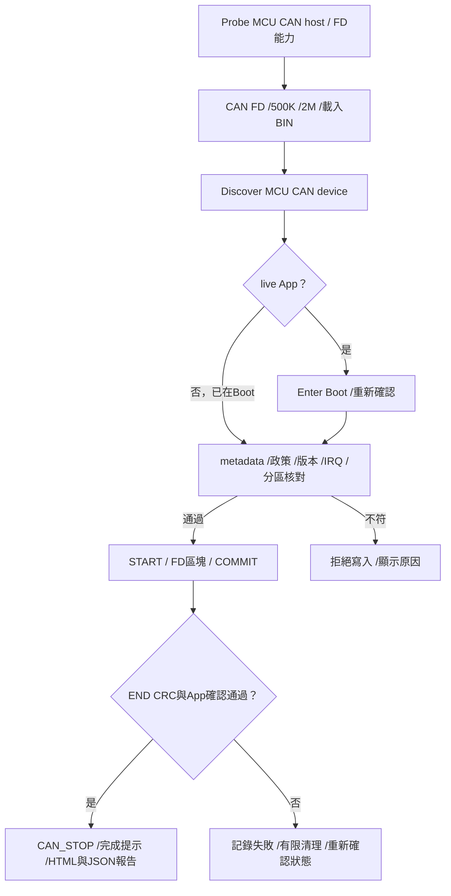
<!-- FD_UPDATE_END -->

<!-- FD_DEVICE_BEGIN -->
<a id="can-fd-device-engineering"></a>

## MCU CAN FD device 工程設定

CAN FD Boot/App設定來源、timing、metadata、建置與產物集中於Device指南。
[閱讀完整章節](https://released.github.io/slide_boot_loader_for_RL78/#can-fd-device-engineering)
<!-- FD_DEVICE_END -->

<!-- FD_TRANSFER_BEGIN -->
<a id="can-fd-custom-transfer"></a>

## CAN FD Custom Transfer 通訊測試

Custom Transfer 驗證 MCU CAN host 與 MCU CAN device 的收發，不使用更新 BIN，也不擦寫 Flash。
FD 範例使用 `RL78_F24_CAN_FD_Transfer` 獨立整機映像，由燒錄器安裝。
此映像使用自己的 SC 工程與相鄰 FD Boot 工程的 common 後端；它不經 Boot/App 更新流程啟動。

接收使用 RX Message Buffer 0（64-byte 容量）與中斷，資料經 8 筆 RAM queue 交給主迴圈。
Standard 0x710／mask 0x7FF 的規則只儲存到 RXMB0；接收 FIFO 不啟用，TX 完成狀態仍由主迴圈輪詢。
啟動訊息為 `CAN RX backend: RXMB0 interrupt -> RAM queue=8 -> main; payload=64 TX=polling`。
ISR、queue 與主迴圈的分工見[中斷接收路徑](#can-fd-transfer-rx-interrupt)。

### 操作與核對

| 步驟 | 設定／操作 | 核對結果 |
| --- | --- | --- |
| 1 | 燒錄 `DefaultBuild/RL78_F24_CAN_FD_Transfer.hex` | UART115200 顯示 `FD 500K/2M BRS payload=8/64` 與 CAN init OK |
| 2 | Tool Open + Probe Host | Host 支援 CAN FD、standard ID及通用 TX_WAIT_RX；F24 Host App1.7.0可使用 |
| 3 | CAN TAB → Custom Transfer | BIN與metadata不參與此測試；上方保留的OFFLINE檔案不代表live target |
| 4 | CAN FD、Nominal500K、Data2M、RX Filter Metadata/default | standard request0x710／response0x711、mask0x7FF |
| 5 | Discover Test Target | 讀取7頁DEVICE_INFO，顯示live target與capabilities |
| 6 | Transfer Test | PING／ECHO／PATTERN、3組FD64 ECHO及12項統計通過 |
| 7 | Disconnect | 結束CAN session後可選其他設定 |

既有 Classical device 使用 Classical CAN 與其已編譯速率。
FD mode不會讓Classical firmware自動支援FD；測試時匯流排上的節點需適用於所選幀格式與速率。
Bridge Self Test是另一項Classical功能，與 `Transfer Test` 的FD64驗證分開。

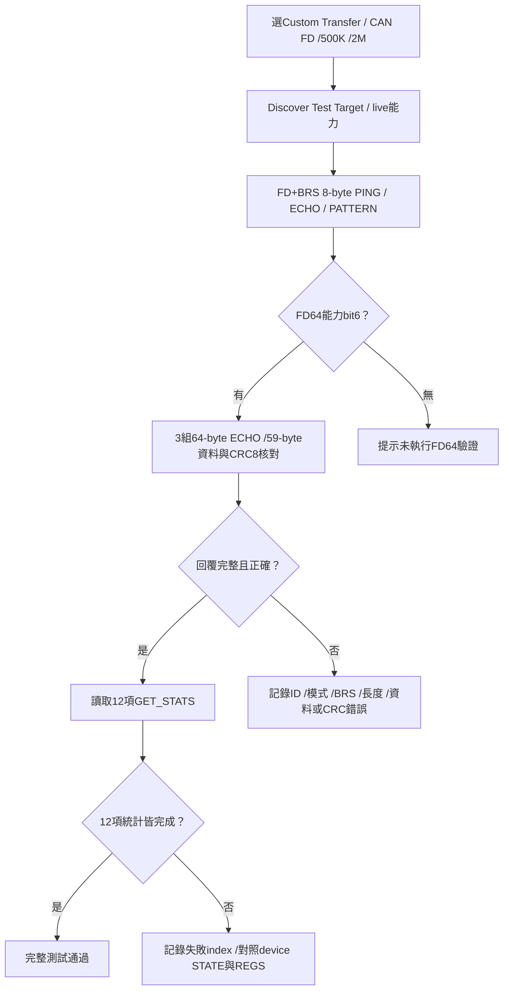

### 幀格式與能力

Discovery、PING、ECHO、PATTERN與統計維持8-byte payload，在FD mode使用FDF=1、BRS=1。
Classical命令與格式維持原有行為。
FD64能力由device的DEVICE_INFO page6 bit6（0x0040）宣告；完整範例capabilities為0x007F。
沒有此能力時，Tool不會將僅完成8-byte測試當作64-byte測試通過。

| 64-byte FD payload位置 | Request | Response |
| --- | --- | --- |
| byte0 | A5 | 5A |
| byte1 | 協定major1 | 同request |
| byte2 | 非零sequence | 同request |
| byte3 | ECHO_FD64 command07 | 同request |
| byte4..62 | 59個測試資料bytes | 完整回傳相同資料 |
| byte63 | CRC8-ATM，涵蓋byte0..62 | CRC8-ATM，涵蓋response byte0..62 |
| CAN frame | standard0x710、FDF/BRS、wire DLC15 | standard0x711、FDF/BRS、wire DLC15 |

CRC8-ATM使用poly0x07、init0、無reflection／xorout。
Tool測試遞增、反向與AA/55交錯三種資料；每幀實際payload為64bytes，包含5bytes協定欄位與59bytes測試資料。
Device對相同request重送保留完整回覆；相同sequence卻不同資料、CRC錯誤或無效64-byte格式會計數並丟棄。
Tool對模式／BRS／ID／DLC／sequence／資料／CRC不符回報失敗；等待與重試維持有限上限。
UART trace區分 `wire_dlc=15 bytes=64`，並列出完整資料。
測吞吐量時可關閉device UART trace與Tool detailed trace，正常測試則保留以利對照。

<a id="can-fd-transfer-rx-interrupt"></a>

### 中斷接收路徑

| 執行位置 | 工作 | 對應程式／設定 |
| --- | --- | --- |
| 硬體接收 | standard 0x710 寫入 RXMB0，產生 INTRCANGRVC | `add_rule()`；RMNB=0x0701、RMIEC=0x0001；實體 vector 0x4C |
| Renesas ISR | 擷取來源並確認／清除 RMND，再呼叫 callback | `r_can_glb_rxmb_isr()`；`CAN_CFG_INTRCANGRVC_USE=1` |
| Callback | 呼叫 InHandler，搬移完整 header／payload，最後發布 queue head | `my_can_glb_rxmb_callback()`、`R_CAN_ReadRXMBInHandler()` |
| 主迴圈 | 取出 queue，核對幀格式、協定、CRC，處理 request／reply 與 UART log | `Device_CanRead()`、`CAN_TransferProtocol_Process()` |

ISR 已先處理 RMND，因此 callback 使用 `R_CAN_ReadRXMBInHandler()`。
此 API 負責 RAM window 保存／還原及讀取期間的覆寫檢查；ISR 不解析協定、不輸出 UART，也不等待 TX。
主迴圈只消費 RAM queue，不以 polling 直接讀取 RXMB0。

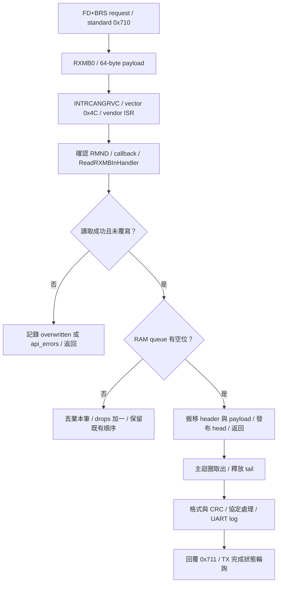

RAM queue 可保存 8 筆完整訊息；實作用 9 個槽位區分空與滿。
ISR 是唯一 producer，主迴圈是唯一 consumer，完整複製後才交接槽位。
queue 滿時丟棄新到訊息，累計 `drops`；不覆寫尚未處理的資料。
RXMB0 本身仍只有一個硬體訊息位置；讀取期間的硬體覆寫與 RAM queue 滿載分別計數。
此配置屬於獨立 Transfer 映像；更新工程的接收設定見[FD device 工程](https://released.github.io/slide_boot_loader_for_RL78/#can-fd-device-engineering)。

此 Custom Transfer 中斷接收配置已完成一般一問一答實板驗證。
此結果的範圍是通訊測試；Flash 更新、queue 滿載、持續流量與供電中斷分別驗證。

<a id="can-fd-transfer-diagnostics"></a>

### 逾時與 RXMB／TX 診斷

`Host returned TIMEOUT for command 0x21.` 代表 Host 已透過 UART 回覆 CAN 交易逾時。
它與 PC 沒有收到 Host UART 回覆的 `Host Link response timeout after retries.` 分開判讀。
Tool 保留原始錯誤，另顯示 `attempts`、`last_tx_result` 與失敗的 `GET_STATS index`。

| Tool 診斷 | 意義／核對方式 |
| --- | --- |
| `attempts=2` | Host 的 CAN 交易共嘗試兩次，包含第一次發送 |
| `last_tx_result=2 (TX_END)` | 最後一次 CAN TX 完成；不代表 device 軟體已取出或處理 request |
| `TRANSMITTING`／`ABORT_OVER`／`END_WITH_ABORT` | 發送未正常完成或包含 abort；與最後 CAN controller 狀態一起核對 |
| `invalid diagnostic payload` | 回覆長度或保留欄位不符，Tool 不將其解讀為有效 TX 結果 |
| `GET_STATS index=3` | 停在讀取 device 的 TX failure counter；不代表 counter 本身就是故障原因 |

Device 的 `CAN_TRANSFER_RUNTIME_DIAGNOSTICS_ENABLE` 預設跟隨 `CAN_TRANSFER_UART_TRACE_ENABLE`。
啟用時，初始化、每 16 筆接收、TX 異常會輸出 `TRACE CT STATE`、`TRACE CT IRQ` 與兩行 `TRACE CT REGS`。
沒有新接收時，每秒最多一組空閒快照，連續最多三組；有接收後重新計數。
空閒快照也會在正常等待操作時出現，不單獨代表錯誤。

| Device UART 欄位 | 意義 |
| --- | --- |
| `reason` | `INIT`、`RX_CHECKPOINT`、`IDLE_WAIT` 或具體 TX timeout／abort 原因 |
| `tick`／`seq`／`cmd` | device tick、最近收到的協定 sequence／command；不是 PC 時間 |
| `sw_tx` | 軟體狀態：0 idle、1 sending、2 aborting、3 fault；sending 快照可能只是尚未輪詢完成 |
| `rx`／`tx`／`last_driver`／`errors` | 軟體收發計數、最近 HAL 結果及已擷取的 CAN error flags |
| `RMNB` | RXMB 配置；本範例為 0x0701：1 個 RXMB、64-byte 容量 |
| `RMND` | 接收完成旗標；bit0=1 表示 RXMB0 有新訊息，由 vendor ISR 確認／清除 |
| `reads`／`overwritten` | 接收 API 成功次數／讀取期間偵測到的覆寫次數，皆為 16-bit 飽和的軟體觀察計數 |
| `before`／`after` | callback 內 InHandler 呼叫前後的 RMND；ISR 已先確認旗標，因此 `before=0` 正常 |
| `entries` | RXMB callback 次數；來源為零或尚未 ready 時不搬資料，不必與協定 RX 筆數相等 |
| `queued`／`dequeued` | 成功入列／主迴圈取出數；無待處理資料時兩者應相等，計數飽和後不再用差值判讀 |
| `depth`／`peak` | 當下待處理筆數／初始化以來最高筆數，範圍 0..8 |
| `drops`／`api_errors` | RAM queue 滿時丟棄的新訊息數／接收 API 其他錯誤或無效長度數 |
| `RMIEC`／`mask`／`pending` | RXMB 中斷允許位元、快照前 CPU mask、CPU request flag；正常啟動為 RMIEC=1、mask=0 |
| `window` | CAN RAM window 的原始讀值；RXMB0 資料經 page2 讀取，再還原原先視窗 |
| `TMC0`／`TMSTS0`／`last_tmsts` | 當下 TX 控制／狀態，以及 TX polling 在正常清除完成旗標前保留的原始值 |
| `GSTS`／`C0STSL`／`C0ERFLL`／`STB` | Global／channel 狀態、當下 error flags 與 transceiver standby 電位 |

快照在主迴圈暫時遮罩 RXMB 中斷，取得一致的 ISR 軟體計數後，還原原先 mask。
它不清接收旗標、不消費 queue、不 reset，也不自動重試。
硬體仍可在此期間接收，寄存器依序讀取；`before`／`after` 不單獨作為通訊完整性的證明。
ISR／InHandler 使用方式見 [Renesas RS-CANFD Lite 驅動說明](https://www.renesas.com/en/document/apn/rl78f24-rs-canfd-lite-module-software-integration-system)，接收寄存器見[接收緩衝區說明](https://www.renesas.com/en/document/apn/rl78f24-rs-canfd-lite-configuration-reception-and-transmission-rev100)。

遇到逾時時，保留 Tool detailed trace 與 device UART 的最後一筆 RX／TX、`STATE`／`IRQ`／`REGS`。
先對照 request 是否到達、RMND／reads／overwritten 是否改變、TX 是否完成，再決定處理方向。
UART 輸出會增加主迴圈延遲；吞吐量量測時可將兩個 trace 開關設為 `0U` 後重建。

連續測試可在同一連線重複執行 `Transfer Test`，核對每輪的 12 項統計均完成，並由 UART `rx` 觀察累計接收跨過 16、32、64 筆。
同一個 session 可持續接收；不依累計筆數重新初始化 RXMB0。
一般一問一答測試的 `drops`、`overwritten`、`api_errors` 應保持 0，取出後 `depth=0`，`queued=dequeued`。
若 `entries` 不增加，先核對 RMIEC／mask／pending 與實際向量；若 `entries` 增加但 `dequeued` 停住，則對照 queue 與主迴圈狀態。
重新上電時，先確認 device UART 已重新連線並開始記錄，再核對 `INIT`、`CAN init` 與 `STB`；LED 心跳本身不代表 CAN 已就緒。

### 工程與產物

FD Transfer與 `RL78_F24_Boot_loader_CAN_FD` 放在同一父目錄。
在FD Transfer目錄使用Windows PowerShell5.1：

```powershell
powershell.exe -NoProfile -ExecutionPolicy Bypass -File .\build.ps1
```

此入口只clean build FD Transfer，不重建Boot或App，不需要Python。
MTPJ的pre/post hooks引用FD helper；SC重新產生後使用同一入口重新prepare與建置。
正式產物為 `DefaultBuild/RL78_F24_CAN_FD_Transfer.hex`，供燒錄器安裝，不能載入CAN Upgrade。
安裝獨立Transfer會取代板端原有程式；燒錄前核對實際MCU、映像與erase範圍。
CRC／診斷欄位見 [Custom Transfer診斷](https://released.github.io/slide_isp_tool_for_RL78/#transfer-diagnostics)。
一般中斷接收與 Transfer Test 已完成實板驗證；queue 壓力、波形及故障測試另行記錄。
<!-- FD_TRANSFER_END -->
