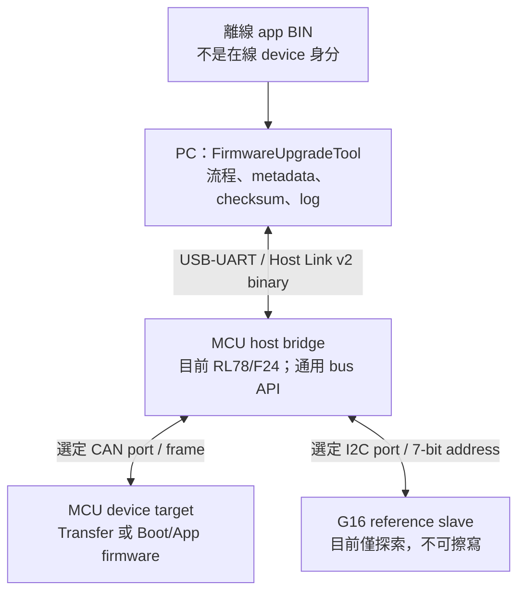
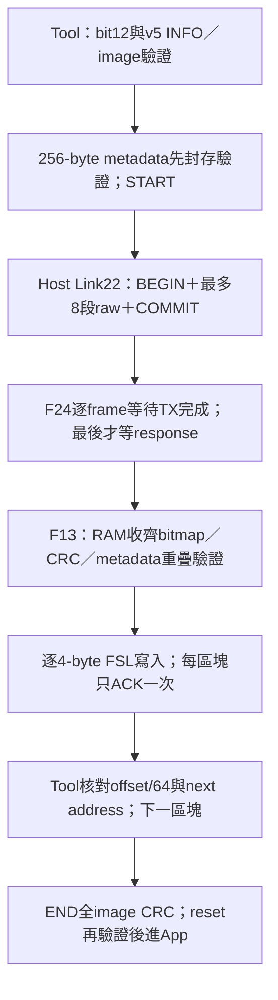
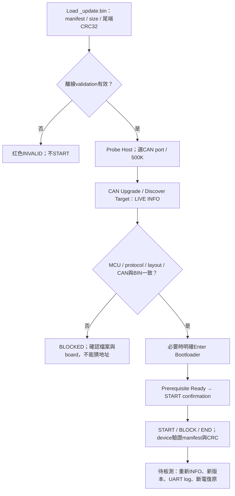
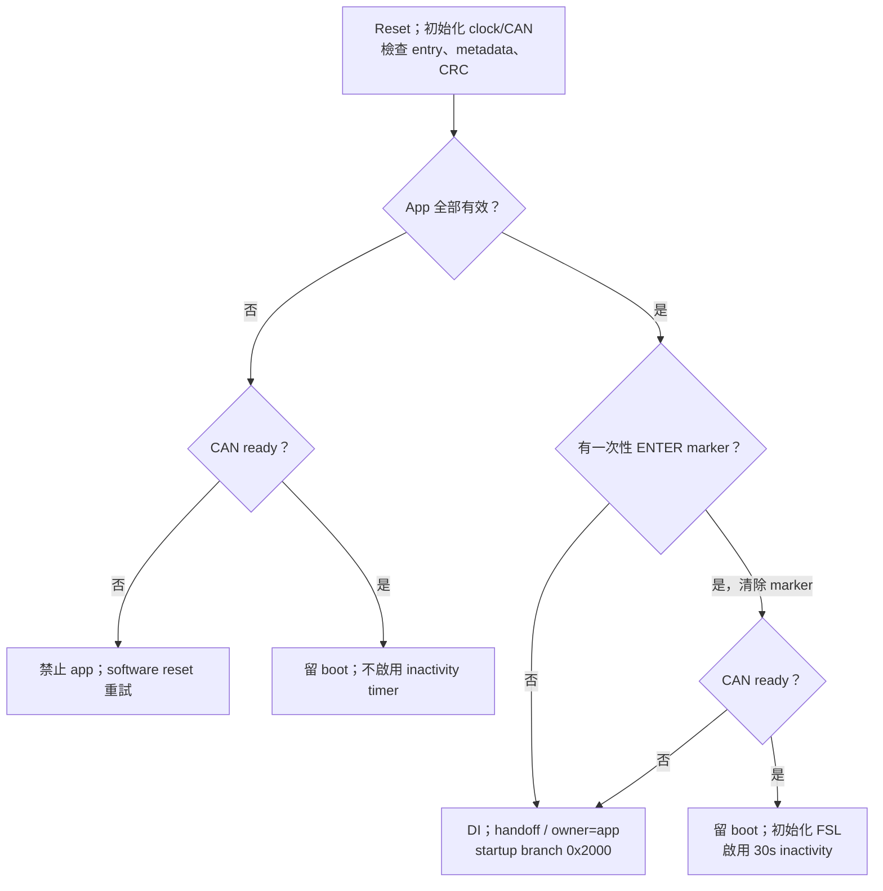
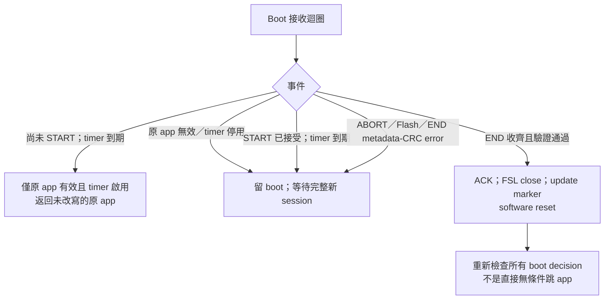
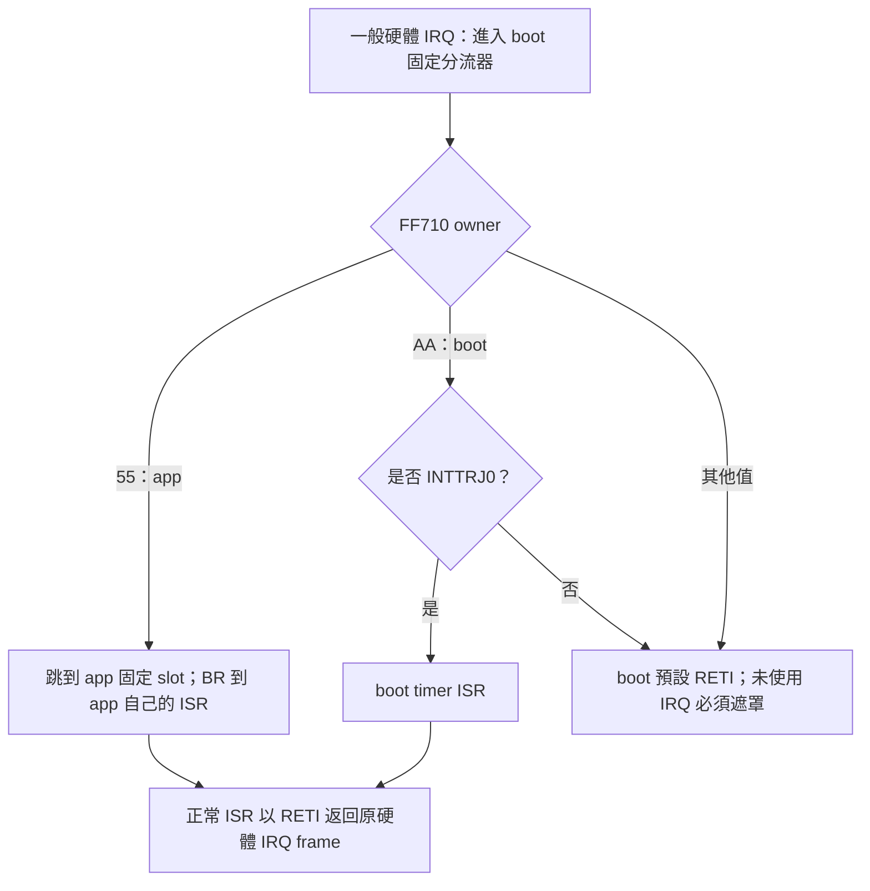
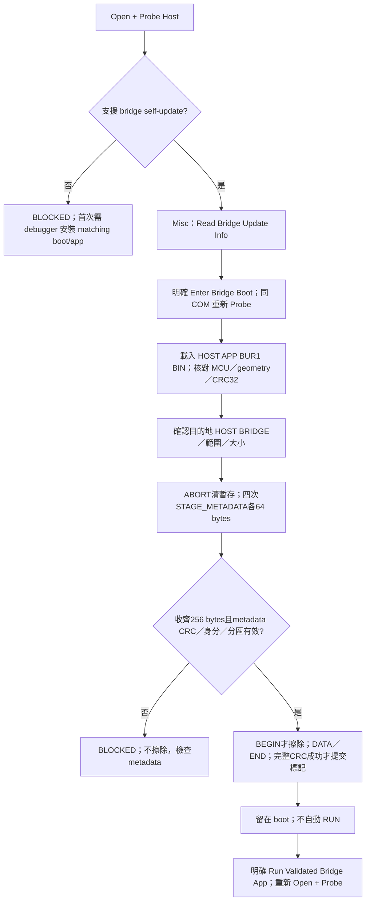
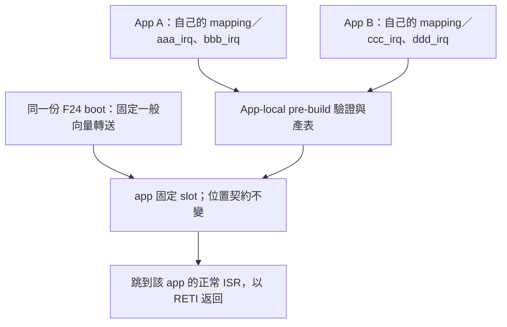
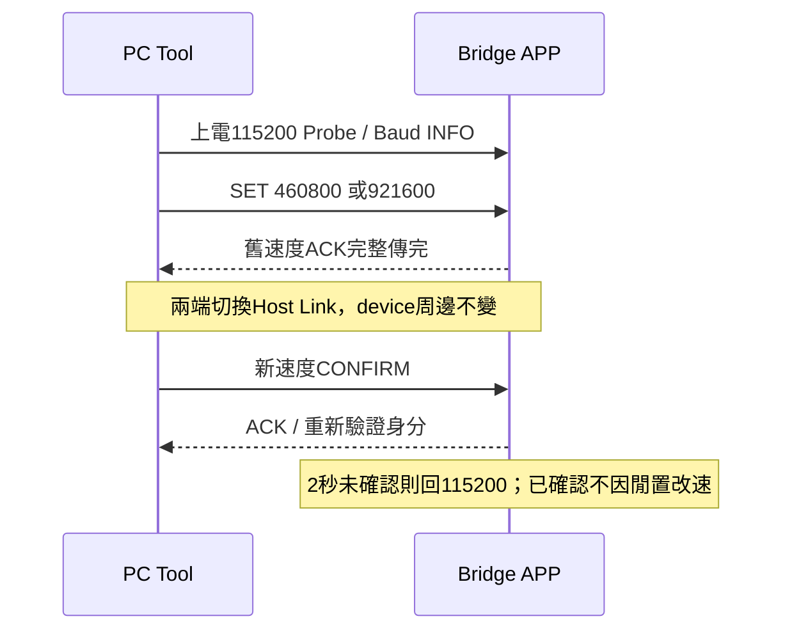
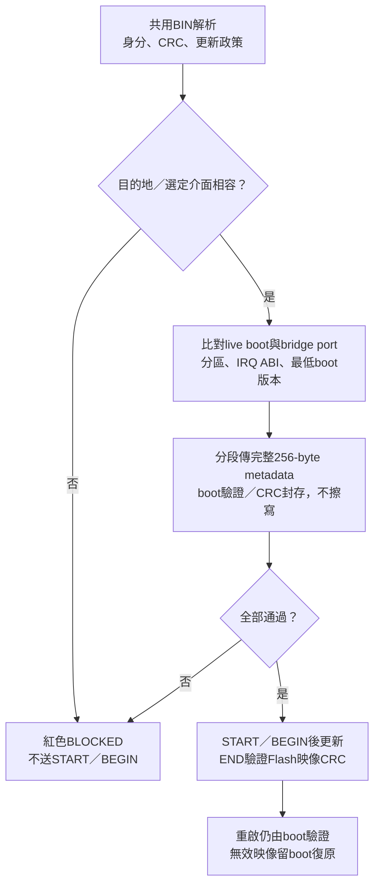

[知識庫首頁](https://released.github.io/) · [Bootloader 實作指南](../slide_boot_loader_for_RL78/)

<a id="article_top"></a>

# RL78 ISP Tool 與 MCU Bridge 操作指南

> 先辨識板子，再驗證映像，最後才開始更新。

FirmwareUpgradeTool 提供 MCU bridge 連線、映像驗證與韌體更新操作。
原始碼資料夾為 `simple_renesas_isp_tool`；EXE / INI 使用 `FirmwareUpgradeTool`。

本版Host Link payload上限128 bytes，完整frame142 bytes；舊96-byte host不相容，
PC／bridge需配套更新。F13使用image format6，F24使用bridge contract3。
首次須安裝相容的Boot/App；後續更新仍須通過live能力與BIN metadata檢查，Misc不更新Boot。

<span class="state state-ok">已有使用者 CAN benchmark 證據</span>
<span class="state state-report">CAN正常更新已有實板紀錄；完整故障矩陣仍待驗證</span>
<span class="state state-blocked">G16 I2C 擦寫封鎖</span>

本頁介紹目前 tool 與 RL78/F24 bridge 操作。F14、RA2L1、RA6 是未來 backend，
不是已驗證的 host；source/mock test 通過不代表 MCU device 已更新成功。

使用時需準備相容的bridge firmware、device Boot/App與更新映像。
F13初裝使用boot_app.hex，後續CAN更新使用_update.bin；兩者用途不同。
精確配套版本、SHA-256及單次實測紀錄請查閱所用交付套件的說明，
不要把本頁的通用步驟當成所有版本皆可互換。I2C擦寫與UART device更新尚未開放。

## Firmware 開發者入口：自訂 Bootloader／App 移植

如果只想知道 MCU Boot/App 的向量、startup、linker、RAM、建置與安裝設定，
請先讀 [RL78 Boot/App 移植指南](../slide_boot_loader_for_RL78/#boot-app-porting)。
內容區分沿用現有 Boot／自行開發更新流程，列出 F13/F24 差異、必要檔案、
App-local 產表與 App-only 更新的前提；不要求先熟悉本 Tool，亦不等於任意 App 可直接載入。
技術內容由同名 canonical MD 的 RL78_PORTING block 同步，避免兩份手動維護。
本頁繼續負責 Tool／bridge 操作；兩者都保留實板尚待驗證標示。

## 1. 三個角色，不要認錯板



| 角色 | 來源 | 不能據此證明的事 |
|---|---|---|
| Host | UART GET_HOST_INFO：board ID、FW/build、Host Link；支援時再讀 bridge descriptor 的 MCU part／boot／layout | USB adapter 名稱不是 MCU 身分；舊 host 不提供完整 descriptor，不從板名推測 |
| Device | CAN INFO / Transfer DEVICE_INFO；I2C reference signature | 收到 frame 不等於 flash完整、read-back正確或身分認證 |
| Loaded app | BIN manifest、實際size、calculate/stored CRC | 未通訊前不知道板上版本；CRC不是簽章 |

## 2. 明亮 UI：先看五張資訊卡

| 卡片 | 要確認什麼 | 顏色與來源 |
|---|---|---|
| HOST BRIDGE | 哪塊host、哪個COM、FW/build、boardID | 綠色 VERIFIED LINK：已完成Host Link探索 |
| DEVICE TARGET | MCU family/part、targetID、Application / Bootloader / Transfer mode | 綠色live protocol資訊；G16 reference為琥珀色 |
| BOOT CODE | Boot version/build、reserve、app start | LIVE INFO；未探索或Transfer不提供時N/A |
| INSTALLED APP | 板上version/build、installed bytes、capacity | LIVE INFO；不是載入檔案或read-back CRC |
| LOADED APP BIN | 待更新version/build、實際size、MCU、start | 藍色 OFFLINE；CRC/manifest錯誤為紅色 |

角色與來源都有文字，不只依賴顏色；hover卡片可讀完整資訊。
BIN size、calculated CRC、stored CRC、compare與metadata仍分欄顯示。
未載BIN為N/A；斷線後live卡片回N/A，已載BIN保留離線顯示。
主視窗不設上下捲軸，以1366×768為目標；左側介面設定、中間共用
BIN／18欄metadata／CRC、右側共用log、底部共用progress／elapsed。
底部進度列的操作名稱／百分比維持單行，以UI字型
量測並預留100%寬度；進度條、耗時與build資訊保持在底部列內且不重疊。
只有操作名稱改變才重新配置，逐包百分比不觸發整頁重排。100／125／150%字型
幾何測試不等於實際桌面DPI驗證，仍需實際操作與截圖確認。
啟動期間須先完成INI路徑與欄位初始化，再儲存設定；不修改Windows權限。
Host重新連線仍須完整讀回metadata，不可略過驗證。
只有log歷史和下拉選單可捲動。較小畫面五張卡同列，較大畫面可分兩列。
左欄標題INTERFACE SETTINGS下方才有CAN／I2C／Misc TAB；TAB不橫跨中、右欄。
中欄固定標題SHARED IMAGE / METADATA，右欄固定SHARED LOG；切TAB仍沿用同一組控制項與BIN。
CAN、I2C與未來UART device只替換介面參數和image adapter，不建立另一套
Load Update Image／metadata／log。TAB最後是Misc，目的地改為HOST BRIDGE，
BOOT／APP卡顯示host資訊，不沿用外部F13或G16的舊資料。
1366×768實際啟動、TAB無殘影及100%/125% DPI仍待桌面視覺驗證；幾何測試不等於目視通過。

<div class="capture-pending">待補新版 UI 實際截圖：未連線、合法 BIN、CRC 錯誤、Host 探索成功。Desktop screenshot helper 無法連線；此區不是示意 screenshot。</div>

## 3. 接線與上電前檢查

| 項目 | F24 host / F13 benchmark 基準 |
|---|---|
| PC ⇄ F24 UART | P15 TX / P16 RX，交叉接線、共地；tool預設115200；binary Host Link不可混printf |
| F24 CAN | P10 TX / P11 RX / P12 STB；X1 20MHz → PLL80 → CPU/CAN40 |
| F13 CAN | X1 4MHz → PLL/CPU32 → CAN16；不可抄F24 clock |
| Transceiver | F13 EVB TJA1050T使用5V；本次3.3V bus error改5V後benchmark正常 |
| CAN bus | H/L正確、共地、兩端termination；斷電H-L約60Ω是常見檢查，不代表時序已驗證 |
| Analyzer | 同bitrate；self-test需能ACK的active analyzer/node；listen-only不會ACK |
| F24 I2C | IICA0 SCL P62 / SDA P63、100kHz；確認pull-up電壓，不可把CAN 5V直接當I2C邏輯電壓 |

不可供電時用歐姆檔量termination。依實際board原理圖確認電壓。
各MCU的flash library、vector、clock、pin mux、erase/write unit不同；共用tool不代表共用register設定。

## 4. 連線：COM 名稱只是選擇提示

1. Refresh → 選 `COMx: Windows friendly name`；降低選錯adapter的機會。
2. 確認UART baud → `Open + Probe Host`；不會自動probe所有COM。
3. 看HOST BRIDGE的board/FW/build，確認與預期host一致。
4. 選CAN / I2C TAB，再選firmware宣告的Bridge port；Misc只更新host自己的app。
5. disabled時讀operation error / prerequisite，不要靠反覆按button猜測。

INI保存canonical COM，不把friendly name當identity。
`Reset Host` 明確reset並reconnect host，不是reset device。
`Disconnect` 停當前bus/target；`Close COM` 結束UART並可取消工作。

## 5. Bridge Board Self Test：先排除 host TX

1. Probe Host、選CAN port，保持CAN stopped。
2. Classical CAN → host支援的250K/500K/1M，analyzer同rate。
3. `Start Bridge Board Self Test`；旁邊 `?` 提示要搭配analyzer。
4. STD `0x123` / DLC8，每約1秒 `11 22 33 44 55 66 77 counter`。
5. 每次啟動counter reset：`00 → 01 → … → FF → 00`；按Stop結束。

不擦寫，也不證明F13接收正常；TX counter不是wire量測。
CAN rate經UART SET_CAN_CONFIG在stopped時修改bridge，並非CAN500K變速command；target不跟著變速。

<div class="capture-pending">待補 self-test button / tooltip / PC log / analyzer trace。空的0x000/DLC0不代表正確測試frame。</div>

## 6. Custom Transfer：已確認 benchmark

1. Device燒錄`RL78_F13_CAN_Transfer`、完成init；不需BIN。
2. Tool選Custom Transfer / Classical500K / metadata-default exact filter。
3. `Discover Test Target`：確認part、targetID、protocol。
4. `Transfer Test`：DEVICE_INFO、PING、ECHO、PATTERN、STATS，均不擦flash。
5. `Start Log`存PC log；device存UART TRACE；analyzer存CAN trace。
6. `Export Summary`；比對sequence、command、payload、CRC、error counters。

Request STD `0x710`、response `0x711`、DLC8；CRC-8/ATM不是app CRC32。
Analyzer單獨送DEVICE_INFO page0：`0x710` / `A5 01 01 01 00 00 00 DC`，
本次F13回`0x711` / `5A 01 01 01 00 01 00 8D`。
這只讀page0；Tool discovery會讀全部identity pages。

### 使用者原圖：歷史 benchmark，非新版 UI

<figure><figcaption>2026-10-14使用者Transfer benchmark；不是Boot/App programming證據。</figcaption></figure>

<figure><figcaption>同一benchmark的MCU UART，供與PC/analyzer比對；不是新版UI。</figcaption></figure>

## 7. CAN Upgrade：先看 BIN，再看 live device

CAN正常更新與END CRC已有實板紀錄；完整故障矩陣仍需獨立驗證。

<a id="can-upgrade-performance"></a>

### 更新速度：區塊傳輸與量測方式

CAN更新以區塊減少PC往返：每64-byte區塊一次ACK，區塊內標準ID720..727
攜帶8-byte image，最後短段使用DLC4。Flash仍以4-byte word寫入，並非每個word
都要完成一次PC往返。Tool與bridge能力、device protocol及image必須相容。

PC串口在有資料時立即返回，無資料才按剩餘期限等待；等待上限不是逐包固定延遲。
若UI佇列溢位，log會明確告警，不可用不完整的trace行數推算實際收發量。
效能依映像大小、Host Link速度、CAN bitrate、Flash及Detailed trace負載而異。
單次實測數字與精確版本保留在交付紀錄，不當成所有板子或映像的速度保證。



安裝順序：F24經Misc115200更新相容的Bridge App，明確RUN並Probe bit12；
已有相容Boot時不需重燒Boot。F13初次安裝須使用matching Boot/App；
範例採8KiB／App2000h、format6／metadata256與F1V1向量ABI。
區塊protocol不提供舊逐筆DATA相容模式，不能任意混用兩者。
缺段／CRC錯或ACK遺失限整區塊重送一次；已提交區塊核對Flash、不重寫。
Flash錯誤／錯ACK／斷線停止，ABORT後完整重刷，不猜續傳。
軟體已測實際PC、F24 codec／非阻塞progression、F13 RAM staging／CRC；
CAN HAL、Flash與斷電仍是模型，不代替實板。後續同BIN／CAN500K各測Host
115200、460800、921600與trace-on/off，記錄blocks／ms／B/s／CRC／errors。
G16新版I2C與UART device仍未開放；固定Misc速度不跟Host高速會話改變。
泛用burst22負責傳送整組frame，不把PC TX意圖當成已量測的CAN wire trace。
後續維持同BIN／115200／500K／相同Detailed trace設定做多次A/B，再關trace並另測
460800／921600，每組至少3次，留存耗時、CRC與overflow/lost/error計數。
Misc自身App更新仍使用Boot固定115200。I/O模型PASS不等於實板加速倍數。

COM號會變，不能寫死特定COM或從USB driver名稱認定板子；以Probe身分為準。
END CRC成功後，仍需以device UART或重新Discover確認App已執行。



| BIN 欄位 | 確認重點 |
|---|---|
| BIN Size | 實際bytes含CRC尾端；不是capacity |
| Calculated / Stored CRC32 | 計算`[0,size-4)`；stored尾端LE32；MATCH / MISMATCH |
| Metadata | MCU/target、protocol/format、app version/build、layout/CAN |
| App Range / Image Capacity | 實際image範圍vs最大app區；不可擦data/boot區 |
| App Start Override Auto | 使用BIN metadata start，不猜0x2000；手動值须與image/device一致 |

32K/60K/80K/110K皆可能；120K不是固定app size。
但不是任意raw BIN都接受：仍須manifest、minimum/capacity、4-byte alignment、start/protocol匹配。
Post-build依linker map決定尾端、填manifest image-size、末端4bytes CRC32。
Boot/app/data分區變更須配合device linker與metadata；override不能重定位已compile的app。
CRC檢查不是簽章、認證或anti-rollback。

### F13 CAN device：所有 boot→app 條件、ENTER 與逾時

<!-- F13_BOOT_DECISION_BEGIN -->
本節僅適用目前 F13 CAN device boot/app（format6／CAN protocol5），不是 F24
host bridge 的 Misc／RUN 規則，也不是既有 UART／I2C 教材的 boot contract。
依據 `r_main.c` 的 `application_is_valid`／`condition_check`／`boot_main`，以及
`can_boot_transport.c` 的 manifest、START、END 與 timeout 實作；是 source 核對，非新增實板驗證。

#### A. 每次 reset 的 app 有效性檢查：全部通過才可啟動

| 檢查 | 目前 F13 build 必須符合 |
| --- | --- |
| Reset entry | `0x2000` 的第一個 DWORD 不為 `0xFFFFFFFF`；只檢查非 erased，沒有完整反組譯／驗證跳轉目的地 |
| Metadata header | `0x2100` magic=`CAN3`；format6、core length128、flags=`0x0003`；protocol ID1／version5、checksum type1（CRC32）、target=`0xF13B`、Classical CAN／standard ID 格式全部匹配 |
| Metadata reserved | 整區256 bytes 中後128 bytes（`0x2180..0x21FF`）全部為 `0xFF` |
| Metadata policy | UPD1 version1／size32、DEVICE_APP、允許CAN、無未知transport bit、F1V1 IRQ ABI；minimum boot不高於目前boot；policy保留16 bytes全0 |
| Image size | manifest size 含尾端 CRC4 bytes，介於516與122880 bytes，且4-byte aligned |
| App version | 不可為 `0xFFFFFFFF`；不要求比舊版新，不是 anti-rollback |
| Flash layout | app start=`0x2000`、capacity=`0x1E000`、code Flash=`0x20000`、boot reserve=`0x2000`、erase=`0x400`、minimum=`0x204`，均等於 boot 編譯設定 |
| CAN contract | nominal mask=`0x04`（500K）、data mask=0、request ID=`0x700`、response ID=`0x701`，均等於 boot 編譯設定 |
| CRC32 | 對 `[app_start, app_start + image_size - 4)` 計算 CRC32，等於該 image 最後4 bytes 的 LE32 stored CRC |

Boot 現在也直接比對 MCU ASCII family／part，要求 build 已初始化，並檢查
UPD1更新政策、IRQ ABI與最低boot版本。PC仍須另作image/live device比對。
CRC是完整性，不是簽章或身分認證；最低boot版本不等於app防回滾。

#### B. ENTER marker 與啟動路徑

1. app 有效且沒有 ENTER marker：正常返回 startup，轉到 `0x2000` 的 app table。
2. app 收到 standard data ID=`0x700`、DLC1、data=`06` 的明確 ENTER request 時，
   先嘗試送 ACK（ID=`0x701`、DLC2、`06 00`），再將 `0xAA55AA55` 寫入
   no-init RAM `0xFF700`，最後 software reset。ACK 不是 reset 的可靠送達保證。
3. boot 看見 marker 後立即清除，表示本次先進入更新模式，不是永久鎖住 boot。
   P13.7／INTP0 不參與 boot decision，也不要求 tool 或 analyzer 必須在線才能正常開 app。
4. app 無效：禁止跳 app；CAN ready 時留 boot 等完整更新，clock／CAN 初始化失敗則
   software reset 重試，不能藉此放行無效 app。
5. app 有效但要求進 boot，而 clock／CAN 初始化失敗：目前實作會返回有效 app，
   不會永久卡 boot；CAN ready／FSL ready 不是所有正常啟動都必須通過的額外 gate。
6. 真正交接前關中斷，寫 `0xFF714` handoff signature、將 `0xFF710` ISR owner
   設為 app（`0x55`），startup 再 branch app table。這些是 boot 的輸出，不是額外外部啟動要求。



#### C. 30 秒 inactivity、START、失敗與更新成功

| 事件 | boot 的實際結果 |
| --- | --- |
| 原 app 有效、ENTER 後尚未接受 START | 連續30秒沒有符合底層接收條件的 CAN request，關閉已初始化的 FSL 後返回原 app |
| 持續 INFO／HELLO／其他符合接收條件的 frame | 都會刷新 inactivity；不是上電後固定30秒，也不是只由 DATA 刷新；未知 command／錯誤 DLC 也可能刷新 |
| 原 app 無效 | 從一開始不啟用 inactivity timer，接受 START 後也不會自動啟用；失聯仍留 boot 等重試 |
| START 被拒絕（protocol／target／size／FSL not ready） | 沒有進入 started state；不能把這個拒絕當成 app 已被擦寫；原 app 有效且 timer 啟用時仍可 inactivity 返回 |
| START 已接受後 inactivity 到期 | 若本次 timer 原本啟用，回 session-timeout error、留 boot、關閉後續自動返回；不跳可能只有部分內容的 app |
| ABORT／erase-write error／END metadata 或 CRC error | error 返回主迴圈，關閉後續自動返回，留 boot 等新 session；ABORT 即使在 START 前也走這條留 boot 路徑 |
| END 長度／state 尚不完整 | 回錯誤但保留 session；不得先宣布成功或跳 app |
| END 收齊、metadata size 等於 START size、Flash metadata 與 CRC 正確 | ACK 成功，關閉 FSL，寫 `0xFF718` update-complete marker，再 software reset；下次 reset 重新通過 A 節與 ENTER 判斷才進 app |
| 擦寫中掉電 | 下次上電重新跑 A 節；若 image 仍有效且無 ENTER 則可啟動，否則留 boot；不是保證有雙映像回復 |

底層接收條件為standard／非RTR、ID700或720..727、DLC>0；通過即刷新timer，之後才
檢查 command。計時由1ms TMRJ0 IRQ 累加，Flash 操作關 IRQ 時不是嚴格的 wall-clock
30秒。timer 已停用或未啟用時，PC 失聯不能期待 target 自動 timeout／reset；tool 的
bounded wait／ABORT 不能取代供電、Flash、IRQ 與掉電的實板驗證。


#### 固定完整 IRQ 介面：不同 app 專案沿用同一份 boot

F13 image format6／boot1.4.0 起，boot 固定擁有一般 vector 0x04..0x7C
的61個位置（包含保留位置，但 app 不可啟用保留 vector）。Reset 仍屬 boot；
0x02 保留，physical BRK 0x7E 不轉送，留給 debugger／device 設定。
App 的64個4-byte slot 固定在0x2000..0x20FF，公式是0x2000＋vector×2。



INTTRJ0 不再是普通 callback，與其他 app ISR 一樣使用無 vect 的 interrupt
pragma、以 RETI 返回。Boot 內部的 CALL／RET 僅用於壓縮組語分流，先移除
自己的暫存 call frame 再交給 ISR，並不是 C ISR 呼叫另一個 ISR。
分流暫存額外使用10 bytes stack，恢復 AX／HL／ES，原硬體 PC20／PSW frame
保持完整；未採用在分流期間重新 EI 的巢狀模式。

加入 app IRQ 只需：新增非 static ISR、在 app_irq_handlers.json 設定實體 vector
與函式名、將來源加入 app MTPJ、在 EI 前初始化／清旗標／設定優先權與解除遮罩。
App pre-build 會驗證 pragma 並產生 app_irq_table.inc；不要手改產物或 boot 向量。
未用 slot 指向 app 預設 RETI，不再是FFFFFFFF；預設返回不替你清除硬體原因，
所以不能把未處理的 IRQ 打開，否則可能反覆進中斷。

不同 app 專案可共用 boot 的前提：相同 R5F10BMG、8KiB boot／app2000、
完整跳轉表、FF700 recovery 與 FF710..FF71F no-init／stack 保留、startup 與
4MHz／PLL32／CAN16 交接、format6 的256-byte metadata／CRC32，以及
CAN protocol5／ID700與701。App 版本／build 由自己的 ftable.inc 產生，
不綁定 boot 的編譯版本；若仍需 Tool 從 app ENTER 回 boot，該 app 必須實作
INFO／ENTER 與相同 reset request，不能只加入向量表。

**本次需先以燒錄器安裝 matching format6 boot＋app 一次。** 舊 format4 的
callback app 與新 RETI boot 不相容，即使 CRC 正確也拒絕；以後在上述契約內
換 app 專案、新增一般 IRQ 或改 app 版本，只更新 app，不需重燒 boot。
若改 MCU、分區、共用 RAM、boot 本身使用的 IRQ／更新通訊或 metadata ABI，
仍須評估並重新安裝 boot。完整向量不代表所有周邊已初始化。

F24 與 F13 現在採相同 app-facing 原則：boot 持有固定完整一般向量、依 owner
轉送 app slot、app ISR 都是 RETI。F24 用各向量直接分支；F13 為維持8KiB
boot 以共用組語分流節省 ROM，實作不同但 app 不再有 callback 特例。
目前軟體建置／HEX與stack模型檢查可執行；實板新增IRQ、E2 lite、update/reset
及斷電回復仍需驗證，不能把模型結果視為硬體通過。
<!-- F13_BOOT_DECISION_END -->

## 8. I2C Master：本版只能探索 G16

1. Probe Host → I2C Master → IICA0 / 100kHz / slave `0x09`。
2. `0x09`是未左移7-bit，不填`0x12`write address。
3. `Probe G16 Reference`：setup / repeated-start / inquiry / signature / area。
4. Label、boot/app version是範例回報常數，不是認證MCU/installed image。
5. Port/rate/address變更後舊metadata不再current，重新Probe。
6. G16 raw BIN可驗CRC16；MCU/version/start metadata為N/A。

<span class="state state-blocked">Start Firmware Update 保持 BLOCKED</span>

供應的slave缺少active READ/auth與安全boot CRC/recovery，不送erase/write/app jump。
CRC16/XMODEM與CAN CRC32不同，不能混用；corrected slave ready後再補更新/read-back/復原。

## 9. Misc：透過 UART 更新 Host Bridge App

此頁更新的是PC直接連接的host，不是CAN／I2C外部device；不以CAN500K傳切換命令。
支援optional feature bit10的host才可操作；舊standalone firmware保持封鎖，
不能把CAN `_update.bin` 或G16 raw BIN改名後使用。



1. 確認HOST BRIDGE識別，再切到最後的Misc；`Read Bridge Update Info`不擦寫。
2. `Enter Bridge Boot`後等同一COM重新探索，核對實際MCU、UART及boot descriptor。
3. 共用Load Update Image載入`*_bridge_update.bin`；要求HOST APP角色、contract3 BUR1 metadata、
   長度、尾端CRC32及live geometry／minimum boot version一致。
4. 明確確認目的地HOST BRIDGE、COM、檔案、app start及size，才可更新；預設No。
5. 寫完仍留boot，按`Run Validated Bridge App`才執行；COM關閉後重新Probe確認版本。

Close COM會取消並嘗試ABORT。中斷或CRC錯誤保留boot，但不保證舊app還可用。
有效manifest magic最後才提交；完整CRC未通過時不得跳app。這是完整性保護，不是簽章或防回滾。

metadata區固定256 bytes（core128＋reserved128填0xFF），與UART單包128是不同概念。
同一STAGE_METADATA command帶16-bit offset／total，分offset0/64/128/192傳四次；
只暫存RAM，收齊及驗證後BEGIN才可擦Flash。缺段、衝突、CRC錯誤或BEGIN前取消不擦除。
Read Info在有有效app時，會以同一READ_METADATA command分四次讀回並核對descriptor；
更新完成也比對完整區域read-back。有效core長度仍為96，不將256塞入舊8-bit欄位。

### F24 首次安裝與產物

目前R7F124FLJ3xFB為256KiB code flash，分區來源為
`firmware/f24_bridge_common/f24_bridge_layout.h`，不是PC硬編碼。

| 區域／檔案 | 意義 |
|---|---|
| Boot `0x00000..0x04FFF` | 20KiB；Misc不可改寫boot |
| Host app `0x05000..0x3FBFF` | 235KiB capacity；實際BIN動態長度 |
| 保留 `0x3FC00..0x3FFFF` | 最後1KiB含debug monitor，不擦寫 |
| App offset `0x000 / 0x100 / 0x200` | IRQ table256／metadata區256（core128＋reserved128）／linked code |
| `RL78_F24_Bridge_boot` 的 `.mot` | 初次debugger／programmer安裝boot |
| `RL78_F24_Bridge_app` 的 `*_flash.mot` | 初次安裝matching app，已排除低位向量／option／debug區 |
| `*_bridge_update.bin` | 後續Misc更新app；最後4bytes為CRC32 |

最小image為516 bytes，確保尾端CRC不與metadata重疊；實際程式長度仍由linker決定。

不要直接安裝原始app `.mot`／`.abs`代替`*_flash.mot`，低位向量placeholder並非獨立啟動映像。
SC重產後先執行`prepare_f24_bridge_projects.ps1`再clean rebuild；boot/app共用同一硬體來源。
MCU flash-mode程式與RFD須在RAM，IRQ／常數／stack／handoff RAM須通過linker檢查。
BRK使用RETB而非一般IRQ的RETI；boot不轉送physical BRK。這些source／build檢查不代表E2 lite已驗證。

<span class="state state-report">F24 split boot/app與PC parser／mock flash測試通過；實板UART擦寫、IRQ handoff、E2 lite及斷電復原尚未驗證。</span>

<div class="capture-pending">待補Misc的host descriptor、HOST APP確認與明確RUN畫面。首次安裝及真實erase/write須另有具體操作授權；不以模擬flash測試當成板測成功。</div>

<!-- F24_APP_IRQ_BEGIN -->
### F24：各 app 專案獨立產表，沿用同一份 boot

Boot 固定轉送一般 IRQ 到 app start＋實體 vector×2；app 的64個4-byte slot
固定佔用 offset000h..0FFh。各專案決定 slot 要跳到哪個函式，boot 不認識
aaa_irq／ccc_irq 等 app 名稱。這項流程不改 UART boot、分區或 BUR1 contract3。



工程只保留兩個產品：Bridge_boot 是唯一 Boot；Bridge_app 是唯一正常 App。
f24_board 提供共用 board／driver／SC，不是第三份可燒錄韌體。
App 的 main、Host Link dispatch、CAN service 已回到 App 自己的目錄；
共用 UART／timer 僅依賴 f24_runtime_hooks.h，由 Boot／App 分別實作。
可攜式 I2C staging 在 common；分區／BUR1 支援在 f24_bridge_common。

SC 唯一設定為 firmware/f24_board/f24_board.scfg，輸出為同目錄 src/smc_gen。
搬移工作目錄後先執行 prepare_f24_bridge_projects.ps1 -Kind app 更新 SC 路徑，
由 App MTPJ 開啟並核對輸出位置。重產後再 prepare -Kind app、build App；
僅 Boot 自己的硬體設定改變才另行 prepare -Kind boot、build Boot。
prepare 讀取各自既有 MTPJ，保留 build options／hook 與 App JSON，不再複製第三個專案。
SC 新位置的 GUI 重產仍待操作確認；目前已驗證現有設定、來源與乾淨編譯。

每個 app 根目錄保存兩份來源：app_irq_handlers.json 對應實體 vector 與
函式名；app_image.json 保存自己的 packed version／build。產生的
bridge_vectors.asm 與 f24_app_identity.generated.h 不可手改；版本同時用於
Host Link 回報及 BIN metadata，不必修改共用 boot layout header。

```json
{"0x08":"aaa_irq","0x0A":"bbb_irq"}
```

上例只展示新增 IRQ；從 bridge 範例建立專案時，必須保留仍有使用的 UART／
timer／CAN／I2C mapping，不可用這兩筆覆蓋必要的清單。B 專案可改用其他合法
vector／函式名。來源需加入該 app MTPJ；ISR 必須 global、非 static、正常
interrupt pragma 且無 vect=，函式定義為 void handler(void)，以 RETI 返回。
未用的 IRQ 必須停用或遮罩，預設 RETI 不會替你清除周邊原因。

整合順序：

1. 以已整合的 F24 split app 為範本，建立自己的 app 專案；每個資料夾一份
   MTPJ。保留 R7F124FLJ3xFB、BRIDGE_SPLIT_APP、startup／4KiB stack／
   FF700與FF710保留、app5000／code5200／末1KiB保護等契約。不是任意
   standalone 專案加入 JSON 就能完成整合。
2. 複製專案時一併保留自己的全部 App .c／.h、generated_projection、兩份 JSON
   及 bridge_vectors.asm 的專案登錄。若移到不同目錄，先在 CS+ 修正相對
   source／include／library／preinclude 路徑；不要重新產生或覆寫共用 boot。
3. CS+ pre-build 呼叫 prepare_f24_app_irq.ps1 -AppProject "."；post-build
   呼叫 package_f24_bridge.ps1 -Kind app -AppProject "."。腳本路徑指向
   tool 的 scripts，跨目錄專案請使用正確完整路徑；不要呼叫雙專案 prepare。
4. 登錄各 app 自己的 ISR、修改 mapping／app_image.json 後，只執行：

```powershell
.\scripts\build_f24_bridge.ps1 -Kind app -AppProject "D:\MyApps\ProjectA"
.\scripts\build_f24_bridge.ps1 -Kind app -AppProject "D:\MyApps\ProjectB"
```

也可從 CS+ clean rebuild，hook 會自動執行。只驗證產物是否最新使用
prepare_f24_app_irq.ps1 -AppProject 專案路徑 -CheckOnly，不會寫檔。
產表不讀其他 app 的 IRQ 清單；build 的 -AppProject 與 -Prepare 不可併用，
避免誤重建參考專案。App-only 操作不產生／編譯／寫入 boot。

封裝依各 MTPJ 檔名找 DefaultBuild 下的 map／MOT，輸出各自的
專案名_bridge_update.bin／專案名_flash.mot。除原本分區、stack、flash/RAM、
metadata／CRC 檢查，還逐 slot 比對實際 branch 與 mapping，核對 ISR 的
真實 RETI／保留 BRK slot 的 RETB。Physical BRK 仍不轉送。Build 失敗時
舊 BIN 可能仍保留，不得把前次產物當成這次成功輸出。

本輪 A／B 實際 CC-RL 編譯與封裝、不同 mapping／版本、輸入拒絕及 boot
向量／MTPJ／MOT 雜湊隔離測試通過；測試沒有啟用新 IRQ，也沒有燒錄 MCU。
先安裝policy contract3 matching boot/app；之後相容的app-only IRQ改動不需重燒boot。
CAN區塊更新需要bridge宣告泛用CAN burst22／bit12，以live能力判斷，不以版號猜測。
已有相容Boot時，可用Misc115200更新App。實板只換 app、新舊 IRQ／UART ENTER、reset／斷電
與 E2 lite 仍待驗證。
F13 保留既有 app-local mapping 流程；未新增 F13 I2C boot。

若舊F24 App重新連線時INFO成功、接著0x57回BAD_COMMAND，可能是外層分派
漏了READ_METADATA。應安裝包含完整metadata讀回支援的App，不可略過驗證。復原方式：

1. 關閉COM，按住實體SW1（P32，LOW），同時重置／重新上電，讓既有Boot留在recovery。
2. 開啟Tool，Host Baud115200，Open + Probe Host；確認live顯示BOOT。
3. Misc重新Load Update Image，選交付套件中與此Boot相容的_bridge_update.bin，確認metadata及CRC。
4. Update HOST APP成功後另按Run Validated Bridge App；再重新Probe並關閉／重開Tool確認實際App身分。

若Boot、分區與IRQ契約仍相容，不必重燒Boot。步驟為source／mock驗證，實板復測待補。
<!-- F24_APP_IRQ_END -->

## 10. 依層次定位錯誤

| 現象 | 檢查層次 |
|---|---|
| Host Link timeout | COM、UART wiring/baud、host firmware |
| X1 / CAN clock error | 實際晶振、Smart Configurator、runtime clock |
| TX log有，wire是ID0/DLC0 | clock/register/frame buffer；log不等於wire正確 |
| bus error / dominant-bit error | transceiver供電、STB、共地、H/L、termination、rate/ACK |
| 有request沒response | device firmware/filter/ID、CAN RX/TX；分開驗host/device |
| CRC/metadata error | 不可START；取得正確_update.bin |
| CRC MATCH但button灰色 | 讀prerequisite：mode/layout、boot state、override、busy |
| Misc unsupported／BUR1 mismatch | 先確認host feature／matching boot；外部device BIN不能拿來更新host |
| Host要求128但回報96 | 重燒matching bridge firmware；本版沒有舊host相容路徑 |

## 11. 後續補圖與 device ready gate

[拍攝清單](SCREENSHOT_CHECKLIST.md)列出每項功能、檔名與證據要求。
Device ready後補App INFO → Enter → Boot INFO → confirmation → progress → 新版確認；
並補錯MCU/start/size、取消、bus-off、掉電、CRC fail與boot retention。
I2C及RA只在實際firmware與板測ready後補操作，不預填虛構成功。
截圖與log應移除個人路徑、序號及不必要資料。

## 12. 功能、文件與 web 同步規則

每次功能變更，同一輪同步程式對應的MD／受影響PDF與本頁：操作步驟、
支援／BLOCKED範圍、主畫面配置、metadata來源與截圖清單必須一致。
Bootloader教材與知識庫導覽只有受影響時才更新；精確版號與實測數字留在交付紀錄。
實際UI截圖或板測尚未完成時，保留待補及NOT RUN，不用舊圖冒充新版本。

為重新build／替換EXE，已授權自動正常關閉此專案build目錄內的tool，
讓worker取消、COM／log釋放與INI儲存完成；不再逐次要求使用者關閉。
其他路徑的同名tool不處理。若15秒內無法正常關閉，停止build，不強殺更新中的程序。

<!-- COMMON_IMAGE_POLICY_BEGIN -->
## 共用 Metadata 與跨介面防呆

Metadata固定256 bytes：前128 bytes為已定義內容（含32-byte UPD1政策），
後128 bytes必須為0xFF；app code仍從offset0x200開始。舊core96格式不相容。

| UI資訊 | 意義 |
| --- | --- |
| Update Policy | DEVICE APP或HOST APP，以及允許CAN／I2C／UART更新的清單 |
| Boot / IRQ ABI | 映像要求的最低boot版本，以及固定向量介面識別 |
| MCU、版本、分區、CRC | 仍來自載入BIN；不以目前TAB或在線device補造 |

允許更新介面不是app執行時使用的周邊。CAN-only BIN切到I2C仍顯示原本
MCU／版本／CRC32與政策，卡片及政策欄變紅並封鎖更新；不改解讀為G16 raw BIN。
Misc的目的地是HOST BRIDGE APP，不能拿DEVICE APP更新host。
PC到bridge的Host Link UART不算device更新介面；未實作UART device adapter。

上方Baud只管PC到bridge：上電115200，驗證APP支援後可協商460800／921600。
CAN／I2C／未來第二組UART不跟著換速。UART device映像的UPD1 policy version2
在metadata112..115宣告編譯時固定的device_uart_baud，Tool顯示UART @固定值，
不能由Host Link選單覆寫。boot/app須共用target編譯設定；version1 CAN／HOST
BIN保持原值與相容性。BUR1的uart_baud另指bridge自身BOOT固定更新速度。
目前僅準備UART policy解析、build helper與防呆；未提供UART device燒錄流程。

正常Close會盡力回115200；異常斷線後只對選定COM有限探測三組速度。
Misc ENTER改以BOOT描述器的固定baud重連，現行115200，不沿用APP高速。
F24分頻計算值115200→114942、460800→454545、921600→909090；Tool log
會列名義／計算值。高速度的FTDI、時鐘誤差及負載可靠性仍待實板驗證。

更新路徑必須同時受BIN政策、live boot能力、bridge選定port支援；並通過
MCU／target／分區／protocol／IRQ ABI／最低boot版本／CRC檢查。
UI與worker皆檢查，device boot在首次擦寫前再驗證完整metadata，不能只靠按鈕。
切換介面不能沿用另一介面的探索結果；port／address／rate改動後必須重新確認。

F13使用CAN protocol5、image format6，DEVICE_APP／CAN／F1V1。
F24使用BUR1 contract3，HOST_APP／UART／F2V1。
平台首次安裝須有matching Boot/App；不同更新協定或IRQ契約不能任意混用。
已有matching Boot時，可用Misc更新相容的Host App；Misc不更新boot本身。
精確配套版本與映像雜湊以交付說明、live INFO及BIN metadata為準。
已固定的完整一般向量轉送架構不變，未來相容app新增中斷仍只更新app。

G16新版I2C boot/app依使用者要求延後開發；舊範例保留參考及read-only探索，
不提供erase／write／app jump，也不因tool新增metadata就視為可安全更新。

正常更新／END CRC成功，不代表reset後App已執行，也不代表完整故障驗收。
自動測試包含錯映像、介面／目的地不符、
metadata重送／缺段／CRC錯、重設與768個模擬中斷寫入點。這不是實板斷電驗證；
實體CAN／FSL故障、UART斷線、
最大映像CRC耗時、debug／IRQ、斷電復原及1366×768／DPI視覺驗證仍需板測／目視。
CRC提供完整性，不是簽章、身分認證或防降版。




<!-- COMMON_IMAGE_POLICY_END -->
